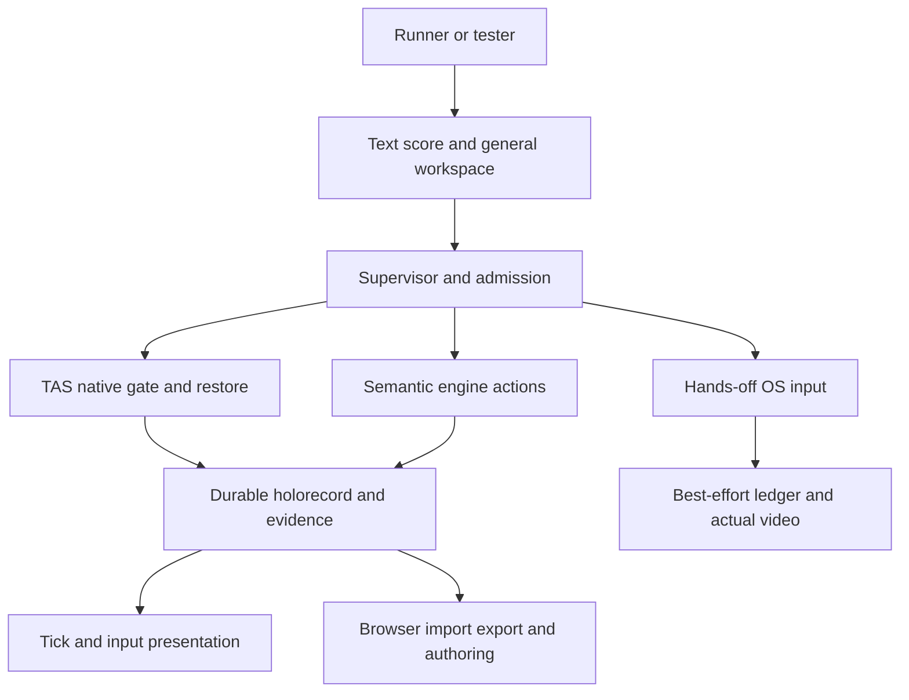
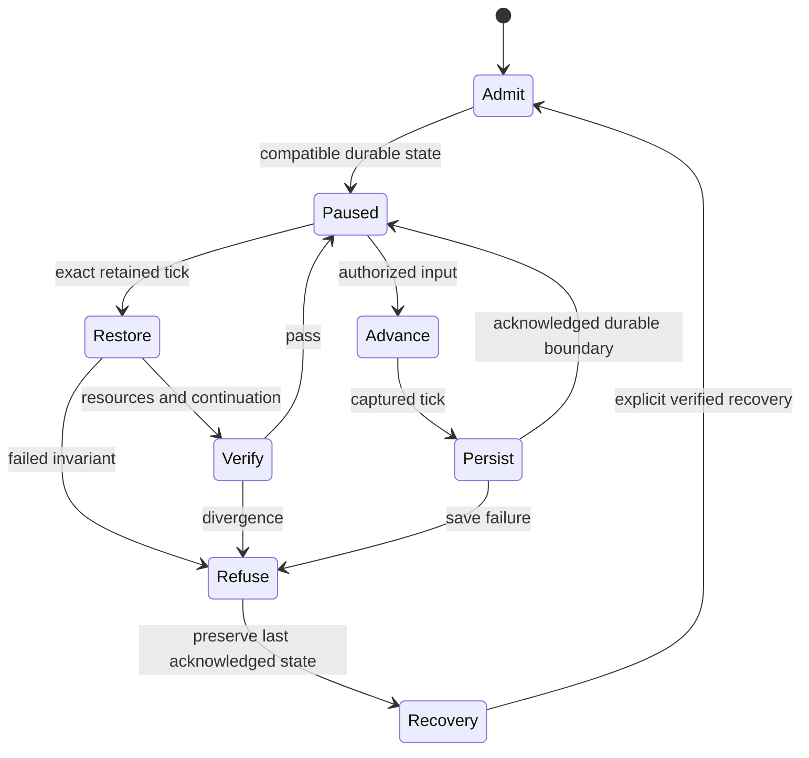
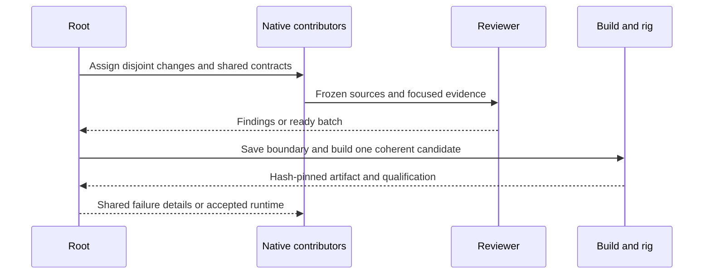
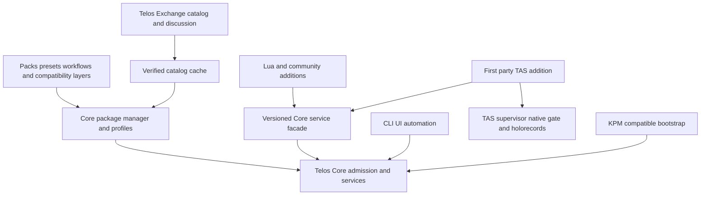
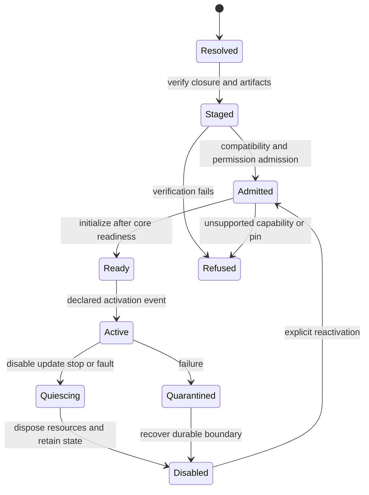
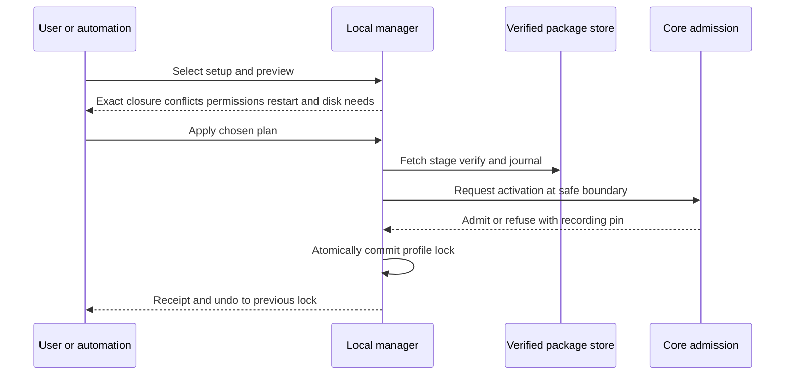

# KPTAS complete product - Plan

## Goal Capsule

**Objective:** KotOR runners can author, preserve, inspect, restore and share faithful tool-assisted runs, and RPG testers can use the separate semantic mode, through a finished, independently installable tool.

**Immediate outcome:** finish a short, understandable, continuous Endar Spire DLZ recording performed entirely through the TAS, while the remaining product work progresses in parallel. The existing AMG lab clip does not close this outcome.

**Authority:** latest direct user instructions take precedence over earlier user instructions; the user-authored export and the user's adopted Discord requirements establish scope; this plan organizes delivery; technical contracts and receipts establish mechanisms and evidence. Assistant summaries, community objections, automated heartbeats and historical handoff commands are not new user instructions.

**Execution:** root owns live gameplay, native qualification, recording and coordinated DLL builds. Delegated owners work on disjoint files and independent research/tests, communicate across dependencies, and return to the next useful unowned task. Routine reversible work is already authorized. Public upstream PRs still require the user's explicit approval; the public demo deployment restriction remains in force.

**Stop conditions:** a failed native invariant, lost durable boundary, incompatible environment pin or exhausted storage stops the affected operation, preserves its evidence and enters repair. It does not cancel unrelated work or authorize replay to masquerade as restore. A progress report, source patch, package build or short clip does not complete this plan.

**Current entry point:** live-5 is paused at durable tick 3615 on the v19 CRLF pin, as of the latest root receipt; verify current companion/route state rather than assuming the earlier first-door setup. Verify the saved boundary and owned process before resuming. No game action is needed to understand or revise this plan.

---
## Product Contract

### Summary

Deliver KPTASInterface / InputInterfaceTelos as a lightweight, separately packaged TAS and experimentation tool in kolto-labs/KPHarness. Make holorecords the durable record of full game state and inputs, with general emulator-like authoring controls and clear provenance. Complete the requested mechanics demonstrations and full run alongside the tool. Extend the qualified foundation to K2, semantic RPG testing and the lowest-priority KPM community platform.

### Problem Frame

The user has repeatedly had to restate the whole project because short-term handoffs replaced the product with the last task. Slow experimentation, lost authoring state, misleading overlays and incomplete acceptance make it hard to finish a credible run. The community's speedrunning history makes faithful behavior and honest, inspectable evidence central to adoption.

### Requirements

#### Core and durability

- R1. Package the tool independently; KotorPhasor is optional, with supported integrations explicit.
- R2. Preserve base-game mechanics, legitimate glitches and RNG behavior, pursuing same-input, same-tick results within a recorded supported environment. Never force a favorable result or claim universal determinism from one fixture.
- R3. Retain full per-tick state in holorecords, covering memory, threads, clocks, files, graphics resources/state and handles, together with inputs, ancestry and provenance.
- R4. Support genuine restore to an exact retained tick and a separately configured TOML checkpoint/replay mode. Replay never qualifies as actual restore.
- R5. Keep all supported keyboard, mouse-button and mouse-motion inputs meaningful through saves, loads, Alt+F4 and relaunch, including the windows used by AMG, buffers and other glitches.
- R6. Persist work continuously, including unusual events, failures, authored inputs and invalid drafts; expose a small truthful save/failure notice and a recoverable durable boundary. Never acknowledge unsaved work as durable or silently discard it.
- R7. Preserve old recording pins across updates. Save and verify the current boundary before a DLL change; retain compatible binaries and recoverable work when direct continuation across versions is impossible.

#### Authoring and interface

- R8. Provide general pause, step, rewind, fast-forward, exact seek, save/load, input editing, branching and retry workflows through supported text/TOML, UI and automation surfaces.
- R9. Make the in-game interface feel light, intuitive and reactive in the style of ReShade and the browser prototype, with BizHawk as the functional quality benchmark. Controls that look clickable must work.
- R10. Display the actual applied input for the displayed tick using a standard keyboard/mouse layout. Distinguish engine tick, session origin, branch position and optional clip-relative time without inventing state or unexplained starting numbers.
- R11. Keep an explicit TAS marker, with the Aurebesh idea available, and use plain language matching the user. Remove the rejected “RECORDED” and “Not live keys” copy; never hardcode labels or highlights for a particular clip.
- R12. Support browser holorecord load/save and authoring parity where meaningful, with truthful distinctions between native state transport, browser simulation and native execution. Keep newer work local until complete and locally tested; preserve the public September 30 rollback in the meantime.

#### Runs and research

- R13. Root must perform every Endar DLZ gameplay input through the TAS and show that pause and genuine rewind work. Use the community mechanics documentation and preserve failed attempts and exact inputs.
- R14. Produce a short, succinct, continuous actual-screen recording with no splices, retiming or substituted frames. Prepare before filming; remove avoidable setup delays through better workflow, and make necessary inputs slow enough to follow.
- R15. Complete and time The Routine against the requested approximately five-minute target, preserving the actual elapsed time and recording rather than substituting a benchmark or another glitch.
- R16. Deliver repeatable clean swoop runs and a clean Taris apartment chain without warps, alongside the broader run work where resources permit.
- R17. Complete an optimized K1 Any% Unrestricted TAS informed by existing records and history. Prove its actual category, timing and provenance; “WR-class” is an ambition requiring comparison, not automatic ordinary-speedrun leaderboard eligibility.
- R18. Find useful K1/K2 community references with visible inputs or actual input files, inspect utility before bounded download, use ffmpeg where suitable, and delete weak newly acquired references. Video alone does not supply missing exact input timing or initial state.

#### Expanded support and delivery

- R19. Provide a TOML-selected semantic mode for real engine memory observations and injected RPG actions, with text output and lifecycle correctness, on a host without a hardware GPU, mouse or keyboard and without fake input devices. Do not reinterpret this as removing the game's graphics/audio runtime dependencies.
- R20. Support K2 through verified profiles, actual native execution and equivalent relevant acceptance, with explicit unsupported builds and portability limits.
- R21. Build KPM → this platform → community modifications/Lua on the existing loader and useful higher-level APIs, avoiding injection conflicts and needless version coupling. Research the best design and adoption path; this is the lowest-priority track.
- R22. Deliver documentation in the user's voice, a short KotORjs-inspired demo using real footage, bodencrouch/kolto-labs/OpenSWKotOR branding, optional donations and a real download path through the new Discord. Validate real destinations; the organization website is deferred.
- R23. Preserve existing work during source integration. Historical `m3-int` rejection and `main` at legacy M2 remain unresolved integration facts until current Git evidence establishes otherwise; no rename or plan revision makes them accepted.

#### Execution and accountability

- R24. Improve practical end-to-end throughput continuously without weakening R2–R7. Every 15 minutes during active work, examine the preceding 30 minutes across all lanes, fix the largest actionable bottleneck and record measured changes and limits. The retracted numeric multipliers are not targets.
- R25. Run independent tasks concurrently with explicit file/resource ownership, root-owned DLZ and one serialized native rig/build owner. Queue compatible DLL changes, freeze and review the batch, build once when its contributors are ready, and coordinate failures before any next batch.
- R26. Report actual tick, completed/partial/blocked work, each milestone's next gate and evidence-based ETA. Give measured durations or bounded work allocations when completion is unknown; historical Saturday and 24–48-hour wishes are not renewed promises.
- R27. Maintain 50 GB free on NVMe and 500 GB on MyBook through prompt, justified stale/duplicate cleanup while protecting active processes, unique work and raw evidence. Record fresh capacity and actual reclaim; never infer safety from age alone.
- R28. Keep AgentDecompile serving port 8080 and protect other user-owned processes. Respect the active workspace/HDD access constraints; the named export read is explicitly authorized, not blanket permission to traverse the disk.
- R29. Maintain one authoritative living plan with landed/partial/next deltas, exact resume state and source-to-work coverage. Preserve every user question and delegated expert/research decision until answered or explicitly superseded.
- R30. Remove confusing competing guidance after its unique meaning is merged and its original bytes are recoverably archived. Keep technical specifications, user documentation, private original sources and immutable proof distinguishable from current instructions.
- R31. Carry the entire preserved Discord discussion as attributed context: adopted requirements, proposals and objections must stay distinguishable. The external-only community objection is not silently satisfied by injection; ordinary-run eligibility must not be fabricated.
- R32. Resolve every issue in `m5-current-review.md` with tested runtime identity, OS-input/video provenance, synchronization and watermark neutrality. A pathname hash or builtin marker alone does not establish loaded-file identity.
- R33. Document the real tick/clock model rather than treating the user's uncertain fixed-60Hz suggestion as fact. Keep exact engine-gated TAS separate from wall-score hands-off playback.
- R34. Keep canceled geometry work, superseded per-command reporting and superseded blanket Lua separation out of current execution. The later coordinated-build policy supersedes the earlier one-build cap.
- R35. Do not turn “foolproof” into an unsupported guarantee. Define concrete failure detection, refusal, recovery and acceptance evidence for each critical path, and resolve researchable questions with expert judgment.
- R36. Preserve reproducible media/resource behavior, including voice and movie timing and graphics restoration. The legacy virtual-Miles null-output design is an explicit current mechanism, not a user instruction to remove audio dependencies or proof of all media acceptance.

### Actors and key flows

A1 is the runner authoring and sharing a run; A2 is the mechanics reviewer inspecting evidence; A3 is the RPG/mod tester using semantic actions; A4 is the contributor or new agent continuing work. A2 receives a declared artifact/tier and compatible pin, runs supported clean judge replay for a published TAS score or appropriate lab inspection/restore for a holorecord, compares named published hashes and the input audit, then records pass/divergence/unsupported. U15 installed-consumer qualification and U16 documentation acceptance exercise this reviewer flow under the existing tier-specific publication contract.

F1 covers author → durable checkpoint → pause → edit → branch → exact restore → retry → inspect → export, enforcing R3–R11. F2 covers prepared fixture → continuous capture → slow visible TAS operation → actual glitch/result → complete-file encode → frame/input audit, enforcing R13–R17. F3 covers TOML mode/profile admission → real engine state/action → lifecycle validation → text result, enforcing R19–R20. F4 covers KPM loader → platform readiness → community extension → orderly shutdown/version compatibility, enforcing R21.

### Scope and decisions

The current user request establishes the full scope above; nothing is silently reduced to the clip or the old native milestones. Injection is permitted for TAS/semantic mechanisms while R2 governs behavior. Hands-off remains a separate no-in-process-tool tier. Browser transport must not be advertised as native execution.

The geometry project is canceled. The organization website is deferred. Optional donation destinations and Discord invite values require real user-owned destinations; discovery/preparation can proceed now. Mod/Lua integration remains included but lowest priority. Unknown platform support is an acceptance gap, not permission to invent support.

---
## Milestones

These are NEW **Product M1–M7**, defined by this plan at the user's request. All older branch names, receipts and `docs/design/contract.md` M0–M5 references retain **Legacy** numbering. New numbering never retroactively upgrades old proof.

| Product milestone | Finished outcome and exit | Main units | Current evidence and remaining gate |
|---|---|---|---|
| M1 — Faithful, recoverable core | Full-state K1 capture/restore and input continuity meet legacy probe/replay/capture/restore/media gates; crashes preserve acknowledged work and drafts | U1–U4 | v19 bounded menu restore passes; host crash/reader fixes pass. Full native matrix, media, restart and fidelity coverage remain. |
| M2 — Complete TAS authoring | General emulator controls, score editing, branches and exact save/reopen work from installed artifacts with measured useful throughput | U5, U6 | Installed host checks pass; native integrated workflow, fast-forward behavior and fresh performance measurement remain. |
| M3 — Intuitive and truthful interfaces | In-game and local browser workflows satisfy the ReShade/browser feel, functional parity, real tick/input display and TAS marking; legacy hands-off M5 is qualified separately | U7–U9 | Local browser/draft fixes and old clip audit pass; full visual/runtime parity and M5 loaded-library/input/video gates remain. |
| M4 — Mechanics and completed runs | Continuous clean Endar DLZ, timed Routine, repeated swoop, no-warp Taris chain and full optimized K1 Any% Unrestricted run are independently evidenced | U10–U12 | 15.05-second AMG lab clip exists; clean DLZ continuation at3615. Other requested run outcomes remain open. |
| M5 — Semantic testing and K2 | Real no-device semantic workflow and supported K2 native execution pass their named acceptance on declared environments | U13, U14 | Semantic host lifecycle and K2 static candidates exist; real engine/no-GPU and K2 native admission remain. |
| M6 — Installable community release | Coherent source/binaries, independent install, honest support/docs, short demo, real Discord/download path and optional donations; browser release only after completion/local tests | U15, U16 | Host wheel independently qualified, later attestor delta excluded. Source integration, native packaging and launch delivery remain. |
| M7 — Extensible ecosystem and full closeout | Standalone Telos Core, versioned KPM→Telos Core extension contracts, reversible resolved setup installation, working local Telos Exchange discovery/publishing/community hub and composable TAS/Lua/mod consumers pass their acceptance; all prior product exits are evidenced | U17–U23 | Architecture and proposed contracts specified; loader integration, installer, hub and consumer acceptance remain unimplemented/unqualified. Local design is authorized; public deployment remains gated. Extension execution stays behind fluid seek and The Routine. |

**Legacy crosswalk:** Legacy M0 probes, M1 fresh replay, M2 every-tick capture, M3 100-point restore and M4 media qualify Product M1. Legacy M5 HUD qualifies Product M3; its no-shim OS-input evidence remains distinct. Legacy portability contributes to Product M5/M6. Historical M6/M7 definitions were not recovered; the new definitions above replace that ambiguity without claiming an earlier milestone passed.

Milestones may advance concurrently. Durability starts immediately, and release-path discovery does not wait for every native feature. Product M7 is complete only when all seven exits are met. No whole-project completion percentage is derived from passing test counts.

---
## Planning Contract

### Key Technical Decisions

- KTD1. Keep immutable environment and recording identities, current compatible binaries and strict restoration canaries; use a new pin for changed DLL/config rather than bypassing old admission. Governs R3–R7.
- KTD2. Store raw input/state evidence independently of presentation. The overlay reads the acknowledged/applied sample and frame identity, not global physical-key state or clip timing. Governs R10–R14.
- KTD3. Use existing holorecord, controller, supervisor, score and browser mechanisms before adding another persistence or control layer. Draft recovery and ancestry validation belong in their shared paths. Governs R6–R12.
- KTD4. Preserve one serial game owner and one native freeze/build decision, while host, browser, static profile, documentation and independent review work in disjoint lanes. Governs R24–R25. (session-settled: user-directed — chosen over unrelated repeated rebuilds: all waiting native contributors must share the coordinated changes.)
- KTD5. Keep the public Worker on the restored version while completing/testing local functionality. Governs R12. (session-settled: user-directed — chosen over incremental public demos: the user requested rollback and local completion first.)
- KTD6. Use filesystem-aware descriptor-backed local runtime identity for the controlled hands-off fixture, with exact namespace/lifecycle/mapping checks and an optional stronger mapped-object handle when accessible. Do not weaken identity to inode-only or ignore device mismatches. Governs R32; detailed decision and fallback are in U9.
- KTD7. Admit K2 only after exact build/profile and scheduling/resource semantics are verified; treat static addresses as candidates, not supported hooks. Governs R20.
- KTD8. Keep normal TAS inputs and semantic injected actions explicitly separated by TOML mode, runtime receipts and UI. Neither can silently fall back to the other. Governs R2, R19.
- KTD9. Canonical plan content owns requirements, milestones, decisions and current progress. STRATEGY owns concise purpose/positioning; AGENTS only routes work and states execution rules. Historical and scoped evidence has no competing project authority. Governs R29–R30.

- KTD10. Telos Core is the standalone platform and installation root. TAS, Lua and community additions install into it; the first-party TAS distribution bundles Core for independent use without KotorPhasor or Lua. Core admission and package management remain independent of Telos Exchange/accounts. TAS services expose one admitted command boundary across CLI, UI and extension adapters; the hub cannot control the native rig. Governs R1–R8, R21 and the latest ecosystem scope below.
- KTD11. KPM owns the compatible proxy/bootstrap integration; Telos Core owns versioned services, package admission and addition lifecycle. Do not create a second injection owner or let catalog packages patch core hooks directly. Qualify the existing coexistence contract before changing it. Governs R2–R7, R21.
- KTD12. Resolve immutable package releases into a profile lock, stage and verify before activation, journal the commit and retain the previous closure for rollback. Active recording pins are immutable and never upgraded in place. Governs R6–R7, R21.
- KTD13. Separate publisher identity, artifact integrity, permissions, maintenance and tested compatibility as distinct evidence. A signature or official badge alone never certifies safe execution or faithful mechanics. Governs R2, R21, R35.
- KTD14. Discover through typed relationships and explained recommendations. Keep user libraries local by default; publish only consented data and real aggregate activity with source/window labels. Govern the latest ecosystem scope below and R21.

### Architecture and lifecycle

### Ecosystem architecture and acceptance

**Latest ecosystem scope:** design KPTAS/KPHarness around **Telos Core**, a useful standalone platform and installation root, a stable independent extension surface, and **Telos Exchange** (working hub name), a central place to publish, discover, inspect, install, update, discuss, combine and maintain additions. KPM → Telos Core → TAS/Lua/community additions is the dependency direction. Everything installs into Telos Core; TAS is the first-party default addition and its standalone distribution includes Core without mandatory Lua or KotorPhasor. This expands R21 beyond a Lua loader or download database. The organization website remains deferred; a local hub design/prototype is authorized separately. The public Worker completion/local-testing gate remains KTD5. The latest native seek → Routine priority governs staffing and acceptance order.

**Current versus proposed:** the core holorecord/controller/supervisor and the legacy coexistence contract already provide architectural anchors. All manifest, SDK, installer, hub, graph and collection interfaces in this subsection are proposed contracts, not shipped capabilities. Verify KPM's actual bootstrap, entry points and ownership in U17 before binding these contracts to native code. `docs/design/contract.md` currently requires module allowlisting from tick zero and hook integrity checks; a catalog compatibility label cannot override that admission.

#### Boundaries and dependencies

Allowed dependency direction is addition → SDK → Telos Core service. Telos Core never imports TAS internals, community packages, hub authentication or discovery ranking. TAS owns its supervisor/native gate/holorecord services and registers their versioned capabilities with Core. Core remains useful with package/profile management, admission, capability inspection and extension tooling when TAS is disabled. The Core package manager resolves install plans and Core admits addition lifecycle. The TAS supervisor separately admits game execution, pins and restore requests. The browser and desktop hub use the same management interface, including accessible CLI/automation equivalents. Prefer a modular local application and one catalog backend initially; separate services only when actual isolation or load demands it.

Native bootstrap remains under KPM coordination. Out-of-process analysis extensions use a supervised broker with bounded requests. Lua uses a restricted platform adapter where enforceable. Native DLLs run with the game's privileges and cannot be honestly described as sandboxed. A crashing native extension may crash the game; preserved durable work and refusal/recovery evidence are required. Remote catalog metadata cannot provide executable startup instructions.

#### Manifest, release identity and shared API

One versioned manifest describes each plugin, pack, preset, compatibility layer or workflow. A package identity is `publisher.name`; a release identity adds SemVer and the immutable artifact digest. Publication stores release metadata separately from mutable project discussion/maintenance state. Unknown manifest major versions, unknown privileged capabilities, invalid paths and unsatisfied compatibility refuse activation.

| Field group | Proposed contract |
|---|---|
| Identity | `schemaVersion`, `id`, `version`, `kind`, `displayName`, short concrete benefit, publisher/maintainers, license, source repository and release commit |
| Presentation | Icon, screenshots, categories, capability tags, README, changelog, support/discussion links and accessible alternative text |
| Runtime compatibility | Host API range, loader ABI range when needed, game/build/profile constraints, OS/architecture, execution tier, activation events, entry point and restart requirement |
| Composition | Required dependencies with version ranges, optional dependencies, distinct `packMembers`, provided/required capabilities, declared conflicts and curated related/together recommendations with attribution |
| Permissions and fidelity | Scoped file/network requests, core read/action capabilities, native-code flag, mechanics/evidence impact declaration and extension-owned state schema |
| Release integrity | Artifact location, size and SHA-256 in the signed release envelope, publisher signature/key identity, verification/compatibility receipt references and their exact tested environments |
| Maintenance | Release history, maintainer changes, supported/deprecated/archived status, replacements, migration notes and support policy; historical versions retain their original bytes |

Required dependencies form an acyclic graph with an explained failure path. Packs are install intentions rather than runtime dependencies: deselecting an optional pack member does not pretend a required runtime dependency is optional. Soft relationships never force install or activation. One active version of a package per profile is the initial rule; incompatible closures use separate profiles rather than covert side-by-side native loading.

The versioned Telos Core service facade exposes narrow capabilities: discover providers, subscribe to bounded events, register commands/panels, and access extension-scoped storage. The first-party TAS provider separately exposes read acknowledged session/tick/input/branch identity and permitted TAS actions through the existing serial queue. A TAS-dependent addition declares that dependency; Core admission does not couple generic consumers to TAS internals. Semantic actions require semantic mode; observation cannot silently acquire action privileges. No public raw pointer/hook API is part of the stable SDK. Privileged native integrations remain explicit, qualified adapters. Commands return request identity, accepted/refused reason and acknowledged result; stale session or branch identities refuse mutation. Cancellation, timeouts, backpressure and unsubscribing belong in the shared contract.

Telos Core API compatibility is independent of the TAS service API, catalog schema and KPM loader ABI. Negotiate supported API major and capabilities before activation. Additive minor changes preserve consumers; a breaking major retains a documented migration path and the old pinned consumer environment. Holorecord identity records the exact extension closure, permissions, configuration digest and relevant extension state. Extension-owned state must declare capture/restore behavior and pass qualification; missing state support prevents an exact-restore claim in that profile.

Initialization occurs outside unsafe loader-lock work and cannot launch background services before readiness. Register disposables under an extension identity; unload in reverse dependency order. Native hot-unload is unsupported until independently qualified. Disable/update requiring unload shows a pending restart; it does not pretend code left the process. Restore quiesces participants through the core authority and refuses missing, mismatched or unqualified extension state. Losing the hub connection never pauses an admitted offline run.

#### Transactional setup and reversible maintenance

Local management operations are resolve/preview, apply, inspect, list, update-preview, disable, remove, rollback and profile import/export. A preview has a digest; apply verifies that installed state and catalog inputs still match it. Mutations have an idempotency key and profile-scoped lock. A profile lock names exact package versions/digests, activation order, configuration digests, grants and environment constraints. Separate receipt data records download/verification/activation results and pending restart state.

Store immutable package payloads outside game-owned files. Before any supported game-file integration, track ownership, snapshot original bytes and verify changes on rollback; never overwrite independently changed files blindly. Reject archive traversal, absolute paths, unsafe links, oversized expansion and untrusted executable install hooks. Permit declarative scoped operations only. Interrupted download stays staged; power loss before/after profile commit yields the old or new complete closure through journal recovery. A committed package set with failed runtime initialization is marked failed and reverted at a safe boundary, preserving the fault receipt. Exact restoration of user-modified settings may need a merge; show it as unresolved rather than claiming universal rollback.

Resolve dependencies automatically before the first preview. Explain unsatisfiable constraints, conflicts, obsolete packages and affected dependents in plain language. Prefer installed compatible versions and minimal necessary changes. Permissions added by an update require an explicit changed-grant decision. Disable/remove previews expose dependent effects and support switching a named setup. Remove deletes only managed payload references; saved settings and recordings remain recoverable. Garbage collection requires that no active profile, recording pin or rollback retention references the artifact.

Telos Core and bundled standalone TAS workflows and local packages require no account. Offline browsing uses the last verified catalog with its age and verification state visible. Offline install/import verifies available artifacts; missing dependencies are named. Signed index/release metadata includes trusted key rotation, version/expiry and revocation information. Expired cached metadata may remain inspectable and already pinned work recoverable, while new update trust is refused until refreshed or a separately recorded local trust decision is made.

#### Discovery, library and community model

Telos Exchange's first view answers what an addition does and whether it helps this setup. The proposed Kolto Labs site button is **Telos Exchange**, routed to `/telos/`, with **Browse additions** as the primary action and **Submit an addition** as a separate contributor action. Root verified the existing [Kolto Labs site](https://koltolabs.bocloud.workers.dev/) with HTTP 200 and its Kolto Labs title. Its named local source is `koltolabs-work/site` in the home workspace: React/Vite with prerendered pages on the `koltolabs` static Worker. The configured `koltolabs.dev` domain currently does not resolve; the GitHub organization blog `swkotor.org` resolves to KotOR.js and is not this integration target. No website modification or deployment is established by this design. Integrate the local `/telos/` route and navigation into that existing site after root coordinates file ownership, and retain KTD5 before publishing. Cards have distinct icons, a concrete benefit, actual screenshot/example, kind, compatibility, installed/update state and trust/maintenance summary. Detail pages include source/license, requested permissions, authors, tested compatibility, release history, conflicts/dependencies and discussion. Keep publisher verification, official ownership, curated recommendation and compatibility evidence visually distinct.

The catalog graph uses typed directed edges: requires, optional-requires, pack-member, conflicts-with, provides/requires-capability, supersedes, related-to, works-with and curated-for. Each recommendation edge retains author/source, rationale, relevant version/environment and date. Dependents are computed from releases; displayed co-use aggregates are separate from guaranteed compatibility. Users can explore dependencies/dependents, related extensions, useful combinations and complete setups through both graph and list views.

Discovery exposes setup-aware recommendations, popular, trending, recent, related, used together, categories, capabilities, curated/community/official collections and completion suggestions. Compatibility filters run locally against the selected profile before recommendation ranking. First use explicit graph/curator evidence and transparent rules. Popularity is a real aggregate over a shown window; trending compares documented windows with minimum sample requirements. Deduplicate and rate-limit manipulation, mark sparse evidence, and show empty states when no reliable data exist. New releases use publication timestamps rather than simulated installs. Sponsored placements, if later authorized, must be labeled and excluded from organic rankings. No fabricated counts, scarcity, urgency, compatibility or activity.

Favorites, wishlist, installed/disabled/pending states, collections, profiles and saved setups are separate concepts. Collections express discovery intent; saved setups contain an exact lock and environment constraints. Completion means the selected setup's explicit required capabilities/packages are satisfied; optional additions remain optional. Share/import/export offers a preview of resolved contents and redacts local paths, secrets, session evidence and private notes. Public setup sharing and optional aggregate co-use contribution require consent. Default recommendations are local and do not upload installed profiles, game state or raw recordings; any telemetry describes fields, retention and opt-out.

Publishers can submit immutable releases, source/permissions/compatibility metadata and migration notes. Publication validates schema, archive safety, identities and artifact digests before listing. Review queues, scoped moderation, report/appeal paths, account recovery, maintainer transfer with visible history and revocation preserve community maintenance. Discussion supports questions, compatibility reports and version-scoped solutions. Do not accept a discussion claim as a native qualification receipt. Keep catalog management, installer authority and discussion moderation separate even within one initial backend.

#### Design basis and unresolved execution facts

The manifest/host range, activation and pack/dependency distinction draw on the [VS Code manifest](https://code.visualstudio.com/api/references/extension-manifest) and [activation contract](https://code.visualstudio.com/api/references/activation-events). Signed update metadata, expiry and rollback defense use [TUF's specification](https://theupdateframework.github.io/specification/latest/) as a design basis; select a maintained implementation during U20 rather than inventing cryptography. These references ground interface choices; they do not establish that VS Code or TUF semantics are already implemented here.

U17 must verify actual KPM proxy/readiness ABI and native unload limits. U19 must classify every exposed service and extension state against capture/restore boundaries. U20 must prove atomic profile publication on each supported filesystem. U21/U22 integrate with the verified existing Kolto Labs local site and select an authorized catalog/authentication stack before backend implementation; static Worker hosting alone does not implement a catalog, discussion database or package installer. The site may browse publicly, while native installation hands off a preview to local Telos Core. No remote site may execute or mutate the native rig directly. Browser-only users receive verified download/setup instructions when no local manager is connected; a successful browser click cannot be labeled an installed native package. Native crash containment remains limited by in-process execution. These are named execution prerequisites, not reasons to displace the current seek/Routine gates.

### Execution order, time and resources

The immediate path is U1 preservation/preflight → actual connected U5/U7 authoring workspace with onscreen piano roll and seekbar → U10 clean DLZ proof → continuous recording and audit. Do not wait for K2 or platform work to film an honest qualified slice. Before filming, root runs a clip-scoped U3 pilot on the filming pin: U1 boundary/process/pin/storage preflight; visible pause/step/strict rewind and applied-input/tick correspondence; 3–5 gameplay restore/continuation points, including an actual transition if transition rewind is demonstrated. Compare full raw memory roots, separate file-tree roots, journal and input, and repeatability. Restrict rewind claims to qualified points. Full 100-point/3600-tick qualification follows later; general U5/U7 completion remains required for whole-product acceptance. Route preparation and host work proceed concurrently.

At four available slots use root for the live rig, one durability/host/media-preparation owner, one K2/semantic/platform research owner, and one independent reviewer. Reallocate after each bounded result. A documentation consolidation pass may temporarily use those slots for extraction/review while the game stays paused. No agent launches a second game or builds its own DLL.

For a native batch, freeze exact touched source hashes only after every contributor declares readiness and cross-file conflicts are resolved. Preserve the running take, build and qualify a new pinned candidate, then distribute the same failure/success receipt. Do not cherry-pick a subset behind another lane's tests or install over a live recording.

Use measured authoring wall time, restore latency, full-capture/store costs and final recording duration. The old host scan improvement and 11.4% blob-store improvement are component measurements; they do not establish whole-game speed. Pilot 3–5 representative restore points before estimating the 100-point matrix. Time Routine explicitly. Report completion ETA as unknown when route success, compatibility or correctness is unresolved, with the next bounded experiment and its budget instead.

Before lengthy capture, measure actual NVMe/tmpfs/MyBook availability and projected output growth. The M3 driver writes video to a dedicated NVMe directory while preserving native session identity; it does not duplicate holorecord packs. Do not disable every-tick evidence or canaries to fit storage. Reclaim justified stale data, reuse existing valid captures, or defer the affected storage-heavy run while independent work proceeds.

### Assumptions and research boundaries

The current active NVMe source tree has no Git metadata; integration requires later inspection of the real repository and preservation of dirty work. The direct export has inferred roles, not authoritative role metadata, and U084/U092 are truncated. Missing text must be retrieved if accessible, otherwise stay explicitly unknown. The preserved Discord source is user-pasted, not independently authenticated Discord data.

The default fidelity claim is the pinned supported environment. Cross-machine/Wine/Windows/driver claims require their own matrix. The normal clock is not assumed fixed by engine design. No new privileged service or general anti-cheat guarantee is part of this plan.

---
## Implementation Units

### U1. Preserve the run, integrate work and measure available capacity

**Requirements:** R7, R23–R30. **Owner:** root with a bounded storage agent. **Dependencies:** none.

**Files:** `kptas/durability.py`, `kptas/telos/live.py`, `tests/test_live_durability.py`, `tests/test_envpin_launch_inputs.py`; workspace capacity and integration receipts.

**Approach:** verify current durable boundary, pin, process ownership and free-space runway before continuing. Reconcile historical rejected M3 claims against exact current sources, preserve all unique refs/dirty edits, and prepare a lossless integration path when repository access is available. Inventory files before safe cleanup; preserve proof bundles and original footage.

**Test scenarios:** save fails before acknowledgment and old boundary stays recoverable; DLL mismatch refuses continuation; stale PID does not authorize process control; deletion candidate used by an active process is retained; fresh capacity is measured after cleanup.

**Verification:** resumable state, exact source/artifact inventory and measured storage are recorded. No historical merge claim is promoted without Git proof.

### U2. Close durable holorecord and authoring recovery gaps

**Requirements:** R3, R5–R8. **Owner:** host/durability lane. **Dependencies:** U1.

**Files:** `kptas/holo/{bundle,authoring,journal,pages,branch}.py`, `kptas/telos/live.py`, `tests/test_crash_recovery.py`, `tests/test_live_authored_score.py`, `tests/test_empty_branch_durability.py`, `tests/test_overlay_drafts.py`.

**Approach:** keep the shared immutable authored-score resolver and accurate inherited boundaries. Extend continuous draft/input persistence and saved notices to all promised workflows, including invalid drafts and strange/crash events. Separate acknowledged state from in-flight edits and preserve both where recoverable. Treat imported full-state bundles as active process-state input: compatibility, integrity and provenance do not prove harmlessness. Preserve supported imported-state restore through explicit trusted-bundle acceptance or a documented isolation boundary, with safe inspection before active restore and refusal of untrusted active restore. Own-production/admitted-root hashes are not publisher safety evidence. Audit existing canonical path validation and stage ownership before adding only missing escape/race tests.

**Test scenarios:** crash at each publication boundary; disk-full/fsync failure; torn journal/manifest; empty inherited child; missing all sidecars with intact manifest; FIFO/symlink refusal; pending edit recovered after process exit; native save/Alt+F4/relaunch retains inputs and ancestry; untrusted active restore refuses before mutation, while explicitly trusted or isolated compatible full-state import remains usable.

**Verification:** host and actual native recovery fixtures, including system/power-interruption strategy on a disposable environment, establish the promised boundary. Existing 20 process-crash cases are evidence, not hardware-loss proof.

### U3. Qualify deterministic capture and exact restoration

**Requirements:** R2–R5, R33. **Owner:** native contributors and root. **Dependencies:** U1, U2; coherent native batch.

**Files:** `native/shim/src/{state,threads,clock,msg,vmem,vhandle,winhandles,gl}.c`, `kptas/supervisor.py`, `kptas/backend/shim.py`, `tests/test_root_qualification.py`, `tests/test_restore_transaction.py`, `tests/test_m3_host_regressions.py`; scoped `m3-current-matrix.py` audit driver.

**Approach:** close remaining legacy probes, run two fresh native processes through menu, pinned load and 3,600 gameplay ticks including transition, verify every map/root and keyframe/full-sweep equality, then execute the current 100-point continuation matrix. Pilot first with the same checks. Retain exact raw-journal comparison separately from normalized restore-telemetry comparison.

**Test scenarios:** memory/thread/clock/file/handle corruption; graphics payload corruption; rejected restore poisons all continuation paths; valid recovery clears poison only after proof; load marker and actual module transition are both covered; parallel file compression preserves bytes and durability.

**Verification:** full roots, file trees, core journals and input agree for every compared continuation tick, with named k≤600, selected ranges and failure detection. Physical graphics proof remains explicit, not inferred from a memory-only verifier. Carry the named historical terminal-canary exit and exit-tick branch EPOC0 cases into the current qualification checklist: verify recorded process exit/status immediately after the final gate and compare each EPOC tick, reason and files_root on ancestry. Older source patches and archived findings do not qualify these scenarios; disposition each with coherent source/DLL identity and fresh native receipts.

### U4. Qualify voice, movies and graphics resources

**Requirements:** R2–R4, R36. **Owner:** media/native lane; root executes. **Dependencies:** U3 qualified slice and preserved successor pin.

**Files:** `native/shim/src/{audio,btrace,gl,glenv,glbuffers,gldraw}.c`, `kptas/types.py` (`Receipt`), `tests/test_framebuffer_restore_contract.py`; planned `tests/test_media_restore_evidence.py`; scoped M4 preflight/procedure.

**Approach:** enable movies in a new pin after the clip; qualify real voiced dialogue and a movie under fresh replay, restore across voice state and no-op framebuffer/resource restoration. Identify actual streams and presented movie frames/timing; audio activity digests or BinkOpen alone are insufficient. Populate `pixel_exact` from actual supported evidence rather than its unset default. Keep the specified virtual Miles/null audio behavior explicit. The media/native lane owns a bounded fidelity discriminator on one pinned voiced-dialogue fixture: compare the existing real-audio shadow path with the virtual model around the documented real Miles stream drain (22–123 ms on six files on one host). Observe engine completion, dialogue continuation, applicable input windows and RNG effects. Repair gameplay-relevant divergence before claiming R2 fidelity; repeatability of the virtual model alone does not establish base-game fidelity.

**Test scenarios:** restore inside voice timing; movie before/during/after transition; mismatched stream/resource identity; unsupported graphics format refuses; no-op restoration matches exact physical pixels where promised; current movie-disabled pin fails preflight honestly; real/virtual stream drain comparison records dialogue/input/RNG divergence or evidence that the difference is gameplay-neutral for the pinned fixture.

**Verification:** complete legacy M4 workload and exact media/resource receipts. Null output is not misreported as audible capture.

### U5. Finish general emulator controls and automation parity

**Requirements:** R4, R7–R8, R10. **Owner:** host controls lane. **Dependencies:** U2 and U3 qualified interfaces.

**Files:** `kptas/telos/{control,live,cli,workspace_protocol}.py`, `kptas/holo/seek.py`, `tests/test_control_playback.py`, `tests/test_control_branch_navigation.py`, `tests/test_live_inspect.py`, `tests/test_workspace_protocol.py`.

**Immediate blocker:** the original overlay must attach to the existing session and show the editable piano roll and seekbar. The extra competing window has been closed; the last verified live game remains paused at tick4081. Visible connected authoring controls must work before the requested clip; source tests alone do not close U5/U7.

**Latest binding decision:** combine `LiveSession` and `Controls` completely into one `TASSession` implementation. Recording, playback, seek, branch, save, current recording, and Supervisor lifetime belong to this single owner. Old names may remain exact import aliases for compatibility, with no separate facade behavior or duplicated mutable state. The original overlay and command transport call this same implementation. A remote client is transport only, never another game/session owner. Validate stale session/take/tick/revision atomically under the owner lock before mutations; attaching a view allocates no Supervisor. Preserve the current live process while source work is tested; do not hot-reload or silently migrate it.

**Approach:** qualify all controls from fresh installed consumers, including strict rewind/seek, editable branching, fast-forward, save/load and resume. Read resident recorded state for low-overhead inspection; never silently hot-reload code into the current controller or apply an invalid draft. Qualify the existing TOML seek.mode replay/hybrid configuration and fallback controls; receipts/UI identify replay-derived state, and strict restore requests cannot silently downgrade. This is qualification of existing mechanisms, not a redundant replay implementation.

**Test scenarios:** pause remains stable; one step applies one intended sample; rewind restores the displayed tick; fast-forward retains all required state and correct timing semantics; branch edits do not mutate the parent; empty-child save/reopen works; cold restart resolves authored tail rather than embedded prefix.

**Verification:** actual native workflow plus installed host tests, with explicit control/engine/UI tick correspondence. Explicitly qualify multi-epoch direct restore to epoch >=1, including backward seeks: set up the recorded target epoch at its boot gate and restore target pages/files with zero target-tick replay. Validate missing/ambiguous epoch metadata, corrupted target blobs and attached-process refusal; terminal continuation canary and exit-tick branch EPOC0 behavior follow the retained legacy contract. These named historical cases remain unqualified until current native receipts close them.

### U6. Improve practical authoring throughput

**Requirements:** R24–R26. **Owner:** performance lane and root. **Dependencies:** representative U3/U5 workloads.

**Files:** `kptas/{supervisor,frames}.py`, `kptas/holo/{bundle,pages}.py`, native phase instrumentation, `tests/test_bundle_parallel_files.py`, `tests/test_bundle_record_cache_immutability.py`.

**Approach:** measure the complete author→capture→persist→inspect→restore→record path and the human/agent interaction delay. Optimize the dominant measured cost, including batching inputs safely and avoiding redundant restarts, scans and builds. Keep fresh integrity checks and durable acknowledgment.

**Test scenarios:** optimized and baseline workloads produce identical relevant evidence; stale cache cannot hide corruption; compression failure never acknowledges a tick; bounded concurrency does not overrun memory/storage; warm microbenchmark gain is distinguished from cold end-to-end gain.

**Verification:** before/after wall time, workload/pin identity and proof equivalence, with the largest remaining bottleneck and next expected benefit recorded every review interval.

### U7. Deliver the real lightweight in-game workspace

**Requirements:** R8–R11, R14. **Owner:** UI/native lanes. **Dependencies:** U5; native changes join KTD4 batch.

**Files:** `kptas/telos/overlay.py`, `native/shim/src/{hud,dinput}.c`, `native/shim/src/hud_badge.inc`, `tests/test_overlay_workspace.py`, `tests/test_overlay_input_view.py`, `tests/test_overlay_drafts.py`, `tests/test_m5_controls.py`.

**Latest presentation decision:** retain both the original transparent overlay and the newer workspace design as selectable layouts of the same session and shared authoring model. Expose versioned external UI preferences for layout, panels, dimensions and shortcuts, plus native Qt QSS themes. UI preferences are separate from semantic RPG plans and game/environment configuration. No DLL rebuild or Python editing is needed to customize presentation. Invalid configuration must leave the current recording, drafts and valid UI state intact. Both designs dispatch the same actions to the single TASSession owner; switching layouts must not create or replace a game/session.

**Actual screenshot acceptance (latest user: identify and fix 15):** game visible; no stale closed-window underlay; no duplicate input panels; native badge unobscured; capture bounds match the actual game/UI surface; expanded editor leaves usable game view; full tick headings; clear current playhead; seek scale/markers; useful piano height; usable scrollbars; compact spatial keyboard/mouse display; grouped mouse coordinates/buttons/wheel; remove orphan dropdown; consistent dense toolbar/alignment without excessive nested borders. Synthetic tests do not substitute for actual screenshots. Root verified one neutral TAS step from 4081 to 4082 was acknowledged and durable, but the native paused X11 surface still failed to repaint despite a correct current framebuffer returned by owner render. This is a presentation defect, not evidence of another running session. Investigate safe live-frame presentation without advancing or falsifying state.

**Immediate blocker:** deliver the actual TAS authoring UI, including an onscreen editable piano roll, seekbar, transport and applied-input correspondence. The screenshot of a badge alone is evidence of missing acceptance. Diagnose how the native surface connects to the workspace before choosing an implementation; prove it visibly in the current game.

**Latest interactive customization requirements:** two distinct combo boxes on the top transport panel, one for `.holo` recordings and one for saved UI layouts. Recording save/load must invoke the same session owner, preserve drafts before replacement, validate selected recordings before closing the current native lifetime, and expose actual supported capabilities. Layout profiles use editable versioned TOML plus QSS and retain all panel state. Every panel supports moving, resizing, hiding, minimizing and its own transparency slider. An independent Panels recovery control restores hidden panels and resets geometry. Acceptance requires real Qt interaction and file round-trips, not only parsed preferences. The current older loaded live owner cannot be claimed to support new source-only load APIs until qualified migration.

**Artifact roles:** the workspace is the editor and view of one open recording; `.score` is optional portable input authoring, while `.holo` holds recorded state, authored input, branches and restoration evidence. Normal editing does not require managing a separate `.score` file. Semantic playthrough TOML, environment configuration TOML and UI preferences TOML have separate schemas, loaders and purposes. The semantic plan parser/runner has passed 22 focused source tests; actual device-independent native execution remains unqualified. These roles do not promote current full-state capture or restore coverage beyond its recorded acceptance evidence.

**Approach:** use a compact unobtrusive collapsed view and a clear expandable authoring workspace, borrowing the local browser's useful interactions. Show current tick/origin, actual applied input, playback state and small saving status. Explain a resumed tick such as866 through general timeline/origin behavior, not a special-case label. Use the user's language and make pause/step/rewind/branch discoverable. While native verification owns an operation, visibly disable state-changing transport/open/branch/save actions, identify the pending operation, and retain draft text plus the last acknowledged tick/input. Re-enable controls after success or explicit refusal; attempted actions must receive clear busy feedback rather than disappear silently.

**Test scenarios:** releases clear highlights on the correct tick; repeats, empty frames, restore frames and tool hotkeys do not mislabel input; opening UI or dragging controls does not send unintended gameplay input; save failure keeps draft visible; long/short HUD text leaves no stale pixels; actual game state/files/input remain equal with HUD toggled; attempted clicks during verification cannot appear accepted or be silently discarded, and success/refusal restores usable controls with the draft preserved.

**Verification:** native frame-by-frame input audit, interaction tests and visible pause/rewind/branch demonstration on a general recording. No fixed clip script or rendered video replaces the tool.

### U8. Complete browser holorecord authoring locally

**Requirements:** R6, R8–R12. **Owner:** browser lane. **Dependencies:** U2 shared format contract.

**Files:** sibling demo `app.js`, `telos.js`, `index.html`, its local authoring/transport checks; `docs/browser-holorecords.md`.

**Approach:** validate portable load/save, branches, parents, drafts, editing and recovery with actual native bundles and declared browser capabilities. Keep dirty/invalid drafts through every mutation path and detect unsupported/native-only operations. Compare useful in-game/browser flows; keep production frozen per KTD5.

**Test scenarios:** import/export preserves bytes and ancestry; Record/Step/console/undo cannot overwrite an unapplied invalid draft; interrupted storage recovers prior acknowledged data; malformed/unsupported archive refuses without losing current work; fresh browser/session roundtrip works.

**Verification:** local real-browser test evidence and native roundtrip checks. Deployment is a separate U16 action after completion, never implied by local success.

### U9. Resolve m5-current-review and qualify hands-off evidence

**Requirements:** R10–R11, R32–R35. **Owner:** runtime identity/input lane; root owns live acceptance. **Dependencies:** U1, U7; independent host fixture before a separate native rig slot.

**Required evidence:** [m5-current-review.md](../../../audit-v8/m5-current-review.md), its attestation/filter receipts, and [M5 resolution research](../../../planning-inputs/m5-resolution.md). This unit owns disposition of every finding in that report.

**Files:** `kptas/backend/handsoff_provenance.py`, `kptas/backend/handsoff.py`, `tests/test_recording_provenance.py`, planned `tests/test_handsoff_filesystem_identity.py`, `tests/test_m5_playback.py`, `docs/m5-controls.md`.

**Decision:** qualify controlled local runtime identity and faithful OS-input/video provenance, not a universal anti-cheat proof against a hostile same-user process. Default to an unprivileged descriptor-backed fixture. Prefer the stronger actual `map_files` object handle when permitted; its absence must be recorded and must not be represented as that stronger proof.

**Resolution sequence:**

1. Retain the narrow deleted-nonmodule filter correction and review executable temporary mappings by actual runtime policy. Deleted DLL/EXE/SO, known proxy, missing/duplicate builtin or replaced image still refuse. Unknown executable mappings remain disclosed and cannot silently receive trusted-module status.
2. Fix the proven Btrfs identity assumption using a held candidate descriptor, its own read-only mmap identity, filesystem/mount/subvolume metadata, exact target path and mapping inode/device, and process/namespace/maps/path checks before and after collection. Linux maps uses a superblock device while Btrfs stat may report a subvolume device; neither inode-only comparison nor a blanket Btrfs exemption is acceptable.
3. Hash the retained descriptor and bind it to the exact trusted runtime package/version/architecture. Check signed-package origin where available. The builtin PE marker is corroboration, not identity. Preserve PID starttime/pidfd lifecycle and window ownership, not `_NET_WM_PID` alone.
4. Run race/refusal fixtures before input. If the Btrfs-aware method cannot meet the controlled-fixture identity contract, use a minimal, dedicated non-Btrfs runtime/executable fixture whose mapping/stat identities can be checked, including affected runtime modules rather than moving only the EXE. Measure space and test Wine loader behavior. Do not touch the active DLZ prefix or pin.
5. Launch a dedicated builtin-only fixture without local proxy or a dinput override for the legacy no-override gate. An explicit builtin override is a separate diagnostic, not that acceptance. Inspect actual loaded identity and loader corroboration before dispatching input.
6. Persist score/pin/tool hashes and an append-only OS input ledger with monotonic requested/completed intervals, exact dispatched commands, return status, focus/window/geometry and cleanup outcomes. Choose the tested XTEST path deliberately; targeted XSendEvent behavior is not assumed equivalent. Before every dispatch and during long held-input/tick intervals validate active game-window identity and owner lifecycle, including each relative-motion dispatch. Focus mismatch stops new key/button/motion/wheel/Alt-F4 dispatch, promptly releases producer-held inputs, records failed acceptance and a recoverable stop, and requires deliberate resume after valid focus. Measure unavoidable XTEST focus races; do not claim atomic isolation.
7. Capture one actual x11grab stream, record PTS/timebase/frame hashes and actual `@sync` observations with measured alignment uncertainty. Keep wall-score units and `best_effort`; never claim native engine ticks or exclusive physical input from OS dispatch.
8. Show a nonactivating input-transparent runtime watermark in the captured screen. Qualify focus/message behavior and matched watermark/capture off/on state where observable; strict native HUD neutrality is a separate instrumented fixture. A postproduction watermark alone is insufficient.
9. Freeze and package the identity fix with current host sources, run installed tests and the live fixture, then close each report finding with exact receipts. The earlier wheel does not contain later attestor changes.

**Test scenarios:** own-mmap same-descriptor Btrfs mismatch; sibling subvolume/snapshot inode reuse; namespace/PID changes; rename/replacement/in-place write and map changes during collection; permission-denied `map_files`; deleted temporary data versus actual module; fake marker/modified builtin/wrong version/native proxy; focus loss during held intervals and relative motion refuses further dispatch; invalid owner/window lifecycle requires stop; resize/encoder failure/crash; held-key release on stop; sync frame/timestamp mismatch; external input remains explicitly not attested.

**Verification:** every finding has a tested fix or an explicit supported-environment boundary. Only qualifying evidence gets a passed receipt; diagnostic/unavailable modes never silently downgrade a strict request. A privilege broker is not the default and is not authorized for installation here; consider it only if a stronger agreed evidence contract actually requires it after the unprivileged paths are measured.

### U10. Prove and record the clean Endar DLZ

**Requirements:** R2, R10–R14, R26. **Owner:** root only. **Dependencies:** necessary U1/U3/U5/U7 gates, not the entire K2/platform backlog.

**Files:** authored Endar scores/holorecords and immutable media under the gameplay workspace; `tests/test_recording_provenance.py`; existing exact saved-PC/door-corner readers and continuous capture procedure.

**Approach:** continue current legitimate doorframe route, recruit/use Trask, pass the first two Sith, open the next door and align on the right frame. Use exact recorded coordinates and real TAS movement for investigation; never write position/orientation or force the transition. Prove repeatability and strict restore before filming from a prepared checkpoint. Demonstrate pause/step/rewind without prolonged redundant setup.

**Pin continuity:** reproduce clip-required defects on the current pin and determine whether host-only correction suffices. Preserve the current process, durable boundary, score and v19 artifacts; continue the current pin when acceptance permits. If native correction is necessary, qualify a successor pin and explicitly determine supported restoration/migration or a separately labelled replay-derived continuation. Do not assume cross-pin raw-root equality or substitute replay for restore; qualify genuine rewind on the filming pin.

**Test scenarios:** identical input from the same qualified state repeats the transition on the same tick; failed alignment stays recorded; UI key highlights match applied samples; full uncut video includes every actual delay once recording starts; origin/tick labeling is understandable.

**Verification:** actual module transition plus lineage, full decode/monotonic PTS, complete input/frame audit and continuous original capture. A rounded coordinate match or a playback endpoint is not success.

### U11. Complete Routine, swoop and Taris demonstrations

**Requirements:** R14–R16. **Owner:** root, assisted by route research. **Dependencies:** U10's qualified workflow; preparation may run earlier.

**Files:** distinct scores, clean pins, holorecords, timing/video receipts and route notes; media audit helpers.

**Approach:** time The Routine from a clearly defined prepared start and report against the requested five-minute target. Prepare clean repeated swoop and Taris apartment chains without warps. Keep lab/cheat practice fixtures labeled and separate from clean claims.

**Test scenarios:** repeat each route from the recorded start; compare outcome/tick and relevant state; record failed attempts and actual wall duration; final videos use no splices or retiming.

**Verification:** each named deliverable has its own completed artifact and acceptance receipt; the AMG/DLZ clip cannot stand in for them.

### U12. Build the full K1 run and useful reference corpus

**Requirements:** R17–R18, R24. **Owner:** route/reference lane; root executes native run. **Dependencies:** U3/U5 qualified slices and U10/U11 methods.

**Files:** source/category/version inventory, screened reference media/input files, complete route scores and segment integration receipts; planned `tests/test_reference_input_import.py` only if an actual import format is implemented.

**Approach:** inspect useful community runs and input availability before download, map legitimate route/technique choices, author the full run through the TAS and join segments through actual state continuity rather than video editing. Benchmark the relevant category timing with explicit TAS eligibility distinction. The route/reference owner maintains a bounded inventory of further mechanics after DLZ: screen available community evidence in one 10–20 minute pass, record candidate/source/known input timing/state prerequisites/fidelity risk and disposition, then select the next useful run-authoring experiment. Candidates beyond the pass stay queued or explicitly deferred with reasons; each selected discovery feeds a route score and a bounded repeatability receipt. This is an ongoing selection obligation, not an invented unlimited catalog.

**Test scenarios:** missing inputs are reported rather than guessed; incompatible initial state/build refuses deterministic reuse; segment boundary state/input agrees; complete fresh replay reaches the ending and reproduces measured timing.

**Verification:** full playable holorecord/score and continuous run evidence, credible comparison and no invented “first”/WR claim.

### U13. Make semantic RPG mode real and device-independent

**Requirements:** R19, R2. **Owner:** semantic lane. **Dependencies:** profile/lifecycle interfaces; may progress beside routes.

**Files:** `kptas/{engine_control,config,native_profile}.py`, actual supported engine adapter, `tests/test_semantic_control.py`, `tests/test_semantic_lifecycle.py`; planned real-engine/no-device qualification fixture.

**Approach:** bind TOML mode to verified engine identity and typed observed state/actions. Implement the standalone bridge if optional Phasor is insufficient; do not create fake keyboard/mouse devices or conflate text output with genuinely device-independent execution. Keep GPU hardware absence distinct from retaining runtime libraries.

**Test scenarios:** actual NPC action and observed postcondition; invalid action/read failure revokes writes; close/relaunch invalidates stale handles; unsupported profile refuses; run on a real no-GPU/no-input-device environment and record dependencies.

**Verification:** real engine completion and lifecycle receipts, plus the target environment test. Mock adapter tests alone do not close this unit.

### U14. Qualify K2 and the supported portability matrix

**Requirements:** R20, R2–R5, R33. **Owner:** K2/profile lane; root schedules native acceptance. **Dependencies:** U3 mechanisms and exact K2 profile evidence.

**Files:** `kptas/native_profile.py`, native profile/gate/input/thread/RNG integration, `tests/test_native_profile.py`, `tests/test_game_selection.py`; K2 exact-byte and runtime fixtures.

**Approach:** verify main-loop gate, scheduling before/after Peek, input initialization, RNG/FLS/TLS provider choice and resource lifecycle on the pinned executable. Current static gate return0x407e6b is a candidate with preceding Steam/frame-budget work to account for. Implement/admit one coherent supported build only after evidence; document every remaining unsupported site.

**Test scenarios:** mismatched build/site refuses; alternate pump is not mistaken for the main tick; FLS/TLS fallback and restore preserve actual state; save/load/exit continuation; current K1 regression remains green; declared OS/Wine/driver environments repeat qualification.

**Verification:** actual K2 native recording/restoration and supported-matrix receipts. The existing33 verified/223 unresolved profile count does not change merely because another static report exists.

### U15. Integrate and qualify the standalone release artifacts

**Requirements:** R1, R7, R23. **Owner:** integration/package lane. **Dependencies:** coherent source freeze for claimed features; discovery starts now.

**Files:** `pyproject.toml`, `kptas/data/k1-keymap.score`, `docs/{install,release-status}.md`, `tests/test_package_includes.py`, release build manifests and installed-consumer fixtures.

**Approach:** preserve historical branches/dirty work, resolve rejected claims with current proof, produce matching host/native artifacts and supported-runtime pins, then install outside the checkout. Maintain optional Phasor/UI dependencies explicitly. Do not modify frozen packages to look current.

**Test scenarios:** clean install without source/PYTHONPATH; bundled/configured/local include precedence; wrong-game include refuses; actual authoring/restore consumer works; absent optional Phasor does not break standalone promised functionality; incompatible DLL/bundle refuses with recovery guidance.

**Verification:** source→binary→installed consumer traceability, real native consumer and platform limits, not just wheel import or PySim.

### U16. Finish documentation, demo and community distribution

**Requirements:** R12, R22, R26, R31. **Owner:** docs/release lane. **Dependencies:** actual accepted capabilities/footage; preparation can run now.

**Files:** `README.md`, user docs, release manifest, local browser demo and actual short-video assets.

**Approach:** write public copy in the user's voice with correct identity, clear tool-assisted scope and installation/support instructions. Inspect the KotORjs inspiration before choosing the short demo's structure. Discover the real new Discord destination, validate the invite and download artifact, prepare appropriate onboarding/support channels as authorized, and use only real donation destinations. Keep private chat text out of public docs. Follow the existing tier-specific publication policy and audit actual public bundles/media/manifests for unintended identifiers or secrets; disclose intended host fingerprints. Use clean fixtures or redaction only where valid bytes/roots remain preserved, and establish explicit release readiness before private runtime state is published. Potential leakage is an audit risk, not a demonstrated leak or justification to replace full-state export with an arbitrary score-only default. Complete local browser acceptance before any deployment.

**Test scenarios:** new consumer follows docs successfully; download/install hash matches release; Discord invite resolves to the intended destination; missing optional donation link is omitted honestly; video matches actual capability; public Worker changes only after the completion/local-test gate and applicable publication authority.

**Verification:** complete release candidate, honest docs/demo, validated destination and actual deployment receipt when deployment occurs. No upstream PR or third-party message is implied.

### U17. Qualify the KPM bootstrap and platform coexistence

**Requirements:** R21, latest ecosystem scope; KTD10–KTD13. **Owner:** platform/native integration lane, lowest execution priority. **Dependencies:** loader ABI research now; implementation after core/run-critical work is staffed and U19 contracts are agreed.

**Files:** existing KPM integration reference, native loader/coexistence boundary and Lua adapter; planned `tests/ecosystem/test_loader_lifecycle.py` and native coexistence fixtures. Exact production paths are selected after the bounded loader inventory, before any source edit.

**Approach:** reuse actual KPM Bink proxy/LoadLibrary and harness entry points, with one bootstrap owner and explicit readiness/shutdown. Document supported proxy combinations and restore admission. Interpret U092-D07's “extremely difficult to untie” as valuable stable services consumers choose to retain, with compatible upgrades, export and migration support.

**Test scenarios:** KPM+platform+Lua+harness start in declared order without competing proxy ownership; partial initialization releases owned resources; reverse shutdown leaves no stale subscriptions; unsupported ABI refuses before mutation; a changed hook or unqualified game-visible allocation halts/refuses; native extension failure preserves acknowledged recording work through crash recovery.

**Verification:** actual installed consumer/coexistence receipts on the declared pin. A manifest, renamed DLL or source-only loader test does not satisfy R21.

### U18. Keep the plan complete and close delivery honestly

**Requirements:** R24–R31, R34–R35. **Owner:** root and independent reviewer. **Dependencies:** all units for final closure; continuous during work.

**Files:** this plan, `STRATEGY.md`, `AGENTS.md`, private source coverage ledger and archive manifest.

**Approach:** map every user directive/question/delegated judgment to R/U IDs and a disposition. Update landed/partial/next deltas after each substantial pass. Retire duplicate guidance with hash-verified recoverable archival and fix inbound links. Review the full scope at each handoff, not just the last task. Historical U002-D02 separately requested saving the no-redundant-confirmation preference to memory. Project routing and this living-plan update do not prove a global memory update. Root owns checking for an existing receipt and, if absent, a separately authorized memory-update action in its allowed destination; this documentation reconciliation does not mutate memories or claim that historical request completed. Keep the disposition pending until an actual receipt exists.

**Test scenarios:** every66 export message is covered or explicitly canceled/superseded; truncated source is never invented; every open question has an answer owner and evidence task; old milestone labels cannot be confused with new Product M1–M7; a fresh agent can locate current run/build/pin/queue without reading competing handoffs.

**Verification:** independent coverage/coherence/feasibility/design/adversarial review, no unexplained source omissions, and final acceptance links for every requirement. This documentation pass is not product completion.

### U19. Stabilize the extension contracts and small consumer SDK

**Requirements:** R21, latest ecosystem scope; KTD10–KTD11, KTD13. **Owner:** API/SDK lane. **Dependencies:** bounded U17 inventory, existing core command/session contracts. Contracts may progress locally without native execution.

**Files:** proposed `docs/design/extension-api.md`, `schemas/extension-manifest.schema.json`, SDK facade and Lua adapter paths selected at inventory; `tests/ecosystem/test_manifest.py`, `test_extension_api.py`, `test_extension_state.py`.

**Approach:** implement the manifest/API/lifecycle contract in this architecture subsection without exposing pointers or bypassing core admission. Produce small observation/panel and permitted-action examples, explicit version negotiation, state capture/restore declarations and migration guidance. Runtime extension ownership never transfers the root's live rig authority.

**Test scenarios:** unknown major/capability refuses; old supported consumer runs on an additive API release; stale branch action and TAS-mode semantic action refuse; event overload remains bounded; extension dispose removes resources; missing extension state blocks exact restore; Telos Core manages profiles/capabilities offline with TAS disabled; bundled standalone TAS authors offline with no community additions/catalog/account.

**Verification:** independent consumer using only public facade, schema validation/error examples and compatibility/state matrix. One large demonstration plugin cannot prove composability.

### U20. Deliver reversible local package management and profiles

**Requirements:** R6–R7, R21, latest ecosystem scope; KTD12–KTD13. **Owner:** local package/installer lane. **Dependencies:** U19 schema/release contract; U17 admission adapter for native activation.

**Files:** proposed local package manager/profile store integrated with existing supervisor, `schemas/setup-lock.schema.json`; `tests/ecosystem/test_resolver.py`, `test_install_transaction.py`, `test_profile_recovery.py`, `test_package_security.py`.

**Approach:** implement the transactional/profile contract above, immutable artifact cache and preview/apply/undo interfaces shared by UI, CLI and automation. Reuse existing recording pin/admission services. Build verified offline bundle export/import before online updates.

**Test scenarios:** diamond dependency resolves deterministically; required cycle/unsatisfied range/conflict explains path; disabled dependent is visible; interrupted fetch/commit and activation failure recover old or new complete profile; archive traversal/oversize and tampered/expired metadata refuse; revoked release cannot be newly activated silently; native disable shows restart pending; changed grants demand review; old recording reopens with its exact closure; externally changed game files remain preserved.

**Verification:** clean isolated offline install/update/disable/remove/rollback/import with fault injection, disk accounting, receipts and no checkout/account dependence. Installed state and runtime activation state are independently inspected.

### U21. Build local discovery, graph browsing and personal libraries

**Requirements:** R21, latest ecosystem scope; KTD10, KTD14. **Owner:** discovery/UI lane. **Dependencies:** U19 schema and U20 preview/state contract; reuse existing local browser/desktop surfaces.

**Files:** proposed catalog graph/search adapter, existing local UI integration, `tests/ecosystem/test_catalog_graph.py`, `test_recommendations.py`, `test_library_export.py`; browser accessibility/end-to-end fixtures.

**Approach:** implement the discovery/library model above using clearly labeled synthetic fixtures for local development. Carry distinctive benefit-first cards into details, graph/list exploration, setup selection and previewed install. Favorites/wishlist/collections remain local until the user chooses sharing/sync.

**Test scenarios:** absent/sparse activity produces honest empty states; incompatible profile filters and explanations agree; graph dependencies differ from soft recommendations; installed/update/disabled states match manager; complete setup counts required capabilities only; keyboard/screen-reader navigation works; a shared exported setup omits secrets/paths/raw run evidence and reimports with a reviewable diff.

**Verification:** independent user can discover an immediately useful extension, inspect trust/dependencies, choose a compatible combination and undo it through local working controls. Screenshot-only cards or fake install buttons fail.

### U22. Deliver publish, discussion and maintenance locally

**Requirements:** R21, latest ecosystem scope; KTD13–KTD14, KTD5. **Owner:** catalog/community lane. **Dependencies:** U19 signed release/schema contract, U20 package validation and U21 details. Public deployment remains a root-coordinated later gate.

**Files:** proposed catalog/publisher/discussion backend and local integration; `tests/ecosystem/test_publish_release.py`, `test_community_permissions.py`, `test_maintenance_history.py`, `test_ranking_privacy.py`.

**Approach:** start one modular backend with distinct publish/catalog/discussion authority. Implement immutable releases, truthful verification labels, per-version discussion, compatibility reports, maintainership history, moderation/report/appeal and revocation. Select authentication/hosting from verified available infrastructure without creating an unsolicited public site.

**Test scenarios:** unauthorized release/maintainer edit refuses; identical version cannot replace artifact bytes; duplicate submission is idempotent; maintainer transfer/revocation retains history; imported report cannot forge qualification badge; untrusted Markdown/media remains inert; ranking manipulation/rate limits and consent/retention deletion work; offline core continues when hub fails.

**Verification:** two local publisher identities publish/inspect/discuss/update a verified fixture through real permission checks; reviewer distinguishes identity, integrity, compatibility and curation. Local full-functionality tests precede any separate public release decision.

### U23. Prove composition and ecosystem adoption workflows

**Requirements:** R21, latest ecosystem scope; KTD10–KTD14. **Owner:** consumer/independent acceptance lane. **Dependencies:** U17/U19–U22, relevant M1/M2 native pins; core and Routine gates retain priority.

**Files:** proposed example observation extension, analysis extension, optional Lua semantic adapter, pack/preset/workflow and compatibility-layer fixtures; `tests/ecosystem/test_composition.py`, `test_setup_end_to_end.py`; contributor/user documentation.

**Approach:** compose small independently useful consumers through shared APIs. Packs select packages, presets configure them, compatibility layers declare bounded supported combinations, and workflows call admitted commands. Use different publishers and an API additive update to demonstrate useful reuse and maintainability. Keep native qualification root-owned.

**Test scenarios:** clean standalone Telos Core and bundled TAS first; TAS disabled leaves Core management functional; select recommended setup, inspect graph/permissions, install closure, combine consumers, save/share/import exact setup, update with conflict preview, disable/remove and undo; uninstall hub leaves core/local packages useful; a missing optional component degrades explicitly; incompatible gameplay modifier cannot be labeled faithful TAS; independent author ports a small consumer using documented APIs.

**Verification:** local end-to-end receipts plus real native consumer proof where native behavior is claimed. U18 closes M7 only when all ecosystem exits and prior M1–M6 exits have evidence. Discovery activity remains unknown until real community use.

**Ecosystem sequencing:** protect seek/reproducibility → Routine recording first. In the available independent lane, U17 inventory → U19 contracts precede implementation. Once critical work is staffed, API/native, local installer and catalog/UI owners may proceed on disjoint contracts; U20 acceptance unlocks real install UI, U21 and U22 converge, then U23 validates the complete flow. Root serializes native builds and gameplay; host/catalog tests cannot substitute for native acceptance. Time estimates follow measured bounded slices, not assumed delivery dates.

---
## Verification Contract

| Gate | Required evidence | Units |
|---|---|---|
| Host correctness | Focused production tests for touched behavior, complete current host suite at a coherent freeze, independent edge-case review | U2, U5–U9, U13–U15 |
| Installed consumer | Fresh isolated install, no checkout/PYTHONPATH dependence, source/artifact hashes and actual changed-feature tests | U5, U9, U15 |
| Native fidelity | Fresh process replay, full capture/maps, at least100 restore points including actual load/area transition, continuation and fault refusal, separate graphics/media evidence | U3, U4 |
| Gameplay proof | Actual state outcome, repeatability, preserved score/pin/ancestry, no engine-position writes, category/fixture distinction | U10–U12 |
| Video/input proof | Complete decode, monotonic timestamps, full original recording and frame-by-frame tick/input audit; no splice/retime or fake overlay | U7, U9–U12, U16 |
| Expanded modes | Real engine/no-device target test; K2 runtime and declared portability matrix, unsupported-profile refusal | U13, U14 |
| Release/community | Matching source/binaries, clean native install, verified docs/download/Discord, browser local acceptance then separate deployment | U15–U17 |
| Ecosystem | Offline standalone core, negotiated SDK/Lua/native consumer, verified transactional profile fault recovery, working local publish/discover/discuss/combine/update/undo and truthful trust/ranking/privacy evidence | U17, U19–U23 |
| Scope preservation |66/66 source messages, all questions/judgments, Discord speaker attribution, latest conversation corrections and m5 report dispositions | U18 |

Use the repository's actual unittest files and scoped audit drivers named per unit; do not replace native tests with mocks. A failed test needs a recorded cause/fix/recheck, not a weakened assertion. Tests are required for behavior and risky boundaries, not for trivial prose rewrites. Archive abandoned implementation experiments after unique evidence is preserved.

---
## Questions and delegated decisions

The private [coverage ledger](../../../planning-inputs/coverage-map.json) retains every atomic question and instruction with its original source. This table assigns recurring questions a concrete answer path; answering must include evidence, uncertainty, next action and owner.

| Question or delegated judgment | Decision / answer task | Owner and closure |
|---|---|---|
| Are all original instructions still being done, and is this the best strategy? | Trace every source atom to requirements/units; compare implementation choices against fidelity, throughput and requested outcomes | Root/U18; coverage review plus current deltas |
| What was the Discord discussion and what does the community require? | Use speaker-attributed preserved source, retain disputed external-only position and adopted injection/fidelity distinction | Root/U18; attributed source map |
| Why is throughput so poor, and what was improved across the last half hour? | Measure whole critical path and all lane delays; fix the largest actionable bottleneck and retain before/after evidence | U6; recurring optimization ledger |
| What tick is current, do pause/rewind work, why tick866 and incorrect highlights? | Show actual native state/timeline origin and applied-input correspondence; reproduce offending frames and general regressions | U5/U7/U10; live and frame audit |
| Does semantic mode exist and meet the requested no-device use? | Inventory real bridge versus host adapter, repair gaps, run actual target-host action/lifecycle tests | U13; real engine receipt |
| Which downloaded runs actually have useful inputs? | Per-reference inspection, input availability and reuse limitations; delete weak new downloads | U12; reference inventory |
| Can work survive DLL updates and crashes? | Durable save/cold reopen, compatibility refusal, retained old pin and explicit migration/replay boundaries | U1/U2/U15; native lifecycle proof |
| Why is the in-game UI not the browser prototype? | Functional parity matrix and real interaction redesign; identify native-only/browser-only behavior clearly | U7/U8; actual UI acceptance |
| What is the best KPM/platform/Lua design and path to a community standard? | Existing ABI, lifecycle, version/coexistence and representative extension research before implementation | U17; rationale and consumer proof |
| Can everything finish by Saturday or within24–48 hours? | Re-estimate each critical gate after measured pilot/run results; preserve target as historical aspiration unless newly scheduled | Root/U18; no unsupported date promise |
| How is m5-current-review solved? | Complete U9's filesystem-aware identity, runtime, input/video and neutrality gates | U9; finding-by-finding closure |
| What is missing from truncated U084/U092 or earlier sources? | Try specifically identified accessible originals; otherwise preserve exact visible text and unresolved tails | U18; source gap remains explicit |

Researchable technical decisions are delegated to the owner and do not require repeated “proceed” questions. Real user-owned destinations, genuinely changed product scope or prohibited publication cannot be guessed. Missing destination values do not block independent implementation.

---
## Latest priority order

The latest user directive makes fluid, responsive, crash-free and reproducible pause/resume/stop/rewind/exact seek the highest priority. Once those gates pass on the native game, perform The Routine and provide a short continuous video/GIF. Endar DLZ and other showcase work remain in scope but follow this gate. Demonstrating AMG alone does not satisfy The Routine: the final menu save/reload and its actual retained/deleted module-state effects must be evidenced. No splices, speed changes, hardcoded inputs or unverified successful outcome.

The latest UI correction requires mildly transparent, compact default panels positioned away from the game HUD, plus a selectable windowed surround workspace with controls outside the game view. Both layouts remain views of the same TASSession, input model and command queue; external TOML/QSS profiles retain individual move/resize/hide/minimize/opacity settings. Validate geometry and actual gameplay visibility before the native recording gate.

Root owns native interaction, repetitive round-trip/state/frame checks and recording. Independent workers own the measured seek restart bottleneck, Routine fixture/provenance preparation and host-package verification. Preserve strict full-root/canary, poison refusal and actual process lifetime evidence; a responsiveness improvement cannot weaken restore integrity.

## Current Evidence and Delta Update

Snapshot: 2026-10-02 evening America/Chicago. Verify live identities before acting; this section is updated in place after each substantial pass.

**Landed:** latest host wheel `a566…113` passed113 installed tests, two probes and83 matching PySim journal comparisons. Focus guard source passed34 focused tests and independent review. M5 identity source passed33 tests plus two review checks; native acceptance remains absent. Audio observability source received review and a compiled DLL build succeeded; exact artifact hash is pending root's receipt. Audio analyzer passed11 tests and review; real fidelity qualification remains absent. Earlier bounded evidence remains valid:205 host tests in40.281s; wheel `7889514b…` with16 installed regressions/four keymap checks/83 fresh journal comparisons; v19 `eeeb5f80…` bounded menu restore/poison recovery with0/480000 pixel differences; continuous15.05s/903-frame v16 AMG lab clip; local browser authoring fixes; host overlay28 tests/review. These are separate source, artifact and fixture claims.

**Partial:** live-5 acknowledges durable tick4082. On resume at 2026-10-03 03:18 UTC, the prior game, owner server and Qt UI processes were absent; no cause is established. Cold recovery at4074 has since passed native full_root/canary with no fallback; exact forward4074→4075 also passed the same strict checks in the same authoritative session. Corrected ordinary-EOF handling now retains the same game PID across four strict4074↔4075 seeks, but18–22second warm latency remains a fluidity blocker. Receipt publication reopens/reindexes the full recording on every seek; a bounded receipt-only append/cache-extension fix is in progress. Native played tick4075 is pixel-identical to the previous restored frame. This is bounded adjacent-tick evidence, not whole-run determinism. Actual pre-interruption screenshots show the shared piano roll, seekbar and configurable panels; new selector fixes remain source/host-tested until the recovered native owner exercises them. DLZ transition and final clean clip are not achieved. The100-point M3 matrix, M4/movie workload, real audio fidelity discriminator and M5 native acceptance are not executed. K2 candidates remain static; semantic adapter tests do not prove a real semantic text RPG playthrough or no-device operation. Source integration/main status remains unverified. Latest NVMe headroom is14.97GB, below50GB; MyBook500GB is not freshly qualified.

**Next:** eliminate the measured per-seek receipt/index overhead, instrument remaining strict restore costs, fix physical Pause availability and seek auto-resume, then qualify the repaired controls/profiles/selectors on the same native owner. Gate The Routine filming on responsiveness, stability and repeated root/frame/input agreement. No AMG-only substitute. Preserve strict restore and refusal on any failed canary. Keep host/native/M4/M5 and K2/semantic preparation concurrent within root's rig ownership; run the small matrix pilot when the rig is released. Do not restart the opening or rebuild merely because documentation changed.

**Current UI/resume evidence:** latest coordinated host wheel `d84ed2b19b93e73e1757844b7f8d7fd0db829b4c1d7ea89affb3580ef2c68ead` passed364 installed tests, with122 files frozen before/after. Native actor state/frame render is coherent at4075; named layout save, panel drag/opacity and layout load were physically exercised without advancing the native tick. A1.24GB net stale build-cache cleanup left15.22GB free, so50GB remains unmet. More recent EOF optimization and durable remote-branch integration are outside this wheel cut. Branch adapter passed25 dedicated/131 combined tests and UI216 tests; a newer installed-consumer cut is being checked. Physical Play→Pause advanced4075→4081 and then stopped; long-operation Pause defects remain under repair.  39 profile/preferences tests passed in2.16s; independent recording/owner review fixed retained-reader cleanup after a failed close and passed108 host tests in3.34s. A read-only load profile found24 packs totaling5,951,815,589 bytes and an empty index; measured full journal reconstruction54.04s before pack indexing. The prior moved-panel/opacity screenshot survived the interruption. No new DLL build, public deployment or clean DLZ recording occurred.

**ETAs:** host test runs take tens of seconds and packaging checks minutes in measured fixtures. Route and full matrix completion remain unbounded until their next empirical gate. Use10–20minute bounded route/diagnostic investigations and3–5point matrix pilots to update estimates; those are work allocations, not promises of success. Product M1–M7 completion dates remain unknown.

---
## Definition of Done

Every Product M1–M7 exit is met by exact source/artifact/installed/native/platform/video/deployment evidence at the appropriate level. Every active R-ID and source atom has a completed unit and receipt; canceled/superseded items retain their disposition. There is no missing full run, substituted replay, untested mode, fake overlay, unresolved acknowledged-work loss, invented download destination or silent public deployment.

The final handoff identifies the current supported artifacts, actual clean recordings, all known limitations, release locations, remaining explicitly deferred website work, and archived superseded guidance. Unique work and raw evidence are preserved. Abandoned experimental code and competing current-plan instructions are removed. The user should not need to reconstruct scope from old chats again.

---
## Sources

- [All user-message text and line anchors](../../../planning-inputs/user-only-traceability.md), [exact export](../../../planning-inputs/chatgpt-cx_6ac00735a92481918a32e998e52f5a32.md), [role/extraction evidence](../../../planning-inputs/extraction-validation.json):123blocks,66human-user,17explicit heartbeats,40assistant; roles inferred from unlabeled headings. U084/U092 visibly truncated.
- [Discord requirements and attribution](../../../planning-inputs/discord-requirements.md), [preserved conversation](../../../planning-inputs/sources/kptas-m3-fixbatch-resume.discord-thread.md), [original quoted user directives](../../../planning-inputs/sources/kptas-m3-fixbatch-resume.md). Private evidence, not text for public release.
- [Legacy technical contract](../design/contract.md), especially legacy M0–M5 gates and current mode/tier semantics. Its historic milestone numbering is not the new product roadmap.
- [Required m5-current-review.md](../../../audit-v8/m5-current-review.md), [M5 research and decision path](../../../planning-inputs/m5-resolution.md), [same-descriptor Btrfs reproduction](../../../planning-inputs/m5-map-stat-reproduction.json).
- [M3 driver procedure](../../../audit-v8/m3-current-matrix.md), [M4 qualification procedure](../../../audit-v8/m4-current-plan.md), [current package report](../../../audit-v8/current-host-package-20261003T010426Z/report.md), [later attestor source delta](../../../audit-v8/current-host-package-20261003T010426Z/later-source-delta.md).
- Primary M5 sources: [Linux proc maps](https://man7.org/linux/man-pages/man5/proc_pid_maps.5.html), [map_files](https://man7.org/linux/man-pages/man5/proc_pid_map_files.5.html), [statx](https://man7.org/linux/man-pages/man2/statx.2.html), [Btrfs subvolume identity](https://btrfs.readthedocs.io/en/latest/Subvolumes.html#inode-numbers), [Wine11 load order](https://raw.githubusercontent.com/wine-mirror/wine/wine-11.0/dlls/ntdll/unix/loadorder.c), [xdotool manual](https://github.com/jordansissel/xdotool/blob/main/xdotool.pod), [FFmpeg x11grab](https://ffmpeg.org/ffmpeg-devices.html#x11grab).

**Compact/surround source gate:** Overlay defaults now use .83 opacity,400×145 transport at(200,35) and220×147 inputs at(572,232) on800×600. Provided native HUD rectangles are clear. Recording and Layout selectors remain separate and functional in More; saved custom layouts retain precedence. Surround workspace uses a4:3 game view with controls alongside and optional piano below, sharing the exact owner/model/document.223 focused UI tests passed; physical native screenshots and switching acceptance are pending.
