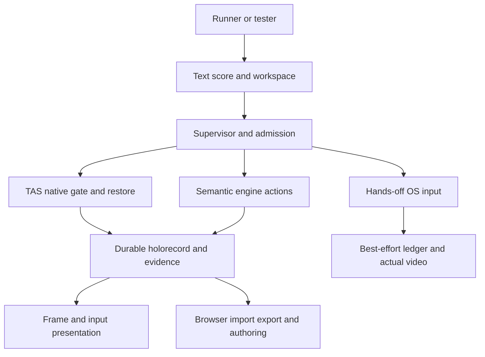
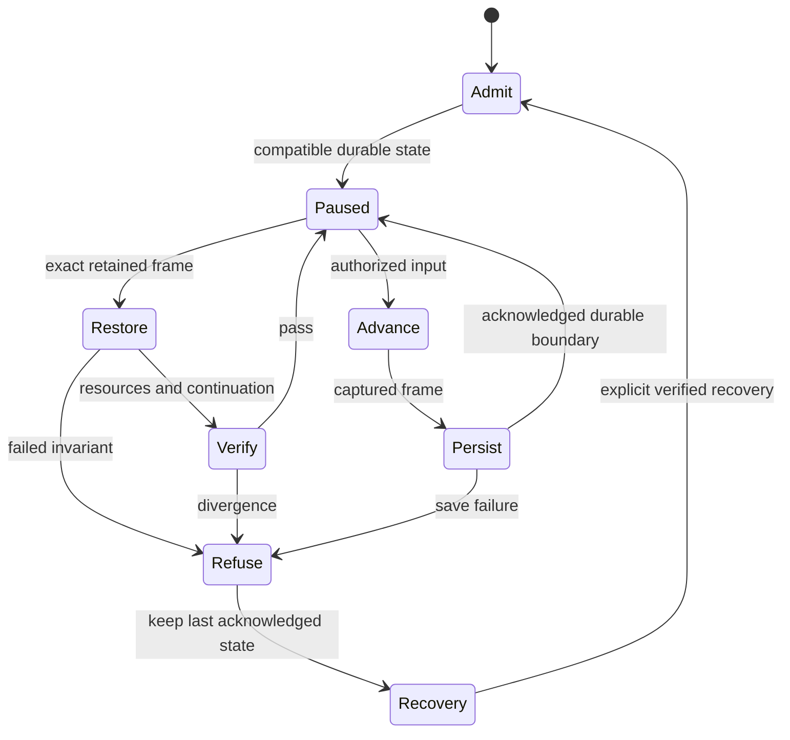
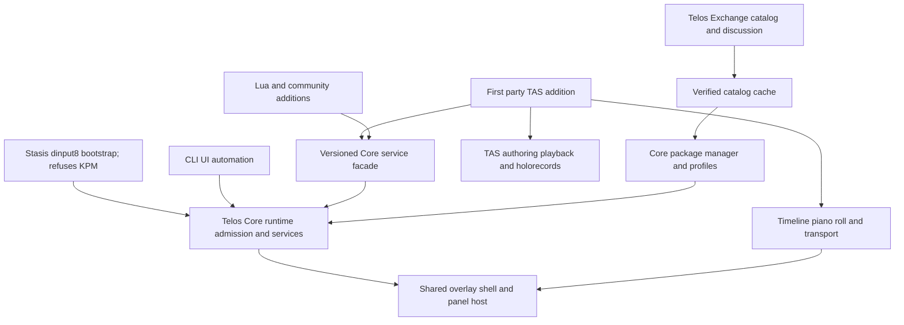

# Stasis complete product - Plan

## Direct user steering and cloud migration receipt (2026-10-14 UTC)

Direct user: "Goal is to put everything on the cloud as soon as possible as fast as possible to resume where we left off as optimally as possible. Do anything required. No more localhost shit lol. Start by using codex cli to spawn a cloud agent and start feeding it"

Direct user: "th3w1zard1 is an old GitHub account. Authenticate using bodencrouch. Kotor.js also is irrelevant? Give me a device code and the website I can put it in and then capture the auth details."

Disposition: cloud migration and correct-account authentication are active requirements. Future execution should move off localhost, preserving the current local guest and data during transition. All P1–P7, native/static bidirectional parity, modular debugger, full-run/Routine, no-tests/no-probes/no-automations/private-assets and accurate acceptance requirements remain in scope. The change of execution location does not itself qualify a runtime or remove gameplay acceptance gates.

Execution evidence, not new requirements: Codex CLI authenticated but cloud exec returned403 GitHub connector disabled/unavailable; old KotOR.js environment is irrelevant and must not be used. GitHub device authorization completed for bodencrouch; gh credential installation exit0 and user API confirmed bodencrouch with ADMIN access to PRIVATE kolto-labs/KPHarness. Source snapshot branch cloud-migration-20261014 pushed with original worktree/index unchanged; latest native authored source snapshot538526f8f8fc06585c4ade77a669c03b0c040b20 includes236 native source/docs files plus earlier dirty KPHarness/BoxedWine patches and full plans. No game assets, recordings, credentials, runtime binaries or live browser memory uploaded. Full data/runtime migration remains incomplete.

Cloud conversation6acefa83-ba90-83e9-af4a-6fc207e8e113 created and fed exact private source branch; current readback contains user prompts only, idle/cwdnull. No actual cloud executor, source checkout, agent output or gameplay progress confirmed. Browser cloud setup is signed out of ChatGPT; user explicitly requested Patchright CLI/default Chromium because in-app session fails. System Chromium launched through Patchright with existing profile; startup observation pending. No cloud acceptance or completed migration claim. Existing local9625a guest not touched; current VM state unverified.

## Continuation receipt — declared section navigation and local startup report export (2026-10-14 UTC)

Previous goal turn answered roadmap, without runtime progress. Re-poll of retainedtab failed and reset CUA; browser selection and later inventory reported unavailable/apps[]/browsers[]. No process/register read or Resume dispatched and no restart/reload/new tab. Last actual paused0renders32/32 remains historical latest observation; current state unverified. Server44787 freshly observed Ssl. Observation failure is not terminal game evidence.

Authorized subagent completed source declared-section/load-span to explicit File bytes preparation. Additive selected-file metadata conveys fileSize, identified header and declared-file-ranges semantics. Navigation uses only file offset/file byte count, rejects zero/NOBITS/out-of-file/unsafe/ambiguous values, prepares at most4096 bytes without a read, and preserves prior byte rows/export. Current static-analysis session/epoch/lease/capability/busy gates apply. Separate explicit capture remains the reader action. No loaded identity/process mapping/execution/platform grant. Helper and design committed895fdcd; coupled backend/debug-ui source backed up and scoped patches retained. Source reviewed, not live adopted/qualified.

Parent startup source now offers Save diagnostic report to recover a local bounded text artifact independently of clipboard. Existing formatter retained with v2 frame-declared session/release identifiers; full URL not exported, declarations not loaded game identity.256KiB cap, dated filename, one-shot URL revocation and download-requested status. No guest read/control request on download. Existing live document not hotpatched or reloaded; normal download acceptance pending. Pre-edit dirty source and isolated patch retained.

Two non-overlapping streams: parent P1/browser evidence collection and authorized modular debugger file navigation. No tests/test probes/syntax checks, automation, SDK rebuild/staging, deployment or private asset publication. Dirty/data preserved. All direct P1–P7/native/static parity/modular debugger/full-run/Routine/platform gates remain incomplete; default53711e and candidate4eff1068 selection unchanged, Workers gate closed.

## Continuation receipt — retained session observed and paused at zero renders (2026-10-14 UTC)

Previous turn completed production monotonic-clock build/stage; current9625a document was not switched. Browser inventory rediscovered only browser2/tab1. Isolated tabs.get succeeded, and parent-only visible DOM read succeeded without expanding guest. Actual existing session says files connected, waiting first game image after66min, unchanged dispatch warning, resumed/running0renders. Older Connecting TAS controls text confirms new shell source not adopted by that document; no hotpatch.

Startup diagnostics opened normally. Runtime observations: presents0, SDL completed proxy calls12, caller256.1ms/callback191.9ms, safe points30/32, Starting0/Running2/KernelWait30/Paused0/Exiting0. Normal Pause key activation accepted, changing pausing31/32 then actual paused32/32 at2026-10-14T02:56:33.630Z, KernelWait31/Paused1/Running0. No renders/input/game image occurred. This is an observed complete published pause boundary in this existing session, not loaded K1 binary identity or gameplay qualification. Session UUID not captured. Handoff mark returned successfully. No Resume/Next render, new guest, reload or runtime selection change.

Visible DOM observations retained in WASM artifacts/retained-9625a-zero-render-pause-20261014.txt and screenshot/tmp/kptas-zero-render-paused-20261014.png. Copy report action displayed Report copied, but clipboard reader returned empty; no full report export claim. Guest displayed-log read, process-refresh action and frame-URL read failed before dispatch or observation timeout. Control REPL reset on last timeout; no terminal-game inference. Latest authoritative state remains paused0renders32/32; later state unverified.

Root P1 live recovery stream made progress through actual paused boundary. All direct P1–P7/native/WASM parity/game-agnostic debugger/full-run/Routine/platform and local acceptance gates remain incomplete. No tests/test probes, automation, build/stage this turn, deployment or private asset publication. Dirty/data preserved. Candidate4eff1068/default53711e unselected and unqualified as previously recorded; Workers gate closed.

## Continuation receipt — WASM monotonic counter and overlay density parity (2026-10-14 UTC)

Previous turn staged recording identity progress. Parent separated browser discovery/reattachment: inventory unavailable; app navigation request remained pending and its waiter terminated, no confirmed navigation, tab binding, new tab, reload or guest restart. User1000 bus socket/broker and user-manager processes exist; bounded service-property read returned no properties. Private socket listening backlog11 is an observation, not failure cause. Existingserver44787 observed Ssl. No desktop/service restart or process kill; current VM remains unverified.

Source comparison found native shim clock.c's frozen/restored virtual per-tick time distinct from WASM parking. BoxedWine Emscripten's default Platform micro counter used gettimeofday wall time; the disabled old branch also had wrong milliseconds-to-microseconds multiplier. Parent changed only Emscripten counter to emscripten_get_now*1000 with startup subtraction. Local SDK4.0.14 pthread source provides performance.timeOrigin+performance.now basis shared across workers. Wall time and non-Emscripten branch unchanged. This is elapsed host performance time, not simulation ticks, pause exclusion, native virtual-clock parity or deterministic replay; it does not establish a cause for renderer/input/control issues. Dirty pre-edit source and isolated patch retained; GL4ES vendor untouched. Source4f380c8c32a6ae307c0dd15f4e6f82d6aa1818aecbacfeb67bffca46bc33af7a.

Production multiThreadedJit rebuild SDK4.0.14/WEBGL_COUNTERS1 completed exit0 after observed compiler/optimizer activity. Built WASMdad1f1cd5fe580bf7090e3a9b4ce41bf12e502f18e403a920b08082088fe586c. Production stage --reuse-staged-root exit0 produced4eff1068467a752c75fa2cfa2c016da493fe2c8ef9c67091562afda0da999360, including prior recording change. Actual runtime-local remains53711e9012340fc0b67300f2fa5fc61b12b48184c33e06535ecd8f3ad61f5afe qualifiedfalse. Retained9625a tab not switched/reloaded; new candidate unaccepted. No installation assets copied/uploaded.

Authorized parity subagent implemented explicit Editor/Timeline/Position-only density in static TAS presentation and shared-profile v4 transfer to native existing set_density. v1–v3 imports preserved. Disabled/unloaded TAS retains intention without activation. Active imports use editor owner; rollback attempts density/layout/storage restoration and reports incomplete failure. HUD represents score position, not guest frames. Source-only/unqualified cross-host/focus/persistence behavior. Safe intended-path commit0c51a37 retained; coupled editor/dock/native work backed up and scoped patches retained, no wholesale commit.

Two non-overlapping streams: parent P1 clock/browser/production build and explicitly authorized native/static overlay parity. All direct P1–P7/full-run/Routine/native/platform/modular debugger gates remain incomplete. No tests/test probes/syntax checks, automation, deployment or private asset publication. Dirty/data preserved; Workers gate closed.

## Continuation receipt — recording directory identity and staged candidate (2026-10-14 UTC)

Previous turn made source parity/lifecycle progress. P1 browser recovery reviewed actual app startup: normal workspace auto-launches configured KOTOR; real saved-recordings view mounts inspection without game.open. Attempt to open that existing product view separately returned browser unavailable. No new tab or guest created, original tab not changed. Existing server44787 observed Ssl. Browser/VM state remains unverified, not terminal from timeout.

P4 source now binds new writer receipts to their created directory via recording=request.name. Existing data is not rewritten. Library stable finalized receipt reads reject a declared mismatching directory, and parent finalized-file receiver independently checks it. Legacy receipts without the field remain readable with an explicit missing-directory-declaration label. Complete/bytes/chunks/end-time and stable-byte gates retained. Directory declaration is not cryptographic content identity, continuous full run, playback, audio, frame alignment, rewind or replay qualification. Exact source backups retained. Writer/library/parent SHA256abd625123c5beda4dbb7941acf9ddf309120ed1cd588707082bbcd0c5c5e0e31/c2d787509a74eb4db2bb67e28c3e7a420956b07f13dfb61f1804154b9c2e020f/69850da30ef35887024b69f85dacd8be62d8e1958a9a543218e2400a9469dd27.

Production staging --reuse-staged-root exit0 produced689ae468549bfb8d5d0ddd3942c3e86f5cc5986209589be2340de482ec379a2a from existing built WASM/root; no SDK rebuild or installation asset copy/upload. Actual runtime-local descriptor remains53711e9012340fc0b67300f2fa5fc61b12b48184c33e06535ecd8f3ad61f5afe qualifiedfalse. Retainedtab9625a not reloaded/switched; new source/candidate not live accepted. Parent P1/browser and P4 recording-source streams advanced safely. All direct P1–P7, parity/modular debugger/full-run/Routine/native/platform gates remain incomplete. Dirty/data preserved. No tests/test probes/syntax checks, automation, deployment or private asset publication. Workers gate closed.

## Continuation receipt — native lane patterns and connection attempt ownership (2026-10-14 UTC)

Previous turn made source readiness progress. Explicitly authorized parity subagent now migrated supported native key/button Hold and Autofire authoring into static piano-roll context actions. Period/phase are score ticks with held floor(period/2) and released remainder, phase relative to first included editable tick after boot-row clipping. Existing prepareScoreNavigation/rollEdit/editTicks/setKey/history retain ownership, repeat-unroll admission, sync restrictions and unrelated lane/mouse/metadata. TAS lifecycle, branch, score and model are rechecked after dialogs; stale repeat continuation throws before commit. New helper and parity documentation committed4139c69. Coupled editor dirty work retained separately; exact baseline backup and scoped artifact static-tas-autofire-20261014.patch distinguish new edits from prior changes. Source-only, not live adopted or guest replay/clock/rewind qualification. Other native lanes and complete parity remain open.

Parent source inspection corrected reconnect pending ownership: folder selection may supersede a local connection without leaving its pending indicator stuck. Separate attempt generation clears only the completing attempt's own indicator; restore-generation guard still prevents obsolete launch/error/fallback changes. Selected files/new attempt are preserved. Backup retained; coupled original-game source uncommitted. No tests/test probes/syntax checks.

Supported browser troubleshooting guidance read. Inventory still contained only retainedtab1/9625a. Same-tab binding/handoff followed by dialog observation timed out/reset; no dialog/VM state returned and no tab/reload/restart. Host reading31GiB total RAM/19GiB available,55GiB swap/43GiB free, does not establish resource exhaustion or a control failure cause. Home4.7GiB/SSD9.8GiB available; native reserve gates unmet. No cleanup/process kill. Parent P1 lifecycle/browser and one authorized parity subagent are two non-overlapping streams. All direct P1–P7/full run/Routine/native/WASM/platform/modular debugger gates remain incomplete. No automation/runtime rebuild/staging/deployment/private asset publication. Default unchanged, Workers gate closed.

## Continuation receipt — independent core input/execution readiness (2026-10-14 UTC)

Previous turn changed core-owned status source. Existing validated input and VM-control handshake paths now refresh core status independently: input pending execution, execution pending input, both connected, or execution unavailable as actually reported. No extra request, timeout guess or new capability. This prevents an admitted execution connection remaining generically connecting solely because input is not yet admitted. Full gameplay/graphics/audio/simulation/replay qualification remains open. Source-only, not adopted by the retained document. Backup original-game-before-core-readiness-20261014.js retained; coupled dirty work preserved.

Server process44787 observed Ssl and original loopback listeners47655/47656 present. Service-manager property read ended Transport endpoint is not connected; no manager health or terminal game inference. Browser inventory rediscovered only existingtab1/9625a. Bound handle/handoff preceded actual error-log read timeout/reset; no logs received/current VM state established. No new tab/reload/server or guest restart. P1/source lifecycle stream made progress; all direct P1–P7/native/static/modular debugger/full-run/Routine/platform and local acceptance gates remain incomplete. No tests/test probes/syntax checks, automation, rebuild/staging, deployment or private asset publication. Workers gate closed.

## Continuation receipt — core-owned game connection status (2026-10-14 UTC)

Previous direct naming correction made source progress. Further source inspection found the connection status still inside the optional telos.tas wrapper. OriginalGame now owns an independent coreConnectionStatus in the main game controls, outside both optional Debug and TAS presentation wrappers. It reports no-session readiness, connection pending, validated input handshake, bridge error and runtime stop independently of extension visibility. Success says Game input connected to Telos Core, not full debugger/VM/replay acceptance. TAS panel retains score-specific waiting/boundary details. This is source implementation of the direct core/optional-extension distinction, not full package decoupling or arbitrary-game support. Pre-edit source retained, coupled dirty work preserved.

Current browser discovery returned apps[]/browsers[]; no reload/new tab/runtime restart or live adoption claimed. Parent stream advanced core/game ownership source. All P1–P7, native/WASM parity, game-agnostic debugger, full run/Routine and live acceptance gates remain incomplete. No tests/test probes/syntax checks, automation, build/staging, deployment or private asset publication. Default unchanged; Workers gate closed.

## Continuation receipt — direct core connection naming correction (2026-10-14 UTC)

Direct user directive: “site still says 'connecting TAS controls' but that text is incorrect for what is supposed to be happening since TAS is some unrelated extension that should be installed into the core stuff so it sould be talking about how the core is being loaded or whatever. Can't remember if we're calling it statis or telos core anymore. Figure out what sounds better and use that lol.” Chosen Telos Core for the existing package/session host, Stasis for the workspace; TAS remains optional extension. Existing Extensions text and core API support this naming. Startup bridge status now says Connecting the game to Telos Core… because the host is already running, with related connection errors updated. Score-specific operation details unchanged. This copy change does not establish full package/core decoupling or parity acceptance.

Existing localhost source updated; pre-edit backup retained. Current same-tab attachment observation timed out, so live adoption is unconfirmed. No tab creation/reload, runtime mutation, tests/test probes, build/staging, automation, deployment or private asset publication. Dirty sources preserved; all existing requirements/milestones and Workers local acceptance gate remain open as previously dispositioned.

## Continuation receipt — native captured-scan inspection and localhost reconnect (2026-10-14 UTC)

Previous turn made authoritative source progress; full objective remains active. Explicitly authorized parity subagent implemented actual native DebuggerDialog import for telos.memory-scan-capture/v1: bounded local parsing, provenance, current/previous typed values/raw bytes and 200-row pagination across all retained matches. Invalid imports retain prior evidence. No native memory read, watch creation, command or restore occurs. Imported source/target/comparison/matches remain exporter declarations, not qualified runtime facts. Native memory_scan_capture.py and debugger_widget.py are source-only/unqualified. Native tree is not Git; pre-edit widget, scoped patch and new module copy retained on SSD. Documentation commit61b74f8 retained. Entire bidirectional parity remains incomplete.

Parent implemented loopback-only Retry local installation through existing bounded manifest validation and launch owner. No attached session/accepted local manifest, connection busy and launch busy gates apply. Current restore generation owns pending/error state. Failed explicit retries retain connected files and remembered permissions without fallback staging. Source-only; retained browser has not adopted or exercised it. Original-game pre-edit backup retained and coupled dirty source uncommitted. Source review performed, no tests/test probes/syntax checks.

Current browser discovery returned unavailable. App reattachment call remained pending until its waiting script was terminated; no confirmed navigation/session result inferred, no new tab, reload or guest restart. Service active PID44787 and real prior root/download journal retained. Observation failure is not game termination. Parent browser/P1 and subagent native parity are the two non-overlapping streams. All P1–P7/native/full run/Routine/platform/modular debugger gates remain incomplete; default unchanged, Workers gate closed. No automation/build/staging/deployment/private asset publication or data deletion.

## Continuation receipt — direct bidirectional injection and overlay parity directive (2026-10-14 UTC)

Direct user directive retained verbatim: “subagent to make sure the native code injection stuff and the overlays in the native game is available in their entirety within the wasm and website stuff. And vice versa.” This extends the existing native/static parity scope to complete coverage in both directions; it is not satisfied by matching UI labels, report vocabulary or presentation imports. User explicitly authorized this subagent. The ongoing tab-reuse/resource preference remains active.

One bounded subagent owned only KPTASInterface/kptas/core/debugger_core.py and docs/design/bidirectional-native-web-parity.md. Local commit4204007 records a 27-feature-family matrix with source owners and separate injection/runtime, overlay/presentation, debugger, interchange and recording boundaries. Python reporting now enumerates the browser canonical operation IDs while retaining four legacy IDs separately, without alias promotion, handlers or capability grants. Source reviewed; no tests/test probes/syntax checks. External native application has not adopted this module. Complete native-to-WASM and WASM-to-native parity remains open, including injection/clock equivalence, coherent CPU/GPU/handle/audio restore and rewind/replay, native panes/readers/static-file handling and live bidirectional acceptance. These are observed implementation gaps, not new assistant-authored user requirements. Existing direct requirements and milestones remain intact.

Parent retained browser/session, original-game/bridge and plan ownership. Browser initially unavailable; app navigation returned navigatedtrue and authoritative inventory rediscovered only existinglocalhosttab1 at9625a. Rebound and marked handoff without opening, closing or reloading a game instance. DOM observation timed out/reset control; current guest state remains unverified. Server remains active PID44787. Source boxedwine-shell.js fetchServerJitCache explicitly continues startup on non-OK response or fetch rejection; the prior jit-modules.zip404 alone is not a startup fault. No cache substitution or asset publication.

Two non-overlapping streams: parent P1/browser continuation and the explicitly requested bidirectional parity subagent. Full P1–P7, native TAS, modular uploaded-game debugger, full run/Routine and release milestones remain incomplete. Dirty work and data preserved. No automation, runtime rebuild/staging, deployment or private game asset publication. Workers gate closed.

## Continuation receipt — storage/service recovery, scanner export and tab reuse (2026-10-14 UTC)

The interrupted export edit was found persisted after source storage recovery. WorkspaceSSD path was initially missing. Read-only UDisks metadata identified existing ext4 volume labelWorkspaceSSD/UUID42571227-17e1-4ae4-be8a-b668cc1cdd4f on sdd2, unmounted. Noninteractive UDisks mount required authorization; sudo -n mount --mkdir of that exact UUID succeeded. findmnt confirmed the original WorkspaceSSD path mounted ext4 rw. No format, cleanup, move or data deletion. Existing dirty sources and the pre-export backup remain present. Home/SSD available4.4/9.8GiB; native reserve gates remain unmet.

Old PID2817322 was absent and old transient service LoadState not-found, with neither47655 nor47656 listening. Recreated the same finite localhost runtime service/configuration using named SSD core and startup overlay, not a recurring automation. Service active/running PID44787; ss confirmed127.0.0.1:47655/47656 and::1:47655 only. Default runtime unchanged. App browser open was queued; bringing this chat into view returned navigatedtrue and browser access returned. Existing currenttab1 adopted9625a workspace URL, initially no KOTOR session/score0 and local-install connection timeout. Reused that same tab with one normal reload; later observations timed out. Actual server journal recorded the browser's private/install.json200 and optional jit-modules.zip404; no cache/renderer cause or successful new game launch inferred. No second reload/restart based on timeout. Old established guest state remains unverified; no VM restoration claim.

New direct user instruction: “please ensure you're closing old browser tabs and/or reusing them when possible rather than spawning them anew as it eventually clogs the ram available and wastes resources.” Resource preference retained as ongoing execution guidance, not a new milestone or fixed numerical tab cap. Authoritative inventory contained only currenttab1; no obsolete accessible tabs to close. That tab was reused and marked for continuation. No new tab created during this turn. Supported Browser.tabs.get avoids an automatic full accessibility capture while rebinding; inventory and handoff succeeded. Screenshot request later timed out/reset the control REPL; no screenshot success or current game-state claim. Future temporary guests should be finalized/profile-saved when needed and their tabs reused/closed, while preserving the established live session wherever accessible and all retained data.

Shared scanner export now uses telos.memory-scan-capture/v1. It serializes current/previous captured raw bytes, their separate session/PID/workspace epoch/ISO time/range/type/model/source/normalized target declarations, latest comparison rule/value/stride/considered offsets and all retained matching offsets. Display limit200 does not truncate matches in the local export. It makes no backend request; payload bounded2MiB, current-context/no-in-flight-capture gating and prepared-URL cleanup retained. UI says download requested, not completed. Failed reads/exports retain captured results. This is a latest-comparison explicit-range capture, not whole runtime state, full scan history, loaded-binary identity or replay/platform qualification. Source-only; no live scan/export download qualified. index SHA256e5c0563f0844da64e14cf982ca08a6c03757722e2c80c3c2051e00c2474861fa; memory-tools SHA2562b82f8139c1e37c5a2ecd7af6accab8ec20a566b4bf17c4f1aa1f281ad6d3999. Design memory-scan-capture-export.md retained; coupled existing dirty/index/data preserved.

Three root-owned streams: storage/localhost recovery, current-tab P1 continuation, and shared debugger capture durability. Full direct P1–P7/native-static parity/modular uploaded-game debugger/full run/Routine requirements and milestones remain in scope/incomplete. Implementation receipts are not user directives. No tests/test probes, recurring automation, delegation, deployment or private game asset publication. Workers gate closed.

## Continuation receipt — saved register to explicit scanner preparation (2026-10-14 UTC)

Previous turn made source progress in correlated release replies and bounded debugger release activity. Browser inventory still returns apps[]/browsers[]; previously queued app-panel open is not confirmation of an opened browser. No new guest launch, reload, restart or recovery claimed. Last actual Escape/neutral boundary remains unresolved; current VM/recording preservation cannot be inferred from unavailable browser control.

Shared debug-ui now offers Prepare scan for nonzero exact32-bit saved register values. Action uses the same current session/PID/epoch, declared pointer width/byte order, supported memory reader, resolved memory.read availability and capture boundary gates. It prepares the existing scanner address/count and reveals that panel; it performs no memory read, write, step or resume. Count remains within1–65536 and is clamped to the address-space end with room for the selected value type. Register values are not verified pointers. Existing active or captured scans prevent preparation; results are retained rather than reset. First scan remains the explicit backend action, and the existing scan/string/watch flow is reused. No extra game-specific adapter or platform support grant.

Original shared index/memory-tools source backups retained as debug-ui-index-before-register-scan-20261014.js and debug-ui-memory-tools-before-register-scan-20261014.js in WASM artifacts. Current index SHA256c7fa043c419289b7bad092e581b8241a5fc9872656a538e91eb4a72d585ddd7d; memory-tools SHA2565cf62893524cec4219548326a39da6e42f734f915fb70d26600b515b116e83c5. Source inspection only, not live-adopted/qualified. Coupled existing dirty/index/data preserved; no runtime build needed for this UI change. Native-to-static parity and modular debugger remain partial. Source choices are implementation evidence, not user directives.

Two root-owned streams: browser/session recovery and portable debugger source. Full direct P1–P7/native-static parity/modular uploaded-game debugger/full run/Routine scope and milestones remain incomplete. No tests/test probes/automations/delegation/deployment/private asset publication/data deletion. Default unchanged; Workers gate closed.

## Continuation receipt — correlated release replies and debugger activity (2026-10-14 UTC)

Previous turn made progress through actual first-area rendering and staged release-admission correction. Current browser inventories repeatedly return apps[]/browsers[]; createBrowserTab(iab, existing localhost candidate9625a) returned browser unavailable. No new browser/game launch confirmed and no old guest restarted. App open_in_codex request for the same localhost candidate returned status queued for this thread; do not infer opened panel or launch. Current prior paused229/full49 queued-event/neutral-release boundary remains unresolved. Known localhost server PID2817322 directly observed alive/Ssl/11:26:03elapsed. User-service property call failed “Transport endpoint is not connected”; no current service-manager health claim. Capacity observed4.5GiBhome/9.8GiBSSD; native reserve gates remain unmet.

Source review tightened parent TAS replies: release success must match an outstanding session release sequence; input errors must match pending score sequence and tick. Unknown tick0 replies ignored. Failed postMessage removes tracked release sequence. Accepted release replies publish schema telos.input-release-observation/v1 to existing bounded debugger session activity/export. Current-session, safe-positive-sequence and fixed-boundary admission retained. Labels distinguish dispatched, queued-consumption-pending, consumed-without-qualified-following-presentation, no-held-events and older-runtime-unreported boundary. This does not update score tick/input metrics or grant any runtime/game/platform operation. Existing40-observation history retention/export reused. No new runtime query or debugger command.

Parent SHA25648924c200156945b1d14119665190ece1ad1e1b109fa42d04656bf932634ae76; workbench SHA25616d10205720e89467479b49a8843b7b0c0baedb6e9cb3281edcdbf1156078ff5. Shell source is separate from staged guest9625a identity; source changes are unadopted/unqualified live. Design receipt release-input-admission.md extended. All coupled dirty/index/data retained. No runtime build required for these shell changes, no deployment/default switch/private asset upload.

Two root-owned streams: browser/session recovery and TAS/debugger source parity. All direct P1–P7/native-static parity/modular uploaded-game debugger/full run/Routine requirements and milestones remain in scope/incomplete. Receipt choices are not user requirements. No tests/test probes/automations/delegation/process kill/data deletion. Workers gate closed.

## Continuation receipt — recorded first-area rendering and release admission correction (2026-10-14 UTC)

Same6e873/tab8/sessiond9403c82/capture23b8538c continued from147 through observed149/154/155/156/161/163/167/175/180. Loading bar advanced;187black transition,193opening bunk/room,204HUD,216room/camera obstruction. This is actual first-area rendering in the recorded session, not playable-area/full-run/audio/replay acceptance. Missing readable opening dialogue and camera obstruction remain unresolved. Existing log showed continuing texture uploads through1985; this does not prove pixel correctness or cause. Source inspection retained owner/context lifetime guards and bounded asset-range cache; no speculative optimization/vendor edit.

Keyboard activation of parent Game overlay and guest Diagnostics disclosures worked around overlapping panels. Normal Pause completed228/full49 after one dispatch timeout. Authored Escape29 and neutral30 through existing score transport. At score30, runtime refused new input: previous batch queued, sequence46/generated1/consumed0/open0/last started46/last completed45/completed events1/completed present228/tracked queued1. Last authoritative state paused229/full49. Tick30 release was not dispatched; no all-keys-released or successful Escape/menu result claim. Score through28 remains normally exported in example (55).score; appended29–30 are authored but not normally exported/qualified. Resume recovery command hit a browser dispatch timeout. No successful resume recovery is claimed.

Control REPL timed out and reset. Inventory first still contained4–8; same-tab binding then timed out. Later browser binding reported unavailable and repeated inventories returned apps[]/browsers[]. No guest closed/reloaded/restarted by this agent. Latest live session/recording state and turn-scoped tab marks cannot be reverified; preservation is unresolved, not silently assumed. Existing disk evidence/data/dirty work retained. Next live action is rediscover existing browser/session and drain the pending event before any neutral scored input; do not infer terminal game failure solely from control timeouts.

Source corrected release handler's ignored native begin/end results. Existing release function now reports native target failure and legacy dispatch failure; successful ack includes dispatch/queued/consumed/no-held-event boundary. Queued is not neutral gameplay evidence. Parent tracks bounded32 session release sequences and stops matched release-error playback without recursive release traffic; unmatched tick0 replies ignored. Backups retained. Production --reuse-staged-root stage exit0 produced9625a021123e7c740cad707ede747e9b09ffef9d3e7fbfa88eafe3148b5b342e; default unchanged/no SDK rebuild or asset copy/upload. Bridge SHA2560baca81d062b126a5dbe1fac5cda7d65f193c2d4c62aecf4bfeb7674ac192546; parent SHA2562f7c49e3da487a0e2ae0a8f08f3ced711b25f7cf72ad286fd2d16c8d81160fe7. Parent shell source is separate from guest release identity. New guards are source/stage-only, not live-qualified. Design receipt release-input-admission.md retained; coupled dirty source preserved.

Two root-owned streams: recorded P1 runtime/recovery and source release admission. All direct P1–P7/native-static parity/modular uploaded-game debugger/full run/Routine requirements and milestones remain in scope/incomplete; receipts are not user directives. No tests/test probes/automations/delegation/deployment/private asset publication/data deletion. Workers gate closed.

## Continuation receipt — recorded character creation and first-area loading (2026-10-14 UTC)

Previous turn made progress through recorded New Game selection and a source-only debugger navigation fix. Same6e873/tab8/sessiond9403c82/recording23b8538c resumed from113, advancing visible loading bar through117 and reaching readable character-class screen at126. Normal Pause completed128/full49. Selected Male Scoundrel confirmed through Enter/release17–18; pause130/full49, release7811.6ms/1change/1after-consumptionGLpresent. Quick Character pair19–20 completed132/full49, release729.5ms. Portrait and confirmation pairs21–24 completed136/full49, release2544.9ms. Readable class descriptions, Quick Character and summary labels observed; portrait top strip remains visually noisy. This narrows the missing-text issue to particular screens/controls rather than proving general text failure or a cause.

Name pair25–26 accepted generated name Tale Star and moved selection to Play. Pair27–28 activated Play and reached first-area loading. Normal parent DOM status confirmed paused140/full49, tick28release37129.5ms/1change/1after-consumptionGLpresent. All28authored held keys released. Final mark name_confirm describes authoring intent; observed27action was Play. No renamed score meaning or character-name acceptance inferred for27. Normal Export score saved /home/brunner56/example (55).score SHA2568987731e31fcffbfebba4d543dce562b1f3175349f5ef85201328fa1ab11e064. Recording remains retained; completed full run/replay/rewind/audio acceptance is not claimed.

Browser workspace click timed out, then native accessibility reported a previous-page capture even after same-tab reattachment. Inventory still contained4–8; same-tab screenshot and parent DOM controls responded. Normal parent Export score succeeded and Game overlay/Resume game continued the same first-area load. No restart/reload/hotpatch. Subsequent parent DOM observed resumed147 with47/49workers and Recording game. Screenshot /tmp/kptas-recorded-first-area-loading-20261014.png retained; later progress requires observation. Guest iframe attachment and native accessibility remain limited; parent controls provide the continuation path.

Read-only source TLK entry inspection found language0 and flags0x7 for all five menu labels in both connected core and overlay. TEXT_PRESENT is set; no missing-source flag explanation established. Loaded-byte identity and rendering cause remain unverified. Design evidence committed4affc17; dirty debugger navigation fix and all other work retained. Two root-owned streams: recorded P1 gameplay and source/evidence investigation. All direct P1–P7/native-static parity/modular debugger/full run/Routine requirements and milestones remain in scope/incomplete. Receipts are not user directives. No tests, test probes, automations, delegation, deployment or private asset publication. Workers gate closed.

## Continuation receipt — recorded New Game selection and debugger navigation (2026-10-14 UTC)

Previous turn made progress by retaining raster evidence and restoring visible browser access. Current same6e873/tab8/sessiond9403c82 recording23b8538c continues. Before authoring, normal Export score saved /home/brunner56/example (53).score SHA25605f9550b75b8e7ec6adbbe511d9ddb664252e8bcd7d4c6e38b58664a98062d72. Scored four Up/release pairs followed by Enter/release completed10ticks atpresent100/full49pause, opening readable “You have no saved games” dialog. This is actual menu input, not a fixture/probe; earlier title labels remain missing.

Appended Enter/release to dismiss, Up/release then Enter/release to choose New Game. All16authored ticks completed atpresent106/full49pause; final release1538.8ms for tick10 and4794.0ms for tick16, each1nativechange/1after-consumptionGLpresentation. These are individual observed transport timings, not game ticks or throughput acceptance. Actual New Game loading screen observed. Normal Export score saved /home/brunner56/example (54).score SHA256ec6f5d8e42ec28c9abe566fc9cda11cd98a56c21f8f46af58245c98ea9042b0f. All held score keys released. Normal Resume continued same load to observedpresent109; subsequent normal Pause completed atpresent113/full49. No fresh VM/reload/hotpatch. Character creation/playable-area/renderer/audio/replay/full-run acceptance remain incomplete.

Parallel source inspection found capability-directory links used Dock.show, which does not expand a collapsed panel. Updated existing debugger-workbench navigation for Threads/Registers/Address backing file to use existing Dock.reveal with show fallback for older docks. Existing capability admission is unchanged; navigation sends no debugger command. Source-only, not adopted or live-qualified in retained guests. Coupled debugger source is dirty and preserved; no wholesale commit of pre-existing work. No arbitrary-game execution or new backend/platform support claimed.

Two root-owned streams: recorded P1 gameplay and browser debugger parity source. All direct P1–P7, native/static parity, modular uploaded-game debugger, full run, Routine clip and milestones remain in scope and incomplete; receipts/implementation choices are not new user requirements. No tests/test probes/automations/delegation/deployment/private asset publication/data deletion. Established sessions retained. Workers gate closed.

## Continuation receipt — browser recovery and recorded raster arguments (2026-10-14 UTC)

Previous browser turn made progress: retained localhost candidate is visible and its iframe controls are accessible. Browser inventory contains tabs4–8; established tab4 and recorded tab5 were not reloaded or closed. Tab7 guest attachment remains limited, while its normal parent Save browser profile acknowledged success; it was not finalized or closed. A fresh tab8 adopted release6e873aa96a4e4ca288fb867040e9c3ef75898c44d6cb046b477677892e66c188/sessiond9403c82-e573-44b7-aa9b-63e8dd67bc70. Recording23b8538c-09b7-4575-960a-5d024a55a65c acknowledged active before the first presentation. Actual full49-worker pause observed atpresent80. Default score0/1165 retained; no authored gameplay input. Browser screenshot /tmp/kptas-browser-working-20261014.png retained.

Displayed log captured in bounded DOM chunks,426956characters,1024requested-raster records (cap reached): /home/brunner56/kptas-browser-game-wasm/artifacts/d9403c82-displayed-requested-raster-title-20261014.txt SHA256f5245e69ca32c8e250350083f4d7b41c0532b952e70dce6349047a421e33eb6b. AlphaFunc requests:131 GL_GREATER/ref0 and5 GL_GREATER/ref0.4. DepthFunc:5 GL_LEQUAL. DepthMask:119true/37false. StencilFunc:5 GL_ALWAYS/ref127/fullmask and4 GL_ALWAYS/ref1/mask255. No Scissor call appears within this bounded capture. Source-alpha/one-minus-source-alpha blend requests appear. These are requested arguments, not backend state, driver acceptance or attribution to a particular label. Initialization and title drawing are mixed; later calls are outside the cap. Missing title labels persist. No rendering cause or fix established.

Normal Resume succeeded in the same tab8; present85 observed. Attempted New Game click was rejected by the browser's fractional-iframe coordinate safety check; no successful menu action or authored input claimed. Normal Pause completed afterward atpresent89 with49/49workers at a safe point. No runtime restart/hotpatch or speculative renderer change. Recording remains retained; full-run and audio acceptance are incomplete.

Two root-owned streams: recorded P1 runtime investigation and source/evidence disposition. All direct P1–P7, native/static parity, modular uploaded-game debugger, full run, Routine clip and milestone requirements remain in scope and incomplete. Implementation choices and receipts are not user requirements. No tests, test probes, automations, delegation, deployment, private asset publication or dirty-work deletion. Workers gate remains closed.

## Continuation receipt — menu source assets and requested raster-state trace (2026-10-14 UTC)

Previous turn made progress through successful workspace audio export and retained backend texture observations. Read-only inspection followed primary PyKotor GFF/TLK reader layouts. Connected source mainmenu8x6 is GUI V3.2 in data/gui.bif, BIF index1/resource28/11354bytes. All five buttons use dialogfont16x16/alignment18 and similar cyan text colors. STRREF1583/1584/1585/1586/42172 resolve to Movies/Options/Load Game/New Game/Quit in BOTH core and startup-overlay TLKs. This rules out missing strings in those source assets; it does not establish which resource bytes the live process loaded or a rendering cause. No game asset copied or changed.

Core TLK49389entries/5425667bytes/SHA256b95c40c863a09ae77f37ec32c9b9ad6643f4ca4f54ee8a79bea923676d2a188b; overlay49265entries/5390721bytes/SHA2561ad520bd736491f5a387590089fc0c91c11ab8cd16cc49828d34dd2aa2bbbf78; gui.bif SHA2560e66237816ede106f15c13df5baa0abafc104af3f66aaf4512dc59e73ef54f4a. Overlay has executable/Bink/INI/TLK/receipt, no GUI replacement. Source inspection found no obvious scalar/color forwarding error. Existing vendor scissor code flushes pending begin/end drawing on changed rectangles; default small-draw batching disabled. Vendor unchanged; no behavior fix inferred.

Downstream dispatcher now optionally logs requested AlphaFunc/Scissor/BlendFunc/DepthMask/DepthFunc/StencilFunc and relevant Enable/Disable calls under exact LIBGL_KPTAS_TEXTRACE1 in the known GL4ES/WebGL-counter configuration. Max1024records, known guest context/operation/raw stack argument bits, backend_state unqueried. No new rendering call, GL query, pixel read or vendor edit. Original callback still forwards once under existing ownership/context/procedure guards. Records are requested arguments, not accepted driver state or rendering cause; library initialization may appear. Backup glcommon-before-raster-state-trace-20261014.cpp retained.

Production kptas-wasm-build-raster-state-20261014 completed inactive/dead/MainPID0/Resultsuccess/ExecMainStatus0 with established multiThreadedJit flags/one job. WASM999d04ad68ea5f02697ee4285800e16db949230ac5063c103164d46d6c46aea6; glcommon.cpp f321f4bf2454f8b4097326acea1d26880142e9701cffe7b30be87833855b7c1d. Production stage --reuse-staged-root exit0 produced6e873aa96a4e4ca288fb867040e9c3ef75898c44d6cb046b477677892e66c188, retaining prior download correction. Default unchanged/no installation assets copied or uploaded. Candidate unlaunched and new trace unqualified. Design receipt main-menu-resource-and-raster-state.md retained; coupled dirty/index/data preserved.

Current4d0/session7a07a4e6 re-observed325/full48/paused with Recording game control. All retained guest tabs marked for continuation; established guest intact. Three root-owned streams: asset/runtime investigation, coordinated SDK build/stage, directive/evidence ledger. No delegation/tests/test probes/fixtures/synthetic requests/automations/live reload/hotpatch/native game launch/deployment/private asset publication/reset/deletion. Every direct P1-P7/native-static parity/modular uploaded-game debugger/full run/Routine requirement and milestone remains in scope/incomplete. Source choices/receipts are not user requirements. Missing text/audio/full acceptance remain unresolved; Workers gate closed.

## Continuation receipt — successful workspace audio download and backend argument observations (2026-10-13)

Previous turn made progress through adopted lifecycle/trace display and staged parent download/backend argument source. Existing compat server re-observed active/running PID2817322. Separate candidate565e34 opened in temporary tab7/sessionab943f36-2c0f-411a-8e9e-c9f64ecf7460. Normal Startup diagnostics→Show guest window exposed recorder; recording88192a17-08c3-44b5-b4cf-130c0c06b72c acknowledged active atpresent0. Actual audio Export displayed only child fallback. Parent helper existed but remained hidden; DOM-backed observation found document.referrer empty. Owned iframe's no-referrer policy made sender's referrer requirement reject the normal route. No browser-policy cause was inferred from the earlier download failures.

Source corrected sender to use canonical declared http/https parent origin when referrer is absent; any nonempty referrer must match. Existing receiver frame/source/origin/session checks and bounded File/schema/context admission retained. Privacy policy unchanged. Production stage --reuse-staged-root exit0 produced4d0e3dbedff1e97a871aee180c1068e5f8ce2f252c4b7cd59b4e1de5e2563a38; default unchanged, no installation assets copied/uploaded, no SDK rebuild.

Actual backend texture logger adopted in565e34. NormalPause96/full49. Full displayed log captured in32768-character DOM chunks:248810characters/129host upload records,78RGB/RGB/UNSIGNED_BYTE and51RGBA/RGBA/UNSIGNED_BYTE. Artifactab943f36-displayed-backend-texture-trace-full-20261013.txt SHA256c524826ff796d5b04f93f8890c91b57a7e144b866ca389372e9a913f690f3452. Arguments narrow the format question for these samples only; no texture binding, pixel correctness, driver acceptance or rendering cause inferred. Capability initialization may be included.

Capture fidelity correction: one-shot browser string returns truncate at200000characters and append[Truncated]. Earlier200011-character artifacts are partial transport captures, not full textarea values. They remain preserved. Same retained9a5c8/session6dd2a90d log captured in bounded chunks:236919characters/823trace records. Artifact6dd2a90d-displayed-title-renderer-trace-full-20261013.txt SHA256deb54334b6e68fa890ff9f56db2ccc35171d634b78f5c97d406ab519b1681b69. Retention beyond64KiB observed;1MiB boundary/omission behavior and complete runtime history remain unqualified. No new runtime/GPU query.

Temporary565e34 had no authored gameplay inputs. Normal Stop recording finalized88192a17, reporting1212854retained browser bytes. Save browser profile acknowledged; normal Close game then acknowledged profile saved. Its logs/recording/browser data retained. This disposes that temporary live VM; it does not preserve or restore its CPU/GPU state. Established ef8991 and prior recorded guests were not closed/reloaded. Same temporary tab reused for fresh corrected4d0/session7a07a4e6-8d5e-47bb-9225-398b6517bb87, not VM restoration or an in-game save/load qualification.

Recording9d71c744-1512-4da2-9e2c-ed561e1bd0a3 acknowledged active before first presentation. Actual Inspect→Export produced parent prepared-file control and child readiness acknowledgement. Normal parent Download audio observation generated /home/brunner56/recording-9d71c744-1512-4da2-9e2c-ed561e1bd0a3-audio-observation.json SHA2569d6e4da4e695f96f175b9a5bd99537e17c99707a3c4172bbb0c7f06327d59e5a. Dated2026-10-13T23:54:17.260Z, session/recording identity retained. This qualifies this actual snapshot download path only; stale/invalid/replacement/other-backend/platform cases remain source-only. No audible or encoded game audio qualification. Last expanded capture3319175bytes/217chunks active/unfinalized. No authored game inputs; default editor data retained. Current325/full48/paused. One transient browser observation/dispatch timeout was followed by same-handle observation and normal pause, no restart. Screenshot /tmp/kptas-workspace-audio-download-qualified-20261013.png.

All currently retained guest tabs marked: primary4/ef8991 paused375/full50, recorded5/731927 paused253/full49,6/9a5c8 paused415/full49, current7/4d0 paused325/full48. Pending source and dirty/index/data retained. Three root-owned streams: current candidate use, coordinated source/recording integration, directive/evidence ledger; older guests preserved without new execution. No delegation, tests/probes/fixtures/synthetic requests/automations/native game launch/deployment/private asset publication/reset/deletion. Every direct P1-P7 requirement, native/static parity, modular uploaded-game debugger, full run, Routine clip and milestone remains in scope/incomplete. Recorder finalization and metadata download do not complete the requested full run. Source choices/receipts are not user requirements. Missing title labels/audio/gameplay acceptance remain unresolved; Workers gate closed.

## Continuation receipt — recorded movement, adopted lifecycle display and prepared workspace downloads (2026-10-13)

Previous turn made progress through recorded first-area rendering and staged lifecycle metadata. Same candidate731927/sessiond7397922/capturec7f8402b continued to210 with HUD/ship geometry but no readable dialogue. Connected INI declares Subtitles1. Source inspection found existing canvas-target/captured-drag guards excluding recorder/diagnostic controls from guest mouse capture; no mouse-routing fix or cause claim made.

NormalPause240/full49, Escape25/release26 acknowledged242/full49, release3167.0ms/1nativechange/1after-consumptionGLpresent. No menu observed; following image showed the player standing in the room. Authored10w plus release27-37 toward the door; completion253/full49, release4508.6ms/1change/1afterGLpresent. Following character/camera position changed, but opening sequence prevents isolation of free movement. All37authoredheld inputs released. Normal score /home/brunner56/example (52).score SHA256fd22f5fe8a951bebfad692a86ece7b12d268eb3a81b5e814bd276fbbd63d18a4 and paused execution /home/brunner56/debug-execution-2026-10-13T23-13-30-930Z.json SHA25620ae1e8ec8cae2dbf0a76716f231443e3498434f0c9f500afd7c389b4c091927 downloaded. Timing artifact d7397922-actual-input-timing-through37-20261013.json contains41captured messages; rolling/duplicates are not complete history or independent authentication. Screenshot /tmp/kptas-diagnostic-before-door-movement-20261013.png retained. Guest preserved paused253/full49, capture active/unfinalized.

Named SSD installation metadata confirmed streammusic/streamsounds/streamwaves and Miles modules present. No movies directory. Canonical relocation receipt already records excluded movies/large Override/tpc-backup; this is not new loss or a complete-installation claim. Wine root archive metadata contains wineoss.drv.so/wineoss.so and WinMM/DSound libraries. Presence does not prove loaded identity, route use or audible playback; no asset changes made.

Fresh separate candidate9a5c8/tab6/session6dd2a90d-5088-4b2c-a541-40a53b16ae82 opened without replacing either retained guest. Normal Startup diagnostics→Show guest window exposed recorder before first presentation. Recording1d23a5ea-a560-41ed-bb84-e585b2dfb662 acknowledged active while present0. Normal inspection displayed all six lifecycle counters. At visible paused title415/full49, context running/lease owned/backendFailed false, active devices0, six counters0/countsSaturated false, clock924.7573333333333seconds at2026-10-13T23:32:15.829Z. This establishes no observed AudioWorklet open attempt through that observation, not absence of other audio routes or audible/encoded audio. Artifact6dd2a90d-displayed-paused-title-audio-lifecycle-20261013.json SHA2561ccf123d3cd6c656712537ebca12a6f77c45f8884a5920c1e655a56c32595c19. Last expanded capture5275448bytes/303chunks active/unfinalized. No authored game inputs in this candidate; default editor data retained.

Actual displayed trace6dd2a90d-displayed-title-renderer-trace-20261013.txt contains200011characters/671KPTAS_GL records, no omission banner, SHA2568087d0c9397f88a35ca395505e47105067158e388fdd2457310c21aeaa28d4a3. This qualifies retention beyond64KiB for actual startup/title output, not the1MiB edge/omission behavior or complete history. Missing title labels except Quit persist. No shader/texture cause established. Screenshot /tmp/kptas-lifecycle-candidate-paused-title-20261013.png.

New visible Save audio observation link appeared. Automatic export and direct link activation both produced no download event. Source correction reuses the existing parent-owned prepared-file/download-button pattern: child sends dated JSON File only to declared parent matching referrer; receiver uses existing frame/source/origin/session gate and bounded File/schema/name/context/timestamp admission. Explicit workspace click downloads the prepared Blob; no message automatically downloads. Request/session-bound acknowledgement means prepared only. Generation/disposal guards preserve prior dated snapshots and reject stale reads; no runtime query/operation, PCM copy or asset upload. Helper a55e5d21cac284ed67515b85189a621d9cf14b0bde3d31b13b50b992611c4a07. Parent route remains unadopted/unqualified in current guests. Intermediate979011 release retained unlaunched/default unchanged.

Existing vendor trace records upload arguments before later conversion. Downstream observed-procedure resolver now optionally wraps existing backend glTexImage2D under exact LIBGL_KPTAS_TEXTRACE1. Forwards nine arguments exactly once; logs scalars/data-presence after return, no pixel/address read, extra upload/state lookup/query/error drain. First128 and every256th below8192, max159records; sequence saturates. Runtime-wide unattributed metadata includes possible capability initialization; void return does not establish driver acceptance/GPU completion. Existing shader-query ABI/context guards unchanged, vendor untouched. Source backup sdlgl-before-host-texture-arguments-20261013.cpp retained. Production build kptas-wasm-build-host-texture-arguments-20261013 completed inactive/dead/MainPID0/Resultsuccess/ExecMainStatus0 with established flags/one job. WASM SHA2567fa06fe3d18b2c05825de09bfc66ac36223b375c0715a9e2fe55fd355e348f8d; source7069f4bcf8ce5bf6bdea02a2bfabd5a21f41612472ebdd8c4e421aa4ece9b80e. Production stage --reuse-staged-root exit0 produced565e34aa87288dd83d88012059d61d72a9492c6907f8743ce3e4e0f4879f082b, batching parent download source. Candidate unlaunched; new paths unqualified. Default unchanged/no installation assets copied or uploaded. Safe helper/design commits2518f2c/5d50862; coupled dirty source/index/data preserved.

Primary ef8991/session632bc210 re-observed375/full50/paused; diagnostic731927 paused253/full49; current9a5c8 paused415/full49. All three actual tabs marked for continuation. Three root-owned streams: retained recorded diagnostic, separate candidate use, coordinated source/build/ledger; primary preserved without new execution. No delegation, live reload/hotpatch, tests/probes/fixtures/synthetic requests/automations/native game launch/deployment/private asset publication/reset/deletion. Every direct P1-P7 directive, native/static parity, modular uploaded-game debugger, continuous full run, Routine clip and existing milestone remains in scope/incomplete. Source choices/receipts are not additional user requirements. Workers gate remains closed.

## Continuation receipt — recorded first-area rendering and audio lifecycle candidate (2026-10-13)

Previous turn made progress through recorded character setup and staged trace retention. The same candidate 731927 / session d7397922 / recording c7f8402b continued from first-area loading at presentation 141. Normal manual audio inspection at 2026-10-13T23:02:36.385Z showed contextState running, captureLeaseOwned true, backendFailed false, deviceCount 0 and audioContextTimeSeconds 1041.4293333333333. Artifact d7397922-displayed-loading-audio-observation-20261013.json SHA256 0340203e39a3aafffb0d0cba3d9b4d62c917ab7834cdb3f1d59e54e2caa46ffb retained locally. The connected INI declares sound enabled, but loaded identity and audible/encoded game PCM remain unverified.

Read-only source inspection found the existing recorder snapshot lists active AudioWorklet devices only. Zero cannot distinguish never-opened from previously-closed devices; SDL fallback and other routes are outside that snapshot. Downstream audio owner now counts existing open attempts/rejections, map insertion/removal, node-ready and node-failure events. Optional telos.audio-device-lifecycle/v1 metadata is scoped to the runtime document, saturates at Number.MAX_SAFE_INTEGER and exposes saturation. Event totals are not mutually exclusive partitions, current device counts, PCM totals or simulation ticks. The manual inspector normalizes six counters and the flag; missing older-runtime metadata remains null. No device operation, PCM copy, query, new timer or vendor edit was added. This remains BoxedWine metadata, not arbitrary-game audio capability or full debugger parity.

Original audio library retained as artifacts/boxedwine-audio-worklet-before-lifecycle-20261013.js. Production service kptas-wasm-build-audio-lifecycle-20261013 completed inactive/dead, MainPID 0, Result success, ExecMainStatus 0. Established multiThreadedJit configuration retained with one job, PTHREAD_POOL_SIZE 4, WEBGL_COUNTERS, KPTAS_DISPATCH_TRACE and KPTAS_PROXY_CONTEXT_LIFETIME. WASM hash unchanged 62999e8e0c4fe4c3c32033be1fc8d4a941a4540a378dd8e56a4aee1446cf26a4; generated JavaScript SHA256 56ab571c0d97d1b07d65244e309161953945c52da395ce7c4a09dd324de12c3e; audio library SHA256 1740748c308a7cdf98305ce96e4275b8621a5997624d03777c5ff417b14e0593. Production stage --reuse-staged-root exited 0 with release 9a5c8cefc8b566a3e1afc3e6b3d70f7c71db689fdcc48b1d4dea66f540afb226. It batches the pending texture-trace retention and visible audio-save fallback. Default unchanged; no installation assets copied/uploaded. Candidate unlaunched and behavior unqualified. Design receipt committed locally 4dda7b6; coupled dirty source/index preserved. Native reserve gates remain unmet; the small WASM build does not waive them.

Actual loading advanced through 150 and 163, then a black view at 175 while presentations continued. Normal Pause reached 179/full49. Authored Escape23/release24 as game navigation; release acknowledged182/full49 at3713.8ms, one native change and one GL presentation after consumption. All24authored inputs released. Following image rendered a character close-up; temporal association does not establish the black screen's cause or that Escape caused the transition. Normal Resume continued to189/resumed47of49. Following image showed ship interior geometry and HUD/minimap. Movement, interaction, dialogue text, audio, replay, performance and full acceptance remain unqualified.

Normal score export /home/brunner56/example (51).score SHA256 bf4a72c1bc1bb63a9bef6e270199edb9730234686adf1825ac6379da6eacee9c; paused execution /home/brunner56/debug-execution-2026-10-13T23-07-55-036Z.json SHA256 5755dbecdc2ad81816997ae84f65995824381b39b93048aa06cd6f9be2d45dca downloaded successfully. Timing journal artifacts/d7397922-actual-input-timing-through24-20261013.json contains six captured messages, SHA256 d676f5f8c11c84eda0497322f1e766540aaf0720e3c583872ad7ac61586d65d8; rolling/duplicate scope is not complete history or independent authentication. Last expanded capture 2701519bytes/173chunks active/unfinalized. Actual close-up audio observation at 2026-10-13T23:08:43.177Z again showed running context/lease owned/backendFailed false/deviceCount0, clock1408.224seconds. Artifact d7397922-displayed-closeup-audio-observation-20261013.json SHA256 8fa529d55a7b9aaff4e2fd6c4d4bf53b682eca6b3722e5e0c2e40beb3e65b22d. Neither existing guest has the new lifecycle fields. Screenshot /tmp/kptas-diagnostic-recorded-first-area-20261013.png.

Primary ef8991/session632bc210 re-observed paused375/full50. Both actual tabs marked for continuation, no guest reload/hotpatch. Two root-owned workstreams: recorded diagnostic gameplay and inactive candidate source/build; no delegation. Every direct P1-P7 requirement, native/static parity, modular uploaded-game debugger, full run, Routine clip and existing milestone remains in scope and incomplete. Receipts and implementation choices are not additional user directives. Workers gate remains closed. No tests, test probes, fixtures, synthetic requests, automations, native game launch, deployment, private asset publication, reset or deletion.

## Continuation receipt — recorded character setup and passive trace retention (2026-10-13)

Follow-up observed the same diagnostic guest still loading at140/resumed48of49, capture2167075bytes/133chunks at last expanded observation. Primary guest re-observed375/full50/paused. Both tabs marked. Current game view retained at /tmp/kptas-diagnostic-first-area-loading-latest-20261013.png. No additional authored inputs or terminal-state inference.

Previous turn made progress through recorded New Game and staged audio-download recovery. Same candidate731927/sessiond7397922/capturec7f8402b continued. Class screen observed at115; normalPause117/full49. Class11/release12 acknowledged119/full49; QuickCharacter13/release14 acknowledged121/full49. Normal screenshots showed class descriptions and QuickCharacter/Portrait/Name/Play text, while portrait-strip corruption persisted. Missing main-menu labels are not a total text-rendering failure.

At121/full49, actual process capture returned16processes and selected reported presentation owner PID10 wine. Register capture returned81rows/9threads; savedthread11EIP201e3240 prepared through shared mapping UI, focused the address form and made no automatic capture. Explicit Capture then returned /lib/libEGL.so.1/start201e3000/extent1000/fileoffset3240. Actual register export debug-registers-2026-10-13T22-55-24-887Z.json SHA256ca10f1169e86ad867352ec1aa424546626d8cd27c5d44513acd94c7f64a04479; mapping export debug-address-mapping-2026-10-13T22-55-52-663Z.json SHA2565cce1e10bd1e6ca5f1415793234493159c02cafd3615d76a7ab3aa74a91e11e4. Both downloaded normally. Mapping panel was already expanded; collapsed-panel reveal remains unqualified. Saved address metadata does not establish live-byte identity, a wait cause or rendering fault.

Portrait15/release16 acknowledged123/full49; actual portrait dialog showed top/bottom strip corruption. Confirm17/release18 acknowledged125/full49, then visible Name selected. Name19/release20 acknowledged127/full49; following screenshot showed generated SatoSavo and Play selected, no name dialog visible. Continued from actual visible state with Play21/release22, rather than assuming another confirmation was needed. First-area loading observed. Default class/portrait/generated name are execution choices, not user requirements. Tick21/22 acknowledged128/129/full49 at17971.6/6434.6ms,1nativechange/1after-consumptionGLpresent each. All22authoredinputs released. Host presentations/input consumption remain distinct from simulation frames, deterministic replay and acceptance.

Normal exports /home/brunner56/example (50).score SHA25676e5b3f09705744df87e522c2b53f357ea2b1f4cdcd924ecb69544b2f9be2021 and /home/brunner56/debug-execution-2026-10-13T23-00-36-300Z.json SHA25699d7c95ace63a67385080b395edf68a995ee58742155b00ad7bef85e8f3cbfaf retained. Timing journal artifacts/d7397922-actual-input-timing-through22-20261013.json contains24captured messages, SHA2567b7cc134e5d97d458a098651efbc8046df8394b9fa9d33f82ac9ccabcd0533ed; rolling/duplicate scope is not complete history or independent authentication. Screenshot /tmp/kptas-diagnostic-first-area-loading-20261013.png. NormalResume129 continued first-area loading; last expanded capture2019882bytes/127chunks active/unfinalized.

Class and portrait displayed trace snapshots each had65628characters including omission banner. Class snapshot contains235upload/4draw/4texture-sample records, SHA2566588c6f8d88964ac2571554a87883a4a98bf2ca2938711ea3d6959bc7664a2ed. Portrait contains233upload/4draw/4texture-sample records, SHA2566803acc1d23cac23f64404c7ee00911b1cba7aecbec0422923ab56cbbb8cd3de. Artifacts d7397922-displayed-class-renderer-trace-20261013.txt and d7397922-displayed-portrait-renderer-trace-20261013.txt retained locally. Portrait's sampled draw tail still belongs to earlier class view; no cause/complete-history/backend-error claim.

Downstream shell source now retains1MiB characters only for explicitly enabled LIBGL_KPTAS_TEXTRACE:1; ordinary sessions retain64KiB. Existing100ms display batch and immediate console/error delivery preserved. Omission banner reports omitted character count and retention limit. No extra GLquery/draw/readback/native request or vendor edit. Old source and SDK shell were byte-identical4ecf6ea325ee2d8148083b6c796ae952c67de6c69a6d707bbfe11739b72070c9; backup boxedwine-shell-before-trace-retention-20261013.js retained. Edited shell5dd5b98265f283a8df0cd0397502ee223478880eb646df3d3be9c6f49252de03 copied to SDK output. Production stage --reuse-staged-root exit0 producedabbc04246c87d3de7502e7e3102aa1c636388affe5d617c236b7715d73f3462c, also carrying prior visible audio-save fallback. Default unchanged/no installation assets copied or uploaded/no WASM rebuild. Candidate unlaunched; expanded retention and fallback unqualified. Design commit82e90bd; coupled dirty source/index preserved.

Primary ef8991/session632bc210 remains intact, with its previously observed375/full50 pause. Both actual browser tabs retained for continuation; no guest reload/hotpatch. Two root-owned workstreams, no delegation. All direct P1-P7, native/static parity, modular uploaded-game debugger, full run, Routine clip and existing milestones remain in scope and incomplete; implementation choices/receipts are not new user directives. Workers gate closed. No tests, probes, fixtures, synthetic requests, automations, native launch, deployment, private asset publication, reset or deletion.

## Continuation receipt — retained browser, recorded renderer trace and audio download recovery (2026-10-13)

Browser recovery was progress: inventory contains retained tabs 4 and 5. In-app browser made visible without replacing either guest. Primary ef8991/session632bc210 remains paused at presentation375 with50/50 workers at a safe point; current UI observed again. Separate candidate731927 session d7397922-c5df-47d9-bdaa-131d17bafa33 / recording c7f8402b-ec04-48bf-ad7d-0717f75c9de6 adopted the manual audio inspector and existing passive LIBGL_KPTAS_TEXTRACE flag. These are two root-owned workstreams; no delegation. Older absent tabs are not claimed preserved.

Normal audio inspection displayed contextState running, captureLeaseOwned true, backendFailed false, deviceCount0, audioContextTimeSeconds253.19466666666668 at2026-10-13T22:49:28.149Z. Metadata display only; no audible/encoded game audio qualification. Two actual export attempts produced no download event. Iframe has no sandbox attribute; captured browser warning/error list empty. Cause unknown. Read-only displayed JSON retained in artifacts/d7397922-displayed-audio-observation-20261013.json SHA2563771173696a9a9db7fcd4a35ace4f8856a15f9a90c67ef34e6fff2a0934235d9; this is not successful download evidence.

Existing displayed renderer console retained in artifacts/d7397922-displayed-renderer-trace-20261013.txt,65628characters/271KPTAS_GL records, SHA256cad021c25bce0ad86c4e5cf4b72999a6280b9c7fbb6a4a4b5d0dc4a2e0b4eede. Rolling log starts after earlier uploads; no complete-history claim. Draws show tracked textures92/94, program0 and framebuffer0; no causal interpretation or backend-error qualification. GL4ES vendor unchanged; no added GL queries. Actual menu rendered with missing labels except Quit. The no-saved-games dialog and loading label did render, so missing text is not a demonstrated total text-rendering failure.

Ten authored menu ticks delivered Down/release, Enter/release, Enter/release, Up/release, Enter/release. Tick1 acknowledged85/full49 in1452.5ms with2GLpresentations(1before/1afterconsumption); ticks2-4 acknowledged86-88 in1326.5/2740.6/1302.3ms,1after each. Actual no-saved-games dialog then New Game loading observed. Tick10 release acknowledged94/full49 in3220.5ms,1after. All authored held inputs released. Normal Resume continued character loading to103,47/49workers at a safe point. Last expanded capture1344331bytes/101chunks active/unfinalized. Engine frames, deterministic replay and full acceptance remain unqualified.

Normal score export /home/brunner56/example (49).score SHA25638bae95405566d63486bb0fc72e5df1add85e5085e7a3157552ccddbfc7860bf and paused execution /home/brunner56/debug-execution-2026-10-13T22-52-30-446Z.json SHA256ee47c20101213a06a674d970460694eecd9783f9e9f6a066fbf2ae7bd28d9b0b downloaded successfully. Timing journal artifacts/d7397922-actual-input-timing-through10-20261013.json contains20captured messages, SHA256279fab9b3c73762fcc7ad98fac7b81e8742705a1724c8b030e95f2ff5f39152b; duplicate/rolling scope retained. Starting editor sample preserved before replacement. Screenshot /tmp/kptas-diagnostic-recorded-character-load-20261013.png.

Source improvement retains a visible Save audio observation link after preparing export, with separate Blob URL from footage/receipt exports. New inspection/recording removes stale link and revokes URL. Prepared status makes no saved-download claim. Production stage --reuse-staged-root exit0 produced20afefcc6f426523d52ad8857156112a92900dea827a5ab4e3b85e881abf1e84. Default unchanged; no installation assets copied/uploaded. New fallback unadopted/unqualified; no live reload/hotpatch. Coupled untracked recording source and all dirty/index/data preserved.

Both present tabs marked for continuation. All direct P1-P7 priorities, native/static parity, modular uploaded-game debugger, continuous full run, Routine clip and every existing milestone remain in scope and incomplete. Receipts and implementation choices are not new user directives. Workers gate remains closed. No tests, test probes, fixtures, synthetic requests, automations, native game launch, native rebuild, private asset publication, deployment, reset or deletion.

## Continuation receipt — paused game address inspection and numbered input (2026-10-13)

Previous turn made progress through actualmovementdelivery/openingNPC and stagedaudio-inspector source. Same ef8991/session632bc210/captureee701f86 remained intact. Existing debugger UI atpaused252/full50 captured11processes; PID10 wine reportedpresentationowner, notverifiedexecutableidentity. Captured9threads. Savedthread11EIP201e3240 mappedto /lib/libEGL.so.1,start201e3000,extent1000,fileoffset3240. Savedthread106EIP20027332 mappedto /opt/wine/lib/wine/i386-unix/dsound.dll.so,start20011000,extent22000,fileoffset27332. Register-to-addressPrepare andseparateCapture used normally; no automaticmemoryread.

Stagedroota14446b27adbaccd4fac25dfb4e951da2dd4978fecfbf6e16aa718871fe4b0c5/99450694bytes hashed andonlytwoWineELFs retainedlocally. EGL31540bytes/SHA25677bd700810be70af752a56c1d5745f1d73fe2aa7ca8ca8f98692223e137f93ca; dsound358940bytes/SHA256abc9bb7786ffee86af6e36260932a676bed3fe3efd607cb2d09e883060a14e71. ExecutableLOAD fileoffset/virtualaddress correspondence inspected. StagedEGL3240 iseglSwapBuffers beginningint99; followingcallbackIDbytesaredata, notordinaryinstructions. Stageddsound27332 isinfloatprocessingcode, noaudio-stallcauseproved. No live-byte/loaded-identity equivalence granted. Artifacts a14446-egl/dsound-saved-address-analysis.elf andcorrespondingdisassemblytexts retained.

Actualexports: debug-registers-2026-10-13T22-23-53-056Z.json SHA256f43683615efa54de82cd2799e7cb81ca8346732d58c788d09245206f0c2d956c; debug-address-mapping-2026-10-13T22-24-45-971Z.json SHA256006795ebd818b48970381fe5806ba25b9244ea12cabc8bb86eaabc15f1816a86; debug-address-mapping-2026-10-13T22-25-18-111Z.json SHA256b8969a71bac81e992cffd7f34a5d348cd1bc8384f943ee0cb4a3bf6f07856f3d. Allinuserhome. Existing keyroutelog afterSpace showedfocus/requested/hit100bc,presented100de. Windowrelationship/semanticfocusnotproved, noroutingfixmade. Displayedlog artifacts/632bc210-displayed-space-route-20261013.txt SHA256b1406741e88c3cd671fb3dff3dbc9859ad55067fc06bfc5d402900f3386c31f7.

ActualSpace40/release41 acknowledged253/254/full50 at5845.6/7197.3ms,1change/1afterconsumptionGLpresent each. In-gamepausestateunverified. NormalResume advanced258→313; sceneunchanged. NormalPause326/full50. Digit1 42/release43 acknowledged327/328/full50 at3579.0/5389.9ms,1change/1afterconsumptionGLpresent each. Followingimage showedNPCbesideplayer. Temporalassociationonly; selecteddialogue text, freemovement andinteractioncompletionremainunverified. NormalResumecontinued, thenPause375/full50 retainedscene. Allauthoredheldinputsreleased. Captureactive6446135bytes/366chunksflushed; noaudiblePCM/encodedresize/replay/fullrun/platform/fullacceptance claim.

Actual43tickscore /home/brunner56/example (48).score SHA256cd879704ea47c64cda4b3ec698638f69350673a7522ca89ed49e59b5605c3907; paused375execution debug-execution-2026-10-13T22-40-05-640Z.json SHA256fa78039b361360b8cedbf4c14edd6a252089e185fa593a7325067c99ec3f8b9e. Bounded53real timingmessages artifacts/632bc210-actual-input-timing-through43-20261013.json SHA25672fdfe52212f2706bd7102eef369185d4ae7ff8cc493c8c97e6db33f538064cd; duplicates/rollinglimit retained, notindependentauthentication/completehistory. Screenshot /tmp/kptas-recorded-opening-after-response-20261013.jpg.

ObservedUIissue: Preparefilledaddress butleftpanelcollapsed. SourcefixaddsadditiveTelosDock.reveal andusesitforpreparedmappingwitholderhostshowfallback. Existingadmissionguards andseparateCapture kept; no automaticread. Coupleddirtysourcepreserved; fixunadopted/unqualifiedinactiveguest. Docs prepared-address-reveal.md/first-area-saved-address-context.md committedlocallyda2ca10.

Atend, olderhandles1/2/3wereabsent; authoritativebrowserinventorycontainsonlycurrenttab4. No agentclose/restartperformed. Currenttabmarkedforpreservation; olderVMpreservationcannotbeclaimed. Existingdiskdata/dirtyworkretained. AllP1-P7/native-staticparity/modulardebugger/fullrun/Routine scope remainsincomplete; Workersgateclosed/defaultunchanged. No tests/testprobes/fixtures/syntheticrequests/automations/delegation/build/deployment/privategameassetcopy/publication/reset/deletion.

## Continuation receipt — real movement delivery, opening sequence and audio inspector source (2026-10-13)

Previous turn established bounded first-area rendering. Same ef8991/session632bc210/recordingee701f86 continued. Authored10w plus release aftertick26, then used normal Play throughtick37. Native completion191→202/full50, Wrequested27-36 and emptyreleased37. The following character/door/cinematic camera does not isolate free player movement; movement semantics remain unqualified. NormalResume advanced opening scene, door opened andNPC appeared. F9 workspacevisibility was read from its DOMlabel and used to hide/show overlays through normal controls; full gameimage became visible. This qualifies that normal visibility path only. No live DOM hotpatch.

NormalEnter38/release39 at251/252/full50 acknowledged1434.2/5970.1ms, one nativechange/oneGLpresentafterconsumption each. It did not produce a visibly attributable dialogue change. Subtitle/reply choices remain unobserved. Current boundary paused252/full50, allauthoredheldinputsreleased, captureactive4412162bytes/243chunksflushed. No free-movement/dialogue/audio/playback/replay/fullrun/performance/platform/fullacceptance claim. Screenshot /tmp/kptas-recorded-opening-door-npc-20261013.jpg.

Actual39tickscore /home/brunner56/example (47).score SHA256e8ec788b1b9d55614cc7ac730a01e2dee8f80f033fb8aa874d16bb7197afcb19. Pausedexecution /home/brunner56/debug-execution-2026-10-13T22-21-05-819Z.json SHA256da7833ff1dfbfb07af0e3adf1bb76350edaa86a6fbac90683adf6e8b7ebe703a. Bounded65timingmessages artifacts/632bc210-actual-input-timing-through39-20261013.json SHA25676877f5f51e5440337f9ebdcdebfb5392c1d6dc126b7bf33944fe431dbe78f39 includes duplicate reports; not additionalinputexecutions/completehistory/independentauthentication. Native27-37 totalMs range2036-6510.93, with release5891.63ms; UIwrapper37reported6281.9ms. Keepthese scopes separate; no simulation cadence claim.

Parallel source: manual Inspect capture audio/Export audio observation added to existing untrackedgame-recording.js. Reads existing audioObservation once while recording, bounded8device records, snapshotidentity/timestamp retained. No audio operation/PCMcopy/new timer/nativequery/GLcall. Lifecycle disablesinspection and clearspriorcapture onnew recording; exportsthe savedobservation and displays failures. Optional existingBoxedWinecapturemetadata only; arbitrary-gameaudio/genericcapabilityintegration remainopen. Source unadopted in active guest. Staged731927e669952421f59d58dcbc9d2e488aceb6c82a01f633a93b934e17d933c9 exit0/reuse-root/defaultunchanged/noinstallationassetscopiedoruploaded/nativebuildnotneeded. Candidate unlaunched/unqualified. Design docs/design/manual-capture-audio-observation.md localcommit925f364; coupleduntrackedsourcepreserved.

Current fourtabs marked; priorpausedguests/data/dirtyworkpreserved. All directP1-P7/native-staticparity/modulardebugger/fullrun/Routine requirements remainin scope/incomplete. Workersgateclosed. No tests/testprobes/fixtures/syntheticrequests/automations/delegation/deployment/privateassetpublication/reset/deletion. No broadgameplayqualification inferred from input consumption or rendering.

## Continuation receipt — recorded first-area scene and HUD (2026-10-13)

Previous turn completed character setup and recorded first-area loading. Same session632bc210/recordingee701f86 advanced98→105→123; loading transitioned to black while presentations continued. NormalPause128/full50. Actual export /home/brunner56/debug-execution-2026-10-13T22-02-10-883Z.json SHA256d765b15c64db79fd24676e4f864dc8706c22aadc006ec6bf0899e1269d6fd5a9 reports7246rangeexchanges/94949291bytes/0failures/26shortreadsand retries,1137762SDLproxycalls. Host observations60:compile0=3/1=38;link0=0/1=19;unreadable0. Initialzero countunchanged; no attribution/verifiedwrites/objectvalidity/cause. GuestGLqueries0. Actual displayedconsole saved artifacts/632bc210-displayed-black-scene-console-20261013.txt SHA256ebf8e6d390970584253653c0c8c7d3bcd759311db8834e9d2df0a07209d351db; no shadercompile failure message at observation. ServedINI has FrameBuffer0 and no movie-disable declaration; configuration is not loaded-identity proof.

NormalEscape25/release26 authored as game navigation, acknowledged129/130/full50 at3547.0/3187.5ms, each1nativechange/1GLpresentafterconsumption. Actualfollowingimage showed character openingclose-up. This temporal association does not prove Escape caused the transition or the blackview was a movie. NormalResume subsequentlyrendered standingcharacter/shiproom, then shipinterior withHUD/minimap. CollapsedRecording details only to expose moreimage; capturecontinued. NormalPause191/full50 retained scene; all26inputsreleased. Lastvisiblecapture3446895bytes/182chunksactive. First-area rendering is now observed for these scenes. Movement/interaction/audiblePCM/encodedcontinuity/replay/rewind/fullrun/performance/platform/fullacceptance remain unqualified.

Actual26inputscore /home/brunner56/example (46).score SHA25696bdbfcf272527b0f67c063bcffe2494273e6e8591ab0f343d5c763e65b1d4ca. Paused191execution /home/brunner56/debug-execution-2026-10-13T22-06-23-484Z.json SHA25642b5097e9233987665180e34525c9025bc1ea5e1a2e15093fdb179597b0c5e8e. Bounded30actualtimingmessages artifacts/632bc210-actual-input-timing-through26-20261013.json SHA256bbbab32fc4b2b6b03026d582d3b98d18fe4dc7454e5d6d9556685890b4eb46c9; rollinglogsnotcompletehistory/independentauthentication. Screenshot /tmp/kptas-recorded-first-area-hud-20261013.jpg.

Read-only downstreamdispatch source inspection located callOpenGL in glcommon.cpp: GL4ES non-owner calls synchronouslyproxytoSDLowner. No batching code or renderer setting changed. Existingvendor code read but untouched. Current fourtabs marked, earlierpausedguests/data/dirtyworkpreserved. Defaultunchanged/Workersgateclosed. FullP1-P7/native-staticparity/modulardebugger/fullrun/Routine scope remainsincomplete. No tests/testprobes/fixtures/syntheticrequests/automations/delegation/build/deployment/privateassetpublication/reset/deletion.

## Continuation receipt — recorded completed character setup and first-area load (2026-10-13)

Previous turn made progress through recorded New Game/class setup. Same session632bc210/recordingee701f86 continued without reload or hotpatch. Actual Quick Character selected, default portrait confirmed, generated Jorrel Sken name confirmed, Play selected. Class/portrait/name are execution choices, not user requirements. Portrait texture corruption persists.

Inputs13-24 all released and acknowledged at69-80/full50. Timesms:901.9/998.5/5750.9/1174.5/1013.2/764.4/1871.2/150.5/903.7/761.5/9723.4/1506.3. Each reported1nativechange/1GLpresentation afterconsumption; these are runtime delivery receipts, not simulation frames or deterministic replay. NormalResume80 continued actual first-area loading. Lastobserved96/workers48of50/running, captureactive1597411bytes/88chunksflushed. No audiblePCM/encodedresize/fullrun/rewind/reload/playability acceptance. All inputs released; leave same guest and recording running to continue load. Earlier guests and current fourtabs marked for preservation.

Actual24inputscore /home/brunner56/example (45).score SHA256f53e220955e750d4161388b33a85f473c16eae4b7efcb9f4fddd218ffe0b2174. Actualpaused80/full50execution /home/brunner56/debug-execution-2026-10-13T21-57-34-922Z.json SHA25603332bcdff4f323d4f2fdf2aac4f4db07a5b1beb21a080157b6bc6cffb3d4359. Bounded36real timingmessages artifacts/632bc210-actual-input-timing-through24-20261013.json SHA256d853ed63671e7c06d136e4165d3ee9f134b3808dfb7a2c177a22348ce9ed7ab8; rollinglogsnotcompletehistory/independentauthentication. Screenshot /tmp/kptas-recorded-first-area-loading-20261013.jpg. Displayed guest console saved artifacts/632bc210-displayed-first-area-console-20261013.txt; its existing diagnostics showed no shader-compile failure message at observation.

Read-only GL4ES source inspection found initialization capability detection itself compiles shaders and queries COMPILE_STATUS in src/glx/hardext.c. Thus observed threecompile-buffer0values cannot be attributed to game shaders. They remain unattributed observations with unverifiedwrites/objectvalidity. No extra GLquery/logging mode or vendor modification performed. Further diagnosis should use existing observations and preserve this recording.

All P1-P7/native-static parity/modular debugger/fullrun/Routine requirements remain in scope and incomplete. Default unchanged/Workersgateclosed. No tests/testprobes/fixtures/syntheticrequests/automations/delegation/build/deployment/privateassetpublication/reset/deletion.

## Continuation receipt — recorded New Game and character setup (2026-10-13)

Previous turn made progress through audio delegation adoption, retained capture chunks and actual four-input menu execution. Same session632bc210-2d56-49b8-a94a-5d19b49c2a29/recordingee701f86-dd72-4523-93c6-61ca66d5bf9c continued without reload/hotpatch. Dismissed no-saved-games dialog, moved selection Up, confirmed New Game. Actual inputs5-10 acknowledged40-45/full50:2097.0/1350.0/1483.0/1711.8/4481.8/3136.1ms, each1nativechange/1GLpresentafterconsumption. All released. Actual screen transitioned to character-loading. NormalResume advanced loading to class selection; paused65/full50. Displayed Male Scoundrel default was chosen as an execution choice, not a user requirement. Inputs11/12 Enter/release acknowledged67/68/full50 at7386.2/1276.6ms; input11had2GLpresents(1before/1afterconsumption), releasehad1after. Resulting character setup shows Quick Character selected. Portrait corruption remains visible; no rendering acceptance.

Capture remained active throughout; last visible999984bytes/66chunksflushed. No suspension observed in this bounded interval. AudiblePCM/encodedresize/playback/full-run/rewind/reload/replay remain unqualified. Retained boundary paused68/full50, all12inputsreleased, captureactive. Screenshot /tmp/kptas-recorded-character-setup-20261013.jpg. Actual12inputscore /home/brunner56/example (44).score SHA256967d0430425a3f1f3e9cdcf420a90e350924dcfeebb8484a684324e7144a2012; pausedexecution /home/brunner56/debug-execution-2026-10-13T21-53-31-677Z.json SHA2560cfa2c1326bf4445276d34cec788de9c97fd775d89464e273faae2b314051c7e. Actualbounded20timingmessages artifacts/632bc210-actual-input-timing-through12-20261013.json SHA2562e8087730fbf1597ff91d03d3bf901723d46c29dbab6fa4e5d8ee01e358b9bbf; rollinglognotcompletehistory/independentauthentication.

Current fourtabsmarkedforpreservation; olderpausedguest/data/dirtyworkretained. Defaultunchanged/Workersgateclosed. Next P1 action is continue Quick Character appearance/name/Play through released actualinputs, keepingcaptureactive; then qualify firstarea and diagnose remaininggraphics. FullP1-P7/native-staticparity/modulardebugger/fullrun/Routine requirements remainincomplete. No tests/testprobes/fixtures/syntheticrequests/automations/delegation/build/deployment/privateassetpublication/reset/deletion.

## Continuation receipt — audio delegation adopted and capture chunks retained (2026-10-13)

Previous turn made progress through retained footage export, actual title18/full50 host output capture, and parent audio delegation source. Current source shows autoplay on both runtime iframe creation paths. Compatibility service remains active/running PID2817322. Existing guest3/session5a4b356c reobserved paused18/full50 and left untouched; current older/library tabs preserved.

One fresh ef8991 guest4/session632bc210-2d56-49b8-a94a-5d19b49c2a29 adopted parent audio declaration. Read-only rendered iframe observation shows cross-origin-isolated; autoplay and localhost runtime origin. Recordingee701f86-dd72-4523-93c6-61ca66d5bf9c started before firstpresentation. After actual startup progress, visible recording status acknowledges18409bytes/2chunks flushed, still active, while present0/workers47of49. This proves retained capture writes and no observed suspension through this bounded interval only. It does not prove audible guest PCM, encoded game continuity, firstimage/playability/fullrun or causality of the earlier suspension. No current VM reload/hotpatch or native runtime rebuild; default unchanged.

Design receipt docs/design/runtime-audio-delegation.md committed locally7588245; coupled parent source remains dirty/preserved. Full P1-P7/native-static parity/modular debugger/full run/Routine requirements remain in scope and incomplete. Workers gate closed. No tests/testprobes/fixtures/synthetic requests/automations/delegation/private asset publication/deployment or cleanup.

## Continuation receipt — browser session loss and retained footage recovery (2026-10-13)

The interrupted previous turn produced no game progress; it confirmed only the localhost compatibility service active/running PID2817322. Browser observations timed out. Current inventory then exposed only an older b233 candidate tab, with no former f6aca or ef8991 owner tabs. Previous live VM preservation can no longer be claimed. Cause is unknown; kernel journal query returned no OOM entries for the requested interval, not proof that no crash occurred. No agent restart, reset or deletion was performed. The recovered older candidate was paused present0/full23.

Recording library on47655 retained six directories. Actual f6aca recording27b207b9 receipt reports39751602bytes/164chunks, completefalse, updated2026-10-13T19:58:35.054Z; neither finalized nor continuous full-run evidence. Downloaded receipt /home/brunner56/recording-27b207b9-9869-413c-b660-154883671843-receipt-snapshot.json SHA256536c6d3e995dd195080b20f9e0401dc9a9da341473d126c26d254f1b1b0ee142. Opened retained snapshot through normal library and downloaded /home/brunner56/recording-27b207b9-9869-413c-b660-154883671843-snapshot.webm SHA2569ab6203a4f30735eefd7c696668be1a8f298e3186f1b8fe556fb1065991c5c44. Metadata reported800x600/durationunavailable; playback/audio/completeness remain unqualified. Stored data unchanged.

Earlier ef8991 recordingcfdb1bc2 has completefalse/0bytes/0chunks. Receipt exported /home/brunner56/recording-cfdb1bc2-f3af-4fd0-891d-f9f379365bf3-receipt-snapshot.json SHA256fc37c1d8d44619db6919c41befc2ffeb92065a9e631c1e71a6f455632caef3c5. No recoverable footage claimed for that capture.

Continued P1 with one fresh ef8991 guest in current tab3/session5a4b356c-b0d0-4a86-816c-b6ce6114938b, without altering the older paused guest or library. Recording1daceb5e-41b3-40f1-9413-674ddedafab3 acknowledged active beforefirstpresentation, lastobserved present0/workers12of13. This is a fresh execution, not VM restoration or continuation of the interrupted recording. Current tabs marked for preservation. Default unchanged; Workers gate closed. Full P1-P7/native-static parity/modular debugger/full run/Routine scope remains incomplete. No tests, test probes, synthetic requests, automations, deployment or private asset publication.

## Continuation receipt — isolated recorded observer startup (2026-10-13)

Previous turn made progress by restoring browser access and staging the observer candidate. An attempt to open its tab timed out and the browser briefly became unavailable. The original browser later reappeared with its existing tabs. The localhost compatibility service remained active/running, PID2817322. No browser or service restart was performed.

Recovered fresh tab34 was navigated to ef8991ee8cafeb4d84483d077b81021a9e77ccded8d45ba1d83249f630973439. Actual session7a1e03d0-4d9c-42ce-b329-77da28a4a982 connected15531 private local files. Recordingcfdb1bc2-f3af-4fd0-891d-f9f379365bf3 acknowledged active before first presentation. Normal startup Pause reached present0/full3. Export /home/brunner56/debug-execution-2026-10-13T20-20-05-920Z.json SHA256b71070f5e5ecc06d19ab647988df1a54307dda7166591d259bd1ff1f03ea9985 contains validated seven-slot host query record, observations0, outputWriteVerifiedfalse/objectValidityVerifiedfalse, and pausedGLv2 timingReadScopeall-nonzero-entries, interval64, nonzero0. This qualifies startup capture/export wiring only; nonzero host output observation, first image, gameplay, replay and rendering cause remain unproven. Native browser Resume acknowledged; startup continued with present0 and3/4 workers at the subsequent observation. No physical game inputs authored or consumed.

All existing agent tabs marked for preservation; user4 untouched. Default unchanged, Workers gate closed. All direct P1-P7, native/static parity, modular uploaded-game debugger, full run and Routine clip remain incomplete. No tests, probes, synthetic requests, automations, delegation, reset, cleanup, deployment or private asset publication. This receipt is execution evidence, not additional user requirements.

## Continuation receipt — browser restored and candidate staged (2026-10-13)

Fresh visible localhost workspace tab 33 opened at http://127.0.0.1:47655/?view=saved-recordings and displayed the saved recording inspector. This view starts no game. Screenshot: /tmp/kptas-fresh-localhost-workspace-20261013.jpg. Existing agent tabs preserved; user tab 4 untouched. Established f6aca guest observed paused at presentation 155 with 37/37 workers parked. No guest reload or hotpatch.

Downstream existing host shader query buffer observer and pause-gated bridge/parent/UI implemented. Output writes, object validity, attribution and rendering causality remain unverified. Vendor GL4ES unchanged; source and SDK backups retained. Helper/design commit 0ce8cb2; coupled dirty work preserved.

Production build service kptas-wasm-build-host-query-outputs-20261013.service completed active/exited, MainPID0, Resultsuccess, ExecMainStatus0. Stage exited0 with --reuse-staged-root, producing ef8991ee8cafeb4d84483d077b81021a9e77ccded8d45ba1d83249f630973439. Default unchanged. No installation assets copied or uploaded. Candidate unlaunched and unqualified; build/stage do not establish runtime acceptance.

All direct P1-P7 priorities, native/static parity, modular uploaded-game debugger, full run and Routine clip remain in scope and incomplete. Receipt records execution evidence, not new user requirements. No tests, test probes, synthetic requests, automations, subagents, deployment or private asset publication. Workers gate remains closed pending local acceptance.

## Continuation receipt — actual black first area and released Escape navigation (2026-10-13)

Previous turn classified progress: capturedGLcounterinspectorsource. Samef6aca owner32/sessionaa9f26db firstarealoadadvanced119→122→144;actualvisiblearea becameblackwhilepresentationscontinued. NormalPause145/full37;IO7370rangeexchanges/96558640bytes/0failures/26shortreadsand retries,1214916completedSDLproxycalls. GuestGLqueries0, no cleanrendererclaim. Normalexecution /home/brunner56/debug-execution-2026-10-13T19-49-11-358Z.json retained. Screenshot /tmp/kptas-f6aca-paused-black-first-area-20261013.jpg. Firstareaplayabilitynotestablished; no terminal/crashinference.

ActualEscape25/release26 authoredasgamemenunavigationwithall24inputspreserved. Nativeack146/147/full37,4088.6/24917.1ms,1change/GL1-before0-after1each. Allinputsreleased. CollapsedRecording/Diagnosticsdetailsonlytoinspectlessclippedguestarea; recordingremainedactive. NormalResume147→149; visiblegamearearemainedblack, menunotobserved. LaterPause155/full37preservedsceneandactivecapture. Nativeconsumptionreceiptsdonotestablishsemanticmenueffect. Normal26input /home/brunner56/example (42).score, postnavigationexecution /home/brunner56/debug-execution-2026-10-13T19-59-12-186Z.json and boundedtimingjournal artifacts/f6aca-actual-input-timing-through26-20261013.json40messagesretained; notcompletehistory/independentnativeauthentication/replayproof. Screenshot /tmp/kptas-f6aca-paused-black-after-escape-20261013.jpg. Capture27b207b9lastobserved35417365bytes/156chunksactive/unfinalized;latertotalsnotasserted.

Passivesourceinspection locatedowneddownstreaminterface: sdlgl.cpp boxedwineInitializeGL4ES currentlyregisters emscripten_GetProcAddress via set_getprocaddress. A futureobservercouldwrapexistinghostqueryoutputswithoutaddingGLqueries, but noobserverimplemented/build/staged thisturn and no status-output/causeclaim. GL4ESvendoruntouched. Newf4a9fulltimingcandidateandcounterinspectorremainunadopted/unqualified; defaultunchanged.

Allpriorguests/recordings/data/dirtyindexworkpreserved;allagenttabsmarked/user4untouched. No tests/testprobes/fixtures/syntaxchecks/syntheticrequests/automations/subagents/build/stage/reload/hotpatch/native launch/deployment/privateassetpublication/reset/deletion. FullP1-P7/native-staticparity/modulardebugger/fullrun/Routine scopeincomplete; Workersgateclosed. Actualnegativegraphicsoutcomeisnotcompletionorimpasse; furtherdownstreamdiagnosis/sourceworkremainsavailable.

## Continuation receipt — captured GL counter inspector source (2026-10-13)

Previous turn classified progress: fulltimingreadscope source/stage. Samef6aca owner32/sessionaa9f26db remainedlive/recorded/loading; latest117/resumed35of37, recording27b207b9active31268450bytes/126chunks. No additionalinputs beyondreleased24; no terminal/restart or playable-areaacceptance claim. Newf4a9 fulltimingcandidate staysunlaunched/qualifiedfalse/defaultunchanged.

Added source Execution selector for every admitted GLcounterentry, using existingpausedstatus only. Changingselection makesno backendrequest/GLquery. Exactcounterindex/name/count andoptionalsampled caller/callback elapseddescribed; invalidboundedvaluesrefused, missingtiming distinctfromreportedzerosamples. Selector disabledwithoutentries inacceptedfullpausedcapture; compact16leadertextretained. Selectionindex joinsnormalexecutionexport. Countselector includesaggregatecounterswithoutcallingthemcompletedGLcallbacks; timingvalues remainruntimecumulative/withwaits/notCPU-GPU/allcallcosts. Oldercaptures maylacktimingbeyondleaders, nozeroelapsedinference.

Helper/designsafecommit3a7c97c; scopecopyrefinedinhelper separately. CoupleddebugUIsource remainsdirty/preservedalongsidepreviouswork. No currentguestUIreload/hotpatch; actualselectoruse/exportqualificationpending. Fulltimingcandidate childpayloadunchanged byparentUI-onlysource; noadditionalSDKbuild/stage. Three root-ownedstreams P1runtime/shareddebugger/directiveledger; nodelegation.

Everypriorguest/capture/data/dirtyindexworkpreserved, allagenttabsmarked/user4untouched. No tests/testprobes/fixtures/syntaxchecks/syntheticrequests/automations/subagents/SDKbuild/stage/native launch/deployment/privateassetpublication/reset/deletion. FullP1-P7/native-staticparity/modulardebugger/fullrun/Routine/replayscopeincomplete; Workersgateclosed. Directrequirements/source/milestonesunchanged; sourceinspectorisanimplementationchoice, notnewuserdirective.

## Continuation receipt — load timing diagnosis and staged full timing-read scope (2026-10-13)

Previous turn classified progress: recordedsetup/firstareaload. Samef6aca owner32/sessionaa9f26db remainedloading. NormalPause103/full37; actualIO4115rangeexchanges/53913398bytes/0failures/13shortreadsand retries;1091858completedSDLproxycalls. SampledTexCoord2f4963/2533442µscaller/27015callback,Color4ubv4410/2523599/28224,Vertex3fv4220/2281892/26632. Cumulative sparse samplescaninclude waits/directownercallsexcluded; notCPUtime/exactproxyoverhead/allcall estimates orprovenbottleneck. Normal export /home/brunner56/debug-execution-2026-10-13T19-29-13-890Z.json retained. Actualexportcontainsv2/3142slots/82nonzeroentries/truncatedfalse/interval64, buttimingonly16countleaders. InitialpassivereaderlookedforglCounts; correctexportfieldpausedGlCountswastheninspected. No nativequery or testprobe.

Source bridge rank<16 condition waslimitingtimingreadsandcouldomitcostlylowfrequencyoperationsfromlatercaptures. Changedsource toattempt existingtimingmetadata gettersforeachnonzeroentrywithsupportedmetricslot underexistingcompletepausepre/post/cachesand4096slotbound. Optionalfailurestimingnull/countretained. AdditivetimingReadScope namesall-nonzero-entries onlywithtimingABI; parent/exportpreserveknownscopeforcompletev2capture/validinterval. Thisisattemptedcoverage, notcompletesamples/qualification. CompactUIstill16countleaders; exportsretainallacceptedtimings. Coupledbridge/parent/UIdirtyworkpreserved; newpathnotadoptedbyliveguest. Designdoccommit6e87bb8.

ExistingSDKWASM1a1f9630b50ab44e15171acdd852ff33d9b89d865ea4084aba90e7d19feb9226 hashconfirmed; capacityhome5.5GiB/SSD9.9GiBfree/nativegatesunmet. Productionstage --reuse-staged-root completedexit0,total896.1ms, newcandidatef4a9fd618bcdc3a356c747fc02f6d37838da7d8de5ea4ed531f42fdeb486c03c/qualifiedfalse/unlaunched;bridgeSHA37ec6ea62489d81325856ba0b5bf05f9bb9ea6b4455dd149ad8544c4fc469051. No SDKrebuild/installassetcopy/upload/defaultchange. Default53711e remainsqualifiedfalse. Stageactualusedoccommitc4ee840/hooksdisabled/no push/PR.

NormalResumef6aca104/resumed35of37, latest110/resumed34of37/loadingvisible; capture27b207b9active31084041bytes/120chunks. No inputbeyondreleased24. Old214aa30paused393/full43/black/capturecfbceeb8andallpriorguests/data/dirtyindexworkpreserved; allagenttabsmarked/user4untouched. No tests/testprobes/fixtures/syntaxchecks/syntheticrequests/automations/subagents/SDKbuild/guestreload/hotpatch/native launch/deployment/privateassetpublication/reset/deletion. FullP1-P7/native-staticparity/modulardebugger/fullrun/Routine/replayscopeincomplete; Workersgateclosed. Sourceimplementationdecisionsarenotnewuserrequirements.

## Continuation receipt — recorded Quick Character, portrait, name and first-area load (2026-10-13)

Previous turn classified progress: recordedclass→QuickCharacter and editorreferencehandoff. Samef6aca owner32/sessionaa9f26db continued withoutreload/hotpatch. Pause85/full37; selectedQuickCharacter13/release14 acknowledged87/88/full37,8910.9/6778.5ms,1changeeach; pressGL2-before1-after1/releaseGL1-before0-after1. ActualPortrait/Name/Playmenuappeared. Portrait15/release16 acknowledged89/90/full37,22527.4/6438.7ms,1change/GL1-before0-after1each. Actualportraitdialogheadrendered, whileportraittopbandandlowercontrolcorruptionpersisted; no graphicsrepairclaim. Screenshot /tmp/kptas-f6aca-portrait-dialog-20261013.jpg. Confirm17/release18 acknowledged91/92/full37,6427.0/7340.7ms,same1change/GL1split; actualNameselected.

Name19/release20 acknowledged93/94/full37,8467.2/948.9ms,1change/GL1-before0-after1each. ActualnamedialoggeneratedDavadChaar, executionchoice/notuserrequirement. SeparateConfirm21/release22 acknowledged95/96/full37,8404.1/6274.7ms,same1change/GL1split; actualPlayselected. Browserexistingwarning/errorloglistemptyatportraitboundary, not fullrendererqualification. Play23/release24 acknowledged97/98/full37,58367.9/6939.2ms,1change/GL1-before0-after1each. Play58.4secondacknowledgementremainsperformancelimitation. All24inputsacknowledged/releasedbeforeexports/othernavigation. Actualfirstarealoadingscreenappeared; not playablelevelacceptance.

Normal24input /home/brunner56/example (41).score, fullpauseexecution /home/brunner56/debug-execution-2026-10-13T19-26-08-865Z.json and boundedactualtimingjournal artifacts/f6aca-actual-input-timing-through24-20261013.json84messagesretained. Journalisnotcompletehistory/independentnativeauthentication/simulationframealignment/replayproof. Execution1080925completedSDLproxycalls; elapsedvaluescumulative/caninclude waits/directownercallsexcluded. GuestGLqueriesremain0; no cleanrenderer/causeclaim. Capture27b207b9active30862824bytes/108chunksatlatestexpandedreceipt;latertotalsnotasserted. NormalResume98/resumed36of37; screenshot /tmp/kptas-f6aca-recorded-first-area-loading-20261013.jpg. Noinputsbeyond24.

Old214aa30paused393/full43/black/capturecfbceeb8preservedwithallpriorguests/dirtyindex/data; user4untouched. No tests/testprobes/fixtures/syntaxchecks/syntheticrequests/automations/subagents/build/stage/guestreload/hotpatch/native launch/deployment/privateassetpublication/reset/deletion. FullP1-P7/native-staticparity/modulardebugger/fullrun/Routine/replayscopeincomplete; Workersgateclosed/defaultunchanged. Directrequirements/source/milestonespreserved.

## Continuation receipt — editor draft handoff and recorded class confirmation (2026-10-13)

Follow-up actual screen at78/resumed36of37 confirms Quick Character selected, after all12inputs released. This establishes the class-screen→Quick Character transition. Portrait top-band corruption remains; no graphics acceptance. Recordinglatest26577383bytes/88chunks/active. Screenshot /tmp/kptas-f6aca-recorded-quick-character-20261013.jpg. No furtherinputs.

Previous turn classified progress: recorded keyboardmenu transition. Three root-owned responsibilities remain P1guest/runtime, shareddebugger/referenceauthoring and directiveledger; no delegation. Samef6aca owner32/sessionaa9f26db loadedcharacter selection at59, MaleScoundrel visiblyselected (executionchoice, not requirement). Normal Pause60/full37; authored Enter11/release12 preserving10inputprefix. Native receipts61/62/full37,7410.3/36713.7ms,1change/GL1-before0-after1 each. Class portraits became textured duringrelease; graphics/fullacceptance not established. All12inputsreleased/acknowledged before othernavigation. Normal12input /home/brunner56/example (40).score, execution /home/brunner56/debug-execution-2026-10-13T19-11-15-432Z.json and bounded timingjournal artifacts/f6aca-actual-input-timing-through12-20261013.json22messages retained. Earlier through10journal34messages retained; current rollingcapture is not completehistory/independentnativeauthentication/simulationalignment/replayproof. GuestGLqueriesremain0. Normal Resume latest62/resumed35of37; screenshot /tmp/kptas-f6aca-recorded-class-selection-20261013.jpg. No semantic classcommit/nextscreen claim untilobserved. Recording27b207b9active22136025bytes/71chunks at latestexpandedreceipt; later totals notasserted.

Implemented editor Import recognition of explicit reference-input-draft/v1 wrapper. HosthandslocalFile toexistingFootage/Speedrunreader; wrapper/evidence/placementvalidated byexistingreaders. Sharedloadpromise/viewgeneration/importrevision/lifecyclegeneration admission rejects supersededwork. Openscapturedfootagepanel without scoreparsing/branchreplacement/game-targetselection/replayrequest. Draft64MiB cap;score/holo20MiBcapretained. Footage/designsafecommit4b53180; coupledapp/editor/Speedrunsource remainsdirty/preserved.

Reloaded only no-game31 toadoptnewsource. Normal editor Import localpicker selectedexisting fullR4NG3draft. Vieweropened86876observations/start240/uncertainty/provenance; target stayed Savedrecordings/sourceplayerunopened/mismatchedcatalogplayerdisabled. PassiveactualDOMscore before/after identical854characters; authoredtick0/1165retained. Selected31673displayedW/LMB/RMB/draft31913/sourcepart9/unavailabletimeatstatechange31672. Screenshot /tmp/kptas-editor-reference-draft-import-20261013.jpg. Successfuleditor→host→viewerhandoffqualified forthisartifact/no-gameworkspaceonly; activegamehostadoption/races/lifecycleloss/malformedlimits/otherartifacts/K2/replay/executable reconstructionremainopen. Actual-use designcommit8e391a6/hooksdisabled/no push/PR.

Allpreviousguests/captures/data/dirtyindexworkpreserved; user4untouched. No tests/testprobes/fixtures/syntaxchecks/syntheticrequests/automations/subagents/build/stage/guestreload/hotpatch/native launch/deployment/privateassetpublication/reset/deletion. Full P1-P7/native-staticparity/modulardebugger/fullrun/Routine scopeincomplete; Workersgateclosed/defaultunchanged. Directrequirements/source/milestonespreserved; implementationdecisionsarenotnewuserdirectives.

## Continuation receipt — recorded keyboard navigation opens character loading (2026-10-13)

Previous turn classified progress: diagnostic title/sparse samples and released menu inputs. Samef6aca owner32/sessionaa9f26db stayed live/recorded. Actual displayed menuconsole saved artifacts/f6aca-menu-displayed-console-20261013.txt; initialmouse press went10127, subsequentpointergrab edges1001b with maskallows1/forcerelative0, coords450300then450160. No proven mouse-route cause; masks/receipts alone do not establish menu action. No source routing change.

Normal Pause37/full39. Authored Up5/release6 preservingfourinputprefix; acknowledged38/39/full39,22406.4/19534.6ms,1change/GL1-before0-after1 each. Quit focus styling became bright/green. Authored Down7/release8; acknowledged40/full39 and41/full40,14882.0/27041.2ms,1change/GL1-before0-after1 each; Quit brightfocus cleared. Authored Enter9/release10 basedthisobservedselection; acknowledged42/full40 and43/full42,41064.1/37627.9ms,1change/GL1-before0-after1 each. Actual character-loading artwork appeared; not yet character-selection/fullacceptance. All teninputs released/acknowledged before exports/navigation. These are gameplayexecution choices, not directrequirements, independentnativeauthentication or replay proof.

Normal teninput export /home/brunner56/example (39).score and fullpause execution /home/brunner56/debug-execution-2026-10-13T19-00-58-029Z.json retained. Actual timingjournal artifacts/f6aca-actual-input-timing-through10-20261013.json34messages retained; not completehistory/independentinputauthentication/simulationalignment. GuestGLreply remainsqueries0; no cleanrendererclaim. Capture27b207b9active10380007bytes/52chunks at latestexpandedreceipt; later totals not asserted. Normal Resume latest43/resumed39of41workers, screenshot /tmp/kptas-f6aca-recorded-character-loading-20261013.jpg. No inputsbeyond10.

Old214aa30paused393/full43/black/capturecfbceeb8preserved withallotherguests/dirtyindex/data; user4untouched. No tests/testprobes/fixtures/syntaxchecks/syntheticbackendrequests/automations/subagents/build/stage/guestreload/hotpatch/native launch/deployment/privateasset publication/reset/deletion. Full P1-P7/native-static parity/modulardebugger/fullrun/Routine/replay scope incomplete; Workersgateclosed/defaultunchanged. Keyboardmenutransition is actualprogress, not fullWASM/game acceptance.

## Continuation receipt — recorded diagnostic title and actual menu inputs (2026-10-13)

Previous turn classified progress: profile-save acknowledgement/firstGLdispatch samples. Samef6aca owner32/sessionaa9f26db reached title/presentation3, recorded beforefirstpresent. Normal Pause confirmed39/39. Missingmenu labels remain exceptQuit; no graphics acceptance. Runtime reports44087completedSDLproxycalls,44047mainThreadDispatches; sparse leaders TexCoord2f188samples/77129µs caller/1259callback, Color4ubv187/123524/1223, Vertex3fv186/89716/1240. GuestGLqueriesremain0; no cleanrenderer/causality inference. Normal title export /home/brunner56/debug-execution-2026-10-13T18-44-55-699Z.json retained. Passive SDLscheduler trace shows emscripten_proxy_sync ownerqueue and callbackcache; no intentional fixed-delay perGLcallback found in inspected path. Counts/samples do not justify removing owner serialization or safepoints; no scheduler change.

Preserved loaded1165tickstandin sample via normal export /home/brunner56/example (36).score before authoring actual K1 menu inputs. First press/release at450,300 acknowledged p5/p6/full39,23515.0/24948.1ms; press2changes/GL2-before1-after1, release1change/GL1-before0-after1. Resumed remainedtitle throughp13, so no character-creation claim. Passive canvas DOM reported800x600backing/736x552display. Based visible topmenurender, authored next450,160press/release preserving firstpair. Acknowledged p18/p19/full39,23383.2/10601.0ms, same2/1changes and2/1GLpresent splits. Menu stilltitle; attemptcoordchoices are execution decisions, not requirements or proof of game action. Allinputsreleased before othernavigation. Normal Resume latestp22/resumed35of39; no inputsbeyond4.

Normal2input export /home/brunner56/example (37).score and4input /home/brunner56/example (38).score retained. Actual timingjournals artifacts/f6aca-actual-input-timing-through2-20261013.json10messages and through4-20261013.json20messages retained; not independent nativeauthentication, completehistory, simulationframealignment or replay evidence. Capture27b207b9active4043700bytes/29chunks at latestexpandedreceipt; later totals not asserted. Screenshot /tmp/kptas-f6aca-recorded-menu-inputs-20261013.jpg. Old214aa30paused393/full43/black/capturecfbceeb8preserved, all otherguestdata/dirtyindexwork intact and tabsmarked; user4untouched.

No tests/testprobes/fixtures/syntaxchecks/syntheticbackendrequests/automations/subagents/build/stage/reload/hotpatch/native launch/deployment/privateasset publication/reset/deletion. Full P1-P7/native-static parity/modulardebugger/fullrun/Routine scope incomplete; Workersgateclosed/defaultunchanged. Firstarea/titleinput/graphics/performance/replay remain unaccepted.

## Continuation receipt — actual profile save and first GL dispatch samples (2026-10-13)

Previous turn classified progress: reference source-clock source/live display. Same recorded diagnostic32/sessionaa9f26db continued: Wine configuration window visibly displayed while GL presentation0; recorded bytes86915/3chunks then174054/5 and181257/7. Actual displayed console tail artifacts/f6aca-startup-displayed-console-20261013.txt SHAbb59d170bb85490ab32535b9db754236611ebf4d873d530e34af9a454401971d reports loader_section009c blocked00a4/retries, PlugPlay/RpcSs/winebth startup errors, wineboot timeout and Showing Window. Not proven stall/wait cause; no restart.

Normal Save browser profile received owner acknowledgement and showed Browser profile saved; guest stayed resumed/presentation0/33of36workers and recordingactive. No gameplay save/atomic live-file snapshot/reload proof. Source configureBrowserStorage keys ROOT/Ddrive by appZipFile; candidate release suffix selects separate profile, even with same logical libraryProfile. Corrected misleading source comment claiming build independence; behavior/storage isolation unchanged, no profile migration. Coupled upstreamshell dirtywork preserved. Profile-boundary actual-use note committedbddccc1/hooksdisabled/no push/PR. Screenshot /tmp/kptas-f6aca-profile-save-20261013.jpg.

Guest reached GL initialization. Normal Pause confirmed38/38workers/presentation0. Execution776completed SDLproxycalls; actual sparse samples include eglMakeCurrent1/1746239µs caller/1744655callback and glProgramStringARB1/38119caller/37514callback. Interval64 sampling/cumulative elapsed can include waits; not CPUtime, all-call estimates, bottleneck or steady-state/pixel qualification. GuestGLreply snapshot remainedqueries0/all9counts0 while otherGLcallbacks nonzero; no clean-renderer claim. Normal export /home/brunner56/debug-execution-2026-10-13T18-41-34-466Z.json SHA623ea8d33acc276e32914c389f1f976daf0ec7253492d382f4e24ad4f1ce8e4a. Screenshot /tmp/kptas-f6aca-first-gl-dispatch-20261013.jpg. Actual-use note commit5fe6286. Normal Resume36/38/presentation0, same captureactive/no scoredinputs.

Existing214aa owner30paused393/full43/black/capturecfbceeb8intact; all retained tabs marked/user4untouched. No tests/testprobes/fixtures/syntax checks/synthetic requests/automations/subagents/build/stage/guestreload/hotpatch/native launch/deployment/privateasset publication/reset/deletion. Direct requirements/source/milestones preserved; full P1-P7/native-static parity/modular debugger/fullrun/Routine scope incomplete. Workersgateclosed/defaultunchanged.

## Continuation receipt — source timing beside actual reference draft positions (2026-10-13)

Previous turn classified progress: actual saved-register mapping navigation. Same recorded diagnostic32/sessionaa9f26db remained resumed/presentation0, workers28→33; latest31/33 and recording27b207b9active86915bytes/3flushed chunks. No first game image or terminal inference. Preserved214aa owner30paused393/full43/black and every prior guest/recording. Three root-owned streams remain P1runtime, shared debugger/reference authoring, directive ledger; no agents.

Community source timing was displayed only in separate input details; now reference authoring position line includes reported state-change PTS and exact rational time base, named state-change observation and source part beside drafttick and uncertainty. No FPS extrapolation or timestamp interpolation; absent/invalid timing unavailable. Helper rejects unsafe PTS/unbounded or nonpositive rational bases. Existing exports/unknown inputs/provenance retained. Helper/design commitf8a5bb2; coupled speedrun viewer source remains dirty/preserved.

Reloaded only no-game workspace31, leaving guests untouched. Normal Capture menu selected K1speedruns; existing Otterito artifact showed draft0/reportedPTS242194410×1/90000/sourcepart0/observation0 and uncertainty. No source player opened. Normal local picker restored existing full R4NG3 draft86876observations/start240/uncertainty. Selected31673 displayed W/LMB/RMB/draft31913 and Source time unavailable at observation state change31672. Source frame31673/sourcepart9 remained displayed separately. No catalog timing substituted for missing imported event PTS. Screenshot /tmp/kptas-draft-source-clock-20261013.jpg. Reported-PTS/absent-PTS display qualified for these artifacts only; other rational clocks/errors/discontinuities/editor handoff/replay/K2 remain open. Design actual-use commitcd07c1a/hooksdisabled/no push/PR.

No tests/test probes/fixtures/syntax checks/synthetic requests/automations/subagents/build/stage/guest reload/hotpatch/native launch/deployment/privateasset publication/reset/deletion. No new score/export/upload/alignment grant. All agent tabs marked/user4untouched, all dirty/index/data retained. Full P1-P7/native-static parity/modular debugger/full-run/Routine scope incomplete; Workers gate closed.

## Continuation receipt — actual saved-register mapping navigation (2026-10-13)

Previous turn classified progress: diagnosticf6aca adoption/zero-query capture and preserved214aa black scene. Same recorded owner32/sessionaa9f26db progressed resumed23/24workers/presentation0. Normal Pause requested23/24then confirmed24/24; no timeout/restart inference. Local47655 server confirmedactive-running/PID2817322/status0. Processes captured10rows; no presentation-owner association yet. Selected namedPID10/wine, not verified Windows game identity. Normal registers captured9rows/thread11/Kernel wait/EIP104fd197.

Actual Prepare mapping for thread11 eip opened and filled exact0x104fd197, displaying saved thread/register/capture-time provenance. No mapping table until separate normal Capture action. Actual backing-file reply /lib/libc.so.6,start10452000,extent0x0000000000100000,fileOffset0x00000000000cd197. Normal exports /home/brunner56/debug-registers-2026-10-13T18-31-56-284Z.json SHA025970a30138a45d3e764f943b5fb31926b9d00ccad5a31f60602e44ffeb875e and /home/brunner56/debug-address-mapping-2026-10-13T18-32-08-660Z.json SHA643bf53440b751a1fcbe222a7af0252be3e6adac7fcb39244935783b2df52e39 retained captured rows without navigation buttons. Screenshot /tmp/kptas-f6aca-register-mapping-20261013.jpg. Navigation/preparation/capture/export success qualified for this actual pause only. Zero/widervalues/otherbackend/selectionreplacement/capabilityloss/reactivation remain source-only; no pointer/current-instruction/wait-cause/replay/platform grant.

Normal Resume confirmed23/24workers/presentation0; startup continues, recording27b207b9active/waiting first saved chunk at latest receipt, no scored inputs. Old214aa owner30paused393/full43 and recordingcfbceeb8preserved. Every retained agent tab marked; user4 untouched. Actual-use design receipt commit2b1c067/hooksdisabled/no push/PR. Coupled source/index/data unchanged/preserved. No tests/test probes/fixtures/syntax checks/synthetic requests/automations/subagents/build/stage/reload/hotpatch/native launch/deployment/private asset publication/reset/deletion. Full P1-P7/native-static parity/modular debugger/full-run/Routine scope incomplete; Workers gate closed.

## Continuation receipt — preserved black first area and recorded diagnostic adoption (2026-10-13)

Previous turn classified progress: stale-register-button source repair and staged libc analysis. Existing214aa owner30/session25751740 transitioned from Loading to black at391, then393 while resumed. Normal Pause confirmed393/full43workers; no terminal/crash inference. Execution now7175range exchanges/94004254bytes/0failures/26short reads and retries,2227632completed SDL proxy calls. Normal export /home/brunner56/debug-execution-2026-10-13T18-28-04-514Z.json SHAc9d227cc0dff0541e22f5675cd211f1b64b11d9db6c288055b141926063199b6. Capturecfbceeb8 active65224136bytes/404chunks. Preserved fully paused owner30 and clear black-scene screenshot /tmp/kptas-214aa-black-scene-20261013.jpg; no further inputs beyond14. First-area acceptance failed to produce visible playable scene so far; not a rendering fix.

Capacity observed home5.6GiB/SSD9.9GiBfree/RAM8.8GiBavailable, swap23MiBfree; native reserve gates remain unmet. Opened already-stagedf6aca separately, owner32/sessionaa9f26db-8441-4e4b-91e0-3ba20bc46c94, glDispatchTiming=1 confirmed in actual guest URL. No SDK rebuild/stage/default switch. Parent Execution adopted new GL-reply field and latest debugger UI source; register navigation actual-use qualification still pending. Normal Show guest window exposed recorder before first presentation; started27b207b9-9869-413c-b660-154883671843, active/waiting first saved chunk at observation. No score playback or scored inputs.

Normal new-guest Pause confirmed4/4workers/presentation0. Execution displayed valid no-queries message; normal export /home/brunner56/debug-execution-2026-10-13T18-29-31-278Z.json SHA9833526b83a949c8eb2348fec8bbeef7398fb396de5ff7e5ef3f3d2155f22017 preserves guestGlErrorReplies schema/runtime scope/nine zero counts/queries0. Producer/transport/normalizer/UI/export zero-query path qualified for this actual pause only; no nonzero reply/rendering/attribution/performance/causality qualification. Normal Resume confirmed3/4workers/presentation0; startup continues, no restart. Screenshot /tmp/kptas-f6aca-zero-replies-startup-20261013.jpg. Design receipt safe local commit86390fe/hooks disabled/no push/PR.

All retained guests/recordings/data/dirty/index work preserved and tabs marked; user4 untouched. No tests/test probes/fixtures/syntax checks/synthetic requests/automations/subagents/newbuild/native launch/deployment/private asset publication/reset/deletion. Full P1-P7/native-static parity/modular debugger/full-run/Routine scope incomplete; Workers gate closed.

## Continuation receipt — stale navigation admission and staged read-wrapper analysis (2026-10-13)

Previous turn classified progress: actual load counter comparison. Same recorded214aa owner30/session25751740 remained resumed and progressed374→376→377→383→387; latest40/43workers, nearly full load bar still visible. No terminal/restart or playable-area acceptance claim. Recordingcfbceeb8 active64914102bytes/387chunks at latest expanded receipt; later totals not asserted. Collapsed Diagnostics/Recording details to restore clear gameplay view without stopping recording. Screenshot /tmp/kptas-load-near-completion-20261013.jpg. No scored inputs beyond released14/14.

Source review found new register mapping action could appear enabled after disable/reactivation invalidated its captured epoch, though click already refused it. Each button now retains capture epoch/PID/session and disabled-state checks all three. Coupled debug-ui source remains dirty/preserved; source-only, not live adoption. Design refinement commit988dbd9.

Passive local analysis reassembled existing Wine-root chunks in memory and checked full roota14446 digest. Extracted only staged lib/libc.so.6 (1655568bytes/SHA141319771edb3c2ffbd91d7617dc133bc70eafa3bf718defa60d11ba5a729d7d) into private WASM artifacts. ELF executable LOAD maps matching file/virtual offsets. Objdump __read@@GLIBC_2.0 begins0xcd16b; saved mapping offset0xcd1c4 is compare following int0x80 at0xcd1c2. Earlier0xcd197 also int0x80. Captured main thread11 Paused/EIP104fd1c4/EAX1000 and other Kernel-wait threads EIP104fd1c2/EAX3 are consistent with staged read-wrapper code, not verified live-byte equality, syscall attribution or wait cause. Disassembly artifacts/a14446-libc-read-disassembly-20261013.txt SHA8337288abf07a7c236d9470a1e9083c383620566bfa42591002081204d14daa3. Evidence scope documented in recorded-first-area-load-progress.md, commitd562a3a; hooks disabled/no push/PR.

No tests/test probes/fixtures/syntax checks/synthetic requests/automations/subagents/build/stage/native launch/deployment/private asset publication/reset/deletion. No guest reload/hotpatch. Stagedf6aca remains unlaunched; default unchanged. All sessions/dirty work/data preserved and agent tabs marked; user4 untouched. Full P1-P7/native-static parity/modular debugger/full-run/Routine scope incomplete; Workers gate closed.

## Continuation receipt — measured recorded first-area load progression (2026-10-13)

Previous turn classified progress: saved-register mapping preparation source. Same214aa owner30/session25751740 remained live and recorded. Normal Pause now confirmed present373/full43workers. Compared actual366capture: range exchanges4669→5889, bytes61170718→77161502 (+15990784), cache hits25941→31178, failures0→0, short reads/retries14→15, SDL proxy completions2170588→2186224 (+15636). Actual glTexCoord2f+5524/glVertex4f+5628/glVertex3fv unchanged. The changing counters establish work during loading; no stall/terminal or bottleneck inference. Loading still visible, not playable-area acceptance. Normal second execution export /home/brunner56/debug-execution-2026-10-13T18-20-23-970Z.json SHAdef656fa22050161c83e3c570d2ef91f26f44059797097f1c8b84b0732ac939b.

Passive source tracing confirms GL4ES callbacks serialize on SDL owner, synchronous per-call dispatch plus context restoration. Existing per-operation elapsed sampling requires a fresh glDispatchTiming=1 launch; retained session has no such samples. Counts do not justify bypassing owner serialization/lifetime/marshaling. Owned-install already retains64KiB cache blocks and documents larger sync-range failures. No runtime hotpatch, unsafe batching or transport resize. Source/evidence note docs/design/recorded-first-area-load-progress.md committed e297bc9 with hooks disabled; no push/PR.

Normal Resume confirmed40/43workers/present373, same capture active; latest prior recording64750499bytes/382chunks. Screenshot /tmp/kptas-loading-progress-20261013.jpg. Existing guests and dirty work preserved; no additional scored inputs beyond14. New register navigation remains source-only; stagedf6aca unlaunched/default unchanged. Full P1-P7/native-static parity/modular debugger/full-run/Routine scope incomplete; Workers gate closed. No tests/test probes/fixtures/syntax checks/synthetic requests/automations/subagents/build/stage/native launch/deployment/private asset publication/reset/deletion.

## Continuation receipt — saved-register mapping navigation source (2026-10-13)

Previous turn classified progress: actual paused first-area diagnosis and resumed recorded game. Three root-owned responsibilities remain P1 runtime/game, shared debugger parity, and directive/evidence ledger. No delegation. Same candidate214aa/session25751740 remained resumed; latest observation present371 with41/43workers and Loading visible. Recordingcfbceeb8 remains active at64750499bytes/382flushed chunks. All inputs remain released at14/14; no additional scored inputs or restart.

Passive source review found an ordinary overlay click handler; prior semantic automation no-ops do not establish a product defect. Added source navigation from captured register rows to the existing address mapping form. It prepares an exact32-bit value, retains displayed thread/register/time provenance, checks capture epoch/session/PID plus mapping reader/capability/boundary, and requires a separate Capture action. Zero is valid; wider values are refused without truncation. Preparing leaves previous mapping table/export intact and explicitly labels that state. No runtime request, pointer inference, current-instruction inference or platform grant. Helper/design safe local commit0b5695c; coupled debug-ui index edits remain dirty alongside existing work. New UI navigation has not been adopted or qualified live; existing game was not reloaded or hotpatched. See docs/design/saved-register-mapping-navigation.md.

No tests/test probes/syntax checks/synthetic requests/automations/subagents/build/stage/native launch/deployment/private asset publication/reset/deletion. Stagedf6aca remains unlaunched and default unchanged. All retained tabs/data/captures/dirty work preserved, user4 untouched. Full P1-P7/native-static parity/modular debugger/full-run/Routine scope stays active and incomplete; Workers gate closed.

## Continuation receipt — live first-area load diagnosis (2026-10-13)

Follow-up resumed observation advanced present367 then370,42/43workers; loading remained visible, so no terminal inference. Recording latest observed64667154bytes/378chunks. Semantic overlay click did not change layout; fresh numeric Game overlay control succeeded and clear gameplay view was restored. Screenshot updated at the same path.

Previous turn was a verified wait: browser controls reconnected to existing owner30, with resumed workers and first-area Loading visible; no guest restart. Current actual candidate214aa/session25751740 remained at present366 during observations. Normal Pause reached43/43workers. Refresh processes captured16processes; PID10/wine now reported presentation owner, not verified Windows executable identity. Registers captured81rows across9threads. Thread11 saved EIP0x104fd1c4; actual backing-file capture returned /lib/libc.so.6,start0x10452000,extent0x0000000000100000,fileOffset0x00000000000cd1c4. These saved values do not establish a wait cause or next instruction.

Normal exports retained: /home/brunner56/debug-registers-2026-10-13T18-13-27-207Z.json SHA f3fc5747fdc20bf63446af7157e6539d80ae9ae6c94093e449c7ed2589cbdd3c; /home/brunner56/debug-address-mapping-2026-10-13T18-13-54-074Z.json SHA e931f38c6794fb8d98f5ae09e848f3c5fa5ae926e797c613f0c0ddc1538a9188; /home/brunner56/debug-execution-2026-10-13T18-14-22-384Z.json SHA 3b41a55cc3caeee70696a02d31b94ce1259a56b90b479f05b3c30bc2ad0fad5d. Semantic Export registers action produced no download; fresh numeric control succeeded without recapture. Actual displayed console tail artifacts/214aa-loading-displayed-console-20261013.txt SHA8c00f2e201e2ea1a5152044e67110bc08c91824c5e15a6f54512a1d685a6b076 reports Module Loaded/Module Running; not playable-level evidence. Execution reported4669range exchanges/0failures/14short reads and retries,2170588completed SDL proxy calls; cumulative timings include pause waits and exclude direct owner calls, so not throughput qualification.

Recordingcfbceeb8 active64619228bytes/377flushed chunks at observation, unfinalized. Normal Resume confirmed40/43workers/present366; same game and capture remain intact, no additional inputs beyond14. Screenshot /tmp/kptas-loading-diagnosis-20261013.jpg. Local server47655 active/running/PID2817322/status0. Candidatef6aca remains staged/unlaunched, default unchanged. All retained agent tabs marked for continuation; user4 untouched. No tests/test probes/fixtures/synthetic requests/automations/subagents/build/restart/native launch/deployment/private asset publication/deletion. Full direct P1-P7/parity/modular debugger/full-run/Routine requirements remain open; Workers acceptance gate closed.

## Continuation receipt — recorded Name/Play and first-area Loading (2026-10-13)

Previous turn classified progress: actual portrait confirmation and staged guest-GL-reply diagnostics. Same214aa owner30/session25751740 continued without reload/hotpatch. Name11/release12 completed342/343/full43workers,4585.5/13059.0ms, consumed1change each/GL1-before0-after1. Actual resumed screen showed generated Quesa Kinree and Play selected; extra confirmation was unnecessary in this actual state. The generated name is an execution choice, not a requirement. Authored Play13/release14 from that screen, completed351/352/full43,53900.1/6455.1ms, consumed1change each/GL1-before0-after1. The roughly54second Play receipt remains a performance limitation, not a pass. All held inputs released before other navigation. No inputs beyond14.

Normal Resume reached actual first-area Loading. Latest observation present362/resumed41of43; loading bar advancing, not playable-level acceptance. Screenshot /tmp/kptas-214aa-recorded-first-area-loading-20261013.jpg. Normal14-input /home/brunner56/example (35).score SHAd020fb4ca2779697b33e502b224823e71fae2f2577f1d4dbdc776a464595f474 retained. Separate actual browser timing journal artifacts/214aa-actual-input-timing-through14-20261013.json26messages/SHA97107e3b9cfeec8e58209160bda6cdb862f64fa1d46b9d0c2eebd36f36455c7c retained; not independent native authentication, complete history, simulation alignment or replay evidence. Capturecfbceeb8 remains active; beginning-of-turn receipt62287711bytes/349chunks, later totals not asserted yet. Server47655 remainsactive-running/PID2817322/Status0; no restart.

Passive source review confirms recordVmCommand clears both pausedGlCounts and guestGlErrorReplies before commands. Stagedf6aca diagnostic remains unlaunched/unqualified, default unchanged, no further build/stage. Documentation-only grammar refinement committed78ef987 with hooks disabled/no push/PR. Existing30game,29paused167/full43,28paused107, every retained VM/data/capture and dirty source preserved; user4 untouched. No tests/test probes/fixtures/syntax checks/synthetic requests/automations/subagents/native launch/AgentDecompile8080/deployment/private asset publication/reset/deletion. Direct requirements/source/milestones unchanged. Full P1-P7/parity/modular debugger/full run/Routine/replay scope remains active and incomplete; Workers gate closed.

## Continuation receipt — recorded portrait confirmation and guest GL reply candidate (2026-10-13)

Previous turn classified progress: recorded class/Quick Character and imported-source guard. Same214aa owner30/session25751740 continued with actual portrait7/release8 at162/163/full43workers,24038.1/12368.1ms, both consumed1change/GL1/before0/after1. Actual portrait dialog rendered a badly corrupted head, not a graphics acceptance. Portrait confirmation9/release10 completed209/210/full43,5607.1/6440.1ms; both consumed1change, tick9GL2/before1/after1 and tick10GL1/before0/after1. Normal Resume reached Name-highlighted character-generation screen, no later inputs. Latestresumed42of43/present315; capturecfbceeb8active58954502bytes/326flushedchunks/unfinalized. All press/release pairs acknowledged before other navigation. Normal ten-input export /home/brunner56/example (34).score and separate actual timing journal artifacts/214aa-actual-input-timing-through10-20261013.json18messages retained; timing messages are not independent input authentication, complete history, simulation frames or replay proof. Screenshot /tmp/kptas-214aa-confirmed-portrait-20261013.jpg. First-area/loaded identity/graphics/performance/full acceptance remain open.

Source read located glcommon_glGetError: it already returns a stored thread error (clearing it) or one host pglGetError reply. Added observational recording of the returned EAX after that unchanged branch, only under existing OpenGL/Emscripten/WebGL-counter flags. No additional GL operation/error query. Nine saturating atomicU64buckets cover0,0500..0506 and aggregateOther; no PID/context attribution or causal timing. Native getters version1/slots/code/count expose metadata only. UINT32_MAX labelsOther, not a literal reported error. GL4ES vendor source unchanged. Preserved glcommon.cpp at artifacts/glcommon-before-guest-error-replies-20261013.cpp, beforeSHA231d94b7e6fd165a60a968932350648456a5cf54e9e316013a9a75e86e8f2b20/afterSHA473704ec31cbcb1126995d0989d39d897179012ada252f782e18d95f5bf7f475, mixed line endings retained outside inserts.

Bridge validates exactABI/nine-code-layout/U64safe counts and sum, complete pause before/after, caches under existing reset boundaries. Shared normalizer strips to fixed schema/runtime scope/guest-requested-glGetError-replies semantics. Parent/UI admit only paused captures; Execution displays runtime-wide counts and exports exact normalized metadata without another request. Missing/invalid/unrepresentable optional data staysUnavailable without granting capability or disrupting controls. Zero queries/zero error replies do not prove clean/correct rendering. Producer/transport/consumer source is complete for this diagnostic slice, actual use unqualified.

Preserved previous SDK7files/7062642bytes at artifacts/sdk-before-guest-gl-error-replies-20261013. One finite production build kptas-wasm-build-guest-gl-error-replies-20261013.service using onejob/pool4/counters1/dispatchtrace1/proxy-lifetime1 completedactive-exited/MainPID0/Resultsuccess/Status0. SDKWASM SHA1a1f9630b50ab44e15171acdd852ff33d9b89d865ea4084aba90e7d19feb9226. One compatible production stage --reuse-staged-root exited0,total1014.1ms: f6aca22d9e8838dc203bde0a7ee77d14bdd431b6d37e9c3c926c0a417a3644a4,qualifiedfalse/unlaunched,samea14446root/default53711unchanged,no installation assets copied/uploaded. Existing30 not reloaded/hotpatched. Source choice is a P1 diagnostic implementation decision, not a new direct user requirement or graphics repair.

Shared helper/design-only local commit8c16bce and initial design385117e, hooks disabled/no push/PR; subsequent doc grammar refinement remains dirty. Coupled native/bridge/parent/UI edits and all existing dirty work/data preserved. No tests/test probes/fixtures/syntax checks/synthetic GL requests/automations/subagents/native launch/AgentDecompile8080/deployment/private asset publication/reset/deletion. Requirements/source/milestones unchanged, full P1-P7/parity/modular debugger/full run/Routine/replay scope incomplete; Workers gate closed.

## Continuation receipt — recorded class/Quick Character and imported-source guard (2026-10-13)

Previous turn classified progress: community draft handoff and recorded New Game. Same214aa owner30/session25751740 continued Loading→actual six-model class selection. Selected Female Soldier is an execution choice. Completed class press3/release4 at35/36/full43workers,16173.4/37605.4ms, then normal Resume. Quick Character displayed portrait corrupted band and transient body silhouette; next actual press5/release6 completed73/74/full43,5358.0/7871.4ms. All four consumed1change and GL1/before0/after1; not simulation-frame or replay proof. Normal Resume reached portrait/name/play screen with textured body; portrait band persists. Latest resumed40of43/present114, recordingcfbceeb8 active29187085bytes/125flushedchunks/unfinalized. No inputs beyond6. Screenshot /tmp/kptas-214aa-quick-character-20261013.jpg. Normal six-input export /home/brunner56/example (33).score SHA6a29ae9586a22d968a0d31e717fb1de77e07da42217a8b8143d642aef2002702. Separate actual browser timing snapshots artifacts/214aa-actual-input-timing-20261013.json8entries/SHA7a503ed44afa679c4373c022f480e1659d1bf4fe72a6e409ac648658b8c20987 and through6 journal14entries/SHAb04b9c0c61068312fa59c572152e4c575b019e21614b34d8262d7d330176f1e5 retained; messages are not independently authenticated input evidence. Graphics/latency/loaded identity/full acceptance remain open.

Reloaded only no-game31reference viewer to adopt filename refinement, restored saved actual draft via normal local picker and exported actual official20261011artifact name. New /home/brunner56/r4ng3__submitted-20230725__acquired-20261011T003106Z__run-y4ol3jkz__official-vod__frames-0-86876.reference-draft.json SHA7240569bad4529024ec7173a878150aab208a0716728312077e5a3896edf35b1; old export/data preserved. Actual use then exposed imported R4NG3 data under default Otterito heading/catalog player. Source fixes set imported identity heading, replace imported source notes, remove borrowed no-player resolution/rate, and require both reported video/submission URLs to match before opening the selected catalog player. Matching declarations are not authentication or alignment. After reloading only no-game31 and restoring saved draft, actual UI showed R4NG3(y4ol3jkz)/86876/start240/read-only and disabled mismatched Open catalog player. No external player opened. Semantic Show visible inputs locator failed; fresh full native state/numeric disclosure succeeded without another reload. Screenshot /tmp/kptas-draft-imported-source-gate-20261013.jpg. Matching/archived source cases remain unqualified.

Source also guards catalog-read success/error by observationRevision so a later result cannot overwrite a local import; existing video controller remains separate. This race path and later placeholder/tooltip refinements are source-only. Coupled speedrun integration remains dirty/preserved; actual-use design doc safe local commita3ee932, hooks disabled/no push/PR. Existing6889paused167/full43,2adpaused107, all old VMs/assets/data/captures preserved; only no-game31reloaded. All retained tabs marked for handoff, user4 untouched.

No tests/test probes/fixtures/syntax checks/synthetic requests/automations/subagents/newSDKbuild/stage/native launch/AgentDecompile8080/deployment/private asset publication/reset/deletion. Requirements/source/milestones preserved; old primary dispositions archived verbatim. Full P1-P7/parity/modular debugger/full run/Routine/replay scope remains active and incomplete; Workers gate closed.

## Continuation receipt — community observation draft handoff and recorded New Game (2026-10-13)

Previous turn classified progress: actual startup address lookup qualified at one pause. Continued same214aa guest30/session25751740; startup advanced through memory/worker changes to original KOTOR title and live-input readiness. Missing title-menu labels except Quit persist. Samecfbceeb8capture active from before first presentation; no reload or replacement. Authored actual2-input New Game press/release. Normal Step acknowledgments: tick1 consumed2changes atpresent9/full45workers/13191.4ms, tick2 consumed1change atpresent10/full45/27771.4ms; both GL1/before0/after1. Native consumption/host presentations are not game-frame or replay proof. After both acknowledgments, normal Resume reached actual character-creation Loading; latestresumed42of45/p10/251MB. Normal exported /home/brunner56/example (32).score retains2inputs. Screenshot /tmp/kptas-214aa-recorded-new-game-20261013.jpg. No later game inputs this turn.

Implemented requested observation-to-draft handoff in source: separate kptas.reference-input-draft/v1 wrapper embeds accepted original observation packet and reported provenance, preserves unknowns/unresolved bindings/source parts/PTS records, and carries user-editable start/uncertainty. One selected observation per draft tick is explicitly an unqualified authoring hypothesis; read_onlytrue/executable_scorefalse/replayfalse/physical_inputs_completefalse. No game controller/score importer consumes the wrapper. Local import validates embedded evidence and placement; nested wrappers/unsafe bounds refused,64MiB limit, no silent truncation. Chosen offset240 is an execution choice, not a user directive. Source replacement resets placement and download URL ownership is bounded by replacement/disposal.

Fresh no-game31 opened existing saved-recordings view; persisted overlay briefly hid initial target control (no layout), resolved through fresh state, not restart. Normal Proof of Concept→K1speedruns loaded controls.47655catalog R4NG3 uses older80400estimated timeline; used normal local picker to import existing official full86876artifact instead, with no upload. Selected observation31673 showed W/LMB/RMB, sourcepart9; draftstart240 displayed31913 with uncertainty. Playwright numeric fill did not update selected observation; read actual DOM value0 and used supported setValue control, successfully selecting31673. Normal Export draft downloaded /home/brunner56/r4ng3__submitted-20230725__acquired-20261003T224804Z__run-y4ol3jkz.reference-draft.json,741643bytes,SHAbfddf46262df930153e0fd85b4aff3d0bf87363ea3f5196320079bc3f63d4fde. Actual payload contains86876observations/42lanes/6614state changes/294unknown changes/start240; embedded artifact is the20261011official assembly. Normal re-import retained offset/uncertainty and selecting31673 again displayed same inputs/draft31913. Read-only handoff/display qualified for this artifact only; no physical inputs/replay/K2 corpus/executable-editor integration acceptance. Source now derives future filenames from imported artifact instead of older catalog label; this refinement not adopted by already-loaded31. Screenshot /tmp/kptas-community-draft-reimport-20261013.jpg.

Safe helper/design local commitb779ee5 and scoped actual-use doc commit0f5496a, hooks disabled/no push/PR. Coupled existing speedrun integration remains dirty/preserved. All prior guests/data/captures, including old6889paused167/full43 and2adpaused107, retained. No tests/test probes/fixtures/syntax checks/synthetic requests/automations/subagents/newSDKbuild/stage/native launch/AgentDecompile8080/deployment/private asset publication/reset/deletion. Requirements/source/milestones remain intact, prior disposition rows archived. Full P1-P7/parity/modular debugger/full run/Routine/replay scope incomplete; Workers gate closed.

## Continuation receipt — actual paused startup backing-file lookup (2026-10-13)

Previous turn classified progress: production build/stage214aa and actual recorded view adoption. Same30/session25751740-3189-41fc-9310-551286814c9e continued startup; worker counts and reported memory changed, no terminal inference. Browser warnings/errors list empty. Actual displayed console reports loader_section timeout in thread009c blocked by00a4, PlugPlay/RpcSs/driver startup failures, Vulkan unavailable and Showing Window. Not a proven startup cause. Saved bounded displayed-console tail at artifacts/214aa-startup-displayed-console-20261013.txt SHA6462ebd60e3a2f92488af2b4d7a1946ed0effe73998270a85910f28fd4602327.

Normal Pause confirmed present0/full38workers. Normal Processes captured14rows, all presentation-owner attribution unavailable at this pause. Selected named PID10/wine without claiming Windows executable identity. Registers captured one thread11/kernel wait with EIP0x104fd197 and8general registers. Normal export /home/brunner56/debug-registers-2026-10-13T16-51-53-386Z.json SHAcb61846c33bb050cd978c6cd4fa16cdb697fda6a0d4f8230b3e938868a74e961. Actual backing-file lookup of this saved EIP returned /lib/libc.so.6,start0x10452000,extent0x0000000000100000,fileOffset0x00000000000cd197. Five rows captured; normal export /home/brunner56/debug-address-mapping-2026-10-13T16-52-12-433Z.json SHAf937a376a8491b6e4879a81a81f948478308df20e2bf502cb0f564fd66cfd7f0 retains exact PID/address, process scope, live-runtime source, mapped-file-address semantics and normalized metadata. Descriptor target is declared K1/PE32/x86/windows-32, not proof the mapped libc file is a Windows executable. Successful producer/bridge/parent/adapter/UI/export qualified for this actual pause only. No-map/busy/zero/unknown-offset/long-path/interruption/other-backend cases remain source-only; no wait-cause/game-identity/replay/platform claim. Screenshot /tmp/kptas-actual-startup-address-mapping-20261013.jpg also shows actual Wine configuration window, not original KOTOR acceptance.

Semantic Game overlay locator timed out after successful panel collapse; fresh numeric observed toggle restored overlay, then normal Resume confirmed resumed36of37/present0. No reload/restart. Recordingcfbceeb8 active36853bytes/4flushedchunks at latest observation, starting before first presentation, no scored inputs. Existing6889 owner29paused167/full43 and its3a56capture retained; all29agent/user retained tabs marked except user4 untouched. Documentation scoped receipt committedd876120 with hooks disabled/no push/PR; coupled source remains dirty.

No tests/probes/fixtures/syntax checks/synthetic requests/automations/subagents/newbuild/stage/native launch/AgentDecompile8080/deployment/private asset publication/reset/deletion this turn. Actual startup diagnosis/captures only. Requirements/source/milestones preserved; native-static parity and modular debugger partially advanced, full P1-P7/full run/Routine/replay scope remains incomplete; Workers gate closed.

## Continuation receipt — compiled paused mapping candidate and recorded actual view adoption (2026-10-13)

Previous turn classified progress from refreshed recording evidence. Same production build remained live through newer clang++ processes,134 then168newer objects and wasm-opt; no restart. Terminal service status now active/exited/MainPID0/Resultsuccess/ExecMainStatus0. SDK boxedwine.wasm SHA6b8321c7243c2653dc8e274ca090b979bdf9bff3c9c1eaec07252eb0bf0f022b. One production stage with --reuse-staged-root exited0: release214aa1fcda65b8e28a210139cf244d0d72f467cf6953bb5cfc613064a50ef8a5,total1579.8ms,samea14446root/default53711qualifiedfalse unchanged. No installation assets copied/uploaded; candidatequalifiedfalse. Server kptas-wasm-compat-47655.service remains active/running/PID2817322/Status0.

Opened separate actual guest30/session25751740-3189-41fc-9310-551286814c9e on same localhost/profile. Startup responded, worker population increased2→27 while present0; no termination inferred from startup no-image advisory. Persisted bundled Debug/TAS already enabled; initial Extensions click found no layout because Game overlay had appeared, resolved via fresh state without reload. Normal Game overlay toggle exposed authoring; prepared empty K1 score, no game inputs. Normal Execution toolbar displayed Address backing file; activating it opened the actual view. Process/address controls and disabled capture/export are visible; readiness requests a selected process. This qualifies navigation/view/capability adoption only, not any mapping reply or original-game acceptance.

Normal Startup diagnostics→Show guest window exposed recording controls before first presentation. Record game began capturecfbceeb8-bd84-4183-8855-158b04e6422c while present0; active/unfinalized, first saved chunk pending at start. Collapsed summary without stopping recording. Lastactual state resumed25of27workers/present0, files connected, startup progressing. Existing6889 owner29paused167/full43, recording3a56 and all prior guests/data remain intact. Address capture and first image pending; no hotpatch/guest reload.

Updated docs/design/paused-address-mapping.md with successful build/stage and actual view scope; safe documentation-only local commit451266f, hooks disabled/no push/PR. Coupled source/dirty/index/data preserved. No tests/test probes/fixtures/syntax checks/synthetic requests/automations/subagents/native launch/AgentDecompile8080/deployment/private asset publication/reset/deletion. Requirements/source/milestones unchanged; full P1-P7/native-static parity/modular debugger/full-run/Routine scope active and incomplete. Workers gate closed.

## Continuation receipt — preserved active recording snapshot and live build (2026-10-13)

Previous turn classified verified wait on live production build. Same kptas-wasm-build-paused-mapping-20261013.service remains activating/start/MainPID3075661; newer clang++ processes confirmed, not terminal. Passive output inventory observed1326objects/68newer than build-log creation at that observation, latest fs objects. This is compile progress, not completion or stage acceptance. No restart or concurrent rebuild.

Actual preserved6889 owner29 still paused167/full43workers, score16/16, Recording game. Expanded normal recording controls reported29053320bytes/166flushedchunks. Iframe Download recording receipt timed out with no state change; did not infer termination/reload. Existing saved-recordings27 View receipt refreshed its prior startup snapshot: completefalse,29053320bytes/166chunks, updatedAt2026-10-13T16:06:03.257Z. Normal parent Download receipt snapshot succeeded: /home/brunner56/recording-3a56bc76-0e45-4879-b4d4-69f4fb21ce27-receipt-snapshot (1).json,1880bytes,SHAa7bf92973a265f6c9b178f4388565a4604c6c9d87f5a2c94c0e626bf77c6ccc6. Recording remains active/unfinalized. Matching receipt/UI counters establish reported stored recording state only; not complete playback, audible audio, dimensions continuity, replay, full run or Routine qualification. Source inspection confirms writer already flushes receipt after each flushed chunk; no speculative recording repair applied. Screenshot /tmp/kptas-active-recording-preserved-20261013.jpg.

All28retained browser tabs marked for handoff; user4 untouched. Community viewer source retains separate observations and unqualified replay; no executable input/score substitution made. No tests/probes/syntax checks/synthetic requests/automations/subagents/native launch/AgentDecompile8080/stage/deployment/private asset publication/reset/deletion. Full P1-P7/native-static parity/modular debugger/full-run/Routine scope remains active and incomplete, Workers gate closed. Requirements/source/milestones and earlier dispositions preserved.

## Continuation receipt — paused address mapping source and production build (2026-10-13)

Follow-up: previous source turn classified progress. Same build service remains activating/start/MainPID3075661, with its live make chain and clang++ confirmed running (latest observed compiler95percentCPU). ExecMainStatus0 while activating is not completion. Added capability-directory navigation and execution-toolbar access to the backing-file view, plus runtime/UI contract documentation. The canonical main disposition now records implemented source/build pending, with its former row archived verbatim. Product plan has no matching registry row; its receipt remains authoritative. Validator/design-only safe local commit713fd68 preserved; coupled integrations remain dirty. No stage, fresh guest or live mapping capture yet. All28retained browser tabs remain preserved; user4 untouched.

Previous turn classified progress: browser access recovered without replacing the established guest. Current authoritative browser observation again shows candidate6889, session8684c095-4ccc-4aa4-8633-3ae72381f3bb, paused167/full43workers, score16/16 and Recording game. All agent-created retained tabs marked for handoff; user tab4 untouched. No guest reload, hotpatch or input occurred this turn.

Continued the existing modular debugger implementation decision, not a new user requirement. Native source adds ABI v1 paused address-to-backing-file capture with nonblocking control/mapping locks, exact name capacity, explicit offset availability and exact64-bit values. Legacy helpers remain unchanged. Shared memory.mapping vocabulary, broker read classification, origin/session bridge, parent and runtime validation, capability handshake, bundled adapter registration and debugger view are now wired in source. The view requires a selected process and explicit32-bit virtual address; validates the capture again, retains the full bounded path and exports exact parameters/semantics/metadata. Offset0 remains valid, unknown offsets null. This is backing-file metadata, not a Windows module table, loaded executable identity, replay or platform proof. Generic hosted adapters retain four-owner support intersection; the original guest uses its existing trusted runtime/controller, not four independently qualified owners.

Preserved prior SDK outputs:7files/7060247bytes at /home/brunner56/kptas-browser-game-wasm/artifacts/sdk-before-paused-mapping-20261013. Started one finite production build kptas-wasm-build-paused-mapping-20261013.service using one job, PTHREAD_POOL_SIZE4, WEBGL_COUNTERS1, KPTAS_DISPATCH_TRACE1 and KPTAS_PROXY_CONTEXT_LIFETIME1. Build is pending until terminal status confirms success; no runtime stage or guest adoption yet. Existing/default runtime and assets remain unchanged. Documentation docs/design/paused-address-mapping.md accurately records source-only disposition and actual-use gate.

No tests/test probes/fixtures/syntax checks/synthetic requests/automations/subagents/native launch/AgentDecompile8080/deployment/private asset publication/reset/deletion. Full P1-P7, native/static parity, modular debugger, recorded full run and Routine requirements remain incomplete; Workers gate closed. All previous requirements, source, milestones and dispositions preserved below.

## Continuation receipt — actual corrected-renderer wizard and mapping design (2026-10-13)

Later actual outcome: first-area Loading transitioned to black at observed156 while control remained resumed. Capture23993352bytes/155chunks remained active. Normal Pause167/full43 preserved the same6889 VM. Actual debug-execution-2026-10-13T16-07-04-042Z.json SHA1db018adb5e15926469427c008279f3b0e3cd1c9242faad85bdeba4abb7b6ab7 contains v2/3142slots/85nonzero/truncatedfalse; glDrawElements cumulative4348, file failures0/short reads26/retries26. No non-square uniform names among captured nonzero proxy entries; direct-owner calls are excluded, so absence is not proof of no use. Browser warning/error artifact is empty115bytes SHA064f9292398ee1dec23174236196fda604c377ccbd044d955dfbd50dda868ece. Actual displayed-console tail26015bytes SHA3d1f77f61993a567f0a18a7d8dd622dfb9b0ee03b35846889d1f5fab98f592b3 reports contexts1/2 retired,3 created, rectangular-matrix resolution gaps, PlugPlay failure, Module Loaded/Module Running. These are observations, not proven cause. No recorded frame-copy failure. The copy change is not accepted as a black-screen repair. 29 remains paused167/data/capture intact; old28paused107 unchanged. Source pause/export UI timeout was a missing Expand control because Execution was already expanded; used fresh export control, no restart. Screenshot /tmp/kptas-6889-black-area-paused-20261013.jpg. Documentation negative result committed53b901f, hooks disabled/no tests/push/PR. No requirement or milestone was completed by this result.

Previous turn classified progress. Same6889 owner29/session8684c095-4ccc-4aa4-8633-3ae72381f3bb remained live: Wine configuration dialog, then original KOTOR title. Menu labels still missing except Quit. Actual class screen displayed six textured models. Completed16 native-consumed press/release inputs at full43worker pauses, with normal Resume after each pair. Female Soldier and generated Alriana Santill are execution choices, not requirements. Actual Name dialog remained open after12, so confirmation13/14 was needed; Play15/16 then reached first-area Loading. Portrait corrupted band and transient body silhouettes remain. Non-destructive presentation source has not established graphics or performance acceptance.

Observed parent completions: ticks1–16 at presents23/24/51/52/59/60/64/65/71/72/78/79/108/109/115/116,16013.1/20669.3/6892.1/32090.1/8706.0/4598.8/19615.7/6652.1/6002.1/5470.9/9622.0/1001.3/8627.0/8390.9/50874.3/5744.9ms. Tick1 consumed2 events, remaining ticks1 event. Ticks1/7/11/13/15 GL2/before1/after1; othersGL1/before0/after1. Host presentations are not simulation frames, native sampling or replay proof. The roughly51s Play receipt remains a performance limitation, not a pass.

Actual browser-captured Telos TAS timing journal artifacts/6889-actual-wizard-timing-20261013.json SHA403931c6bf097e36ef63d3e8192430bd1ae63663677a37758afddf11045eb819 contains32entries/duplicates and completion ticks1–16. Bridge timings differ from parent round-trip timings; not independently authenticated input evidence. Final actual16-input example (31).score429bytes SHAa422836fbe67b59bd639c323d3a1038c1d4bf6ee315287af5aed3bc1e4afe220. Latest40-observation inspection15-47-44-389Z35611bytes SHA4a118319f62e6bf7be646f8738d772d2326710c0a35b068904e1e17759fda334 retained; not independently complete full history. Screenshots /tmp/kptas-6889-portrait-observation-20261013.jpg and /tmp/kptas-6889-generated-name-dialog-20261013.jpg retained. After semantic panel actions failed to change state and a recording summary was intercepted, fresh numeric controls collapsed Debugger and restored Game overlay; no hotpatch/reload. Actual resumed first-area Loading lastpresent133/40of43workers, capture3a56bc76 active23660310bytes/132flushedchunks/unfinalized. Screenshot /tmp/kptas-6889-recorded-first-area-loading-20261013.jpg. Older28 remains paused107 with prior VM/data/capture preserved.

Examined existing copy_module_name/module_file_offset exports for modular debugger work. Name is silently capacity-truncated; offset0 is ambiguous between valid data and failure; native helpers lack a complete-pause guard. KProcess methods inspect mapped backing files, not a complete Windows loader module table. Production getMappedFileForRange snapshots/retains mapping owners but takes mapped-file mutex, requiring a nonblocking public capture boundary. New docs/design/paused-address-mapping.md specifies exact PID/address/versioned producer, availability/truncation/offset status,64-bit preservation, pause/session/owner guards and process-scoped backing-file semantics. No unsafe lookup operation exposed or advertised. This is an implementation design, not a new direct user requirement; source/API/live use remains outstanding.

Updated non-destructive-frame-presentation.md with actual6889 use and remaining defects. Safe documentation-only commit1ddea11 contains that receipt and mapping design, hooks disabled/no push/PR. Coupled source and all dirty work preserved. No new SDK build/stage/native launch/AgentDecompile8080/automations/subagents/tests/test probes/fixtures/syntax checks/synthetic requests/deployment/private-asset publication/reset/deletion this turn. Actual gameplay, recorded diagnostics and source inspection only. Direct requirements/source/milestones unchanged; prior dispositions archived verbatim. Full P1-P7/native-static parity/modular debugger/full run/Routine/replay scope remains active and incomplete; Workers deployment gate closed.

## Continuation receipt — black-image interval and non-destructive presentation candidate (2026-10-13)

Previous turn classified progress. Same recorded2ad owner28/session a7b3f16e advanced first-area Loading to a black image while presentations advanced98. Normal Pause captured99/full44workers; supported debugger captured11processes, presentation-associated PID10/wine,9threads (3Paused/6Kernelwait),81saved x86 register rows. Main thread11 saved EIP005d2385, paused102 EIP104fdc7b, paused103 EIP104a0df8, remaining saved EIPs104fd1c2. These are saved values, not current instructions, wait causes or loaded-Windows identity. Bounded static objdump of the configured private9c10 EXE found text at005d2385; this is only a candidate file/address correspondence, not live module/build proof. No executable was run by that command.

Normal exports: debug-execution-2026-10-13T14-43-08-450Z.json SHA141b2e9c1f49da128ea1b17f01d8a51310ea2bb180f3ab3dbe9718ac7f3fd850; debug-threads-2026-10-13T14-43-30-138Z.json SHA2bb85f9871c3ce95f6c62914c74821dd3fadb5010f4f8c0d8c2874eb14020257; debug-registers-2026-10-13T14-44-12-555Z.json SHAfb6384b8728a1afbccb0ac6a811e1d60c91d731c3ec5f75105538b431f78fb27. Numeric controls were needed after semantic Refresh/Registers actions did not change the visible state. Resumed same guest, then normal Pause107/full44; later execution export14-48-39-201Z SHA012ccc770f0e65b07547439528b6da6da8cb709813ac8a8c29e27efbb5ffba3e. Both v2 captures preserve3142slots/84nonzero entries/truncatedfalse. Across eight presentations, glDrawElements+731, glVertex3fv+5393, glTexCoord2f+6072, glBegin/glEnd+242 each, mainThreadDispatches+47208. Both observed endpoints black; host-call deltas do not prove correct pixels, GPU completion, current scene, engine cadence or cause. Cumulative file failures stayed0, short-read/retry totals26/26 unchanged. Last observed capture20913450bytes/101chunks active; owner remains paused107/data/recording intact, no new scored input after14.

Source inspection found socket tracing budget128 still incurred mutex bookkeeping after logging stopped. Changed only downstream kunixsocket.cpp helper functions: saturated relaxed-CAS budget, clear diagnostic waiting set on exhaustion, fast exits after budget. IPC data/conditions unchanged. Preserved CRLF/source outside scope; original at artifacts/kunixsocket-before-trace-budget-20261013T1430.cpp SHAb1b020aa9008e8753de59b343d14e446215ac7add6ea3b8def321ae2e94f452c, edited0398b7f04a5a09ef201418462a2448e8f36e23a59325b70121c1e3381a936842. Preserved6previous SDK output/config files5732548bytes at artifacts/sdk-before-ipc-budget-20261013T1430. Initial exec build omitted proxy lifetime and ended143; not accepted/staged. Actual config comparison identified missing boxedwine-proxying-lifetime.o. Corrected finite oneshot service kptas-wasm-build-ipc-budget-20261013 completed active/exited/MainPID0/Resultsuccess/ExecMainStatus0. Same production pool4/counters1/trace1/proxy-context-lifetime1, one low-priority job/BINARYEN_CORES1. SDKf6cb0733772007995add07ecd3f9cc6f6b64e82c9acd19de1718c37beb67828e. One stage5860d62fe925cd79c5b24a3bf6238878cd96bbd6bc83d65f1e2e8effa2dada33 also carries recording-dimension metadata;1142.8ms,qualifiedfalse/unlaunched/samea14446root/default53711 unchanged/no install-assets copied or uploaded. No demonstrated performance improvement.

New renderer evidence led to downstream sdlgl.cpp inspection: worker presenter transferred the guest OffscreenCanvas bitmap itself. MDN transferToImageBitmap documentation confirms it replaces the source with a blank image. Replaced that side effect with a separate cached2D copy canvas and existing cropped-frame transfer/one-pending-slot/disposal; failed send closes an untransferred bitmap. Private #boxedwine-webgl-thread-* contexts retain their drawing buffer; regular #canvas setting unchanged. GL4ES vendor untouched. Source cause of observed black image is still a hypothesis, not accepted repair. Preserved prior source artifacts/sdlgl-before-nondestructive-present-20261013.cpp SHA4a45294dab310310179c47ec5b372b6e311a1f5f9df3e15d5d7a2e8365d907de; edited8d91d4e2f9825e97ccf2d7969e58d9e3f030904fec5b2b15c00c872377d6c401. Preserved11SDK code/symbol/config files7092486bytes at artifacts/sdk-before-frame-copy-20261013. Same-option finite oneshot frame-copy production build completed active/exited/MainPID0/Resultsuccess/ExecMainStatus0. SDK89b886c68a56cb3f13dd170b9dce354c1f87dcf077a7988b850978b1379e270a. Compatible stage6889abc33e9d4ef3873061f436568b2cd2a99e7fd03a04b851dcd36f6b093af5 includes earlier trace/recording changes,548.0ms,qualifiedfalse/sameWine root/defaultunchanged/no owned assets copied/uploaded by stager. No timer, schedule, boot enablement or recurring automation was created by finite builds.

Fresh visible29/session8684c095-4ccc-4aa4-8633-3ae72381f3bb opened6889 on same independently running loopback server47655. Existing28 was not reloaded/closed; remains full44paused107. Prepared emptyK1score; no gameplay inputs. Normal Show guest window/Record game started3a56bc76-0e45-4879-b4d4-69f4fb21ce27 before first image. Earlier29 resumed40of41/present0; later current observation resumed37of39/present0/first image pending. Actual saved-recording library27 refreshed/selected/read/downloaded1871-byte active startup receipt SHA4f8f639f29180bb4dfdece4d3f11446564ffd586ee21113a76dbecdefd824fb3: source declares6889/session8684, initial canvas and track300x150/tracklive, explicit dimensionsScope and video observation qualification, completefalse/bytes0/chunks0 at snapshot. This qualifies actual startup metadata adoption only, not encoded dimensions/audio/playback/finalization/full run. Receipt /home/brunner56/recording-3a56bc76-0e45-4879-b4d4-69f4fb21ce27-receipt-snapshot.json; screenshot /tmp/kptas-corrected-frame-copy-startup-20261013.jpg. Service2817322 revalidated active/running/ExecMainStatus0. All prior guests/captures and user tab4 preserved. Documentation-only local commit83a1d15 contains IPC/dimension boundaries with hooks disabled; new non-destructive-frame-presentation doc and coupled source remain dirty.

No tests/test probes/fixtures/syntax checks/synthetic backend requests/subagents/native game launch/AgentDecompile8080/Workers/publication/reset/deletion. Actual debugger/file analysis and finite production builds/staging only. Direct requirements/source/milestones unchanged; implementation choices are evidence, not new user requirements. Full P1-P7/native/static parity/modular debugger/full run/Routine/replay scope remains active and incomplete. Workers deployment gate remains closed; native capacity gates not waived.

## Continuation receipt — durable recorded character wizard (2026-10-13)

Previous turn classified progress. Same28/session a7b3f16e-a1f4-467d-a311-3453b1bb8000/release2ad reached the actual original title, then character creation, Quick Character, portrait, generated name/Play and first-area Loading. All14 press/release inputs completed native consumption and full44worker pause:1/2 at presents6/7,15886.8/29698.3ms,2/1 native events, GL2/before1/after1 then1/before0/after1. Input3 at26,12290.7ms, one native event/GL1/before0/after1. Inputs4–14 at27/31/32/37/38/41/42/45/46/53/54,42989.6/8048.5/7105.5/21751.4/5392.8/6168.8/10531.1/3337.0/12783.3/3347.7/50371.1ms, each one native event/GL1/before0/after1. Normal Resume followed each completed pair. Generated name is an execution choice; after12 it was visible and Play highlighted, so no redundant name-confirmation pair was sent. No deterministic keyboard timing or game-frame claim. Portrait band corruption and transient model silhouettes remain graphics defects; textured model also observed after Quick Character and Name. Portrait screenshot /tmp/kptas-durable-portrait-artifact-20261013.jpg.

Actual2-input inspection14-06-37-372Z SHAefcb572de6d1907bf2c8cfe0a5f4ec3cad9d525b8c40452a3dcfde6b23b9f460 and example (29).score SHA11f8c6e6244656d0f01ed59a894dbe4bf8ca8cb50c4b82892fa65f531772c0ce retained. Final14-input example (30).score SHA8bc2523670d41f85cbbf84c864930c0e522b3955d99e08958920e11d73f47688. Latest40-observation inspection14-24-22-405Z SHA173901223034d3fd2e13ad0aaaf94e7d86745d0d06750b7108ae657a526f8dd6 retains acknowledged inputs4–14, not an independently complete14-input journal. Input3 completion is preserved in this receipt from the actual observed UI. Normal displayed-console tail artifacts/2ad-durable-wizard-displayed-console-20261013.txt SHA352480efae1ee0ed710cf3d5baacc80d692c5dec98080f2a486fda1280cc31b1 retains mouse routes and six Enter down/up pairs; routing does not independently prove GL completion or game action. A semantic Diagnostics click was intercepted; fresh numeric106 opened the normal console without restart or hotpatch.

Checked older retained guests. Normal Pause confirmed1 at1881/full50 and2 at2059/full49, preserving VM/data/captures.6/7/8/10/11/14 already paused full50/50/49/44/37/35.16 normal semantic Pause did not change state; fresh numeric77 reached pausing5of6/present0, still pending at final observation.15 AX capture still belongs to prior page; DOM/screenshot remain observable, normal Pause did not acknowledge and existing report says guest did not reach one GL presentation/pause barrier. No terminal inference, force stop or replacement. Current28 stays resumed, lastpresent66/42of44workers; active recording118b0c7b-ff2f-4382-81d5-967bb34158aa flushed20277713bytes/70chunks, not finalized. Actual first-area Loading screenshot /tmp/kptas-durable-recorded-first-area-loading-20261013.jpg. Independent loopback service2817322 revalidated active/running/ExecMainStatus0. Old079d paused405/terminal26 and all existing data retained. Pausing reduces competing activity; performance improvement is not independently qualified.

Recording source now explicitly scopes legacy width/height to startup canvas and adds bounded canvas/capture-track observations at start, first interruption and finish. Writer retains separate video diagnostics. Observed dimensions do not prove encoded dimensions/resize continuity/full playback. Existing active owners/captures do not adopt this source. Both recording script/writer must enter a later compatible staging batch; no new stage/build this turn. Design docs/design/recording-dimension-observations.md records source-only boundary. Coupled dirty work preserved, no blanket commit.

No tests/test probes/syntax checks/fixtures/synthetic requests/automations/subagents/native launch/SDK rebuild/deployment/private-asset publication/reset/deletion. Direct user requirements/source and milestones unchanged, prior dispositions archived verbatim. Full P1-P7/parity/modular debugger/full-run/Routine/replay scope remains active and incomplete. First-area rendering/save/reload/audio/cadence/loaded-Windows identity/replay/full-run acceptance remains incomplete. Workers deployment gate remains closed.

## Continuation receipt — adjacent uploaded-file inspection and live startup (2026-10-13)

Previous goal turn classified progress: restored independent loopback server, downloaded terminal capture, opened recorded fresh owner. Later same-handle observation: resumed42of43workers/present0, displayed197MB; no first image. Normal shared inspection export /home/brunner56/telos-inspection-2026-10-13T14-02-00-336Z.json SHA0264b03ab460fa1eb6465e8e1842d6a6747df2d5c38ee9f3412b3d324e231f9f retained one activity observation and zero memory bytes. Displayed-console tail SHA924f24751165d95e0994cba17391d33cb2b05535b797ea87cf40930216c8b764. Screenshot /tmp/kptas-file-byte-navigation-20261013.jpg records actual uploaded-file UI; /tmp/kptas-recorded-startup-continuation-20261013.jpg records retained game workspace. Current28/session a7b3f16e remains live, no inputs sent, no first image yet. Worker snapshots advanced20of22→37of38 and displayed guest memory80→169MB. Actual console tail includes PlugPlay service failure, loader critical-section timeout/retrying, command-result timeouts, winebth driver failure, unavailable Vulkan and later WASM JIT simd enabled. These are diagnostic observations, not proven startup cause or terminal state. A console read timed out once; retry on the same handle succeeded without restarting. Tail retained /home/brunner56/kptas-browser-game-wasm/artifacts/2ad-durable-startup-console-20261013.txt. Recording118b0c7b remains active/waiting for first saved chunk. Server service2817322 revalidated active/running/ExecMainStatus0. Existing owner21 paused405 and terminal26 remain preserved.

Added complete decimal/0x offset parser and adjacent captured-file range preparation with safe integer/extents, 1–4096 bounds and remaining-byte edge clamp. Reader reports selected-file size; UI/export retain it alongside exact captured range. Previous/next prepare controls do not request reads; old table/export remain unchanged until explicit Capture. Missing extent from legacy backend leaves navigation unavailable. Session change clears extent; no process addresses, editing, arbitrary-game execution or platform support granted. Helper/reader/design committed4932387 with hooks disabled; coupled Debug UI integration remains dirty alongside preserved work.

Only non-game file workspace25 reloaded; normal chooser selected actual5279145-byte boxedwine.wasm SHA f7fe5961d57dd228ff1696b3293a7fc9710e4df52d2d90c73b8e6cd34e0ff511. Captured header at0x0/128bytes, then normal next preparation displayed0x80/128while prior rows remained visible. Explicit Capture displayed8rows at128–255. Normal export debug-file-bytes-2026-10-13T13-59-00-154Z.json SHAe4aad89bcf6331093cfb03a08dc855fb852842f269ea8febbc7c1766cd89c9ed records static-file-742a7627-2d4e-45e5-a068-f4c3319b8263, selected-file identity/range/fileSize. These captures and forward preparation qualified; backward/edge/cancellation/error paths remain source-only. No tests/test probes/syntax checks/synthetic requests/automations/subagents/SDK rebuild/deployment/publication/native launch/reset/deletion. Full P1-P7/parity/modular debugger/full-run/Routine/replay requirements remain incomplete; authority and milestones unchanged.

## Continuation receipt — durable localhost browser recovery (2026-10-13)

Compatibility owner26 completed all16 native-consumed input receipts at full36worker pauses: class, Quick Character, portrait, generated name Chayla Jerrod and Play. The name is an execution choice. First-area Loading appeared; persistent portrait corruption remained with Frame Buffer=0. The attempt then stopped on an owned-file transport error reading lips/localization.mod bytes65536..131071. Server handle41826 returned exit143 and its47655/47656 sockets were absent; termination cause is not established.

Restored the same loopback-only server using transient user service kptas-wasm-compat-47655.service, PID2817322, active/running, ExecMainStatus0, index15531files ready. This is an independent foreground server lifecycle, with no timer, automation or boot enablement. Original server56186 and retained079d owner21 paused405 remain untouched. Terminal26 was preserved without reload. Writer finalized recording41256372-fc29-4abf-a953-c830519cd814 at20122189bytes/138chunks. Normal saved-recording library27 prepared and downloaded footage SHAa500b8640720dc2e7599d618d4880030ffe61937e4dd68d4fbfa08afbd1c9529 and2060-byte receipt SHA7c2b6f5431d5e8d35624c9b14111ff11abfd592059ef9c8b0295d93d92f96977 under /home/brunner56/. Writer finalization does not qualify a full run, playback, audio or replay. Actual16-input example (28).score SHA6bab551c6cc7152b2616d77daee48df0b0ac6a74c87040516adb4660b53419ea and terminal inspection13-46-40-612Z SHA2535c7496aea45ff19f91ab89dbab5bd398dc665aed612c29d4d225db9dcf33d retained.

Opened fresh visible tab28 on the same2ad/profile/server; session a7b3f16e-a1f4-467d-a311-3453b1bb8000 responds and files connected. Normal startup recording118b0c7b-ff2f-4382-81d5-967bb34158aa began before first image; no game inputs sent. Last observation present0/resumed5of6workers, first image pending. All prior agent tabs retained; user4 untouched. No tests, test probes, SDK builds, automations, subagents, publication, deployment, reset or deletion. Requirements/source/milestones remain unchanged and incomplete; P1-P7/parity/modular debugger/full run/Routine scope remains active.

## Continuation receipt — recorded compatibility profile and full counter projection (2026-10-13)

Previous turn classified progress. Original079d remained live/black. Displayed console retained GL context retirement1/2, creation3 and Showing Window; source read showed software and private GL frames share output canvas. No handoff cause inferred and no SDL/GL4ES vendor change applied. Actual present372/full36pause export debug-execution-2026-10-13T12-34-44-483Z.json SHAd27bbc72ce5ba39521caacbffa23f1a099804bb5f46a99e0c9d45f418f9287d0 retained16of85 cumulative nonzero counters; geometry leaders do not establish black-interval draw behavior. Console later visibly reported Module Loaded/Module Running. Recorded Escape21/release22 completed at374/375/full36,25605.4/25043.9ms,total2/before1/after1 then1/before0/after1; no visible playable level acceptance. Old owner later paused405/full36 through normal control, keeping VM/data/capture intact. Actual22-input score example (27).score SHAa29ca5a2dc8305d86294d5ec0be7892d976b5d1a45c7e1f0348bc08e118a2447; inspection2026-10-13T13-15-07-086Z SHA89c6de8bc3a3eb56c49a005e6cb9839c06ca3e9e6527730a5b3b22107761cf18. Displayed-console tail saved artifacts/079d-black-screen-displayed-console-20261013.json.

Bridge now projects every nonzero paused GL count under telos.paused-gl-counts/v2, bounded4096slots/name127ASCII/unique sorted indices/full-pause pre/post checks. Optional timing reads remain16leaders. Parent/Debug UI accept v1 andv2; summary16leaders, execution export additionally retains validated pausedGlCounts without silent truncation at64KiB limit. Source files remain coupled dirty work; design docs/design/full-paused-gl-count-capture.md records boundary. One JS-only production stage2ad56c89b4c00be7133eda118e1a1cbb6cf1e53d3f2e0cca44194b19a8a1c44f exited0,total1098.8ms,sameSDKf7fe/root/no install-assets copied by staging/no default selection.

Read exact startup INI: Frame Buffer=1. Prepared separate private .playwright-cli/k1-gog-framebuffer-off-20261013T125545Z, copying four existing startup files and changing only Frame Buffer to0 with CRLF preserved. Original files unchanged. EXE9c10e0450a6eeca417e036e3cde7474fed1f0a92aab018446d156944dea91435,Bink2d0ae23a6175dc7b635c402a5e7e9542e923c0d1c376a8c5ef876ca0d5959d23,dialog1ad520bd736491f5a387590089fc0c91c11ab8cd16cc49828d34dd2aa2bbbf78 unchanged; INI7cec7c56c77a0c96d21152a3d6ea3880473c20699f10699f1eec2eeef173c238→e873c70a4ece3e7880841a756cbec9f81ea20fcef11a5d31d08c14432893b3b9. Local copies stay outside public root and were not published. profile-receipt.json records hashes. Settings hypothesis is an execution choice, not a user requirement or established black-screen cause.

Capacity available12685MiBRAM/home5.9GiB/SSD9.9GiB, native reserve gates not waived. Revalidated original serverPID56186/47653 untouched. Started independent server handle41826 at47655/47656; normal initialization indexed15531files. Fresh26/session d2b84e82-ce43-4cfd-bc90-191e7158489c uses2ad and new private profile. Installed/enabled bundled Debug/TAS through normal manager, opened editor/transport and prepared emptyK1score; no startup inputs. Normal startup recording41256372-fc29-4abf-a953-c830519cd814 begun before first image. Actual title atpresent14, then recorded mouse450300 press/release1/2 completed25/26/full36,15790.8/25864.6ms,total2/before1/after1 then1/before0/after1. NormalResume showed actual character-creation Loading; lastresumed31/34of36 and3411111bytes/40flushedchunks, captureactive/unfinalized. In-level graphics/profile/durability/cadence/replay/full-run acceptance pending.

Actual loaded overlay cockpit/panel area game, one720pxrow, panel y0/height720, qualifying grid repair for this1280x720workspace. Normal execution export debug-execution-2026-10-13T13-19-51-830Z.json SHA b2f9a86eaeb1a6cf440c06aed64d7187d052721424d890cb5a55e736c873bc31,17739bytes contains v2/3142slots/81nonzero entries/truncatedfalse/sampleInterval64. Complete nonzero projection/export qualified for this pause only. Screenshot /tmp/kptas-framebuffer-off-recorded-new-game-20261013.jpg.

No tests/test probes/fixtures/syntax checks/automations/subagents/new SDK build/native launch/deployment/private-asset publication/reset/deletion. Existing data, dirty work and captures preserved. Direct requirements, source and milestone columns unchanged, prior dispositions archived verbatim. Full P1-P7/parity/modular-debugger/full-run/Routine/replay scope remains incomplete.

## Continuation receipt — uploaded-file bytes and live black-transition inspection (2026-10-13)

Previous turn classified progress. Corrected079d remained live: Loading advanced to black presentation, counter266→304. Normal Pause reached present305/full36workers. Actual process list captured16 rows and selected runtime presentation-associated PID10/wine. Threads captured9 rows (3Paused/6Kernelwait); Registers captured81 saved x86 rows. Main thread11 saved EIP4048c65c, thread125 EIP20026fe6, others104fd1c2. These do not identify Windows executable/build, current instruction, module or wait cause. Saved /home/brunner56/debug-threads-2026-10-13T12-07-12-336Z.json SHAf013666a2a946ca2c7fc338320dcdf928454cbaf52ff514a2013bc944edaa854 and debug-registers-2026-10-13T12-07-28-434Z.json SHA0805a19e6eccb04e668796f371704c757b5095349042c8d1f29c37ca9dcaabb6. The first semantic Resume did not change native state; after hiding inspector panels, fresh accessibility index77 confirmed resumed34of36/p305. No restart or terminal inference. Recording75e50ab2 remained active at36327872bytes/270flushedchunks. No scored input beyond20.

Added binary.bytes vocabulary, static broker read classification, owner declarations, bounded immutable Blob reader and File bytes UI/capture/export. Requires exact safe offset/length within file, length1-4096, before/after-read owner/cancellation guards; UI records exact range and selected-file-bytes semantics under target/static-analysis scope. No process memory/edits/execution grant. Actual normal file chooser in no-game25 selected boxedwine.wasm(5279145bytes,SHAf7fe5961d57dd228ff1696b3293a7fc9710e4df52d2d90c73b8e6cd34e0ff511). Captured offset0/length128/8hex rows,20header rows and12section spans. Selected-file hash is not loaded-game identity; architecture, ABI and pointer width unavailable. Other sizes/cancellation/replacement/error paths remain source-only.

Three actual exports share static-file-0c44bfd7-31f9-4d3a-9cc8-39c618cc6977: debug-file-bytes-2026-10-13T11-48-27-657Z.json SHA1845e447520d8f8051b9b171f067e72e42648c35a5e971df2b731ddf2adc3937; debug-file-headers-2026-10-13T11-52-08-182Z.json SHAbe0469192cf54b12896a4c79eb923d31e849887b0a0a8313c4cf15a3756b2b71; debug-file-sections-2026-10-13T11-49-09-214Z.json SHAe6e433b8ba2cfeb95fe29c2b400e4f6fcbad81fbdd8e66472173b8f88ba489d9. An initial header export timeout reset only the control kernel; same tab reattached, actual header capture had not occurred/export was disabled. Fresh AX capture/export then succeeded; no workspace or guest reload. Screenshot /tmp/kptas-uploaded-file-byte-inspection-20261013.jpg. Self-contained helper/design doc committed2fbffb65e6b69260090a13c99efe6c428964eed3 with hooks disabled; coupled integration remains dirty, preserved. Caption/declaration copy refinements made after25loaded are source-only there.

Actual live profile warning at11:56:11Z was KOTOR profile background sync failed:ErrnoError; cause/errno/save durability unproven. Added bounded name/errno/message reporting to canonical adapter and matching workspace copy, without changing ready/origin/request/serialization/success gates or retry behavior. Preserved previous workspace copy at /home/brunner56/kptas-browser-game-wasm/artifacts/owned-install-before-error-detail-20261013T120309.540296Z.js SHA4d3034fb605e9a6571f5020f41fcba9b4dd8c3442e7d92d8109d56a5aae6a087. First production stage reused079d because workspace adapter copy was stale,total668.6ms. Scoped copy repair then one JS-only stage80ff6f5b9638298976f73b37f4e2d952ad4da15090826fef218087897743811a exited0,total588.4ms,sameSDK/root. Prepared only/unqualified/unlaunched; active/default selection unchanged; no installation assets copied/uploaded. Actual warnings saved artifacts/079d-black-transition-warnings-20261013.json. Source logging improves diagnosis, not durability or black-render acceptance.

No tests/test probes/fixtures/syntax checks/automations/subagents/new SDK build/native launch/deployment/private-asset publication/reset/deletion. Dirty work/index/data/guests/captures preserved. Direct requirements/source/milestones unchanged; implementation choices are evidence, not user requirements. Full P1-P7/parity/modular-debugger/full-run/Routine/replay scope remains incomplete.

## Continuation receipt — recorded character wizard and overlay source repair (2026-10-13)

Previous turn classified progress. Corrected079d/session b461b3a0 remains live and recorded. Inputs5-20 completed native consumption/full36worker pause and declared GL boundary;1/5/7/9 have total2,before1,after1. Quick Character, portrait and generated-name steps completed visibly; Mara Organ is an execution choice, not a user requirement. Play19/20 reached actual game-start Loading. Input20 completed in43506.5ms before normal Resume. Numeric3, Down and early mouse540271 attempts produced no observed menu action; score annotations preserve that distinction. A black preview silhouette was observed transiently, with textured character restored after Name; full graphics acceptance remains open. Recording75e50ab2 is active/unfinalized at34987089bytes/237chunks. Screenshot /tmp/kptas-079d-recorded-game-start-20261013.jpg.

Normal Pause safely retained inactive17/18/20 at full49/37/43worker barriers and presents1620/1235/372; guests/captures were not closed. Old15 AX observations reported previous-page capture; DOM remained observable, no terminal inference or restart/pause action there. Browser inventory23 shares21provider identity; retained both handles without closing/reloading.

Actual overlay computed layout exposed cockpit area center versus game panel area game, rows372px/0px/514px and game y372. Corrected both TAS stylesheet names to game, matching dock stylesheet. Scoped clean-file commit84d518af77746aa6ba437f257f938a11189536ba contains CSS and design doc only, hooks disabled/no tests/push/PR. Live owner not hotpatched/reloaded; surrounding layout restored. Newly opened recordings-only24 had overlay disabled, qualified nothing and was closed without starting a guest. Loaded-live CSS acceptance remains pending.

Saved actual20-input score /home/brunner56/example (26).score SHA0e502e7b4df9b84d5c6ce189ad656ed9ca882505025e26b08197161a7a54735f,569bytes; latest40-observation export /home/brunner56/telos-inspection-2026-10-13T11-41-23-356Z.json SHA4a94fd37cdf975e874b8e0253138f0b6699d65c01dd0f036aaf41a2dbf284ecc,35040bytes. Bounded existing console diagnostics retain all20 bridge completion ticks in artifacts/079d-start-game-input-timing-20261013.json SHAb2b07d2ac7dd4cfabd1fa62c2b11574a16d9a295dca84b4dc81c337a648f1f64,53377bytes/68entries with duplicates. Bridge timings differ from parent round-trip timings; diagnostics are not an independently authenticated input journal. Earlier exports retained. Existing mouse route logs show540271 grabbed delivery to1001d with mask4c/mask-allows1, not game action proof; saved mouse/grabbed route artifacts.

No tests/test probes/automations/subagents/new runtime build/stage/native launch/deployment/private-asset publication/reset/deletion. Existing dirty work/index/data preserved. Direct requirements, authority and milestone columns unchanged; implementation choices are execution evidence. P1-P7/parity/modular-debugger and all full-run/Routine/replay milestones remain incomplete.

## Continuation receipt — recorded character selection and full community observation import (2026-10-13)

Previous turn classified progress. Revalidated live corrected079d/tab21/session b461b3a0-c8af-454e-b878-932d8a66507c and active recording75e50ab2-8364-4873-af78-aa33ed6e1440. After the accepted press/release, actual Loading advanced to character selection at present42. Input3 Enter selected the highlighted Soldier through a full36worker pause at present43, one consumed native event, GL total1/before0/after1,6545.0ms. Input4 release completed at present44/full36worker pause, one consumed native event, GL total1/before0/after1,50317.6ms. Normal Resume followed; actual character setup screen describing an optimized template appeared. Screenshot /tmp/kptas-079d-recorded-character-setup-20261013.jpg. No later setup input sent. Soldier choice is an execution choice, not a user requirement. No engine-frame, replay, loaded-executable or full P1 acceptance claim. Recording remained active at11367763bytes/46flushedchunks.

Export containing both previous accepted inputs1/2: /home/brunner56/telos-inspection-2026-10-13T11-15-12-268Z.json,27622bytes,SHA25616f2ddc5663e386c81377e2bc43b6cd1083a7fcd77b17446b348a89d2e0ed2f3. It independently retains requested buttons/mouse and native-consumption GL counts. This export predates input3. Final actual export of all four accepted input receipts: /home/brunner56/telos-inspection-2026-10-13T11-18-32-161Z.json,29288bytes,SHA18c40f0a715c513ac3aee05a783d0c84f25653ac0327c98bbf8aee845bfcd561. Actual four-input score /home/brunner56/example (25).score,183bytes,SHA1020b713862a16db28b6ff3cba806bf31d02458e233009ac70c935622a2b34db.

Actual full official R4NG3 y4ol3jkz observation track failed normal import because acquired metadata carries source_primary_correspondence_verified at root rather than inside source. Repaired the bounded importer to accept either location, require boolean values and agreement when both appear, and preserve the claim in normalized source metadata. Original artifact unchanged; all replay-disabled/read-only/physical-input-incomplete flags, alignment requirements, event/lane/contiguous-part validation retained. Only non-game tab22 reloaded to adopt the source. Normal local file chooser opened648947bytes/86876observations/42cells; actual frame31673 navigation showed W/LMB/RMB highlights, source part9/decoded source frame31673. No physical hold durations or executable score inferred. UI still separates imported source claims from selected catalog player identity. No K2 corpus or community replay acceptance obtained.

Source SHA25686d3e5d8194b07a466aaf312c840f468407ca5f6ed21e71f3e5e9d5d2585f62d (demo/public/js/speedrun-playground.js); original observation SHAd984896f2660808e3c22a188be2fbe6525f55b1f16195c8f1f57a55d6f656508; new design doc community-observation-correspondence.md SHA585df915dc07a5a96822a5ca389ec385754a60ba8dd24aed0141f770f162dcd3. Actual screenshot /tmp/kptas-official-vod-import-20261013.jpg. Source edits remain alongside coupled dirty work; no blanket stage/commit.

No tests/probes/automations/subagents/new builds/restage/native game/deployment/private-asset publication/reset/deletion. Retained guests and captures unchanged by importer. Authoritative requirements/source/milestones unchanged; P1-P7 and browser/native parity and modular debugger remain incomplete.

## Continuation receipt — browser recovery and corrected live input (2026-10-13)

Opened a fresh visible in-app browser tab at localhost without reloading any retained guest. The fresh default guest had no input or recording; its profile-save close did not acknowledge, so the normal Stop without saving control disconnected only that unused new guest. The new tab now displays the saved-recordings library. All earlier agent tabs were retained; user tab4 was untouched. Opening the corrected existing game in the Codex panel returned queued, not a confirmed panel activation.

Revalidated corrected079d/tab21/session b461b3a0-c8af-454e-b878-932d8a66507c: actual KOTOR title image is visible. Startup recording75e50ab2-8364-4873-af78-aa33ed6e1440 remains active. Normal score input1 requested mouse450,300/lmb, consumed2 native events, completed at present24/full36worker pause in17545.3ms. Parent accepted GL total2, beforeConsumption1, afterConsumption1; requested keys/buttons/mouse appeared in the shared debugger and actual exported activity. This qualifies the previously rejected nonzero-before-consumption admission case for this input only, not game-frame cadence, replay, loaded-executable identity or full P1 acceptance. Release input2 subsequently completed at present25/full36worker pause in30052.9ms: one native event consumed, total1/before0/after1. Normal Resume restored the retained recorded guest. Recording remained active at766517bytes/28flushedchunks. Screenshot /tmp/kptas-browser-recovered-20261013.jpg. The exported JSON above predates input2 completion.

Actual exported evidence: /home/brunner56/telos-inspection-2026-10-13T11-08-35-345Z.json, 26887bytes, SHA256005dea5006c62cf7f132cda542d38454f61435a07aa2a097ea82703b175dc7f7. No tests, probes, automations, builds, deployment or private-asset publication. Requirements, authority columns and incomplete milestones are unchanged. P1-P7 and parallel parity/debugger work remain outstanding.

## Continuation receipt — actual finalized playback and corrected startup capture (2026-10-13)

Previous turn classified progress. Revalidated corrected079d/tab21 live: nofirstimage, present0, initially29of30workers andlater34of35. Filesconnected/startupresponding, notterminal. No inputs sent; emptyK1scorepreserved. Started normalstartup recording75e50ab2-8364-4873-af78-aa33ed6e1440 viaShowguestwindow/Recordgame beforeimage; active/unfinalized. Existingguestsnotreloaded/restarted.

Added View finalized footage tostaticrecordinglibrary. Usesvalidatedfile-backedFileandseparateplaybackURL; no whole-videoArrayBuffer oractive64MiBsnapshotlimitrelaxation. Separate downloadURLretained; selection/disposal clears/revokesfile/URLreferences. Reloaded onlynon-game library19,restoredselectedrecording36c33e15-09a8-49ec-b9e6-d108239777f7 throughnormalcontrols,prepared112656286bytesandopenedplayer. Actualbrowsermetadata800x600/ready4/durationunavailable; actualPlaytime23.902318s/pausedfalse/errornull/mutedtrue plusdecodedKOTORtitleimage. NormalPauseafterwardpausedtrue/time80.491043s/errornull/mutedtrue. Initial-segmentdecode/play/pausequalifiedforthisartifact; entirecontainer/end/duration/audibleaudio/framealignment/fullrun/Routine/replaynotqualified. Screenshot /tmp/kptas-finalized-file-backed-playback-20261013.jpg. Downloadedvideo/receiptandOPFSfilesremainunchanged.

ActualpauseleftcaptionPlayingat80whileDOMpausedtrue. Sourcecaptionrenderer nowrefreshesonplay/pause/volumechange/seeked; secondthrottlingonlyforprogressupdates. Currentretainedviewerpositionpreserved; captionrepairnotloadedthere. Safe localcommit08d2515 contains2previouslycleanrelatedlibrary/docfiles, hooksdisabled/no tests/push/PR. LibrarySHA52beb885afa3dd287fd579b2a76a5b688883c103234fa27deb8e95f5a7ebac94; designSHA8056ce66b7138cc5e6fa5fd7880cbc22ec30e6f42f8b3909ec97f9b7edd04207. CoupledOtherchangespreserved. Sourceauthoringtimeoutlabel changedGameframe→Scoretick toavoidclaimingengineframes; sourceonly/retainedownersunchanged.

No tests/testprobes/syntaxchecks/fixtures/syntheticbackendrequests/automations/subagents/newSDKbuild/restage/nativegame/defaultswitch/Workers/privateassetpublication/reset/deletion. All1-3/5-21retained,user4untouched. Existingactivecaptures/data/dirtyworkpreserved. P1 stillneedsactualcorrectednonzero-beforereceiptacceptanceandfulloriginaldemo; P2-P7/parity/game-agnostic/milestonesremainincomplete. Playback/implementationchoicesareexecutionevidence,notnewuserrequirements.

## Continuation receipt — actual v12 gameplay and admission-total repair (2026-10-13)

Prior turn classifiedprogress. Revalidated97d/tab20live/startup39workers,present0. Displayedconsole reportsloader-lock/wineboot/servicewaits,notterminal; savedconsumption-97d-startup-console-20261013.txt SHA7bdd93bebf0d1f2359c6eb4a4c2afadced6dd97e7da4641691e17a9f088feacb. NormalRecordstartedcapture5bef495c-36ff-4cc5-9c79-98be4ca35118 beforefirstimage; lateractualimage57,506630bytes/48flushedchunks. v12admissionlabel/handshakeobserved.

Actualrecordedinputs1-4completedfull43pause/nativeconsumptionandvalidatedv12receipts. Presents69/70/71/72; consumedevents2/1/2/1; GLtotal1,before0,after1each; latencies4928.5/9975.5/10840.5/24122.7ms. First350300press/release lefttitlevisible; effectnotaccepted. Visiblecanvas800x600/CSS620x465andunobscuredmenuinformed450300press/release3/4; actualLoading appeared. NormalResume thenactualcharacter-generationFemaleSoldierhighlighted. Nativecoordinate-causeforthefirstpairisnotproven; selectionisexecutionchoice,notuserrequirement. Actualscore23SHA7b608ae0eb36d3ab368cc7f996fc5dc0842a4ceaf32c15c83816a26db28a1494; inspection10-24-14-256Z SHA4224375078bd596a469ee539a5b29c012bf25c2b33e8150ebfe4aacec36ada27 containsallfourreceipts. Screenshot /tmp/kptas-97d-recorded-menu-loading-20261013.jpg. Normalv12ack/display/exportpathsqualifiedforthesefourzero-beforecountcasesonly; nonzerobefore/cancellation/deadline/ordinaryRender/Win32sampling/replay/framecadence remainopen.

Actualcharacter5Enter advanced106to108/full43pause, butparent rejected declaredinputadmission. No completed5;6releaseplanned/unexecuted. Existingtiminglog sequence5 total34936.325ms/polls5977 preservedconsumption-97d-pre-acceptance-timing-20261013.json SHA2e2487dec56c122eb43b968cda5266752af3affb4f679c5ec2b9cda67bda8886; rawrejectedreceiptcountsnotretained. NormalResume retainssameguest/capture. Score24SHAc5367b1fe8b110240c31900ce8cbf5161228e0d76ef0a996ce749c85f0d6403a; inspection10-46-43-953Z SHA98d7ce648c05398990234514377ab34a4f217a3b19d7cf51cb785c6928a206d9. Screenshot /tmp/kptas-97d-parent-admission-rejection-20261013.jpg. Capturelast15470133bytes/93flushedchunks,active/unfinalized. No fullrun/Routineacceptance.

Sourcefoundremaininglegacyadmission-to-completiondelta===1 checkbeforev12validation. Parentnowcomparesboundedv12declaredtotal; legacyv8-v11still1. Before+after=total/after1/native-consumptionchecksretained. Bridgeadmissionanddispatchshareonepresentorigincapturedafterpausedbookkeeping; tworeadsaroundnativeallocationcouldspanhostcallbacks. Noorigin-driftwasdirectlycapturedfor5; do notassertitwasthisattempt'scause. Existingtiminglog nowretainsboundedcompletion/requestprojectionbeforeparentvalidation,withoutnewtimer/unconditionaljournal. NativeSDKunchangedf7fe5961d57dd228ff1696b3293a7fc9710e4df52d2d90c73b8e6cd34e0ff511.

Sourcealsofreezes/copiesvalidatedworkspacekeys/buttons/mouseatdispatch,preservesexactrequestinpendingowner/sequence, andexposesrequestedinputbesidematchedacknowledgements/sharedactivityexport. This is workspace-request/bridge-request provenance,notobservedWin32state orcompletejournal. Sourceonly,current20notadopted. ParentSHA538814279e544bf14ac22ec40f9d45dd5c203a1fbdf4784ba08bf06f8df0dd95; bridgeSHAc2a5c22b5c11c7a422cd0e882e44b08a81042f8a1f745aa57024153e7ee2fac6; boundarydocSHA194edaedd3fdcc35c0cba2383b0381006e473fe0389273fe852c46da8c22d1d3; requested-inputdocSHAa1333cff861b90ab324cf1e65c156a97061516327b01a615d8055c415aebb237.

CompatibleJS-onlystages7802d33a32f675ffadbb93c62a8768f66de3486fe21e73db9fff3b971d8d4e69 exited0,total635.2ms; laterorigin-binding079d262d07710b3830eef0e42741e1ed2c9ecef166538862f98d8381aead8b56 exited0,total547.5ms. SameSDK/root,noassetscopied/uploaded,defaultunchanged. Capacitybeforefresh21: availableRAM12006MiB/home6.2GiB/SSD9.9GiB; nativegatesnotwaived. Openedseparatecorrected21/sessionb461b3a0-c8af-454e-b878-932d8a66507c,initialOpeningKOTOR. Freshownerneededforcorrectedparent/projection/nonzero-countqualification; current20notreloaded/hotpatched. Candidate-specificprofilepreserved.

No tests/probes/syntaxchecks/fixtures/syntheticrequests/automations/subagents/newSDKbuild/nativegame/Workers/privateassetpublication/reset/deletion. All1-3/5-21retained,user4untouched. Dirty/index/data andactivecapturespreserved. Everypriorrequirement/source/milestonemaintained; implementationchoicesnotnewuserauthority. FullP1-P7/parity/game-agnosticgoalremainsincomplete.

## Continuation receipt — consumption-aware input presentation (2026-10-13)

Prior turn classifiedprogress (finalizeddownload/draftcommitrepair). Added separatelyversionednative telos_vm_step_input_present(sequence) andinput_present_version1. Requiresfullpause/latestclosedpositiveeventbatch/runnableworker; rejectsopen/wrong/supersededbatch. Runsuntilmatchingnativeconsumptionreceipt thenfollowingGLpresent; Pause/Resumeclearitsgate. OrdinaryNextrender retainsone-imageoperation. This addressesactuald9207/9aa3 stoppingbeforeeventconsumption withoutcallingGLimagesgameframes.

Bridgev12negotiatesonlywithnativeABIversion1; oldSDKsfallbackv11. Receipt schema telos.input-consumption-present/v1 separatelycountstotal/beforeconsumption/afterconsumption. Requirednativeeventcompletion needsafter1,total=before+1; no-event held/mouse-position operationstotal1,nullconsumptioncounts. Parentindependentlyvalidatessession/sequence/counts/deadlines/alignment; shareddebuggerdisplays/exportsseparatecountsandadmissionlabel. Existingtimebudgets and4096presentationceilingboundrequests; extraafter-consumptionimagesrefusecompletion. Pollcountre-readatfullpausetoavoidcomparingstalerunningcounttonewconsumptionmarker. No Win32sampling/simulationcadence/instruction/rewind/replayclaim. Implementationchoicesarenotuserrequirements.

OnecompatibleproductionSDKbuild23390 exited0 withPTHREAD_POOL_SIZE4/USE_GL4ES1/WEBGL_COUNTERS1/KPTAS_DISPATCH_TRACE1/KPTAS_PROXY_CONTEXT_LIFETIME1. WASMSHAf7fe5961d57dd228ff1696b3293a7fc9710e4df52d2d90c73b8e6cd34e0ff511; generatedJScontainstwonativeexports. Stagea2e1b7c60e0ce6658e55d5c76f53fde949c5f154dec7c065f7370c89c043c016 exited0,total902.0ms; laterJS-onlypollcorrectionstage97d07e8c156d12da05ab14ff842bc4753847a4e14db8aee63ca34e05b7938689 exited0,total507.2ms,sameSDK/root. Bothunqualified/defaultunchanged/noinstallationassetscopiedoruploaded. Source:demo/public/original-game/telos-tas-bridge.js SHA4075ed3a51a48b3ebe4a27da1dd9cea998da97156d43fca70a093c690debb0d1; demo/public/js/original-game.js SHA32baac73e745cf5ea581918e4c88f8eae05c90f4c9de7a8071c6c911231b4e37; demo/public/js/debugger-workbench.js SHA9eb0b0fdaed3d0792d9428c8c3df24cb2047e9ed89c5b06f0710d30f3aa99f53; docs/design/input-consumption-present-boundary.md SHA9ab1b1fc396d1f03f1db801a072b5292584ce7bcd440dec85db582898d085098.

Capacitybeforelaunch: availableRAM16416MiB/home7.5GiB/SSD9.9GiB; nativegatesnotwaived. Newtab20/sessione2973940-c2fa-4fd1-b198-88af33f446fe opened97dseparately; latestactualresumed38of40workers,present0,filesconnected,noimage. TASpackfinishedloading; preparedemptyK1scorebeforegameplay. TASreadywaitsfirstpresentbyexistingsourcepolicy,soinputadmissioncurrentlyUnavailable. No v12inputreceipt/livebehaviorqualifiedyet. Needrecordbeforefirstgameplaythenqualifyactualv12consumption/postpresentcounts,correctdrafttransportandordinaryRenderoperation; no probes/tests.

Old9aa/tab18 remainslive/resumedpresent445/35of37,recordingactive. All1-3/5-20retained,user4untouched. No reload/hotpatchofretainedguests; originalpartialmedia/librarydata intact. No tests/testprobes/syntaxchecks/fixtures/syntheticrequests/automations/subagents/nativegame/defaultswitch/Workers/privateassetpublication/reset/deletion. InstalledSDK/GL4ESuntouched; downstreambackportretained. Dirty/index/data preserved. P1-P7/parity/game-agnostic/milestonesremainopen.

## Continuation receipt — finalized download and transport draft race (2026-10-13)

Previous turn classified progress. Actual d920/tab17 reached QuickCharacter screen beforethisturn; attempted7Enter thenfailed: onepresentation advanced, full49pause, sequence13/generated1/consumed0/open0,lastcompleted10,trackedqueued1. No completed7 or8. NormalResume retainedsameguest/capture45ab. This is a nativeconsumption/presentation ordering failure, not terminal or reload acceptance.

Implemented normal finalized-footage path in existing static library: Prepare finalized download readsboundedreceipt twice,requiresunchangedbytes/complete:true/endtimestamp/positivesafebytesandchunks, andmatchinggame.webm size. Sendsfile-backedFileonlytoboundlocalparent, which independentlychecksmetadata andexposesDownload finalized footage. No fullvideoArrayBuffer; independent64MiBactivepreviewlimitretained. Selection/disposal clears/revokespreparedURLs. Freshlocal tab19 completedactual112656286byte download /home/brunner56/recording-36c33e15-09a8-49ec-b9e6-d108239777f7.webm SHA459cbea4463e3c977756802ae32d3b5cad161a5efd92658d43761d78aa61e62c and2054bytepairedreceipt-snapshot.json SHA0010c47ba1b69c4a78698587f51104a35b0fad2e3f81ee5afd988ee1750210e4. Screenshot /tmp/kptas-finalized-download-qualified-20261013.jpg. Normalprepare/parentaccept/downloadpathsqualifiedforthisretainedartifact; refusal/cancellation/changebranches andplayback/audio/container/fullrun/replay/rewind remainopen. Filesremainlocal; noOPFSwrites/deletes/gamecontrol. Safe localcommit6f7beba5871f73d40585f1c30d21bf5e692fdeeb contains4relatedlibrary/docfiles; hooksdisabled,no tests/push/PR. Otherdirtyworkpreserved,indexemptyaftercommit.

CorrectedSDK9aa/tab18/sessionb67ead83 reachedfirstgameimage,present72. Startedcontinuouscapture d22f1546-b3df-47e8-9f33-a39224d00a23 beforegameplay; actualearly51371bytes/11flushedchunks. Nativeack1 completedpresent95/full37pause,3transitions,6418.9ms;2completedpresent96/full37,4transitions,6421.2ms. These unexpectedlymatchpossible formerstand-in d/s/RMB→release+mouse; exactsentkeyswerenotcaptured. Sourceinspectionfound350mseditdebounce andStep/Play lackingexistingdraftnavigationgate. ImmediateStepcanuseoldbranchprogram whileeditorhasnewdraft. Therefore1/2qualifytransportacknowledgementsonly,notintendedtitlemenuinputs/replay. This refinement supersedes any earliermenu-intent reading; earlierexact-stateevidenceassessedindividually,notgloballydiscarded.

Source Stepforward nowusesprepareScoreNavigation afternativependingguard andbeforebranchread; PlayusesitbeforeResume. Flushes/validatescurrentdraft,retainsinvaliddraft/refusesnavigation. Parenteditorsinretainedownersarenotreloaded; sourceadoptionpending. Editordigestdc7f52f0c1d336c9e6a12febeef6ae8bae650f1a531a9e378cb4230125ae4ca6; designnote score-transport-draft-commit.md SHA08abb6ae7cda9e6a3ff841ecbfc381266b95c182f8d4ff7af62232c9b25b41c1.

Inretained18, normalResume andscoreeditfollowedvisibleauthoringcommitbeforestep3. Actual3failedatpresent98/full37: onepresentation advanced, sequence3/generated1/consumed0/open0,lastcompleted2/events4/present95,trackedqueued1. No completed3;4releaseplanned/unexecuted. NormalResume retainedguest. This establishesseparatebackendorderingproblem: firstpresentationcanreachpausebeforeXeventconsumption. No silentunitrelaxation,engineframeclaim orreplayacceptance. NextP1workmustaddressconsumption-awarepresentationcontrolwith explicitunits/receiptcounts; implementationchoicesarenotuserrequirements. Exactscore22SHAc285dbfe846a9af137cef3780ecc37d474e7e39e4b49916d22a47633a92d6d43; inspection09-09-37-515Z SHA638aaa9a5caf50c64fc66700d77180110af54a97bd36d8fcc3bf4c5e970fe3e4. Screenshot /tmp/kptas-9aa-recorded-input-consumption-guard-20261013.jpg.

ActualpausedpublishedDispatchdisplay/exportnowloaded9aa; debug-execution09-07-13-773Z SHA728f4d389fca4d83986f67aec96e51f4bd993abaa88566afc942d2a9c649a4fd. Rowsreportedsequence/EIP/table0; no instruction/module/causeproof. SourceGUI nowlabelsblockinfoUnavailable(sequence0),which canbeinitial/wrapped. Ages/waitflagsarenotCPUtime/currentrunningstate. Source-onlylabelchange,retainedviewunchanged.

Alltabs1-3/5-19retained,user4untouched. Old8fguestnotclosed,itsfinalizedpartialmedia downloaded;45ab/d22factiveunfinalized. No tests/probes/syntaxchecks/fixtures/syntheticrequests/automations/subagents/newSDKbuild/nativegame/Workers/privateassetpublication/reset/deletion. Defaultunchanged. Nativegatesnotwaived. P1-P7/parity/game-agnostic/milestonesremainopen; fullrun/Routine/audio/replay/rewindnotaccepted.

Latest same-owner continuation: actual6release completedpresent60/full49workerpause,1event,29545.7ms. NormalResume retainedtab17. Actual score21SHA1f35e1fed4bfe5a616199325fbf6623c75787ccafe63f0f621bd489017f5de56,inspection08-36-28-154Z SHA8df6c5e92641a109763829846b2f300048ec78d7cb92ca768065b700d5b2943a preservecompleted1/3/4/5/6and2refusal. Neither authoring positions nor individual acknowledgements qualifyreplay/framealignment/fullrun. Capture45ab stillactive,13988157bytes/45flushedchunks; noStop. Corrected9aa/tab18stillresponding30of31workers,present0,filesconnected,noimage; no terminalinference/restart. Screenshotofthe recordedcontinuation /tmp/kptas-d920-recorded-class-continuation-20261013.jpg. Existingownersretained.

## Continuation receipt — v11 gameplay and upstream proxy lifetime backport (2026-10-13)

Previous turn classified progress. Actual d920/tab17/session2ac4ae8d-9bfa-4f2f-8bd6-43d2b739137f reached firstgameimage,present17. Started continuous capture45ab9196-2381-4b26-b103-807aa91d3d3c. Replaced fresh page's stand-in example with explicitK1 actualattempt score; stand-in content is not replay evidence. v11actualinput1enter completedpresent29/full51workerpause,1consumedevent,8351.4ms. Tick2release refusedbefore dispatch duequeuedpreviousbatch; no completed2. NormalResume then3mouse350300LMB completedpresent30/full51,2consumedevents,5271.0ms;4release completedpresent31/full52,1event,26952.9ms. Natural loading later reachedcharacter classselection atpresent55. Then5enter completedpresent59/full49,1event,22471.8ms;6releaseinflight atlastreceipt. Menu/class choices are execution decisions, not user requirements. Gameframe/Win32sampling/replay/fullrun/rewind acceptance absent. Actual score20SHA560c9b59a88e014cb08550adb28b1d94e79e036e2c3fc9547ee68a13d76d37a1 contains attempts through4; actualinspection08-26-26-571Z SHAe12598c53aeac5c625ba4a098493ccc3e1559408e879b7dd1f5909e73ecf78b9 preserves1/3/4acknowledgements and2refusal. Later5/6 are distinct, export pending.

Source focus boundary corrected: parent windowblur defers check and releases only when document losesfocus/currentowner; embedded child no longer independentlyreleases scoredstate on iframeblur. Visibility/target/failure/explicitrelease and standalone/pagehide remain. Actual refusal followed embeddedrecordingcontrol focus changes; exact nativebookkeeping unavailable in oldloadedbridge, no singularcause proven. Admissionerror now includespausednativecounters. Source stagef947 exited0,total773.7ms. Doc scored-input-workspace-focus.md SHA9a90bbbe09f757130f98000c20f0ca0ea6ebb399a096f4b59af86f3ea4597c84. Latest parent/bridge changes notloaded d920; trueblur and within-workspace transitions remainunqualified.

Read-only artifact correlation: old8f function13644,offset0x45064f,length248, matches currentfunction13662/__private_cond_signal except4calloperandbytes positions27/189/212/235,each18index relocation. No exact-byte match; this is staticbody/callee correlation, not applying currentindicesdirectly. Trap correspondswaiter-stateCAS. PinnedSDK proxying source has syncsignalafterunlock. Official Emscripten PR26582 (https://github.com/emscripten-core/emscripten/pull/26582) fixes this contextlifetime race forDONE/CANCELED bysignalbeforeunlock. ActualK1fault is consistent, cause remainsunproven.

Implemented downstream copy of pinnedSDKmodule with only2orderingchanges; KPTAS_PROXY_CONTEXT_LIFETIME=1 linksobjectaheadofSDKarchives. InstalledSDKsource unchangedSHAcbae5a9736353234d3991e19ca74ce5779fe0f7eb45a35e10f7cc2b2622b8c00; noSDKcache replacement orGL4ESedits. CopiedmoduleSHA6b0c590bc641e021fc9507d00d285ca237d02a011dbfe9cb64033707c459052a; manifestSHAe26f2d9b3e2f7fef8acd9134e6a121840a7d34a58818a30eee033159c10a735e. Productionbuild26786 exited0; WASM6338488a9f693990dbf72f6baf7b6af9ccac7cf33bd689691d4c70e7f928fa3c. StaticobjectdisassemblySHA d4facea5804623732c4bebce03f1bfe2341d00f240da61068df2a30b56855ade retained. Stage9aaaca97b15e58f77f6db9e6d049324a4c0de2c018d2e1bad74ffc17e19f1781 exited0,total754.3ms, includeslinkedbackportlicense/sourcehashes/symbolmap. Defaultunchanged/noassetscopied.

AvailableRAM18734MiB/home7.8GiB/SSD11GiB confirmed before opening separatecorrectedtab18/sessionb67ead83-d2a6-4049-9e3d-0f530c315177. Lastactualstartup responding12of13workers,present0,filesconnected,noimage. No rebuild injected intoexistingowners. Native storage gatesstillunmet,no native launch. All1-3/5-18retained,user4untouched. Old8f finalizedpartialmedia remainsretained. No tests/probes/syntaxchecks/fixtures/syntheticrequests/automations/subagents/hiddenstorage-CDP/Workers/publication/reset/deletion. Dirty/index preserved. P1-P7/parity/game-agnostic andmilestones remainopen.

## Continuation receipt — terminal reload fault and finalized media (2026-10-13)

Previous turn classified progress. Current live revalidation revealed retained8f605/sessionbd9ee88b is terminal: STARTUP_ERROR, operation does not support unaligned accesses. This supersedes earlier Loading/resumed observations. Never restarted/closed. Actual console stack preserved artifacts/recorded-8f-terminal-unaligned-20261013.json SHA791e34936fb55fa2c77e51457d878940db2968cb1d0905ab5e20139ab16e3ece. Exact retained WASMe30165b684ce5f3183015cff9e72bdac13d1450e4c4c8f147347c2de6f70aae3 static disassembly at0x450691/function13644 is i32.atomic.rmw.cmpxchg. Artifact recorded-8f-unaligned-fault-disassembly-20261013.txt SHA820a3cd909cc6bf2d2e5cef951361307a3bf8dffc892cc5457adcd607c8035d5. No pointer/source-function/cause proof. Screenshot /tmp/kptas-recorded-8f-terminal-20261013.jpg.

Actual Stop recording timed out at control layer; same-handle re-observation confirmed Recording saved,112656286bytes. No duplicate Stop. Library read receipt complete:true,chunks1061,duration17467167ms,start03:17:19.153Z,end08:08:26.195Z. Capture36c33e15; source guest canvas/audio only; executableIdentityVerified:false,audibleGuestAudioVerified:false,gameFrameAlignment:false,rewindOrRestoreEvidence:false. Saved displayed receipt /home/brunner56/recording-36c33e15-09a8-49ec-b9e6-d108239777f7-finalized-receipt.json SHAb6042d4680997ea0df397d1697de3adc5d0f44c03401e8577225ea398bf63222. Two direct receipt-download actions produced no download event; fallback used normal saved-recording UI and preserved displayed JSON. Finalized media is retained in browser; footage download/playback/encoded audio qualification remain pending. Full run and Routine not accepted.

Production linker now --emit-symbol-map; stage retains optional boxedwine.symbols sidecar in immutable hashed payloads. Production runtime-symbol-map-build-20261013.log exited0; current WASM unchanged131854078f3c56a3f0a40856bcb6efec22331c89351b2adfa041949865ce1470,mapSHA06b780e90484bc4468148d3a9fdd3b63821b46094863fde10001e50565bb0c91. One stage exited0,total1083.4ms,release6458d3e39d90a0bf3eea2625105965d3323023f6a2d0e2e115eaf0644ce9a7b4. Current symbol indices must not be applied to old8f binary. Design docs/design/runtime-fault-symbol-provenance.md. No runtime cause fix or local acceptance claim. Default unchanged/noassetscopied.

Tab15 stale accessibility observations re-read same owner; screenshot confirmed retained class-selection guest/resumed, no terminal inference. Tab17 latest resumed48of50workers,present0,noimage; ongoing startup retained. All tabs1-3,5-17 retained,user4untouched. No tests/probes/syntaxchecks/fixtures/syntheticrequests/automations/subagents/nativegame/Workers/publication/hiddenstorage-CDP/reset/deletion. Dirty work preserved. P1-P7 and parity/game-agnostic/milestones remain incomplete. Receipts/implementation choices are not direct user requirements.

## Continuation receipt — actual safe startup capture (2026-10-13)

Prior turn classified progress (production diagnostic build and new localhost candidate). Revalidated live tab17/d920: resumed27of29workers,present0,noimage. Actual normal Pause completed33of33; process capture11Wineprocesses with presentation ownerUnavailable. Selected launcherPID10/namewine and used new Execution Threads navigation; Capture threads returned1row,thread11,Kernelwait,locationUnavailable. Actual exported /home/brunner56/debug-threads-2026-10-13T08-04-39-522Z.json SHAc408e920bb58342bd60e53e6f509e4fd039f8d2ac3c3d668017cb697644090cd. No Windows executable identity, current instruction or wait-cause proof. Normal Resume preserved the same guest; latest resumed32of34,present0. No terminal failure/restart inferred. All prior sessions re-marked retained, recording owners preserved.

Actual completed pause showed why pausing-only published diagnostic display loses useful data at the safe boundary. Source bridge/parent/shared Execution now admits published trace samples while pausing or paused, retaining the same bounded schema and distinct semantics. This is optional telemetry, not register capture, instruction timing or execution permission. No SDK rebuild required: one JS/source stage completed release123bca50501c001a95554d0bc0bf25569765a5c38a7a7206124244f49c3798a2,total1449.9ms, same WASM131854078f3c56a3f0a40856bcb6efec22331c89351b2adfa041949865ce1470. Design SHA7dc81c1986c8ec9c03ddffe5c0f0d41a513b6ff83754ecba32ec328a707eec44. New release not loaded in retained guest; paused published rows remain unqualified. Default unchanged, no assets copied/uploaded.

No tests/probes/syntaxchecks/fixtures/syntheticrequests/automations/subagents/hiddenstorage-CDP/nativegame/Workers/publication/reset/deletion. Dirty/index/data preserved. P1 local startup/image acceptance remains open; P2-P7 and all direct parity/game-agnostic/milestone requirements retain their prior dispositions. This implementation choice/receipt is not direct user authority.

## Continuation receipt — fresh browser and dispatch diagnostics (2026-10-13)

Direct user steering authorizes a new browser tab without questions. Reused accessible Codex in-app browser; fresh visible localhost tab17 opened recording workspace, then candidate d920a280e1e8d95d8e5f2a213d089451b11a9bc92be1685ff4edd0a05cfbe5bb. Files connected, no image yet. Actual Pause reached12of12workers,present0; normal Resume returned11of12,present0. Browser access works; original-game startup/local acceptance remains pending. Screenshot /tmp/kptas-fresh-candidate-d920-20261013.jpg. Tabs1-3,5-16 retained without reload/closure; user4 untouched. Captures remain intact.

Retained05a/tab16 remained pausing5of6,present0; process capture stayed disabled. Normal Resume returned resumed5of6,present0. No unsafe register read or failure/wait-cause claim. Source adds optional bounded published dispatch samples during pausing via native fixed64row buffer, bridge bounds/identifier checks, parent normalization and shared Execution display/export. Best-effort reported EIP/table/sequence/age/kernel-wait flag is not registers, current instruction, executable identity, wait cause or CPU timing. Empty/absent data does not prove idle. Existing capture/admission guards retained. Design docs/design/published-dispatch-progress.md. Live diagnostic rows remain unqualified: new candidate completed pause rather than remaining pausing.

Production dispatch-progress-build-20261013.log exited0 with trace disabled. Compatible rebuild dispatch-progress-trace-build-20261013.log exited0 with KPTAS_DISPATCH_TRACE=1; configuration dispatch_trace:true and generated JS contains three new exports. WASM SHA131854078f3c56a3f0a40856bcb6efec22331c89351b2adfa041949865ce1470. One stage --reuse-staged-root exited0,total1200.6ms, release d920a280e1e8d95d8e5f2a213d089451b11a9bc92be1685ff4edd0a05cfbe5bb. Default unchanged, no installation assets copied/uploaded. Retained older runtimes unchanged. Build/stage/normal pause are not replay qualification.

No tests/probes/syntax checks/fixtures/synthetic requests/automations/subagents/hidden storage or CDP/native launch/Workers/publication/reset/deletion. Dirty work preserved. All P1-P7, parity/game-agnostic directives, milestone gates and prior dispositions remain open. This receipt records execution and does not create user requirements.

## Continuation receipt 2026-10-13T07:36:04.977254+00:00: real idle-menu admission failure and staged quiescent policy

Previous turn classified progress. Same three root-owned responsibilities: P1 game/runtime, shared debugger/native-static parity, directive/evidence ledger. All direct P1-P7 and original milestones preserved/incomplete; implementation choices and receipts are not user requirements. No delegation or automations.

Actual861ca780/tab15 remained resumedpresent80 with character class selection and recording28e81e43 retained9,626,841bytes/43chunks. Floating Debugger was hidden through the normal dock picker. Earlier16-note attempted prefix remains preserved in example (18).score. Unexecuted tail was replaced in the active authoring text with a continuation from the visible class menu; cancelled13 retained and explicitly marked unqualified, then selected-class Enterhold14-16/release17 planned. Actual14 stopped atpresent80/full43of43pause with The guest did not reach one GL presentation and return to its pause barrier. No completed14 or accepted class selection claimed. Exact immutablev10 bridge source places that message in advanceOnePresent, used by pre-input alignment here, before dispatchInput. The source imposed a spontaneous render prerequisite before admitting input. Idle-menu behavior is consistent with the observed unchanged80, but the underlying renderer/thread wait cause remains unproven. Normal Resume after diagnosis retained the guest, observed40of43/present80. Active attempted score /home/brunner56/example (19).score SHA0645324207f4757f9a411f404debd65c57eceb619e3927b1d7066ebf8157f366 preserves completed/attempted/planned distinction; no authoring seek presented as VM restore. Existing original8f605/tab13/recording36c33e15 remains intact; no new input, stop, browser reload or completed old-game reload claim.

Bridgev11 source now admits input only after a complete worker pause and refusal of any open/queued prior native input batch. It removes the pre-input render request, declaring quiescent-pause-and-bounded-gl-present-per-score-step and telos.input-quiescent-alignment/v1 withzero pre-input presents. Existing post-dispatch native consumption where required, exactlyone observed GLpresent, completepause, budgets and cancellation checks remain. In-flight presents and idle held-state steps can still fail; no synthetic render, extra scored render, Win32 sampling, simulation clock or replay qualification is invented. Parent explicitly negotiatesv11; oldv8/9/10 policies retained. Shared debugger gains bounded Input admission display/export separate from qualification/key support. Future pending-input readiness now reports Unavailable rather than Unsupported before the bridge connects; that last parent source line was edited after new16opened and is not loaded there. These source changes are unqualified in live input operation. No hidden iframe/global/style patching.

One compatible production stage reused compiledSDK/root; exec59746exit0,total1621.1ms. Immutable05a9b110d782ee1ebf6d58762fac1d6f7c6b3f353ef00ca339cb8b3ab9dd6b93 descriptor readqualified:false. WASM51f6304bf623a77bd45f9c394769ef1cf10b9d79e423542f0d4fd72ed0ab45bb and roota14446b27adbaccd4fac25dfb4e951da2dd4978fecfbf6e16aa718871fe4b0c5 unchanged. Bridgebd331afdcc104b92471ce5bb8ba8bf3f781c062dda679405361292d112e5fc15. No SDK rebuild/default selection/privateassetcopy/upload. New05opened in separatetab16/session7b980039-d9fb-4d71-aa08-37a2e39dd5f8, preserving all earlier owners. Fresh capacityhome7.8GiB/SSD11GiB,16635MiBavailableRAM before launch. Native reserve gates still unmet; no native launch.

New16 ordinary startup showed Save browser profile disabled before readiness, then enabled after filesconnected. Normal activation received owner acknowledgement and displayed Browser profile saved. Use KOTOR's Save Game menu to save progress, without closing/restarting the guest. This partially qualifies normal storage UI/request/receipt only; no durable gameplay save, atomicity, reopen/restore, timeout/error/owner-change qualification. New Open threads navigation actually opened Threads with Capture threads and Export threads disabled until a process/capture boundary were selected; no backend capture fabricated. Normal navigation/labels partially qualified for this startup owner only. Other gates/backends remain unqualified.

New16 stays live/responding at5of6workers/present0,firstimage pending at22:05. Empty actual K1 scoreheader,tick0,no inputs or recording in this startup. A download observation timedout; same tab recovered and direct accessibility export succeeded: /home/brunner56/telos-inspection-2026-10-13T07-25-33-637Z.json SHA f5b094dabb03a3e10942fef39dcffc56445709e598719acd1a377a2a84022c34. Existing Startup diagnostics and Show guest window used normally; displayed native console saved /home/brunner56/kptas-browser-game-wasm/artifacts/quiescent-05a-startup-diagnostics-20261013.txt SHA8dc8b6149dad880b90f59a651c9ade73c7f035bf2d2262bd575a88acd218f728. Actual /bin/wine swkotor.exe command, candidate-specific root,800x600,rootload2601ms andfirstJITtable14569 observed; no terminal startup error or causal diagnosis inferred. Screenshot /tmp/kptas-05a-profile-save-startup-20261013.jpg. Observation duration is not a restart condition; same handle retained.

Source fingerprints: parent15493a59528b5fe6786ecd6e47744211ffedc25dd6a65005573e9628bdb9cd73,shareddebuggerf969b5faa1ab1f682d4d3d4ef7077df3b8ce9fc6a6e0d39ef821a0c57cf378d9,quiescent design note7cc2bcbf721caeb25b2196ebf366d96d189298c357545a087f9d3b6ce207eb27. Profile/nav design notes refreshed to their scoped actual positive observations. Coupled older dirty/index/data preserved; no blanket commit. All tabs1-3/5-16 re-marked; old4untouched. Existing captures active/unfinalized; firstimage/newpolicy/overlay correctedgeometry/inventory-i/performance/audio/loadedexecutableidentity/persistence/replay/true rewind/fullrun/Routine/finalmedia remain open.

No tests/testprobes/syntaxchecks/fixtures/syntheticbackendrequests/hiddenModule-CDP-storagebypass/automations/subagents/nativegame/newWASMbuild/defaultswitch/Workers/privateassetpublication/reset/deletion. Full goal active; Workers gate closed.

## Continuation receipt 2026-10-13T06:29:46.601978+00:00: actual debugger captures, launched key candidate and overlay placement correction

Previous goal turn classified progress. Three root-owned streams remain P1 game/runtime; shared debugger/native-static parity; directive/evidence ledger. All direct P1-P7, original milestones and user requirements preserved and incomplete. No agents/automations; attempt labels, implementation decisions and receipts are not new user directives.

Retained recorded8f605/tab13/sessionbd9ee88b remained resumed during actual save loading, advancing899 to1312 without observed loading completion. Normal Pause for load diagnosis reachedpresent1360/full36of36; lifecycle32kernel-wait/4paused. Actual Processes refresh captured16Linux/Wine processes and reported PID10/wine as presentation owner, not the loaded Windows executable/build. Existing Registers reader captured81rows for9PID10threads; actual export /home/brunner56/debug-registers-2026-10-13T05-54-32-893Z.json SHAd1a4dfb5c6822be2568e5e64b6d1cb72885859a88a66b67ae91c72ce4d2273bd. Existing Threads reader captured9rows with6kernel-wait/3paused and locationUnavailable; /home/brunner56/debug-threads-2026-10-13T05-56-55-109Z.json SHA5b43c6f02d581259e6a0485500b5ab0c11ee49782234bab6a107367a61c38bd8. EIP examples104fd1c2,104fdc7b,20026fe6,203583d0 are saved register values, not mapped module/build identity, wait causes or guaranteed next instructions. Normal Resume then acknowledged; latest recorded guest resumedpresent1808/34of36workers. Recording36c33e15 retained110,749,183bytes/1055flushedchunks, active/unfinalized. No new input beyond109 or completed reload/full-run/Routine claim.

Browser control had a transient frame-tree timeout, then a download wait reset its control kernel. Same existing tabs were rebound without navigation/reload/restart. Scoped locator actions intended for Threads were observed refreshing Registers while Threads remained empty; no reader failure inferred. Direct fresh accessibility controls captured/exported Threads correctly. Both actual captures are now durable local exports. All earlier tabs/data retained and re-marked, including new15.

Fresh capacity home7.8GiB/SSD11GiBfree and16651MiBavailableRAM allowed one separate legitimate original-game candidate launch. Prepared861ca7804157b434c06a299d559efe669651233fca39aa75071872169b49c097 opened in newtab15/session05c1daa0-8b4f-4a80-a981-af7ae9f475c4 with its own candidate-suffixed app/profile archive; ownedIndex47b8a45b10b84d6962f5702d5d7a24fbfd823c6847037684a680130d4b4c4332,LIBGL_DEFAULTWRAP0,soundtrue,moduleBroker0. No existing guest replaced. New workspace's unexecuted generated sample was replaced by an empty actual K1 score header. Startup responded0/0 then23/26,25/27,41/43workers with1range/1684bytes then2116ranges/27,716,861consumedbytes/429cacheentries/39files/0failures/0shortreads. Firstimage pending at12:09 was a live wait, not terminal. Candidate later reached actual original K1 title/present6 and advertised all24keys including i. Title still has missing labels exceptQuit. Shared Score keys display/export actually captured the24-key declaration; /home/brunner56/telos-inspection-2026-10-13T06-02-22-982Z.json SHAe01fc7f3be05b12f024101e30107cbdca4679d01ec947f06fef16f0c239e3952. Earlier startupUnavailable export /home/brunner56/telos-inspection-2026-10-13T05-49-39-126Z.json SHA7aeb21c617cb2ee375ac136e6adbd5287622f7ab28a463195d8199fe17a9395c retained. Positive handshake/display/export partially qualified for this session, not per-key Win32/game acceptance or old/malformed/missing paths.

New recording28e81e43-bbbd-4a54-a4b8-a10ad712f91e started normally, preserving old capture independently. Agent-authored prior character-attempt prefix was applied as actual gameplay, not a simulation/fixture. Inputs1-12 completed with native consumption/presentation, last12present56/release15584.3ms. Loading appeared during the prefix instead of the expected setup progression. Playback was stopped at13; actual cancellation says input may already have reached the guest and no completed frame is claimed. Full43of43pause atpresent56 followed; normal Resume retained the same guest. After natural loading, character class selection appeared, so earlier loading is not proof of an Endar world transition or shared-profile contamination. Prefix is not replay-qualified; planned14-16 remain unexecuted and13 unqualified. Source storage-key derivation uses the complete encoded app archive name, and loaded candidate URLs have distinct suffixes; actual cross-candidate persistence/restore remains unqualified. Latest candidate resumedpresent80/42of43,recording9,626,841bytes/43flushedchunks. Actual score export /home/brunner56/example (18).score SHA535eeb630be22987204d4245b13dcd0b19fa1f1326c673884ddaff419e439cd4; this includes planned/attempted notes, not16completed inputs. Actual inspection/cancellation export /home/brunner56/telos-inspection-2026-10-13T06-20-57-967Z.json SHAd3edabc0b311b177073f890ed891e93218c1e015b9cabf7f405ace5123df28f4. Screenshot /tmp/kptas-candidate-861-recorded-loading-20261013.jpg captures later class selection. No inventory-i operation or performance benefit acceptance.

Normal Overlay activation on new15 exposed a real blank-game layout. Read-only geometry: p-center x608.09375/y659,w671.90625,h61 in1280x720 cockpit. Saved inline grid-area:game overrode the overlay's center placement and produced an implicit area. Direct return to Surround restored the same guest/recording. Overlay source now overrides the game grid area with!important and resets absolute transport grid area toauto!important only in Overlay; saved inline placements retained. CSS SHA853085fed5752892cd399a9a9026554c7a5dbb68cbadde5c4f4cd87cce1208bc,design noteSHAa91be09fff7853bf79c20ec65a5455e902365739c594817643d6acddbcd69220. Safe local commita2f1ae47aaa75d0e370013a0d42622ccb494f78d contains only these2previouslyclean files; hooks disabled, no tests/push/PR. This latest fix is not loaded or qualified in retained pages; no stylesheet injection or browser reload. Expanded recording/overlay control geometry remains open.

Source profile-save correction: active sessions without a ready owning frame/profile now reject rather than return success. Flush receipt binds session/frame/window/origin/request and requires booleantrue; owner changes or send failure reject with listener cleanup. New Save browser profile button uses existing serialized lifecycle and child FS.syncfs path without closing/restarting the guest; disabled before readiness/during a request. Source-only, not loaded15 or13; normal/early/failure/timeout/owner-change and persistence remain unqualified. Parent SHAdcf50b341a0b7380e4e56fe0f8daf36833b9cab687ef65e1c50e2df4beac487e; docs/design/browser-profile-save-boundary.md SHA5e2ecbd23b65613b3c4fa3aa8d797c2bc816085c84820be7c789e26b80c03534. Capturing a profile does not save gameplay, create a VM snapshot, or prove atomic game-save/reload.

Shared debugger source now adds direct Threads/Registers navigation in Execution and the inspection directory, preserving reader/operation/qualification/dock gates. Capture/export actions use distinct view names rather than duplicate generic labels. Navigation alone issues no capture. Shared workbenchSHAff5dc40db9e8db4b73db3c1211d2b93593b6c00a9ac4b982e2b1cd7f4d1fb183,capabilitydirectorySHA3f1531f56abeeeef7b884c5e10afb36b5682664336c57a82679571534005b524,debug-uiSHAf1f7c1d43da86db79f702b1995ec2344df70dd15fcc744d3b8ceba42e9f8004c,docs/design/debugger-reader-navigation.md SHAa38cae7d45e123b53b20446b03e647f1db471efc0ec24d14d861fd868112be1b. Source-only, not loaded retained pages; broader backends and new navigation/labels remain live-unqualified. Coupled older source/dirty work remains uncommitted; index empty after the scoped CSS commit.

No tests/testprobes/syntaxchecks/fixtures/syntheticbackendrequests/hiddenModule-CDP-storagebypass/automations/subagents/newSDKbuild/restage/nativegame/defaultswitch/Workers/privateassetpublication/reset/deletion. Existing serverPID56186 confirmed same owner. Native reserve gates remain unmet; no native launch. Performance/cadence, graphics/audio, loaded Windows executable identity, true rewind, persistence/replay, full run/Routine/finalmedia and all later priorities remain open. Full goal active; Workers gate closed.

Latest same-session observation after the receipt: resumedpresent732/33of36workers, Loading bar/tips still displayed; guest confirmed live, not terminal. Existing displayed console preserved separately in /home/brunner56/kptas-browser-game-wasm/artifacts/recorded-8f-load-progress-diagnostics-20261013.txt and screenshot /tmp/kptas-live-save-reload-loading-20261013.jpg. Startup service/GL export warnings in the bounded console do not establish a load failure or cause. Loading completion remains pending; no restart inferred from observation duration. Demo/performance main dispositions refreshed in addition to the four prior main updates; exact prior rows retained.

## Continuation receipt 2026-10-13T05:43:41.200549+00:00: actual in-session save, accepted load flow and negotiated score keys

Previous goal turn classified progress. Three non-overlapping root-owned responsibilities remain P1 game/runtime, shared debugger/native-static parity, and directive/evidence ledger. All direct P1-P7 and original milestones remain preserved and incomplete. Agent menu choices, marks and implementation decisions are evidence, not new user requirements. No agents or automations.

Retained recorded8f605/tab13/sessionbd9ee88b-ac7f-4356-a579-a26303018b4d continued from51 through109 authoredticks. Escape52/release53 opened actual Options, endingpresent455/release5643.4ms. Short save-selection54/55 triggered an actual menu tutorial rather than the save screen; Enterhold56-58/release59 dismissed it, present463/release5539.8ms. Mouse60/61 highlighted Save Game without opening it. Held mouse62-64/release65 accepted the Save Game screen, present471/release12698.1ms. Save-button66-69 left New Slot visible; Enterhold70-72/release73 accepted the save-name dialog, present481/release12290.2ms. Digit1hold74-76/release77 and Enterhold78-80/release81 entered name1 and initiated a real save, endingpresent490/release23936.8ms. Attempted list selection82-85 overlapped the Saving screen, not accepted list inspection, endingpresent495/release9288.0ms. Normal Resume let the actual Saving screen finish and Options return bypresent502. Held selection86-89 then reached actual Load Game list, present509/release24687.5ms, with save1, Endar Spire/Command Module and scene/portrait thumbnails. Screenshot /tmp/kptas-real-created-save-20261013.jpg establishes an in-session save, not cross-session persistence or replay.

Enter90-93 opened the load confirmation, present514/release17078.4ms. Mouse94-97 at390,303 endedpresent519/release13069.5ms but left the confirmation visible. Corrected measured mouse98-101 at390,295 also left it visible afterpresent524/release9828.4ms. These acknowledgements are unaccepted application attempts. Up102-105 visibly selected OK, endingpresent529/release10198.0ms; Enter106-109 accepted it and opened actual Loading, endingpresent534/full36of36pause/release18433.8ms. Normal Resume continued that same guest; latest live readback resumedpresent572/34of36workers with Loading progress/tip changing. Loading completion remains pending; no browser reload, new VM, whole-VM restore or completed Routine rewind/correction/reload claim. Score109 export /home/brunner56/example (17).score SHA254939759a0855e88197bfa6fc4406ff505ed0c4f357b016e96e22b59c756c8d. Earlier score85 /home/brunner56/example (16).score SHAf38e176a606f9058b8da0855c4e20e897f30001a1c07884c6a0d4061655b23dc preserved.

Recording36c33e15 remains active/unfinalized, latest displayed102,491,339retainedbytes/498flushedchunks. Saving screenshot /tmp/kptas-real-saving-20261013.jpg. Existing displayed diagnostics saved /home/brunner56/kptas-browser-game-wasm/artifacts/recorded-8f-save-load-diagnostics-20261013.txt,14855bytes,SHA96aa856680a05293753084506ba60c9b6c30ae355e549774681ecdf489e71f5f. Existing mouse-route logs show both edges to grabbedrecipient10020 withmask4c/mask-allows1/force-relative0, unchanged requested/local points390,303 and390,295; keyboard has a different focus route. This does not establish why the game rejected the mouse attempts or prove Win32 sampling. No new runtime query/probe/logging hook. Diagnostics and recorder disclosure closed normally; captures and all earlier tabs retained.

Source now appends I at compiled input bit23, with table/enum size assertions and exported immutable table count. Editor accepts i while retaining all older xbits including both mouse-button positions. Bridgev10 explicitly declares either the original23-key prefix or24 only when the batch SDK exports the expected count; older batch/legacy runtimes remain23. Parent accepts these exact prefixes, including rejection of holes, and stops unsupported scored keys before native input. Child checks compiled support again; no untagged legacy fallback for i. Session inputKeys metadata and bounded shared debugger Score keys/displayed-view export do not depend on a KOTOR profile and grant no operation or game mapping. Retained pages do not adopt this source. Inventory-screen/extra-key, invalid/missing handshake, old/new runtime compatibility and new presentation remain live-unqualified. Design note docs/design/compiled-input-key-negotiation.md SHAa6580f3c29dd84e96cca611249fcbeb203a21b376251869a023037107f46b31a. Source hashes: score5190ddff3a505df2a092e4c4d8931061f40b20ce7d56e49137908509b7566515,parent2a66737ba29b6501da069fe50b53efcbb259d39e0ba8fd5c9f8f7a26670172bf,shareddebugger007aaf89d144cd997dcec0f60bd248c822e6c0352ba1e06b5c217c8dff23f1a7,bridge859c555d277322d465ec607217839fae482b0ed3c06d4b04cf60aad7dbf1faed,SDKheader0e51664395a30eb3a428aa25bbafe9ba7794e67f69f1564768056806205a6531,SDLinputdafdba79902a7fa5cdddc14fd778d5d7d725eaa4305c7a4d9681fc40a3334477.

One compatible production build completed exit0, including prior paused-worker rebroadcast fix and new compiled key table. Build /home/brunner56/kptas-browser-game-wasm/artifacts/inventory-key-build-20261013.log SHA266f7d99394ba9629c507f25c184e13c36ab621c79a42de8f13e35a1d3ac9e95; emittedJS contains the new export without executing it. RawJS c548368061cd10fdb49bd5b54c5b153cc637a365a738e422ba8a9af00717fe4e,WASM51f6304bf623a77bd45f9c394769ef1cf10b9d79e423542f0d4fd72ed0ab45bb. Production stage exit0,total1244.4ms,immutable861ca7804157b434c06a299d559efe669651233fca39aa75071872169b49c097 descriptor readqualified:false,unlaunched. Existingroot a14446b27adbaccd4fac25dfb4e951da2dd4978fecfbf6e16aa718871fe4b0c5 reused. No accepted performance benefit. Default53711e901 remains unchanged/unqualified. No installation assets copied/uploaded. Parent/debugger source changes after staging are outside that immutable child payload. Existing coupled dirty source/index/data preserved; no blanket commit.

Fresh capacity home7.9GiB/SSD11GiB/MyBook166GiBfree; native50GBNVMe/500GBMyBook reserve gates remain unmet, no native launch. ServerPID56186 remains existing serve-local.py owner. No tests/testprobes/syntaxchecks/fixtures/syntheticbackendrequests/hiddenModule-CDP-storagebypass/automations/subagents/nativegame/privateassetpublication/defaultswitch/Workers/reset/deletion. Local full acceptance, full run/Routine/finalmedia, all subsequent priorities, native/static parity and arbitrary-game runtime debugger remain open. Full goal stays active; Workers gate closed.

## Continuation receipt 2026-10-13T05:16:54.149586+00:00: browser recovered, recorded tutorial progression and paused-worker source correction

Browser connection recovered through the existing visible Codex in-app browser. Main tab13 and all earlier retained guest/evidence tabs preserved; no reload, replacement, new VM, stop or recording finalization. Main guest8f605/sessionbd9ee88b-ac7f-4356-a579-a26303018b4d resumed through its normal control at score51/present442,32of36workers at a safe point. Screenshot /tmp/kptas-browser-recovered-20261013.jpg. Existing game remains visible and browser control works. This is connection/control recovery, not full runtime acceptance.

Earlier in this continuation, Enterhold39-41/release42 accepted the visible Fine-let-us-go response, present414/full36of36pause/9654.2ms; Enterhold43-45/release46 accepted Okay, present419/full36of36/8344.6ms. Dialogue ended and gameplay HUD appeared. Pointer-center47 and W48-50/release51 completed present442/full36of36/2486.2ms, with a changed textured world image. Exact movement distance/player coordinates, camera cause, simulation timing and replay are not established. These are agent route attempts, not new user directives. Active recording36c33e15 had84,258,959retainedbytes/405flushedchunks. Score51 now exported normally to /home/brunner56/example (15).score SHAce08c63c0cc44848a547d3a5cef881d6acfc4d8dce0c66ea282dbf7fb84026a8. Full run, true Routine rewind/correction/reload, inventory/save/reload, audibility, graphics, executable identity and final media remain open.

Downstream SDK source now avoids rebroadcasting an unchanged Paused worker state after a wake; first transitions and command notifications remain. Source teloscontrol.cpp SHA3ce8c9f9a5952718c39357b66492e942d031e492dc642effeff7616624f2c68d. One compatible production build completed exit0; build log /home/brunner56/kptas-browser-game-wasm/artifacts/paused-transition-build-20261013.log SHA266f7d99394ba9629c507f25c184e13c36ab621c79a42de8f13e35a1d3ac9e95. New WASM8bb5629db56958ce6d3355055e8639f336f4f283ddb4044904f3ecb4da4f217a staged in immutable217533c6cea4e4483887c54360623fbab164234912dcb960350661390a9330a8, qualified:false and unlaunched. Existing guests retain their original runtime. No measured speedup or runtime qualification of the fix. Coupled dirty source preserved, no blanket commit.

Three root-owned responsibilities remain P1 game/runtime, shared debugger/native-static parity, and directive/evidence ledger. All P1-P7, direct parity/debugger directives and original milestones preserved and incomplete. No tests/testprobes/syntaxchecks/syntheticrequests/automations/subagents/hiddenbrowserbypass/nativegame/privateassetpublication/defaultswitch/Workers/reset/deletion. Workers gate remains closed. User hands-off browser recovery authorization honored without further questions.

## Continuation receipt 2026-10-13T05:01:42.596048+00:00: real dialogue acceptance, paused timing and overlay source correction

Previous goal turn classified progress. Same three root-owned streams: P1 game/runtime; shared debugger/native-static parity; directive/evidence ledger. All direct P1-P7 and original milestones preserved and incomplete. No agents/automations. Main performance/vendor and game/browser-state/demo dispositions refreshed; exact prior rows archived, requirement/source/milestone columns unchanged. Assistant implementation choices are not new requirements.

Recorded8f605/tab13/sessionbd9ee88b-ac7f-4356-a579-a26303018b4d retained. Spacehold23-25/release26 completed present338/full36of36pause,release9607.0ms; real camera/dialogue response text appeared. Read-only parent geometry showed client421/scroll683/scrollTop0. Normal parent-scrollbar drag revealed actual Who-are-you and Endar-Spire choices without a game-canvas mouse action. Digit1/release27-28 completed present341/full36of36,release18283.4ms; image changed toTrask and subtitle about findingBastila/getting her offship. Space/release29-30 completed present344,release15666.2ms; actual Who-is-Bastila/Forget-it choices appeared. Digit1/release31-32 acknowledged present347,8698.5ms at32/no newinput changes, but same choice remained visible: not application acceptance. Corrected Enterhold33-35/release36 completed present352/full36of36,release14576.8ms; choice disappeared and Trask's reputation/combat-training subtitle appeared. Space/release37-38 completed present355/full36of36,release10432.6ms; next soldiers/combat subtitle visible. Actual dialogue progress is established for this sequence, without exact causal timing, simulation cadence or replay claims. These route choices are agent attempt choices, not direct user requirements.

Recording36c33e15 active/unfinalized:52,046,075bytes/275chunks,63,252,053/304,64,484,721/307,65,804,913/310,66,729,669/313,68,619,039/318,69,960,208/321flushedchunks. Normal Resume after38 acknowledged; same guest left running. Score38 actual export /home/brunner56/example (14).score SHAbafe7eff522da363d71d74d888e9964b937a894b85cceb054b95e28f0fa4fcff. Screenshot /tmp/kptas-recorded-trask-dialogue-20261013.jpg. No Stop/finalization/true rewind/reload/full-run claim. Save/profile/reload, audibility, executable identity, performance, full original run/Routine/finalmedia and subsequent priorities remain open.

Separate072/tab14/session6a2ce8d0 reached actual original K1 title. Normal shared Pause confirmed35of35workers atpresent35; no scored inputs or recording in this guest. Title labels remain missing exceptQuit. Existing SDK sparse timing exports actually captured through bridge/parent/sharedUI atinterval64,15of16countleaders withnonzerosamples. TexCoord2f1631samples/540232caller-us/7516callback-us; Color4ubv1619/507537/7980; Vertex3fv1613/470751/8158. These independent sparse elapsed readings identify dispatch/scheduling as an investigation target, not CPU time, exact overhead subtraction or extrapolated full-call cost. Actual normal displayed-view export /home/brunner56/debug-execution-2026-10-13T04-29-53-989Z.json SHAfd293d186aff56968b37893198227a71022f29dd50e56fa7ca13988eefa4ca0e. Screenshot /tmp/kptas-real-paused-gl-timing-20261013.jpg. Capture/normalization/presentation partially qualified for this paused guest only; missing/invalid/interruption paths and other backends unqualified. Guest14 intentionally retained paused35 to preserve evidence/reduce competing work.

New072 I/O2682exchanges/35,137,674consumedbytes/75,276.4range-ms/35,135,990cachedbytes/543entries/41files/0failures/4shortreads-retries. Fresh retained628/tab10 readback stillpaused444/full44of44,3226exchanges/sameconsumed andcachedbytes/543entries/41files/0failures/4shortreads-retries/72,509.1range-ms. Observed544fewerexchanges for equal aggregatecachepopulation is consistent with removal of discarded full requests, but different SDK/flags/runtime states prevent controlled startup-time, speedup or cold-warm-repeat acceptance. No synthetic file requests or repeated-launch probe.

Actual opt-in displayed graphics diagnostics saved /home/brunner56/kptas-browser-game-wasm/artifacts/timing-072-title-diagnostics-20261013.txt SHA89defd5b26f5ff1a3d8ea577c611bcdc1a9ee2b0419b082e372423413e444229,65628characters/131drawtrace lines. Console tail explicitly omitted earlier text. Existing upload/draw/sampler metadata includes viewport/scissor and cachedtexture fields; no artifact cause, actual GPU error or complete resource lifetime inferred. No vendor edit or new GLquery. Diagnostics collapsed after saving. Existing earlier startuptext retained.

Overlay source correction now reserves parent mode/target/runtime chrome in flow above iframe; frame takes remaining space; dock ID grid rules, titlebar/toolbar/splitter visibility and bounded transport handled through CSS only. DOM model/session/controller/recording nodes retained. Actual existing pages still have older CSS and were not reloaded/injected to load this change. Floating/expanded-recorder geometry and full visual/control acceptance remain open. CSS SHA02f3389f6e0aa73bab27a7a26348fa1d8d3e499c2874b6501c6d26ed05d33d47,design noteSHAa08f609c942a81103140487dbae5b4ce9f8a06c9974707c2eaaec0552e47b646. Safe local commit63bb809fd33648517d784f9abb3d850062c1fc18 contains only these two previously clean/new files; hooks disabled, no tests/push/PR. Coupled older dirty/index/data work preserved. UI README updated to scoped live timing/count evidence, SHA49557b5c27ae66cc97ac76b0a3f932ba97d79cdde1653df39408e2d103a7ab0d,uncommitted with its existing coupled changes.

No tests/testprobes/syntaxchecks/fixtures/syntheticbackendrequests/hiddenModule-CDP-storagebypass/automations/subagents/nativegame/WASMrebuild/restage/defaultswitch/Workers/privateassetpublication/reset/deletion. Native storage reserve gates remain unmet; native full qualification still open. All earlier tabs/VMs/captures/files retained and marked. Full objective active; Workers gate closed.

Latest same-session observation: recorded8f605/tab13 remains resumed at present307/34of36workers; recording36c33e15 retained51,289,203bytes/273flushedchunks. Screenshot /tmp/kptas-recorded-trask-continuation-20261013.jpg. No new input beyond22 or full-run acceptance is claimed.

## Continuation receipt 2026-10-13T04:19:38.948208+00:00: recorded input22, separate timing candidate startup, and main disposition refresh

Previous goal turn classified progress. Same three root-owned workstreams: P1 game/runtime; shared debugger/native-static parity; directive/evidence ledger. No delegation/automation. Canonical main statuses for wasm-evidence-implementation, wasm-browser-state, wasm-startup-performance, wasm-demo-readiness and game-agnostic-debugger-environment updated against actual recent evidence. Direct requirement/source/milestone columns unchanged; exact prior five statuses archived in a fenced historical section. No assistant implementation choices promoted to requirements. Current counts and launched072 disposition then refreshed in the main rows only.

Retained recorded8f605/tab13/sessionbd9ee88b-ac7f-4356-a579-a26303018b4d remained live, progressed261to267. Read-only displayed canvas geometry800x600/rendered591x443.25; normal surrounding-page scroll exposed lower letterbox with no choices visible. No hidden game/Module/CDP access or synthetic request. Appended attempt-specific advance_trask_introduction mark, oneSpace/oneemptyrelease. Actual tick22 acknowledged1releaseevent atpresent271/full36of36pause/20616.8ms. Native queue consumption/presentation is not Win32 sampling, dialogue-branch acceptance, simulation cadence or replay. Normal Resume acknowledged, presents278/281/295observed. No visible choice/accepted branch yet. Recording36c33e15-09a8-49ec-b9e6-d108239777f7 active/unfinalized:33,041,985bytes/227chunks,36,932,814/237,40,417,520/244,finally46,376,520/261flushedchunks. Score22 actual export /home/brunner56/example (13).score SHA83d6c4ec33dd7ad6d55adfedbfd4af822bff677c75099d942e23c2bb67965293. Existing2fe8 guest remains normally paused398 and all earlier VM/recording/data handles retained.

Normal Game overlay activation displayed full scene and same input22/controller/status, without restarting the guest or recorder. A subsequent normal pointer activation of child Recording game disclosure was intercepted by parent #b-tas-presentation toggle. No forced click or success claim. Returned to surrounding layout through existing toggle; same iframe's normal Recording game activation succeeded and showed46,376,520retainedbytes/261chunks. Current layout left surrounding; overlay recording-control hit geometry remains incomplete and needs correction. Screenshot /tmp/kptas-recorded-full-game-overlay-20261013.jpg records the earlier full-image overlay, not all-control acceptance. Capture remained active; no Stop/finalization/rewind/reload. Full-run/Routine/finalmedia/render/audio/save/reload/replay/identity acceptance stays open.

Fresh capacity before one necessary separate qualification launch: availableRAM17413MiB,home8.4GiB/SSD11GiBfree. Native reserves remain unmet; no native launch. Opened prepared072 candidate in new IABtab14, leaving recorded13 running; no existing VM reload. Actual candidate-owned session6a2ce8d0-2846-449a-a58e-678de39068db,ownedIndex47b8a45b10b84d6962f5702d5d7a24fbfd823c6847037684a680130d4b4c4332,candidate-specific app/profilearchive. Iframe URL shows LIBGL_DEFAULTWRAP0,LIBGL_KPTAS_TEXTRACE1,BOXEDWINE_GL_DISPATCH_TIMING1,soundtrue,wasmModuleBroker0. Requested flags are not yet a sampled-timing or render qualification. Replaced only this new workspace's unexecuted generated sample with empty actualK1header; tick0/noinputnotes. No stand-in score delivered. Recording off in new candidate pending first image; main13 recording continues separately.

New actual startup at0:27: respondingp0/2of3workers,1private-range exchange1684bytes/22.4range-ms/0cachedentries/0failures,0SDLcalls; at0:35responding3of4. Normal Startup diagnostics/Showguestwindow exposed same startingguest; no timeout/restart. Displayed runtime text /bin/wine swkotor.exe,rootloaded2195ms,firstJITblocktable14569,PlugPlay service warning. Saved exact displayed diagnostics /home/brunner56/kptas-browser-game-wasm/artifacts/timing-072-startup-diagnostics-20261013.txt SHA8ba36028a49bc679b667e936a99a115d88f89223a5d431e1d0f7f599bf53d128. Warning is not terminal/cause proof. Laterrespondingp0/28of29workers,10completedSDLproxycalls/114296caller-us/101367callback-us. Firstimage/pausedGLsample/transport-path benefit remain pending. No cold/warm/repeat or performance-improvement comparison inferred from root2195ms or this new mixed workload.

Actual new shared Execution view displays Sampled GL proxy elapsed asUnavailable while startup has no pausedsample; normal Export execution view saved /home/brunner56/debug-execution-2026-10-13T04-14-24-443Z.json SHA9aab75d8be2c28fe9367db8e108873a4d344d28ebbe3069567d935d38102b49c. This proves displayed startup snapshot/export only, not optionalmetriccapture or actualenablednativeflag. Newcandidate retained/live and not stopped. ExistingSDK/root/default unchanged; no rebuild/restage in this turn. GL4ES contributor instructions read; no vendor edit/upstream contribution.

No tests/testprobes/syntaxchecks/fixtures/syntheticbackendrequests/CDP/hiddenstoragebypass/automations/subagents/nativegame/defaultswitch/Workers/privateassetpublication/reset/deletion/ambiguouscommit. Native/static parity, arbitrary-game backends and all directP1-P7/originalmilestones remain incomplete at their existing gates. Full objective remains active; Workers gate closed.

## Continuation receipt 2026-10-13T04:05:44.525554+00:00: recorded Trask arrival and bounded GL timing source

Previous goal turn classified progress. Same three root-owned streams: P1 game/runtime; shared debugger/native-static parity; directive/evidence ledger. All direct P1-P7, native/static parity, uploaded-game debugger directives and original milestones remain preserved and incomplete. Fresh capacity home8.4GiB/SSD11GiB/MyBook166GiB,availableRAM14543MiB; native50GBNVMe/500GBMyBook reserve gates remain unmet. Passive service PID56186 remains the existing serve-local.py owner. No native launch or service restart.

Earlier2fe8/tab8/session8fbe229e-9de6-44ba-aad8-2046bd3b4b31 freshly responded resumed/present398/48of49workers,recordingd4d41336 retained52,727,756bytes/397chunks. Normal Pause game acknowledged paused398/full49of49. This retains that guest/score/capture while reducing competing work; no quantitative speedup or cause of its earlier unchanged image established. No Stop/reload/replacement/delete. All existing handles re-marked.

Current recorded8f605/tab13/sessionbd9ee88b-ac7f-4356-a579-a26303018b4d remained active and advanced217to248to252. Appended attempt-specific opening_scene_skip mark with Escape press/release to existing score, preserving prior18 inputs. Normal playback completed tick20 atpresent256/full36of36pause; release acknowledged1event/12139.6ms. Image now shows Trask beside player, whereas earlier image showed him across room. No exact causal attribution to Escape, dialogue-choice branch or simulation timing is claimed. Normal Resume acknowledged and present257observed. Recording36c33e15 remains active/unfinalized:28,531,181bytes/214chunks,31,204,620/222then31,512,116/223. Actual score export /home/brunner56/example (12).score SHA11d288bded3b303e3bd3f00ad0c79b614ab19ddd10669709c84cfe7b26427c77. Screenshot /tmp/kptas-recorded-trask-arrival-20261013.jpg. Dialogue choices/full-run/Routine true rewind-correction-reload/finalmedia/render/audio/replay/executableidentity acceptance remain open.

P1 performance source review: GL4ES state and lifecycle stay on existing SDL owner; no worker-side GL or deferred/batched guest callbacks added. Vendor USAGE describes driver draw merging, which does not eliminate existing per-int99 proxy crossings. Existing SDK has per-raw-GL-index sparse metrics controlled by BOXEDWINE_GL_DISPATCH_TIMING,interval64. Compiled rawJS text contains metric/count/sample_rate exports; no synthetic execution or hidden runtime read. Current aggregate caller/callback elapsed remains unsuitable for subtracting CPU or exact proxy overhead.

Bridge source now reads optional three timing values for at most16existing paused count leaders, with4096slot/intervalbounds,nonnegative safe integers,samples<=rawcount,fullpause recheck/cacheinvalidatedbycommands/resume. Missing/invalidtiming does not disablecounts/controls. Parent preserves boundedfields; sharedExecution adds Sampled GL proxy elapsed text and displayed-view export includes it without newbackendrequest. It reports sparse cumulative samples/caller/callback elapsed and actualinterval, not extrapolatedtotals/subtractedcost/CPUtime/allfunctionranking. Zero samples can mean disabled; independent/inflight accounting andwaits remain possible. Parent glDispatchTiming=1 is loopback-only opt-in for futurelaunches, passing BOXEDWINE_GL_DISPATCH_TIMING:1 in both owned/local-folder launchpaths; existingguest environment unchanged. No newpoll/GLstatequery/timerprobe.

Compatible productionstage reusedexisting SDK/root and current private-file transportfix,exec47424exit0,total857.9ms. Immutable candidate072789d1d8c0360c525e5a109fb902d77b104387c04ee79262e1adc653e6856a descriptor readqualified:false,unlaunched. RawJS6bc9e279cd9d337eb2c1293513414227467bf0b3dc41727f2fa61581848764d9,WASMe30165b684ce5f3183015cff9e72bdac13d1450e4c4c8f147347c2de6f70aae3,roota14446b27adbaccd4fac25dfb4e951da2dd4978fecfbf6e16aa718871fe4b0c5 unchanged. Parentfdf5d386f74679e82113a8b6d82c7578bd124f8caa8a8400bf4ce4c963df7df2,bridge81d503fea7b34025a3bf5fc84e83ba4f30b4e4620a6b89c769d5106b96131829,debugUI0e0110c82677320a0e47cc99090c19db5cfb3b8f88fc221df7a5ac61396f4480,UIREADMEf5067a7645156c2b52368f440dbb17a3d6705d30f56ba28d0ac4e800af2cdbb0. Newtiming path/source-only, not loaded8f605; performance improvement unqualified. Existingcoupleddirtyworkuncommitted.

No tests/testprobes/syntaxchecks/fixtures/syntheticbackendrequests/automations/subagents/nativegame/WASMrebuild/defaultswitch/Workers/privateassetpublication/reset/deletion. Only stagedpublicruntime payloads changed; no installation assets copied/uploaded. Full objective remains active; Workers gate closed. Implementation choices/receipts are not new user requirements.

## Continuation receipt 2026-10-13T03:58:06.150819+00:00: retained score input and shared file identity

Previous goal turn classified progress. Same three root-owned streams: P1 game/runtime; shared debugger/native-static parity; directive/evidence ledger. All direct requirements and milestones preserved. No delegation or automation.

Same recorded8f605/sessionbd9ee88b-ac7f-4356-a579-a26303018b4d retained. Appended attempt-specific mark advance_opening_dialogue with one Space tick and one empty release to existing score; prior16 inputs preserved. Actual playback completed tick18 at present201/full36of36 pause, one release event acknowledged in21946.4ms. This establishes queue consumption and presentation for this input sequence, not a particular dialogue branch, Win32 sampling, simulation clock or replay. Normal Resume then acknowledged; present advanced through210,213,214. Actual opening-room player/Trask scene remains visible, but dialogue-choice progression is not yet established. Recording36c33e15-09a8-49ec-b9e6-d108239777f7 remains active:20,839,283bytes/179flushedchunks then21,118,807/180. No Stop/finalization/reload/rewind. Actual score export /home/brunner56/example (11).score SHAecf8a12f96d1eb3044bd670bf76d813cb609072b05d0d1fd94da98bbf5ba3359. Screenshot /tmp/kptas-recorded-opening-progress-20261013.jpg. A parent text-selector timeout for Recording game did not match the iframe disclosure; fresh AX and normal native disclosure activation succeeded on the same live handle, without restart.

Shared static binary backend now carries complete-file local SHA-256 and header-declared pointer width into its normalized target and identity rows. Hash is bounded128MiB, WebCrypto availability/failure has explicit null/reason; cancellation checked around file read/digest. Only identified thin PE/ELF/Mach-O header formats supply declared address widths; ambiguous/fat/WASM remain unknown. No guest pointer size, executable loaded by VM, build profile or execution support is inferred. Existing three read-only operations and bound-owner/session/revision policy retained.

Only no-game inspection workspace12 reloaded to load source. Normal chooser selected actual /home/brunner56/modsync-manual/games/K2-manual/swkotor2.exe,6588416bytes. Normal Refresh captured20identityrows:PE32/x86/windows/little,32bits,full-fileSHA6a522e71631dcee93467bd2010f3b23d9145326e1e2e89305f13ab104dbbffef matched passive disk SHA. Runtime compatibility remainsNotqualified. Normal row export /home/brunner56/debug-file-headers-2026-10-13T03-56-24-480Z.json SHAfc3420b439103da316ba908fa09dce144d0a7c58647098a3b310d7d6b3cd1bf7,static-file-92dda171-cae3-4b72-9f4e-57e9e25586e3,targetscope/static-analysis/pidnull/normalizedSHAandpointerBits32. Screenshot /tmp/kptas-shared-k2-identity-20261013.jpg. This partially qualifies actual PE32 file identity capture and displayed export; interruption/hashfailure/sizelimits/other formats/native or uploaded-game runtime backends remain unqualified. Game13 and all earlier sessions/data preserved.

No tests/testprobes/syntaxchecks/syntheticbackendrequests/WASMrebuild/defaultswitch/Workers/privateassetpublication/nativegame/reset/deletion/ambiguouscommit. Full recordedrun/Routine rewind-correction-reload and localacceptance remain open; Workers gate closed. Source implementation choices are not new user directives. Goal remains active.

## Continuation receipt 2026-10-13T03:52:31.849283+00:00: recorded Endar Spire room and browser recovery

P1 progress in the same preserved recorded 8f605 candidate/tab13/session bd9ee88b-ac7f-4356-a579-a26303018b4d: original K1 reached the Endar Spire opening room. Recording 36c33e15-09a8-49ec-b9e6-d108239777f7 remained active; observed 9,919,024 bytes / 145 flushed chunks at present178. Normal debugger Pause reached present192 / 36 of 36 workers. Actual displayed diagnostic text preserved at /home/brunner56/kptas-browser-game-wasm/artifacts/recorded-8f605-room-diagnostics-20261013.txt (SHA256 6abd5603fa8b00542d7037d59a45be5e26959785795cde2376a4a610a0e69eac), and paused execution-view export /home/brunner56/debug-execution-2026-10-13T03-49-09-006Z.json (SHA256 2b4c1f1557694646737bb3c51d63306f8d07c7a51e05240942e0c5cf9d139747). Diagnostics report Module Loaded / Module Running; early Wine warnings are not late terminal evidence. Cumulative range I/O at pause: 8,952 exchanges / 97,624,726 bytes / 236,144.2 range-ms / 0 failures / 26 short reads and retries. Proxy caller/callback elapsed includes possible pause waits, not game FPS or CPU time.

Browser control recovered without replacing/reloading this guest. All prior recorded/inspection handles marked for retention. Browser made visible; normal Resume acknowledged, and presentation advanced to194. Screenshot /tmp/kptas-browser-resumed-room-20261013.jpg visibly shows player and Trask in the opening room. Earlier close-wall view does not establish a persistent camera/projection defect. Agent character choices remain attempt-specific, not user directives.

Source improvement in the actual staging input /home/brunner56/kptas-browser-game-wasm/public/owned-install.js: when synchronous binary XHR responseType is rejected with InvalidAccessError, avoid sending then discarding a full-range response before reading the same range through bounded text slices. Binary validation/retry and text slice validation/short-read continuation remain. No quantitative/live benefit established; not loaded into preserved8f605 guest. Compatible production staging exited0, immutable candidate19fa58799f583aec16e5c4a1ca57dfa15fe79317321ee21f1c68b6cae7fbcdac. Descriptor read qualified:false; staged owned-install.js SHA25645f08d252ce48100c96d6a8252fa3b4331944961631111aeda6768c939c786a1. Existing compiled SDK/root reused; no WASM rebuild, default switch, private asset publication or Workers deployment.

All direct P1-P7, native/static parity, uploaded-game debugger requirements and original milestones preserved and incomplete. Same three root-owned workstreams; no agents/automations/tests/test probes/syntax checks/native launch/reset/deletion. Full run, true rewind/correction/reload, final media, rendering/audio/replay/identity/platform acceptance remain open. This receipt records progress only.

## Continuation receipt 2026-10-13T03:36:20.705664+00:00: recorded K1 character setup passed prior gate; input-budget source hardened

Previous goal turn classified progress. Same three root-owned workstreams: P1 runtime/game/bridge/controller; shared debugger presentation; directive/evidence ledger. All direct P1-P7/native-static/uploaded-game requirements and original milestones remain preserved and incomplete. No agents/automations. Fresh capacity before launch: home8.5GiBfree,SSD11GiBfree,17570MiBavailableRAM; native reserve gates remain unmet.

Root opened one necessary separate deadline/cache candidate8f605 browser tab13, preserving existing guest/capture handles. OwnedSessionbd9ee88b-ac7f-4356-a579-a26303018b4d,ownedIndex47b8a45b10b84d6962f5702d5d7a24fbfd823c6847037684a680130d4b4c4332,candidate-specific app/profile,LIBGL_DEFAULTWRAP0. Empty actual K1 authoring header replaced only that tab's generated sample; no sample inputs delivered. Startup status0:34,p0,3/4workers; at10:20,p0,31/33,2452ranges/26695197bytes/59277.4range-ms,6045hits/37chunk-cached-files,11completedproxycalls. Same session later reached original title,p23; no timeout-triggered restart. This is one new profile, not a cold/warm/repeat or accepted speedup comparison. Callback-cache normal proxy path has live activity, but benefit/nesting/TLS shutdown correctness remain unqualified.

Actual recording36c33e15-09a8-49ec-b9e6-d108239777f7 started in tab13 and retained77885bytes/15chunks,then179969/27,3352827/71 and3428117/76. No previous recording stopped or replaced. Unused floating Inspect file panel was hidden only in this game workspace; it held no selection. Recording disclosure collapsed/expanded without stopping. Real authored inputs progressed: title tick2ackp57/12587.2ms; class_soldier pointer350,300 down/release tick4ackp84/16922.1ms with36/36pause; quick_character535,180 tick6ackp87/4415.5ms; portrait_setup535,214 tick8ackp90/6876.1ms; default portrait keyboardaccept tick10ackp93/2626.8ms; name_setup tick12ackp96/618.0ms; default generated name acceptance tick14ackp99/3014.2ms; Start Game tick16ackp102/6700.5ms. Source/visible-game evidence confirms Soldier/Quick Character/Portrait/Name/Play transitions and actual Endar Spire loading. Agent selected Soldier/default portrait/generated Davad Star for this attempt; these choices are not new user directives. Acknowledgements are native X11 consumption plus bounded presentation, not Win32 sampling/simulation/replay.

This separate actual recorded attempt passed the class-selection gate where1237 stopped. Two changes (cache/deadline) and different runtime state prevent attributing a quantitative benefit or exact causal timing. SDK8f605's60second pre-input render limit is now used in real successful setup. No deliberately induced failure/probe. Initial class models were silhouettes before Quick Character; textured character subsequently appeared, so a persistent black-model defect is not established. Portrait remains visibly corrupted/partial and title button labels remain missing exceptQuit. Rendering/audio/audibility/performance/save/reload/replay/identity/full-run/true rewind acceptance remains open. Screenshots /tmp/kptas-deadline-fixed-class-selection-20261013.jpg,/tmp/kptas-deadline-fixed-quick-character-20261013.jpg,/tmp/kptas-deadline-fixed-portrait-20261013.jpg,/tmp/kptas-deadline-fixed-name-20261013.jpg,/tmp/kptas-deadline-fixed-start-game-20261013.jpg.

Follow-up in the same session: present116/running34of36workers;61039646owned-range bytes across5600exchanges,151277.1range-ms,0failures/14shortreads-retries. Recording36c33e15 reached3563623bytes/84flushedchunks. Screenshot /tmp/kptas-deadline-fixed-endar-spire-loading-20261013.jpg. Loading remains active and observed progress is not terminal or full-run acceptance.

At end of observed sequence, normal Resume continued the same Endar Spire load,p107,34/36workers,running,4809ranges/52406070bytes/128835.8range-ms/47chunk-cached-files/0failures/13shortreads-retries. Recording active3428117bytes/76chunks; this is retained progress, not finalized continuous full-run proof. Score16 actual export /home/brunner56/example (10).score SHA535eeb630be22987204d4245b13dcd0b19fa1f1326c673884ddaff419e439cd4. Earlier failed1237score3/draft4 and primary2fe8score32/recordings preserved. Current Root SDK must not be reloaded to load later source revisions. Full requested run/Routine correction/reload/finalmedia and all subsequent priorities remain open.

Shared execution-view export actually used with real runtime owner: /home/brunner56/debug-execution-2026-10-13T03-13-44-711Z.json,1335bytes,SHA9a9e5d030edfc1bbb0031620ad473ff3b92d04ad6a9b6c53133c923d0301b23c; sessionbd9ee...,K1/running/render-present/live-runtime,p0,displayed35/36workers and normalized file/SDL text; no backend request. Subsequent AX35/37/432calls is a later observation, not an export mismatch. Second actual runtime export /home/brunner56/debug-execution-2026-10-13T03-35-11-840Z.json SHA9b2234acdfd684538527f5604a6db81d2d5756aae9628826a0834afc1ab5e9b2,p107,running,34/36. Runtime-owner display export is partially qualified; native observation atomicity/executable identity/owner replacement/oversize not proven. Existing K2/static captures and owners retained.

Source audit found phase budgets could cumulatively exceed advertised input90seconds and queued controls could execute after newer Pause. Next bridge source now assigns one90second receive-side deadline before queueing, refuses expired queued input, limits pause/pre-input/post-input phases by that deadline, rechecks before actual dispatch and before completion. Manual render limit stays60seconds. Parent timeout requests Pause before queued release, reports whether it was sent, and late acknowledgements are refused against the parent's send-side budget. A scored failure requests recovery Pause before error acknowledgement/release. Pause is a request; worker barrier still must be observed, and input already delivered cannot be undone. JavaScript cannot preempt blocked synchronous exports; no exact wall-time promise. Latest VM control intent is tracked separately from status nonce; older queued Resume/Step/Pause are refused before dispatch without replacing retained failure notice. Status requests do not supersede intent. These new budget/intent paths are source-only and not loaded into tab13.

Compatible bridge batch staged once with the existing compiled cache SDK (no rebuild) in exec5079 exit0: immutable candidate0e1b0256527b4a48c0469b09fc0af7342da48c833b7eec8249233fed55deb360,descriptor actually read qualified:false,stage1238.4ms. RawJS6bc9e279cd9d337eb2c1293513414227467bf0b3dc41727f2fa61581848764d9,WASMe30165b684ce5f3183015cff9e72bdac13d1450e4c4c8f147347c2de6f70aae3,roota14446b27adbaccd4fac25dfb4e951da2dd4978fecfbf6e16aa718871fe4b0c5. Local default unchanged; no assets copied/uploaded/no deployment. No full-source manifest supplied. Bridgec9f666dcb5694daf82ec302f6dd7a53a44ce143700fd1535ebea3d31897b219b,parent05811cb33d1bfa848314dba12ff2564e67cf4da87332abc4063afe2476e26481,README d89db49beec2f5ab80d11509dcf6cd420a74404425609bf0655cbe6eecc15622. Source files contain coupled earlier dirty changes; no ambiguous whole-file commit.

No tests/test probes/syntax checks/fixtures/native launch/deletion/reset/automation/agent/private publication/default switch/Workers deployment. No goal/milestone complete claim. All supported-platform/source/runtime/provenance evidence boundaries retained.

## Continuation receipt 2026-10-13T02:44:32.124601+00:00: real paused GL counters; recorded title progression; callback-cache candidate

Previous goal turn classified progress. Same three root-owned workstreams: P1 runtime/game/bridge/controller; shared static debugger presentation; directive/evidence ledger. Full direct P1-P7/native-static/uploaded-game requirements and original milestones remain incomplete and unchanged. No agents or automations.

Same candidate1237/tab11/session63f982b1-ae87-4bcb-97b2-30e2caf3551b was passively observed from2:52 through10:35 startup, then actual original K1 title,p5/p6. It was not restarted on slow status. At10:02,p0,2504ranges/27258109bytes/60939.9range-ms/6177hits/39chunk-cached-files,766completed SDL proxycalls. At10:35,p0,2816ranges/30656858bytes/68926.1ms,976proxycalls,4shortreads/retries. Real title screenshot /tmp/kptas-counter-first-image-20261013.jpg. Missing title button labels except Quit remain visible; no full rendering acceptance. No cold/warm/repeat or accepted performance benefit inferred from one new profile.

Normal Execution Pause atp8 confirmed37/37workers. Actual paused GL readout had16of81nonzero counters: mainThreadDispatches95551,glTexCoord2f26734,glColor4ubv26540,glVertex3fv26445,glDisable1761,glPushMatrix1124,glPopMatrix1123,glEnable1053,glMultMatrixf981,glTexParameteri899,glScalef864,glBlendFunc712,glBindTexture622,glProcAddressAvailable617,glMatrixMode554,glActiveTextureARB542. SDK i64 counter conversion/constant-name transport/parent normalization and shared readout are partially live-qualified for this actual positive pause; scope remains cumulative callback/host counts,not timings/simulation/replay. Displayed metrics retained locally at artifacts/retained-1237-paused-title-metrics-20261013.txt SHA4219cab91bbc20b34220c71af72bf00afaaa4984b319fa7719b645dfb655d0bd; screenshot /tmp/kptas-counter-paused-title-20261013.jpg. Resume changed GL readout toUnavailable.

Timing scope corrected from direct source and observations. Paused p8 had95582proxycalls/34075517caller-us/2931481callback-us. Resume showed95753calls/365895614caller-us/2937805callback-us. sdlDispatch caller timing ends after TelosControl::leaveKernelWait, which can park at VM barrier. Callback timing surrounds graphics presentation; sdlgl.cpp calls notePresent(thread), which can itself wait at the render-step barrier. At later scored p51pause callback-us5681985 became62370854 after Resume. Both elapsed sums can include intentional pause waits; difference is not exact proxy/CPU/FPS cost. Shared Execution caption and startup report document that scope.

A separate recording6d606943-d3ba-4cd6-8215-4c1007a11403 actually started in tab11. Resume progressed p9→35→51→73; retention advanced183925bytes/27chunks→483037/43→806575/65. Existing d4d41336 capture was not stopped/replaced. Actual authored title segment (#score game=k1 hz60; title_continue;1enter;1release) completed tick1ackp50/12280.6ms, pre-input48→49 and tick2ackp51/20684.4ms. Native X11 consumption/render acknowledgements are not Win32 game acceptance, simulation cadence or replay. Screenshot shows loading then actual Character Generation class selection atp74 (/tmp/kptas-counter-recorded-current-20261013.jpg). Recording controls collapsed only; capture kept active. Full run, audibility/final encoded timeline, Routine rewind/correction/reload and final media remain open.

Next authored class_soldier pointer350,300 down/release was attempted from tick2. Tick3 stopped atp80 with 'guest did not reach one GL presentation and return to its pause barrier'; candidate recovery Pause produced37/37 and retained transport failure. Source locates that failure in advanceOnePresent called before class input dispatch. Class input delivery is not established; no completion or retry claimed. SDK1237 alignment helper still10seconds despite advertised60. Source now uses one60000ms constant for advertised/manual/pre-input render deadline; parent step request allows70000ms whilePause/Resume stay15000ms. This later deadline revision is not loaded into tab11. Current score draft includes failedt3/undeliveredt4 and must be preserved. Current score-failure source additionally publishes its bounded notice through VMstatus so shared Execution can retain it; this later notice path remains source-only. No intentionally induced failure/test probe.

Counter evidence motivated WASM-only synchronous callback cache in platform/sdl/sdlcallback.cpp: one idle slot per producer thread; checked out slot is absent during proxy_sync, nested calls fall back to existing global pool, return clears function/guest-thread pointer, TLSdestructor deletes idle object. Existing owner/queue/proxy_sync, worker barrier/result/metric order and native path retained. No deferred CPU pointers, GL command batching or parallel GL4ES global-state changes. Source1850e83bc20021971b5670443b28fa38206ccefa8470970e3f296740731fbc26. Prior raw1237 outputs preserved artifacts/callback-cache-baseline-20261013-ro_kzgs0. Production make sameSDK4.0.14/-j2/pool4/GL4ES1/WEBGL_COUNTERS1 completed actual exec92819 exit0; explicit log exit0,logSHA675e37ea60f9b0877622b72ff44f0bf478b220997e1666a9c7ce60a9af62a67b. No vendor source edits. Cache performance and TLS lifetime remain live-unqualified.

Stager42917 exited0 and produced intermediate2a1bcdba683ef8e69f4a7dda49b4d50196d8f9c5587bfe331856dfe5cee93f83; descriptor read qualified:false. Later compatible score-notice script staged with same compiled cache SDK in exec65085 exit0,final8f605fb748e064b81dd341fa7918e88178911cc2b745f072dae9c86ab7e3fbeb. RawJS6bc9e279cd9d337eb2c1293513414227467bf0b3dc41727f2fa61581848764d9,WASMe30165b684ce5f3183015cff9e72bdac13d1450e4c4c8f147347c2de6f70aae3,roota14446b27adbaccd4fac25dfb4e951da2dd4978fecfbf6e16aa718871fe4b0c5. Neither cache candidate launched; no guest reload/default change. No full-source manifest supplied. All source/build/stage receipts remain separate from live acceptance.

Shared debugger gained Export execution view: session-checked displayed text, UI render/export timestamps, metrics/status, schema telos.execution-display-capture/v1,64KiB bound, URL cleanup on replacement/deactivation. No backend request/new operation; no game-specific object required. Fresh no-VM tab12 at existing saved-recordings URL selected actual local K2 swkotor2.exe through supported file chooser. Export actually downloaded /home/brunner56/debug-execution-2026-10-13T02-21-56-376Z.json,988bytes,SHA c4d46a4d4eb97764c9bfdc75326819a4a633d43048bd004ad60cba2188b6ea87. Actual JSON session static-file-6c7be6f0-8ec4-4d74-8895-f8a5a26277e9,PE32/x86,Inspection/static-analysis,runtime countersUnavailable. This qualifies that static-owner download only; runtime/owner replacement/oversize qualification remains open. Existing tab9/K2captured rows preserved. Startup copy report now retains normalized optional file I/O/paused GL counts/last failure and metric scope; currently retained game pages have not loaded that host revision.

Presentation source follow-up hashes: demo/public/js/game-startup.js 0b8db28ec5b17d8a019494f62b34e0ed2f5c64ebf6cdc131337a421464758834; demo/public/packages/debug-ui/index.js 71486f9c7704f2537b4c44bc1159a25fb6563b2a34636a93c400e882369e5ff0; demo/public/packages/debug-ui/README.md 64422665620e7f1caad8905942f20448d62a1ce94edadb3fed88204c7937421d. Authored attempt exported through actual UI to /home/brunner56/example (9).score; it contains title inputs and the failed class selection/release draft, not proof of completed class input. Final8f605 descriptor actually read qualified:false. The first performance-row column-count guard aborted only the row mutation after receipt writes; a corrected fence-aware five-column update retained every other column and archived the exact prior row.

Source hashes bridge9e9194b4b6154a525e5c2eca5b454ffcdab9dfb0b2d9733ce1be8d051c928b2f,parent0f2af74065c6231a367000ba07c976545b645a94061d97818775f2560a9d7720. Other final presentation hashes recorded below. Source files contain coupled earlier dirty changes; no ambiguous whole-file commit. Earlier2fe8/tab8 remainsresumed,p398,48/49workers,score32,d4d41336capture52727756bytes/397chunks with no newly observed flushed progress. Other guests/file owners/libraries retained. No tests/test probes/syntax checks/fixtures/deletion/reset/native launch/deployment/private publication. Native reserve gates/whole-native acceptance remain open; Workers remains gated on full local acceptance.

## Continuation receipt 2026-10-13T02:12:51.617408+00:00: counter-enabled production candidate staged; retained step recovered

Previous goal turn classified progress: browser recovered, source changed and scoped receipts preserved. This turn uses three root-owned non-overlapping workstreams: (1) P1 runtime/build/live session and its bridge/controller; (2) shared static debugger/TAS presentation packages; (3) directive/evidence ledger and operation receipts. No delegation or automation. Full P1-P7, native/static and uploaded-game requirements remain intact; no milestone closed from this partial work.

Production make1543227 was repeatedly confirmed live with actual clang compilation, then GL4ES production CMake target37percent through100percent, library link and make directory-exit lines. Both original make/shell PIDs are now absent. Fresh rawJS417393bytes and WASM5272212bytes were produced; passive source search confirms four boxedwine_gl_counter exports. Initial exec session result was lost to truncation, so no exact compiler exit code is claimed. Log artifacts/gl-counter-build-20261013.log SHA981879fef43507c400401feb87dd2fdfa89cc0b789e1328c0ce2616cfe7d24e1. Original raw outputs preserved at artifacts/gl-counter-baseline-20261013-f24i10w9 (JS415389/WASM5257207bytes). No duplicate build. SDK4.0.14,MAKEFLAGS=-j2,PTHREAD_POOL_SIZE4,USE_GL4ES1,WEBGL_COUNTERS1; vendor source unchanged.

Production stager session15307 actually returned exit0,883.5ms and immutable local candidate1237b776370ab525a3d271329506edf4ceef6a701cd8fbce3980a7779d18be70. Descriptor read qualified:false. RawJSb315513ffab1bedb51dc05c945b40473f758e4af8511798eaee3cc9437e8f8f3, stagedJS20254fd5bcfee8c3f4359eb74ea7ef2b57cfcb58f28e12b04de0e803979e5f9e,WASM3ba9fe6c4de60374e806fe2f561a5e34455e3934e68e27d6fad50ab1b83c8dd5,roota14446b27adbaccd4fac25dfb4e951da2dd4978fecfbf6e16aa718871fe4b0c5. Compatible bridge changes staged together; host source serves updated packages. No full source manifest supplied, default selection unchanged, no installation assets copied/uploaded. Existing guests not reloaded.

Retained2fe8 session8fbe229e-9de6-44ba-aad8-2046bd3b4b31 accepted normal Pause at49/49,p398. One actual debugger image-step entered stepping but produced no observed new image; a later normal Pause recovered49/49,p398. Resume returned running47/49,p398. Browser warning/error log query returned no retained entries. Existing displayed runtime Diagnostics were read and locally preserved at /home/brunner56/kptas-browser-game-wasm/artifacts/retained-2fe8-runtime-diagnostics-20261013.txt SHA49fa7d58fdc8776a9c331dd22d70c6e9de43730e229f2d539cbdbad2f3afa678. Log confirms Module Loaded/Module Running and earlier Wine/translator/input/audio messages; those historical warnings do not identify cause of later stall. Screenshot /tmp/kptas-retained-runtime-20261013.jpg. Primary active recording UI still52727756bytes/397flushed chunks; unchanged count is not continuous new-media progress or finalization. Original score32/captures/data intact. Comparison628a stillpaused44/44,p444,4632247proxycalls/1078073668caller-us/25470760callback-us.

Source review found admitted step timeout/failure left native run-until-present open. Candidate bridge now requests a separate recovery Pause on that failure, retains failed step outcome, and requires later actual worker-barrier status before inspection; no automatic restart/completed-render claim. Bounded lastControlError display survives status polls until a new command. Fresh acknowledgement error stays separate, preventing stale display errors from rejecting another request. Shared UI validates full positive pause barrier and descending count/tie-index ordering before GL display. Startup timeline caption now accurately describes moving a sample authoring playhead. No runtime qualification of recovery path/counter values/performance benefit yet.

At17180MiB available memory, root opened exactly one necessary separate candidate browser tab11 for actual original K1 startup, ownedSession63f982b1-ae87-4bcb-97b2-30e2caf3551b, ownedIndex47b8a45b10b84d6962f5702d5d7a24fbfd823c6847037684a680130d4b4c4332. Candidate-specific app/profile URL retains same configured owned installation and LIBGL_DEFAULTWRAP0. Empty K1 authoring header replaced only this tab's generated sample; no scored input delivered. Initial files-connected startup0:16,p0,1/2workers,2range exchanges/1684bytes/49.1ms,no cached-file/error/retry activity or SDL proxy calls. At1:26,p0,17/19workers; status-responsive warning says dispatch counters unchanged, not terminal. New Paused GL call counts readout correctly unavailable while running. Corrected authoring caption actually rendered. Execution was docked to Right using its own supported move menu, preserving game viewport; screenshot /tmp/kptas-counter-candidate-docked-20261013.jpg. Candidate startup/title/counter values/step recovery acceptance remains pending. Keep this exact tab alive; do not restart on slow startup. Earlier4guests/capture and saved-library/file-inspection tabs retained and marked.

Follow-up actual candidate tab11 at2:19: status received just now,present0,30/32workers; SDL proxy counters advanced to6completed calls/72807caller-us/63213callback-us. Startup warning changed to responsive/first-image-pending. This is live progress in the same session, not a terminal timeout, GL-counter qualification or restart trigger.

Final source hashes bridge7976cc540f612537cb364c23833a943ab4ae36fba43fbb340d2f0bed1bbc8996,parent172ab57a68043298e5fb64adebcd92dd643dae4d635c46baf1caa0cf91c0e948,debugUIcd39a5787f31a149957b3c1cac69afe72cfd158434775139c901a367685a1c97,README45464ae2c46294e83b6d29405a5b7981e5436b6fa90fadc18ffb2cde9ed20685,TASeditor1793c4925a7e6f25648838f6f5966d3ab1f37e9f9e42d5c63e302a614f077f3c. These files contain coupled older dirty changes; no ambiguous whole-file commit. Native reserve gates remain unmet (home8.7GiB/SSD11GiB in fresh inventory), no native full-run/recorder launch. No tests/test probes/syntax checks/fixtures/automations/subagents/private publication/deployment/reset/deletion. Workers remains gated on full local acceptance.

## Continuation receipt 2026-10-13T02:02:21.088132+00:00: browser recovered; paused GL counter source; production build pending

The retained IAB tab8 was recovered through supported CUA controls and opened in the Codex browser panel. A fresh screenshot shows original K1 opening-room/Trask scene; no reload or guest replacement. Current UI still reports resumed,present398,47/49 workers at safe points. Recording d4d41336-82f1-4793-97e0-d3526355838e remains active according to its displayed recording controls,52,727,756bytes/397flushed chunks; no completion or new flushed progress inferred. Screenshot /tmp/kptas-browser-recovered-20261013.jpg. Existing game, score32, owned-session8fbe229e-9de6-44ba-aad8-2046bd3b4b31, debugger captures and other parked guests retained. User authorized fresh tabs if needed; recovering this existing tab resolved browser access without asking. Game scene progress remains separate and open.

Source work adds optional paused GL call-count telemetry from existing conditional native exports. Bridge requires full positive worker pause barrier/version1, bounds4096slots, safe nonnegative counts, bounded ASCII constant names, returns sorted top16/nonzero/truncated metadata, rechecks barrier and caches until command or resumed observation. State declaration moved next to command state. Parent validates/freeze-copies payload; shared Execution renders cumulative counts with explicit no-timing qualification. No GL calls/error query/deferred borrowed CPU pointer or global GL4ES threading changes. Optional unavailable/invalid telemetry remains null without disabling VM controls. No actual guest has loaded this new source and no hot-function evidence obtained yet.

Source hashes bridge4d17fc06e96b41604c62e937da2553d3ec0e44efebef532a128e5aa76492082a,parent85a675fc1727c43ad4995197a74878019b86e046575c2a075b6a64dea371d1de,debug-ui/index167fadacb0cc45ad53c12d027e6e04acfee6dddf5031dde92b4fe9d88a6d659c,README9b69da0de4a78ce7df3e2d518d28529bd308fd475f1c686668602508f8682dc2.

Existing compiled JS/WASM were copied into unique gl-counter-baseline-20261013-* under WASM artifacts before production build. Root production make multiThreadedJit with SDK4.0.14,MAKEFLAGS=-j2,PTHREAD_POOL_SIZE4,USE_GL4ES1,WEBGL_COUNTERS1 is pending. Passive process inventory confirmed make1543227 and real clang compilation with BOXEDWINE_WEBGL_COUNTERS; build log /home/brunner56/kptas-browser-game-wasm/artifacts/gl-counter-build-20261013.log. Original exec session result was lost to truncation; do not duplicate build. No success/exit claim, stager/default change or new runtime guest yet. Next continuation should inspect this exact process/log and preserve old runtime baseline, then stage compatible batch once build completes.

All direct directives, prioritiesP1-P7, native/static parity, uploaded-game capability work and milestones remain preserved and incomplete. These observations are receipts, not new user requirements. No tests/test probes/syntax checks/fixtures/automations/subagents/private publication/deployment/reset/deletion/native launch performed. Workers remains gated on complete local acceptance.

Follow-up: primary recordingd4d41336 actual UI reports52727756bytes/397flushedchunks,Recording game,unfinalized; primaryguest stillresumed/present398. Screenshot /tmp/kptas-measured-startup-20261013.jpg preserves the separate measured-startup UI. Located actual optional SDL metric implementation under upstream/platform/sdl/sdlcallback.cpp (earlier searches had inspected other paths). Source confirms completed emscripten_proxy_sync calls are counted; owner/main-thread direct calls bypass counters; caller elapsed includes allocation/proxy wait/callback/resumption and callback span is separately accumulated. Getters load relaxed atomics independently, not an atomic timing snapshot. Refined future UI label/caption to SDL proxy dispatch totals/completed proxy calls and documented scope/non-atomic reads; no runtime/native modification or exact overhead/slowdown claim. Latest debug-ui/indexSHA538125f6c0dad453162c8110f110f4f6c4cbce457865132f186025b351d0608c;READMEc8237d67900428014904edb0a2ef759afb53a380cd80223517989c172a97d11c. Also corrected stale README register-not-used wording with the prior observed current2fe8 81rows/ninethreads evidence. These caption edits are not loaded in retained guests. Native keyboard source routes to existing X11 focus and notes browser TAS events lack a host SDL focus transition; no game-internal focus/pause diagnosis inferred or synthetic focus call made. Full qualification gates remain open.

Actual recorded-media audio inspection: decoded the existing18065150-byte snapshot (1).webm audio stream with ffmpeg volumedetect; no application/game command, output-device change or test fixture. Process3715 completedexit0 after decoding297434880stereo samples,about51:38.28,mean-29.3dB,peak-0.0dB. The preserved prefix is not wholly silent. Decoder reports unfinished end atbyte18065150,video pixel format unspecified during audio-only inspection, and one duplicate/non-monotonic audio timestamp atDTS117611376. Do not present the unfinished prefix as a clean finalized timeline or infer subjective guest audibility. Created no-overwrite8-second mono22.05kHz/64kbpsMP3 playback derivative from recorded51:20 at /tmp/kptas-opening-audio-20261013.mp3;source footage/receipt untouched. Extraction43764 completedexit0. Audio-content forwarding reported that this model does not support audio input; no listening/source-identification/audibleGuestAudioVerified claim or user handoff requested. This is actual media audit of requested captured footage, not a KPTAS test/test probe. Final full media/Routine/audio/alignment qualification remains open.

Late actual startup evidence supersedes earlier no-image observation: measured628a646d/session9a24 reached the original KOTOR title menu; actual screenshot still shows missing menu labels except Quit. First observed post-startup statuspresent317/43of44;later screenshotpresent362 with3226private-range exchanges/35137674bytes/72509.1ms/14194cachehits/35135990cachedbytes/543entries/41chunkfiles/0failures/4shortreads/retries. SDLreported3777302proxycalls/882177508callerµs/21245855callbackµs. Parked this measured guest through normal Execution Pause atpresent444/full44of44;retained3226exchanges/15283cachehits and4632247proxycalls/1078073668callerµs/25470760callbackµs. No recorded/scored inputs or default switch in this guest. Screenshot /tmp/kptas-measured-title-20261013.jpg preserves title/counters. These summed independent counters are a concrete proxy-scheduling investigation target, not exact overhead/CPU attribution or an accepted performance fix.

Source read callOpenGL in upstream/source/opengl/glcommon.cpp: GL4ES paths keep process-global state on the existing SDL owner; non-owner calls synchronously dispatch a callback capturing borrowedCPU*/index. Per-GL timing is opt-in viaBOXEDWINE_GL_DISPATCH_TIMING=1, sampled1/64 and initialized on first use. Current candidate URL didnot enable it; no per-function timing captured. Deferring those borrowed-CPU callbacks without copying arguments would change ownership/lifetime semantics; no blind asynchronous/batching patch or parallel GL4ES execution introduced. ExistingcpuAffinity option is application CPU-count/affinity logic, not established SDL-owner affinity. No unsafe performance claim/source modification.

Restored primary8's existing app browser panel via supported queuedopen/navigation,noreload. NormalResume accepted but displayedpresent398 remained. Coordinate canvasfocus attempt rejected fractionaliframecoordinates; supported frame-locator #canvas click succeeded and AXfocus becamecanvas86. One normalfocused Enter was delivered as actualunsequenced gameplay input; score32unchanged/noTASack claimed/no visibletransition established. No repeats/focus-cause/game-internal-pause diagnosis; preserve exact guest/capture and inspect again. All three other game VMs nowparked; primaryrecordingstillactive52727756bytes/397flushedchunks at lastdirectread. Source capture and declared VM status alone do not prove continuous simulation cadence. Screenshot /tmp/kptas-retained-primary-20261013.jpg retained.

Canonicalperformance-row update first hit exact historicalrows inside codefences and abortedbeforewrite. Correctedmutation toselect only the main registry row outsidefences, preserving exactprior disposition as another historicalcodeblock. Main registry now records observedcounter propagation/nonzero startup evidence and still-open performance gates. No originaldirective/milestone changed. AudioexcerptSHAe605539e69ceb9042512f357b9cdf88681154d2ea7c18104c2b594a2fdf2c95f. All existingdirtydata/score/media/profiles retained; no tests/testprobes/synthetic requests/automations/newbuild/restart/deployment/privatepublication. Full goal and all missingacceptance remain active.

**Actual overlay use, compact control fix and separate measured startup — 2026-10-12 (UTC 2026-10-13):** Previous turn propagated existing telemetry and staged candidate628a646d without replacing the live guest. Current retained2fe8/session8fbe229e observation initially had a stale accessibility capture; re-polled the same handle successfully, no restart. Game overlay normal toggle switched to the same iframe/transport at present328, preserving28-note score/session/capture. Overlay runtime card visibly obscured part of the narrow scene. Returned through the same toggle to the surrounding editor at present332. Authored actual opening-scene Enter held3ticks/release1 at29–32 and played the four-note segment without intermediate screenshot pauses. Final tick32 acknowledged1inputchange,present337,14615.4ms,49of49 paused. No visible dialogue transition established; native consumption/present acknowledgment is not causal Windows-game acceptance. Normal Resume accepted; exported /home/brunner56/example (8).score SHAd1a5c8b3039034d93bdf0d61f981d57e679d1e7f4d67b6d0798a98321c1dc9f1. Original scene/recording remained active, laterpresent398/48of49 safe. All older scores/recordings/VMs retained.

Source identified package-owner wrappers changing control-grid children while layout rules still targeted direct children. Visible wrappers now use display:contents, preserving hidden/disabled owner boundaries; nested status text spans grid. Overlay width capped440px; narrow layout keeps Close game alongside wrapping runtime buttons, status/file details below. No controller/guest handler/frame operation added. CSS not loaded in retained2fe8; no visual/keyboard/responsive acceptance claimed. Source hashes style.css72beb70337da508261d2a8f60ce4055fa3b21ce4ebc36ea6e3883aae199062ef;tas-presentation.cssd6952dd681255ed5eed0f1492fc0d1b9b053a7126a88eb7baa62539b66f25bd9. Added tas-presentation.md with actual observations and pending gates. Read actual Git diffs/index for these paths; only current scoped edits were present and no staged changes to them. Local coherent commit efa4a77 on m3 contains only these two styles and new doc; hooks disabled to prevent tests. Remaining dirty/index work preserved, no push/PR/publication.

Before another isolated candidate, passive capacity read31920MiB RAM/19125available,23860MiB swapused;home15GiB/SSD11GiB free. Requested larger storage reserves remain unmet and no native full-run launch was made. Opened prepared628a646d in separate hidden tab10 to collect real startup metrics, preserving current recorded guest and two older parked guests. No recording started on new guest. New declared session9a24c46a-c53b-48f1-bba7-eae1449ae521;app/profilecandidate suffix628a... is distinct from2fe8, same private ownedIndex47b8a45b10b84d6962f5702d5d7a24fbfd823c6847037684a680130d4b4c4332. No default selection, asset publication or existing-session reload. Four game VMs retained under the single root P1 stream, not four workstreams.

Actual normal Execution panel on new candidate initially showed2range exchanges/1684bytes/46.9ms range-read time,0cachehits/residency/files/failures/shortreads/retries,0SDLcalls/caller/callback counters,6of6 workers,renderpresent0,36selapsed. At1:39,26of28 workers,stillnoimage. At6:15,39of40workers,renderpresent0,417rangeexchanges/4530836bytes/11151.9ms range-read time/504cachehits/4529152cachedbytes/70entries/30observedchunkfiles/0failures/shortreads/retries;SDLreported10calls/109446callerµs/98102callbackµs. This qualifies observed field propagation, nonzero updates and scoped display for this actual startup only. Counters are cumulative, do not establish CPU profile/frame cadence or total cold/warm/repeat acceptance. Existing unchanged-dispatch/no-image notice was not treated as terminal. Keep this exact startup handle, do not repeat/restart on timeout.

Fresh candidate's unused generated standin authoring was replaced atcursor0 with empty K1 header/comment; no scored input delivered to that guest. Default sample source and older sample/score artifacts remain available; primary32-note score unchanged. No synthetic fixture was created or run. Read exact source range-reader scope: counters exclude Wine-root/archive reads and async startup-file preload; observedFiles covers chunk cache, not all file reads. Refined source caption to chunk-cached files observed and documented scope/live readings. Candidate loaded earlier caption; newcaption/source/debug-ui/indexSHA09feb65605d25770bb41c4206ac095e29e532121c9d36beb065cd014560f81c0,README9c1d4b8c4a349fa2b8b1b7979f075c829d2619ea6309d20c4b565ed1c3d5525d. No source/native instrumentation calls, guessed slowdown cause or CPU-address attribution.

Same three root-owned workstreams: original-game/local acceptance; native/static/modular debugger; run/capture preservation. Full directP1–P7/parity/beyond-KOTOR requirements/milestones preserved and incomplete. No agents/tests/test probes/syntax checks/synthetic backend calls/automations/native launch/DLL build/WASM recompile/default change/deployment/private asset publication/deletion/reset/ambiguous commit. Actual gameplay/dialogue/render/audio/save-load/replay/full-run acceptance remains open.

**Existing performance telemetry propagated / compatible immutable stage — 2026-10-12 (UTC 2026-10-13):** Previous turn made current-guest register/thread capture, durable media exports and registry fidelity progress. Reobserved retained2fe8/session8fbe229e at present282, then313/321, resumed47–48of49,301MB. Actual letterboxed Trask opening scene continues. Lower-canvas inspection showed no visible response choices; no blind dialogue/key replay authored. Current28-note score and continuous recording preserved. No terminal state inferred, no guest/server restart or other VM launch.

Source traced actual existing transport: owned-install.js already retains aggregate lazy-range read/cache counters via getOwnedInstallIoStats; telos-tas-bridge.js already sends assetIo with vm-status. Parent normalizeVmStatus dropped the field. Parent now validates all nine integer counters plus finite nonnegative range-read milliseconds, copies only named counters into frozen telos.owned-file-io/v1, and exposes missing/invalid optional telemetry as null without invalidating controls. Shared Execution view renders cumulative range exchanges,bytes,time,cache hits/residency/entries,files read,failures,short reads/retries. It also displays existing validated optional SDL-dispatch totals with overlap caveat; no CPU profile or simulation/game-FPS interpretation. Runtime fallback was source-read and confirmed it preserves normalized status fields; broker-owned backends continue their restricted projection and may show Unavailable. No new polling loop,file read,guest command or request route added. Bridge getter now catches optional file-telemetry exceptions so they cannot interrupt VM status. These are source changes, not live counters/slowdown diagnosis in the existing page. Existing private64KiB range cache/512MiB budget and game assets were not changed.

Source hashes: parent084d7d9efcab2d6a4360205089a765474c1d596ba5b3db6f2621f4be73cc3ca6;debug-ui/indexa275c46bf8be6b7906ecee890d67548b09723974aac2e1e8e05d587cd4edd167;bridge056211772a6b37e61d8f53d364e3f6dd22cb2f5161e69d8a1041c377217e397c;debug-ui/README525534c7dd83e8af833ec6f5c6eea575b5480b73e88735b2f35a72225c6c8722. Source searches did not locate an implementation of the optional SDL metric export under inspected upstream source/include/emscripten paths; no actual metric availability or causal semantics inferred. Current savedPC20358630 was not attributed to a module/function; no guessed memory read or instrumentation call.

Root production stager reused existing compiled SDK4.0.14 JS/WASM and staged immutable candidate628a646d2f155061661cb8c640949583d935ac6a265992266964703ff3d34e42. Exec session16205 polled to exit0. Stage2324.1ms;archive14.5ms,payload815.2ms,releasewrite20.1ms,rootreuse1467.7ms,descriptor6.6ms. Candidate descriptor actually read qualified:false;rawJS818a2bd815bff5e2f7ec339597322a8c3359460571b427e9d7e21c99a16e1913,WASM3db20072e86db2a45d4c67c2a3104e7be9a9909c279556937025c148dfcbb7f1,roota14446b27adbaccd4fac25dfb4e951da2dd4978fecfbf6e16aa718871fe4b0c5. No full-source manifest was supplied; hashes/stage receipt do not close whole-source provenance. Local default remains unchanged; candidate not launched, existing2fe8 guest/host has not loaded these changes. No game installation assets copied or uploaded. No WASM recompilation. Future actual cold/warm/repeat performance and counter qualification remain open.

Same three root-owned workstreams; full direct priorities/native-static/game-agnostic requirements and milestones preserved. No agents/tests/test probes/syntax checks/synthetic requests/automations/native launch/DLL build/current guest reload/default switch/deployment/private publication/deletion/reset/ambiguous commit. Full local acceptance, full runs/Routine and all later priorities remain incomplete; these source/runtime observations are not new directives.

Follow-up: same resumed guest advanced272→277→280 after real debugger capture/Resume, opening scene still active; screenshot /tmp/kptas-recorded-opening-scene-20261013.jpg. No terminal state inferred, no restart or input duplication. Retained process/register/thread snapshots remain available behind hidden panels; capture remains active and unfinished.

**Current guest debugger evidence / durable media / registry refresh — 2026-10-12 (UTC 2026-10-13):** Previous goal turn made captured-row export and real opening-room/input progress. Same2fe8/session8fbe229e now visibly rendered the player walking/getting up, then a letterboxed opening scene with Trask entering. Earlier empty-body/bed viewpoints were transient opening-animation observations, not established persistent projection/body defects. No graphics source fix or full graphics acceptance claimed. Title-menu missing labels and earlier portrait corruption remain separate observed issues. Guest stayed live at presents251/260/265/270. A temporarily missing iframe accessibility subtree did not indicate guest termination. Supported app open-in-Codex for existing provider tab browser-use:8e0a0128-4cf8-4e29-93c9-e4d744a797ed returned queued; navigating the same task confirmed navigated:true and the existing game appeared in the narrower visible browser panel. No new VM, reload, restart or frame-state replacement. Browser visibility/focus evaluation could not call document.hasFocus in the supported read-only DOM surface; no visibility/focus state or performance cause inferred.

Updated six central directive dispositions (wasm-evidence-implementation,wasm-browser-state,wasm-prototype-integration,wasm-demo-readiness,tas-debugger-interface,game-agnostic-debugger-environment) from stale title-menu blockers to current scoped opening-room/input/file-debugger evidence and remaining gates. Preserved exact prior rows as a historical code block at the end; direct requirements/source references/milestones unchanged. None marked complete or deployment-ready. Dated receipts remain evidence, not new user directives.

Normal library View receipt read active recordingd4d41336 at18065150bytes/266chunks,updated2026-10-13T00:52:34.997Z,complete:false. Separate Open footage snapshot read18065150retainedbytes. Actual parent downloads preserved earlier files with browser suffixes:
- /home/brunner56/recording-d4d41336-82f1-4793-97e0-d3526355838e-snapshot (1).webm SHAec8d73954f854dc66b1b206601f61a1cd9295c7b6e7696e48142084927a419ae.
- /home/brunner56/recording-d4d41336-82f1-4793-97e0-d3526355838e-receipt-snapshot (1).json SHAe30cb3227dc5aa613f9677189e7ad5077d0efcb51ff8d03b73271b74e52900f2.
Actual exported-media metadata inspection reports800x600 VP9 video and48000Hz/stereo Opus audio,size18065150,no reported container duration. This was read-only metadata inspection of the requested captured media, not a KPTAS test/test probe. Stream presence is not audible game-audio/playback/alignment/full-run proof. Partial capture stays active/unfinalized; no Routine/full-run deliverable claim. File/receipt snapshots are separate reads, not atomic finalization.

Normal Pause reached present272/full49of49 for actual runtime diagnosis. Opened Processes/Registers/Threads through normal Panels. Actual process capture16rows,PID10/wine reported presentation owner selected; not Windows EXE/build identity. Actual Registers at19:53:52local captured81rows/nine threads,x86,saved-guest-registers,live-runtime. Actual Threads at19:53:53captured9rows:136/135/11 Paused;141/111/140/110/132/138 Kernel wait;all locations Unavailable. Thread11 savedEIP0x20358630,EAXsame,ECX0x0021fd80,EDX0x04f30df8,EBX0x0031f7f8,ESP0x0021fd4c,EBP0x0031f808,ESI0x418b0ff4,EDI0x97. Saved values do not identify wait cause,next instruction or function. No static address attribution/guessed memory read/mutation or slowdown diagnosis. This qualifies current2fe8 process/register/thread capture and state display for this observed boundary only, distinct from earlier e91 evidence. Screenshot /tmp/kptas-current-guest-threads-20261013.jpg retained. Hid only these panels after capture, retaining all rows; normal Resume accepted,resumed47of49/present272. Same game/capture/score/profile and previous VMs preserved.

Same three root-owned workstreams. No agents/tests/test probes/syntax checks/synthetic backend calls/automations/native game or DLL launch/build/runtime restage/default switch/Workers deployment/private game-asset publication/deletion/reset/ambiguous commit. Full priorities/native-static/beyond-KOTOR requirements remain active and incomplete; local rendering/audio/performance/gameplay/save-load/replay and full-run gates stay open.

Latest capture UI: recording-d4d41336 remains active;13708290 bytes acknowledged as retained with a current chunk awaiting its storage flush. Do not infer finalization or flushed current chunk. After collapsing its disclosure, game remains resumed47of49/present247. Exported28-note score SHA12eae7d8919a326a50ffafda4ab8bfcf3cdd9d3cac0d10cb8de14f13fd7d0f21; screenshot /tmp/kptas-opening-room-20261013.jpg.

Same-session follow-up: after the black transition, actual opening-room geometry and HUD appeared at present230/resumed47of49. Rendering remains defective: viewpoint/body/HUD acceptance unqualified. Authored ticks25–27 heldw, release28, and played that four-note segment without intermediate screenshot pauses. Tick27 reported no new input changes,present237,3648.6ms; final tick28 completed present238,49of49 paused,1 input change,3715.3ms. Room viewpoint changed, but opening-camera motion may also contribute; no causal player-position/movement or simulation-clock qualification claimed. Actual native timing logs seq41total5811.885/scored5728.9ms and seq42total3556.71/scored3543.97ms are transport sequences, not score/game ticks. Normal Resume accepted after final completion; score exported /home/brunner56/example (7).score. Game/capture remain running, no startup repetition or restart.

Downloaded capture file sizes1898/1394/2789bytes respectively. Retained tab9's captured file panels were moved through normal dock menus to Left(headers),Center(sections),Right(dependencies); only that workspace's Game/Inspect-file panels were hidden, without clearing data. Saved named layout K2 file inspection; actual UI confirms saved. Screenshot /tmp/kptas-k2-capture-exports-20261013.jpg shows three captures and export actions. All earlier tabs/captures/footage retained. Full direct requirements and pending acceptance gates unchanged.

**Debugger capture exports / same-session transition — 2026-10-12 (UTC 2026-10-13):** Previous goal turn progressed into new-game loading and actual K1/K2 file inspection. Reobserved live tab8/candidate2fe8/session8fbe229e at present183 with loading bar advancing; capture and all previous VMs retained. Later present203/205, resumed47–48/49,302→301MB, image black rather than Loading. Normal Diagnostics exposed current log tail: openAudio11025Hz/8120/stereo, AudioWorklet output/fixed30ms queue, followed by Server mode Module Loaded/Module Running. These are runtime statements, not restored world rendering, audible output or simulation qualification. No terminal failure inferred from the transition; no restart/repeated-load or new game VM. Existing capture remains active.

Generic captured-row views now prepare an immutable JSON snapshot after a successful session/source/scope/boundary-checked read. Explicit Export captured rows downloads it without another backend call. Schema telos.debugger-row-capture/v1 records session,target,operation,source,target/process scope,pid/null,receipt time,headings,displayed bounded-string rows and semantics/qualification. Nonfinite numeric rows are rejected. Export bounded4MiB independently of display acceptance; oversized captures remain visible without silently truncating an exported row list. Replacing/clearing captures revokes Blob URLs; source changes/session selection still use existing read/clear gates. Source debug-ui/index.js SHAca0456a1efaaa16132408f9a07586aea2ae0886d630739d72eeba4bc6186150f. No tests/probes/synthetic requests/syntax checks.

Opened separate no-VM tab9/saved-recordings workspace to load current UI while preserving tab5's captures/preview and all game VMs. Real supported chooser selected the directly requested local K2 executable; actual Refresh actions captured18 headers,4 sections,15 dependencies. Newly loaded Section scope now visibly says PE section/RVA is declared metadata, not runtime mappings, qualifying the earlier source-scope addition only for this observed PE file. Three normal export clicks completed actual downloads:
- /home/brunner56/debug-file-headers-2026-10-13T00-45-48-614Z.json SHA2acdfffa9084e9a0bfe7613c49ca61a327bc7f81d0a4d13bc67505eb8d29af9a.
- /home/brunner56/debug-file-sections-2026-10-13T00-45-49-131Z.json SHA35ec819cd1c1aab50a8d1a755202cb17b13f9003f1fc091ca10ffe1cec3b26ff.
- /home/brunner56/debug-file-dependencies-2026-10-13T00-45-49-888Z.json SHAff76b4d4303fb8c24cbe2ef94173730d2c0a3cec5352086a76b4f141f20484cc.
Actual header artifact readback reports static-file-d9322eb4-34d2-4141-a8af-d959fdd4f836, swkotor2.exe/PE32/x86/windows/little,source static-analysis,target scope,pidnull,receivedAt00:45:48.614Z,hash/pointerBitsnull. These are local captured metadata artifacts, not executable bytes, runtime captures or K2/other-game compatibility. No reload of existing game/tab5, asset upload or hidden state/CDP. Runtime row exports, oversize/cancellation and non-PE/beyond-KOTOR runtime backends remain open.

Updated debug-ui README stale file/capability never-used wording and source/export evidence; SHA5b4e988115dee03111712a72f82097716422ea5d166722ccf41494d0e557eaa0. An initial malformed documentation patch matched no heading and changed nothing; corrected scoped patch applied. Source files were already dirty; no ambiguous whole-file commit. All direct priority/parity/debugger requirements and milestones retained, observations are not new directives. Same three root-owned workstreams; no agents/automations/tests/test probes/native launch/build/runtime restage/default selection/deployment/publication/deletion/reset. Full goal active; actual world/audio/render/save-load/replay/full-run acceptance remains incomplete.

**Real new-game loading and local debugger file capture — 2026-10-12 (UTC 2026-10-13):** Previous turn made real character setup/input/export progress. Retained tab8/candidate2fe8/session8fbe229e was still live at present151 on Play setup. The earlier start actions had not visibly started gameplay. Authored actual held confirmation at ticks21–23 (3 enter), followed by release24 and ran this four-note segment without intermediate screenshot pauses. Tick21 acknowledgement: no new input changes, present160,2586.7ms, baseline158→159. Tick24 completed present163,49/49 paused,1 input change,11676.2ms. Actual screenshot now showed original KOTOR's new-game Loading screen. This establishes the observed transition after this sequence, not which prior request caused it, simulation-frame timing or replay. Normal Resume continued loading; presents175/176/180 and loading-bar changes observed, world gameplay still pending. No replacement/reload/restart/repeated-load operation. Score exported /home/brunner56/example (6).score SHA692807f72aedeb24013cf79d6e89acd0fc1d478a4c6020bf19e5c92819213293; prior exports retained. Captured4d41336 remained active/unfinalized,7986968 bytes/180 flushed chunks. Audio, full-run, final media, Routine and P1 full acceptance remain open.

In retained no-VM tab5, normal Panels exposed Inspect file. Supported CUA filechooser event succeeded (single selection); selected the already configured local K1 overlay swkotor.exe without launching or uploading it. Core attached static-file-ba263ae5-23a3-485a-b81d-7d01d6da78c7; capability report showed only binary.identity/sections/dependencies available under static-analysis/target scope and no runtime execution qualification. Actual Refresh controls captured18 header rows (4042752bytes,PE32,x86,Windows,little),4 sections (.text/.rdata/.data/.rsrc) and11 library names (opengl32/kernel32/user32/gdi32/ole32/binkw32/mss32/dinput8/glu32/version/imm32). Full hash explicitly Not calculated; runtime compatibility Not qualified. Screenshot /tmp/kptas-file-inspection-20261013.jpg retains this local view.

Next selected directly requested /home/brunner56/modsync-manual/games/K2-manual/swkotor2.exe through the same real chooser. Prior displayed captures cleared before any new reads; three actual Refresh actions captured18 header rows (6588416bytes,PE32,x86,Windows,little),4 sections and15 library names including WINMM,mss32midi,steam_api,SHELL32 plus the displayed common libraries. This is observed K1/K2 file inspection and selection/capture separation. It does not qualify K2/native execution or uploaded games beyond KOTOR, non-PE parsing, cancellation/interruption or arbitrary runtime backends. Selected K2 capture retained; active K1 VM/control/recording remained independent.

Actual K1/K2 header views exposed Section scope as Unavailable. Source parser now declares PE section/RVA and ELF load-segment/section/declared-VA scope explicitly, stating these are not captured runtime mappings. Parser SHA2571c5cc50ea09ee4b9a41bf7d6940ad81f2488947093e180c04672515362c2e. Retained selections have not loaded this source change. Debugger README replaced stale never-used-file wording with scoped actual observations and remaining gates; SHA48a733370f34dd322380a022e5ae4278b41fdc328345114f54e71bd6c06d0ffa. No compile/test/probe/syntax check or fabricated backend request. No ambiguous commit of previously dirty files.

All original direct directives/milestones and P1–P7/native-static/game-agnostic scope preserved; these observations/implementation choices are not new user requirements. Same three root-owned workstreams: local original-game acceptance, native/static modular debugger, recording/native run preservation. No agents/automations, native launch/DLL build, runtime build/stage/default switch, deployment/private asset publication, cleanup/reset or existing-session restart. Continue this actual loading operation and file debugger from retained handles.

**Recorded character setup continuation — 2026-10-12 (observations UTC 2026-10-13):** Continued retained IAB tab8/candidate2fe8/session8fbe229e and active recordingd4d41336. No browser/guest/server replacement. Portrait opening ticks7/8 completed at present84,49/49 paused; tick8 latency9625.6ms. Actual portrait selector showed a black silhouette and horizontal corruption, later a rendered head with the corruption still visible. Rendering acceptance remains open.

Portrait OK pointer pair ticks9/10 completed present87; tick10 latency2596.4ms. OK became highlighted but the selector remained visible even after normal Resume. Do not equate consumed X11 input plus a rendered image with application-level acceptance. Scored Enter/release ticks11/12 completed present103,49/49 paused; tick12 latency3042.4ms. Actual screen returned to Soldier setup with Name highlighted. Enter/release ticks13/14 completed present106,643.8ms at tick14 and displayed the generated name Taarn Kyja with OK highlighted. Enter/release ticks15/16 completed present109,2322.3ms at tick16; actual setup showed accepted name and Play highlighted. These are local acceptance choices, not new direct user requirements or a substitute for the native requested full run.

Start-game Enter/release ticks17/18 completed present112; tick18 reports no new input changes,2196.1ms. After Resume the setup screen remained visible, so game-world startup was not claimed. Authored visible Play pointer press/release at535,274 through ticks19/20; completed present129,49/49 paused,2003.2ms at tick20. Normal Resume accepted, presents advanced to130. Game-world startup remains pending; retain this actual operation without blind repeats/restart. Exported eighteen-note /home/brunner56/example (4).score SHA31f9c5d3e5e73e113f127d796542a28f7933b0aa6c731ab907516491d339f280 and twenty-note /home/brunner56/example (5).score through normal UI downloads; prior exports retained. Sample-authoring score ticks are not game simulation ticks or replay proof.

Live recording readback5253370 bytes/125 flushed chunks, Recording game, unfinalized. Expanded/collapsed its disclosure without stopping capture. No audible guest audio, final media, full-run, Routine rewind/correction/reload or full local acceptance claim. All older VMs, incident tabs, recordings, profiles, saves, scores and dirty/index work preserved. Same three root-owned workstreams; no agents, tests/test probes/syntax checks, fixtures, automations, native build/launch, runtime rebuild/stage/default change, deployment/private publication, cleanup/reset or ambiguous commit. Direct P1–P7/parity/debugger directive and milestone register remains intact and incomplete at its existing evidence gates.

**Recorded local gameplay / usable snapshots — 2026-10-12 (runtime evidence UTC 2026-10-13):** Previous turn made loading-budget/source progress and retained a live capture. Same2fe8/session8fbe229e progressed through real Wine configuration into original KOTOR. Startup showed PlugPlay/RpcSs failures, loader-section wait in Wine thread0098 blocked by00a0, and wineboot event timeout; these were not treated as terminal or justification for restart. Actual GL contexts1/2/3 and first game images followed. Raw startup root load2307ms; compiler outputs/runtime unchanged.

Live score Enter tick1 acknowledged at scored present34,49/49 paused,10258.5ms with baseline32→33. Bridge timings total10129.415ms/alignment2976.755ms/scored-step7113.655ms. Release tick2 acknowledged present35,9595.9ms, alignment0/scored-step9555.49ms. Unlike the previous candidate, both real menu transitions completed without relaxing exact-render/consumption guards. Normal Resume let character-generation loading finish with capture active. Current Soldier highlight was an agent implementation choice for local acceptance, not a new user requirement or substitute for the requested native full run.

Appended native mouse selection at350,300: tick3 press/move acknowledged present77,14338.0ms, baseline75→76. Bridge scored-step10425.55ms exceeds the old10s allowance, providing actual narrow evidence for the expanded loading budget. Tick4 release acknowledged present78,8624.7ms; screen visibly advanced into Soldier character setup. Appended Quick Character click/release at535,180 and ran that two-note segment through Play without intervening screenshot pauses. It completed at tick6/present81 with49/49 paused; the screen shows Portrait/Name/Play setup. Tick6 acknowledged2257.6ms; logged input sequences6/7 are distinct from authoring tick numbers. This is a local menu segment, not the directive's full agent-authored continuous CLI/game run. Executed six-note score exported to /home/brunner56/example (3).score; sample-authoring recomputation/records are not guest snapshots or replay proof. Cancellation, guest-clock determinism, native TAS, save/load, full-run/Routine and platform acceptance remain open.

Capture d4d41336 remains active/unfinalized and grew to2114409 bytes/92 flushed chunks. Original startup receipt width300×150 reflects its start before a game image; actual retained snapshot decoded800×600. A123393-byte snapshot played muted from1.205559 to16.558269s, then was confirmed paused with no media error. It showed startup material, not accepted whole gameplay/audio/frame alignment. Sound config inspection found Disable Sound0 and music/voice/SFX volume85; config was not changed and this does not prove audible output.

Guest-frame receipt download produced no confirmed download event or artifact at the two named normal download paths; capture was left running. Added parent-viewer Download footage snapshot / Download receipt snapshot actions. Library reads preserve bounded original receipt bytes through strict UTF-8/schema inspection and pass immutable File snapshots to the known source/origin parent. Parent validates names/types/sizes, binds download names to prepared snapshots, clears URLs on selection/disposal, and downloads through a separate user action. Bounds remain64MiB video/64KiB receipt. No raw asset publication or game control. Reloaded only the no-VM library and completed actual parent downloads:
- /home/brunner56/recording-d4d41336-82f1-4793-97e0-d3526355838e-snapshot.webm:2114409 bytes,SHA3527bbd190f8dbc8ccce1b0f634a567fbd7f367d14a848ad24f103064f713904.
- /home/brunner56/recording-d4d41336-82f1-4793-97e0-d3526355838e-receipt-snapshot.json:1372 bytes,SHAf76b81605003e81bd9f01761ec4d6a6b7b2e569182bc9a2ce5afb925013cf659; reports incomplete capture92 chunks at00:20:41.367Z.
These are standalone partial snapshots, not final full-run/Routine deliverables. Large/full exports and full media qualification are not discharged by the bounded snapshot feature.

Local coherent checkpoint25ceefc on harness branchm3 contains only the three previously untracked viewer/library/docs files; hooks disabled to prevent test execution. Existing unrelated dirty/index work preserved; no push/PR/publication. Source SHAs recordings-view97d7527fdb99d9294b444abef2f6f1bae051d11cbf63f59955412518cd485477; recordings-library38bae3ce34501af25341e2360f4ad82c6b2603fdebcbb2cc4a41587d2b14c654; docs f437f43eff4175e45671f3b0dc3093f905d0e4bba0737a4a75669f69ff271551. All live game VMs, recordings, raw/exported bytes and other dirty work retained. No tests/probes/syntax checks, synthetic fixtures/backend calls, agents, automations, game/server restart, runtime/DLL rebuild, default selection change, cleanup/deletion/reset, Workers deployment or private publication. Three root streams and the complete direct P1–P7/native-static/game-agnostic objective remain intact and incomplete under their existing gates.

**Loading-budget continuation — 2026-10-12 (capture times UTC 2026-10-13):** Prior turn produced real first-input acknowledgment and a consumed release that missed its rendered-step deadline. Bridge source now advertises a bounded60s scored-render budget with90s parent completion allowance, preserving the exact-one scored presentation, full pause and guest-consumption guards. Parent grants this allowance only to bridgev9 declaring the exact supported pair; legacy/older declarations retain10s. Initial pause/baseline bounds stay10s. This addresses real loading latency rather than claiming elapsed time as a completed frame. The earlier failed release remains failed.

Pending-input ownership now supports immediate Pause: a valid pause request invokes the native pause directly, marks the active score job cancelled, reports that input may already have reached the guest and claims no completed frame. Pause/baseline/step loops observe cancellation; other input work stays serialized and only the owning job clears itself. No synthetic cancellation or deadline call was executed. Timing, cancellation races and longer loading remain unqualified until actual use. Source hashes bridge aeb5a28ae7b15e2519cd2677306793b8262f723a67450c838abdfe0a57d5971e; parent04f17e2872990b6afaafd08e847633e87e8394fba3b63d5fc1f0bc6855924c8b.

Combined immutable candidate2fe8fd4d03bf13d53c49899b8aaf054f7dd3e42523aff619cc3b84fc7dfaf00f packages this bridge and the staged richer audio diagnostics. Matching existing compiler outputs reused without recompilation; default unchanged, qualified=false, no game assets copied/uploaded. Root opened isolated tab8/session8fbe229e-9de6-44ba-aad8-2046bd3b4b31 with its separate candidate profile. Same real two-note menu continuation is prepared but unexecuted before first-image readiness. No further source changes were made during this candidate startup.

To reduce competing work without losing either VM, normal Pause parked b233 at present928 with50/50 workers; b305 remains paused at its earlier loading boundary. Neither was closed/reloaded/restarted. Before the third isolated candidate, passive capacity reported~21.5GiB available RAM. Three game VMs are now retained under the single root local-acceptance stream. The other two root workstreams remain native/static debugger parity and native run/capture preservation. No agents.

Actual new capture d4d41336-82f1-4793-97e0-d3526355838e started2026-10-13T00:00:46.743Z and remains unfinalized. Library readback at00:01:44.734Z reports17899 bytes/3 flushed chunks; subsequent live recorder UI confirms that count and stays Recording game. Initial canvas300×150, before first guest image. Real start diagnostics: context running, audio time0.064s, document visible, capture lease owned, backendFailed=false, deviceCount0. These qualify the new receipt observation path and retained startup data only, not guest footage playback/audibility/full-run continuity or finalization. Five recording directories retained. Latest candidate observation: first image still absent/present0,38/38 workers at safe points, guest memory153MB; startup is live, not terminal. Do not interpret constant-zero clock or an active recorder as real guest audio proof.

All direct P1–P7/native-static/game-agnostic directives/milestones retain their existing incomplete evidence dispositions. No tests/test probes/syntax checks, synthetic calls/fixtures, automations, agents, cleanup/deletion/reset, ambiguous commit, native/DLL build, existing game/server restart, Workers deployment or private publication. Every existing media artifact, score/export, dirty file and retained VM stays preserved. Next local work is actual first-image/input/loading and audio/capture acceptance in retained tab8; source implementation is not acceptance.

**Actual aligned input / audio continuation — 2026-10-12:** Previous turn implemented and staged the baseline fix. Same isolated b305/session1d1bc15d reached its first real original KOTOR title image. Show guest window exposed the existing guest; no restart/reload occurred. Runtime log includes first JIT, root load1969ms and GL4ES contexts1/2. Missing menu labels remain. Character-creation b233 VM remains retained separately.

Through real Transport, tick1 Enter succeeded: UI acknowledgment reports sent1 input change, scored present7, latency6963.2ms, pre-input baseline5→6. Actual pinned-bridge timing at23:51:59.301Z: total6497.05ms, pause0.35ms, alignment1783.115ms, dispatch3.395ms, scored-step4708.76ms, polls995. Game image changed to Loading; VM reported paused with50/50 workers and present7. This is narrow evidence for a consumed menu key and disclosed baseline/scored render, not full deterministic input/replay, simulation-frame alignment, platform or P1 acceptance.

Tick2 empty note dispatched the key release. It timed out honestly: sequence2, dispatched1, last consumed sequence2, presentations advanced0 and paused=false at its last deadline observation; paused-bookkeeping capture refused1. A subsequent actual VM observation reports paused50/50 at present8. Thus release consumption occurred, but timely one-render acknowledgment failed during loading. Do not reinterpret the later paused/render observation as success for the earlier failed tick or restart the VM from that deadline. Next input work must handle real loading/render latency and preserve exact-render/consumption guards.

Actual capture0a902084-1541-40f5-9453-a901c757b05f started23:48:56.979Z and ended23:49:06.920Z, duration10167ms, incomplete, zero bytes/chunks, reason guest audio context stopped running. Updated b305 recorder displayed the precise reason/counts; the existing no-VM library read back its retained receipt/provenance. Four recording directories are retained. Earlier interruption data and media were not overwritten. This capture began before b305's first image and provides no playable footage, guest audibility or run continuity evidence.

Source diagnostic changes now record bounded AudioContext state/time, document visibility, capture lease ownership, backend failure and up to8 guest device PCM counters at start/interruption/end, with unavailable fields null. First-failure observation is preserved; counters are explicitly not audible or encoded-content proof. Worker carries these observations into the existing receipt format, and documentation records the boundaries. No raw PCM or external transmission. Recorder SHA c8d2b360e45e71d7272fc4780cdfe6b9a676b8ab1394eb661f4a21d97c4ebe74; writerSHA43018ffcf1e32f369267ea9d55cbcaff8a63f46f8479a0b4e5a03ba07c56f609; recording docsSHA b9a90ffb82c31d9b1e835ae0dfdb566ce4be3d2126d14fe1b18761f9fd37f17a. Final diagnostic candidatee6890d57e44f9a90e0ad5cf698c5f121d8cbc7bba03638ec38a1db969d6541c8 is staged, unselected/unqualified, reusing matching compiler outputs and pinned bridge. Intermediate diagnostic candidatec83b1536 remains preserved. No third VM was launched, no recompilation/default change or private game asset copy/upload. Richer audio diagnostics remain unapplied to retained live VMs, so the specific suspended/interrupted/closed cause is still unresolved.

Same three root-owned streams and all P1–P7/native-static/game-agnostic direct directives/milestones remain active and incomplete under their existing gates. No tests/test probes/syntax checks, synthetic calls/fixtures, automation, agents, cleanup/deletion/reset, ambiguous commit, game/server restart, Workers deployment or private publication. Current actual state is evidence for continuation, not full acceptance.

**Render-boundary implementation — 2026-10-12:** Previous turn made real menu progress and staged recorder fixes. Source diagnosis: an arbitrary VM pause can stop after a frame's message pump but before its presentation; injecting at that point permits the stale frame to close the step while new X input remains queued. This is an implementation hypothesis supported by the prior actual queued/consumed counters and later menu progress after Resume, not a proven complete cause.

Implemented bridgev9 pre-input baseline: after a complete pause, a new input boundary requires paused event bookkeeping, refuses outstanding/open tagged batches, advances exactly one baseline presentation before dispatch, then requires the existing exactly-one scored presentation plus guest-consumption acknowledgment. Baseline metadata explicitly carries fromPresent/toPresent/presentsAdvanced0or1/beforeInput/schema, and alignment duration is separately reported. A successful scored render may reuse its boundary; release or other VM-control intent invalidates reuse. No extra scored presentations or fabricated consumption are accepted. This establishes render alignment only, not a simulation tick, deterministic guest clocks or replay qualification.

Parent accepts existing immutable bridgev8 and the distinct v9 declaration, validates modular uint32 baseline/score counters, publishes/displays baseline separately, and admits score-alignment command provenance. Connection copy discloses a new boundary's pre-input render and keeps qualification unverified. Startup copy keeps an observation-stalled session open instead of suggesting restart from counters alone. Parent provenance/copy fixes were saved after candidate tab7 loaded; that live parent still has the earlier command-source validator. These latest host changes need a future controlled page load; no hot injection or existing-VM reload was performed.

Staging now rewrites the owned adapter's bridge loader to candidate-relative telos-tas-bridge.js and includes that file in immutable payload hashing. New candidateb305150551424ab8621950bf0b7d4abce156e1f8c9a12fb494b60796906a0544 contains bridgeSHAfe0dac291543a0c6d05deb59956aab596da28734ac695dba0112db3ec46de429 plus the preceding recorder fixes; descriptorSHA057048773dfd3cfdfd4e417c5ea27ac517ef48a3c6f93f1fdf49aa585d53966a. Matching existing JS/Wasm compiler outputs were reused; no recompilation or default selection change. No game installation assets were copied or published. Source/build reproduction and behavior remain unqualified.

Actual isolated local tab7 launched candidateb305 under its separate release profile, session1d1bc15d-d1a0-4d73-b007-978d8a436f4c. Session/files connected; latest startup2:27, running, present0,45/46 workers at safe points, SDL dispatch10 (82.1ms caller/77.6ms callback). First image and new-boundary gameplay/recorder acceptance are pending. Real two-note K1 menu continuation is prepared in the Score editor but was not executed before readiness. Earlier b233 character-creation VM and its artifacts remain retained in tab6. Existing tabs1/2/3/5 plus new7 were marked for preservation. No restart/close/reload of a game, tests/probes/syntax checks, synthetic fixture/backend calls, automation, agents, deletion/reset/cleanup, ambiguous commit, Workers deployment or private publication. Same three root streams and every direct P1–P7/native-static/game-agnostic requirement and milestone remain open under existing proof gates.

**Input-boundary continuation — 2026-10-12:** Prior turn made real-game/receipt/source progress. Same b233 session e2b70c64 remains retained. Original sample score was exported to /home/brunner56/example (1).score before editing. Through the actual Score editor, root authored `#!score v1 game=k1 hz=60`, mark title_continue, one Enter tick then one empty tick. Step executed tick1. Transport failed honestly: sequence6, one presentation advanced, paused=true, consumed sequence0, dispatched transitions1; paused bookkeeping active6/generated1/consumed0/open0/last-started6/last-completed0/completed-events0/completed-present0/tracked-queued1. This establishes a queued event stalled at the single-present pause boundary, not a successful frame-aligned input or simulation tick.

Normal Resume game on the same VM then advanced its rendered title into Loading and ultimately Character Generation / Choose Your Class / Male Scoundrel, present633 onward. No restart, VM reload, synthetic call or acknowledgment relaxation was used. This is actual menu progression after resume, not full input fidelity or replay qualification. Menu labels/render artifacts remain; recording retry is still stuck at Starting recording in the old immutable runtime. Authored input was exported to /home/brunner56/example (2).score; authoring/model score snapshots are not game-state checkpoints. Screenshot /tmp/kptas-character-creation-20261012.jpg retains the actual character-creation image.

Recorder fixes from the preceding turn were staged together as immutable candidate73a8caf44fc6ed0d69e4042182745b9894b8f6a6554702ae569b8a74c461a632 using matching MultiThreadedJit output, without recompilation. Raw JS818a2bd815bff5e2f7ec339597322a8c3359460571b427e9d7e21c99a16e1913 and Wasm3db20072e86db2a45d4c67c2a3104e7be9a9909c279556937025c148dfcbb7f1 remain unchanged. Candidate qualified=false, default and live selection unchanged, no game assets copied/uploaded. Staging does not qualify recorder behavior or reconstruct a new whole-source compiler receipt. Candidate descriptor SHA52f103540534fdb35bc151c49cd86f5a74f0eac960f47c7c0be00001a9a350f9. Source UI connection label no longer claims keyboard/mouse readiness from bridge connection alone; it explicitly leaves consumption and replay unverified (original-game.js SHA160dc1d5999fe2cb4ddc977137b9cb3eba7611de2a508c9b0c7af5b878dd80b6). Existing live label is unchanged until next page load.

Parallel static debugger: actual Inspect file and Debugger capabilities panels opened in the no-VM library. Both supported filechooser flows (visible associated control, then actual labelled input) timed out. No file bytes were selected or parsed and no backend capture was executed; UI presence is not file-backend qualification. No unsupported picker bypass or uploaded-byte execution. Same three root streams and complete direct P1–P7/native-static/game-agnostic objective continue; all unfinished milestones retain their prior dispositions. No tests/probes/syntax checks, automations, agents, private publication, Workers deployment, cleanup/deletion/reset or ambiguous commit. Existing recordings/exports/dirty data and live b233 preserved.

**Live continuation — 2026-10-12:** Previous goal turn made browser recovery progress. Retained fresh b233 session e2b70c64-bc25-4eb7-9dfc-e0fd1b542fe7 now produced a real original KOTOR title image, with render-present observations255 onward and about48/50 workers at safe points. Title menu labels except Quit remain missing; this is rendering evidence, not P1 acceptance. Normal panel visibility hid the obstructing Registers panel without resetting layout. One rendered menu click did not yield a character-creation image; direct input remains unqualified.

Actual Record game started capture0c5b321d-4619-4f53-a238-98e97cbba07e. Its retained receipt declares started23:33:24.378Z, ended23:33:34.382Z, duration10354ms, complete=false, bytes0/chunks0, reason='The guest audio context stopped running.' Guest-audio audibility, executable identity, game-frame alignment and rewind remain false. A normal Record game retry remains pending in the old candidate's audio startup; no successful restart or continuous recording is inferred. The VM was not reloaded, closed or restarted. Browser foreground display was requested through supported controls; cause of the audio suspension remains unresolved.

Source fixes: game-recording.js preserves the first failure, drains queued/final encoded bytes after capture interruption unless storage itself failed, displays interruption reason/retained byte counts, and bounds pending audio startup to30s while releasing a late capture lease through its owner. Recorder changes are queued for compatible staging; the live immutable b233 recorder is unchanged and these behaviors are not qualified. recordings-library.js now labels complete=false receipts with endedAt as ended/incomplete, retaining their reason and separating playback/run qualification. Actual existing zero-byte failure receipt was read through the updated no-VM library after reloading only that library; the corrected disposition was visibly confirmed.

Source hashes: game-recording.js3266ab838c451f33b120f2cef201dd006dc110458d046decf3de23e1dca863c0; recordings-library.js236220d2a6d4ee39a30a5cc3b95676d09695518adfe3e8862b09c768c635e893. No tests/test probes/syntax checks or synthetic backend calls, runtime/DLL rebuild, default selection change, automation, agent, cleanup/deletion/reset, ambiguous commit, Workers deployment or private publication. Existing recordings and dirty changes retained. Three root streams and all P1–P7/native-static/game-agnostic requirements/milestones remain intact and incomplete under their existing evidence gates.

**Names.** The product is **Stasis** (formerly KPTAS, KPTASInterface and InputInterfaceTelos). KotorPhasor.dll is now **hyperstim.dll** (Hyperstim). KPHarness is now **Kolto Tank**. The brand is **Kolto Labs**, and its site is https://koltolabs.bocloud.workers.dev/. Code paths below such as `kptas/...` and `telos_core` stay literal until the internal rename is decided (see D1).

**Pre-update copy.** The full 980-line plan as it stood before this update is at `/home/brunner56/kptas-routine/scratch/plan-pre-agenda-update.md`.

## Remaining agenda after Stasis 0.1.0 (2026-10-04)

### Live acceptance blocked audit (2026-10-12)

Browser control remains unavailable across more than three consecutive goal
turns; even the no-VM recording-library view cannot open. The unchanged local
server PID56186 is still listening, while native TAS listeners are absent.
Existing VM/recording continuity is unconfirmed; no restart/replacement occurred.
Native Routine output resolves through the home symlink onto MyBook, currently
about166GB free. NVMe/WorkspaceSSD have about19/17GB free. Required50GB NVMe and
500GB MyBook reserves remain unmet. Scoped Wasm duplication cannot meet the
shortfall; no deduplication, deletion or broad HDD traversal was performed.
Actual local/native/file-UI qualification now requires an external-state change.
The full objective and every incomplete milestone remain intact. Source work
remains unqualified and is not completion evidence. The goal is being marked
blocked under the repeated-blocker rule. No tests/probes or deployment ran.

### Current browser and modular debugger continuation (2026-10-12)

Static Wasm inspection now captures bounded section file spans/custom names,
with explicit unavailable virtual addresses and memory sizes. Payload contents,
ordering, imports and executable validation remain outside its scope. No Wasm
engine is invoked, and host architecture/ABI/pointer width are not inferred.
The official binary section spec grounded this source change; no actual artifact,
parser invocation, test/probe or platform qualification ran. Browser access is
still unavailable, and full P1/native/recording acceptance gates remain open.

The static parser now includes bounded thin Mach-O segment/section and dylib
name captures, preserving partial-table failures, zero-fill semantics, byte
order and declared file-address basis. Fat binaries retain header-only slice
classification. Header rows retain architecture lists and inspection scope.
Apple's public loader.h grounded format facts; no actual Mach-O file or
platform runtime has qualified this source. No tests/probes/parser invocation
or game restart ran. Browser access remains unavailable, and all actual
file-inspection and P1/native acceptance gates remain open.

Static metadata adapters now use explicit file-inspection mode and may match a
recognized format without guessing unknown ABI or architecture. They report
matched-inspection; runtime adapters retain existing identity requirements.
The broker restricts this mode to target-scoped static-analysis reads from all
four owners, refusing controls/mutations and process-scoped/live operation
promotion. This is source-only metadata support; actual file/UI and platform
execution qualification remain open. Local server PID56186 is confirmed alive.
Display of the existing game panel was queued but not confirmed; browser access
remains unavailable. No tests/probes/reloads/restarts or deployment performed.

Pending static-file selection now checks selector revision, selected session
and normalized target identity before attachment. A newer owner or game
lifecycle binding rejects stale parsing results. Post-attachment checks detect
synchronous listener replacement, and cleanup cannot detach the newer owner.
Core supplies the observed selected runtime. This is source progress only;
actual selection-race/interruption behavior remains unqualified. Browser access
is still unavailable; no tests/probes/restarts or live selection were performed.

Core now wires a restricted local file-inspection service into Debug's Inspect
file picker. It prepares session-bound registries/broker and the three metadata
read reports before replacing the selected debugger. Failed/superseded parsing
retains the old selection; close releases only its own lease. Disabling Debug
cancels pending parsing without controlling the game VM or discarding a completed
inspection. File bytes are neither uploaded nor persisted by this flow.
This source wiring has not been loaded or exercised with a real file; open,
capture, replacement, close/disable and return-to-game behavior remain pending
actual UI qualification. Browser inventory remains empty. No tests/probes,
restarts, active backend selection or deployment were performed.

A trusted static-binary reader factory now supplies file header, section and
dependency capture contracts from the bounded existing parser. It uses an
immutable Blob, bound session/revision/target and explicit static-analysis
target scope. Partial tables remain unqualified. No executable hash, process,
pointer width, game identity or runtime compatibility is invented. A matching
declarative adapter is produced only for identified format/architecture/ABI.
Shared file views and three read-only operation IDs are registered in source.
Host registration, four actual owner reports, file-picker/selection integration
and live qualification remain open. No active backend was installed or file
inspected. Browser inventory remains empty; no tests/probes/restarts ran.

Shared capability reports now normalize and intersect process/target scope.
Scope disagreement prevents qualification. Broker/runtime services retain
scope, including unresolved scope on non-available operations. Generic
captured-row views can inspect non-live target-scoped data without a PID;
requests and replies explicitly distinguish target from process captures.
Live reads and saved thread/register views retain process requirements.
Source/scope/selection changes reject pending data, and unsupported scope
keeps views unavailable. This supplies a contract for a future uploaded-file
reader without inventing a process. No backend was installed or live-qualified.
Browser inventory remains empty; no replacement/restart was requested.
No tests or test probes ran; full scope and acceptance gates remain open.

Browser access subsequently recovered the same five retained tabs. Existing
e91 VM status advanced to present 34,001; its recorder read still timed out,
so recording growth and restored gameplay remain unaccepted. Existing b233
candidate is responding with 35 workers but still has no first image after
about 14 minutes. Diagnostics controls timed out; no restart/replacement was
requested. All five tabs were remarked for preservation.
Shared debugger source now includes captured Functions, Symbols, Code
references, Execution trace, Runtime events and Input timeline views using the
session-bound operation gates and bounded selected-PID row contract. Position
units remain explicit backend data. The existing guest supplies none of these
readers; native and other-game backend integration/qualification remain open.
No tests or test probes ran. Full P1–P7 and native/static/debugger scope remains.

Shared static debugger source now includes a dockable capability inventory with
reported operation states, evidence sources, units, owners and unavailable
reasons. The panel reads advertisements and does not invoke backend commands.
Runtime registration now honors declared qualification as a ceiling: a missing
or available readiness callback cannot promote a declared unavailable,
unsupported or not-qualified operation. Invalid explicit states refuse
registration. Both changes await live qualification; no other-game backend was
installed. Browser inventory still reports no available browsers, and the
read-only service-manager query cannot connect. Current game, capture and
server continuity is unobservable. Source progress continues without claiming
local acceptance, stopping sessions or substituting a smaller objective.

The retained e91 KOTOR game, Game1 save and continuous recording remain intact.
Load has not returned to gameplay. Actual paused register captures show changed
saved execution locations across resumes; the earlier object-list loop is not
a proven load cause. The recording has flushed 149,834,690 bytes / 2,472 chunks
and remains unfinalized. A separate localhost b233 candidate now starts with its
release-specific writable profile, leaving the default runtime unchanged.
First image, input-timeout diagnostics and candidate acceptance are pending.
Browser control subsequently timed out and then reported no available browsers.
VM and recording continuity beyond the last observed state is unobservable.
No restart, reload or storage deletion was requested. Retain the existing tabs
and profiles when browser access returns; do not launch duplicate replacements.
The shared debugger source retains captured thread state, architecture and
saved guest/target register semantics. This supplies view contracts; it does not
install or qualify native or other-game backends. No tests or test probes ran.
See the canonical outstanding execution plan for the complete direct directive
registry and current receipts; all remaining gates retain their disposition.

### Current native recording continuation (2026-10-12)

The shim now retains a frame-sink owner through failed drain/finalization and
reports incomplete shutdown; it clears ownership only after both succeed.
Repeated sink close preserves prior outcomes, and closed ring handles are not
re-read or unlinked again. Exclusive ring creation and fresh allocation names
avoid overwriting a retained ring across PID/epoch reuse. Actual transport
boundary/determinism, retry/close behavior and native fidelity remain unqualified.
No ring/file/encoder/game/test/probe was run. Full native capture, replay/restore
and Routine media acceptance remain open; browser access is still unavailable.

Native archival shutdown now uses a writer deadline and retains resources if
that writer is still active. Encoder/store finalization belongs to the writer;
remaining published frames and encoder failures cannot produce a successful
shutdown summary. The encoder deadline guard targets only its owned child,
with incomplete media/logs retained on failure. Source defaults are300s for
writer shutdown and30s for encoder finalization. Actual timing, kernel-failure
cleanup and media completion remain unqualified; no encoder/game/test/probe ran.
Capture cadence and clock semantics remain unchanged. Full native recording
and the requested Routine clip still require actual execution and acceptance.

FrameSink.drain now reports a failed writer or unstored frames after writer
termination instead of returning silently. Reaching the capture writer remains
separate from encoder finalization and durable media qualification. This is
source progress only; no encoder/game/test/probe was run. Native listeners are
absent and current /home/WorkspaceSSD free space is about19/18GiB; the recorded
reserve requirement remains unmet. Existing data remains intact. Blocking
capture shutdown/finalization paths still need review and live qualification.

Native archival frames now preserve repeated PNG captures instead of replacing
the file named by earlier index records. Each occurrence gets a distinct file,
published atomically without replacement. Hard-link support is required;
unsupported filesystem behavior is not qualified. MKV output avoids existing
part/log names and uses exclusive logs plus ffmpeg no-overwrite. Initial
epoch-0 indexes refuse existing paths, while later epochs and returns to an
already owned directory append. Derived video exports also refuse overwrite.
The existing index schema/readers remain. This is source work only: no encoder,
capture, test or test probe ran. Full native run, archival fidelity and Routine
rewind/correction/reload media qualification remain pending.

The native wall-clock Recorder now refuses pre-existing related output names
before capture, creates the encoder log exclusively and launches ffmpeg with
no-overwrite behavior. Existing event/frame ledgers retain exclusive creation.
Partial startup closes opened handles without deleting created bytes, and an
encoder-start failure remains an error for finalization. This source change
preserves existing recording artifacts; no native encoder/game was run and no
media qualification is claimed. Configured strict-restore continuation checks
remain intact; source review places them in rewind rather than automatic start.
No tests or test probes ran. Native full-run capture and the requested Routine
clip remain open. Browser access is unavailable again, but passive process and
socket inventory confirms the unchanged localhost server PID 56186 is alive.

The external Routine launch configuration at
`/home/brunner56/kptas-routine/routine-speedrun.toml` now selects
`capture.frames = "every_tick"`; previously it selected `off` despite its
header claiming archival capture. Source schema permits `every_tick`, and the
shim host routes it to `FrameSink` rather than preview-only `FrameViewSink`.
This is configuration progress only: no game launch, live frame capture,
full run, audio capture, rewind/correction/reload or replay was qualified.
Current pins, DLL identity and owner resources still require review before a
root-owned actual gameplay launch. The historical preparation helper and
canary/probe routes were not run. Existing recordings and pins remain intact.
Configuration SHA-256:
`9d66fc3f8b7c597733a840c3d467082f411039e28eff9243d2920ce834e089b6`.

This section replaces the stacked dated status sections. Older logs are in [History (superseded)](#history-superseded) at the end.

### Standing rules

- Root alone runs the live game, recording and coordinated DLL builds. No other agent launches a game or builds its own DLL.
- No unit, synthetic or filesystem tests and no validation probes (user override, 2026-10-03). Evidence comes from source review, the real CLI, real gameplay and real media.
- Stasis is not open source. Nothing is published, pushed or deployed. No Workers deployment before full local qualification.
- KPM is removed and hard-incompatible. Stasis refuses to run alongside it. Never modify or delete KPM files.
- Frame is the default authoring unit (`[clock] precision = "frame"`, 60 Hz). `precision = "tick"` selects 1000 Hz.
- Real keyboard and mouse do not drive the game in 0.1.0. The trainer judges Stasis-driven inputs only.
- libTAS stays deferred. Do not stage or integrate it.
- Browser lane: use gl4es to translate GL. Never remove required rendering operations or swap in capability filtering. Keep original game assets private and local.
- Keep AgentDecompile on port 8080 untouched. Protect other user processes and all recordings, pins and raw evidence.

### Shipped in 0.1.0 (tonight)

Evidence is `scratch/release-plan.md` (ship list) unless noted.

**Verification.** The lane-2 check passed at 22:12 on snapshot 14 (frozen batch 12, the 21:34 rewind-to-head fix and the 7 code-review fixes): rewinds 90/70/0/5 exact, done true. The released host is snapshot 15. It is snapshot 14 plus the run manager only: 4 new modules (`save_packs.py`, `speedrun_catalog.py`, `speedrun_cli.py`, `speedrun_widget.py`), 2 registration lines in `cli.py` and a guarded 6-line menu hook in `workspace_window.py`. Owner and session code is byte-identical to the checked tree. Lane-2 did not run on snapshot 15.

**Shipped DLL.** The release DLL is the batch 11 shim `d202bf5a…`. Batch 12 and snapshots 14 and 15 are host (Python) only.

**Durable copies.** `/run/media/brunner56/MyBook/kptas-archive/kptas-snap14-checked-2212.tgz` and `kptas-snap15-release.tgz`. The code review report is copied to `/run/media/brunner56/MyBook/kptas-archive/2026-10-04-plan-and-review/`.

| Feature | Status | Evidence |
|---|---|---|
| Render skipping, texture shadow cache, GL fast path, KPM refusal | done | Shim batch 11 `d202bf5a…`, lane-2 verified exact; same SHA in dry-run `MANIFEST.sha256` |
| Rewind hot tier (`[seek] hot_tier_mb=512`, 0 disables) | done | Review SHIP; lane-2 "rewind 90 exact" |
| Live score pause, unload and swap at an exact frame, with remainder drafts | done | Blocker re-review SHIP; CR#1 (queued load) |
| Input trainer with animated checkmarks and timing windows | done, live check unverified | B1 and I1–I4 fixed; CR#5 |
| Keymap and settings, F1 shortcut list | done | Blocker re-review SHIP; README "KEYMAP AND SETTINGS" |
| Timeline undo/redo, bookmarks, takes, Turbo, rerecord count | done | Take-name blocker fixed (`<base>@b<N>@<frame>.holo`) |
| Read-only memory watch and search | done, no formal review | Checked against real recordings; CR#6 |
| `@assert` | done | Parser fallback and "not evaluated" log fixed by root |
| Analysis window finder and input search | partial | CLI and owner jobs only; dialog hidden |
| Headless lane 2 for checks | done | `just check` runs used for batch 11 (the shipped DLL) and snapshots 12 and 14 |
| Release tooling (justfile, `stasis` launcher, MANIFEST) | done | Real release 22:26 CDT: `dist/stasis-0.1.0.tar.zst`, 702062 B, sha256 `2d3622c0c8724549781746a9b562eb1cec594bb37abc3018a45f536d7dab5297`; shim d202bf5a; host_snapshot_sha256 21c0107f (src == snapshot 15). Fresh unpack: MANIFEST 124/124 match; README 0 [check]. Copy in MyBook/kptas-archive/ |
| `README_REALLY.txt` with KNOWN ISSUES | done | `src/README_REALLY.txt`, 0 `[check]` notes |
| First-run UX and jargon pass, error chip with Reconnect/Restart | partial (unverified live) | Release plan 21:34 update. Code and README were read against the first-run steps in U29. No first run was watched on the shipped build. Window jump on More is still open |
| Code review fixes CR#1–CR#7 | done, in the 22:12 lane-2 check (snapshot 14) | Report: see Sources (durable copy on MyBook) |
| Speedrun save and run manager (U26) | done in code, shipped in snapshot 15 | Not in the 22:12 lane-2 check. Four follow-ups remain (U26) |

### (a) Status of the original plan and chaos's checklist

Original plan: assistant message "What you're asking for, in plain terms", 2026-09-29. Chaos (金融哥哥) checklist: preserved Discord thread, lines 216–226. "Baseline" means `~/.local/share/kptas-research/audit-community.md`, which predates nearly all current work.

| ID | Item | Status | Evidence (one line) |
|---|---|---|---|
| O1 | Product: KPTASInterface in KPHarness under Kolto Labs, KotorPhasor optional | changed scope | Now Stasis by Kolto Labs, Kolto Tank, optional Hyperstim. Not open source |
| O2 | Holorecord: per-tick rows, deltas plus snapshots, seekable greenzone | partial | Every frame recorded; strict full-root/canary restores pass at bounded points; hot tier shipped. 100-point matrix not run (U3) |
| O3 | Hash-chained holorecord as desync detector and cheat audit | partial | Chain is in the format (`docs/holorecord.md`). Reviewer judge-replay flow unverified. Owner: U2 |
| O4 | Score: plain text, one line per run of frames, sync points for loads | partial | Format, live score control and `@assert` shipped. Load readiness rules still wrong in places (load.done fires early) |
| O5 | Build 1: text-first core, `telos` shell, sim backend | done | PySim, score parser and `telos` shell exist |
| O6 | Build 2: KotorPhasor backend | changed scope | Native dinput8 shim became the main backend. Hyperstim stays optional; no Hyperstim backend in 0.1.0 |
| O7 | Build 3: HUD overlay, frame gate, virtual clock, OS mouse and keyboard | partial | Gate, clock, overlay and GL path shipped. Real-hands input is not in 0.1.0 |
| O8 | Feel 1: game stays vanilla, tool touches only time and input | partial | Shim also hooks threads, memory status and GL. Its 4096 MB memory pin likely causes load error 4 (U24) |
| O9 | Feel 2: lab / tas / hands-off tiers stamped and shown | partial | Tiers in `docs/tiers.md` and contract. Hands-off tier unqualified (U9) |
| O10 | Feel 3: lightweight, stdlib only, tiny shim | changed scope | UI uses PySide6. Shim is 48 C++ files. Files stay plain text and TOML |
| O11 | Feel 4: visible TAS watermark with the Aurebesh egg | partial | `native/shim/src/hud_badge.inc` in source. Live look in 0.1.0 unverified |
| O12 | Feel 5: respect the jank, never fix engine bugs | done (policy) | R2; no null guard shipped for the 0x5272D8 crash |
| O13 | R4NCH: All Quests Unrestricted showcase, credit runners | remaining | No full run yet (U12). Credits text unverified |
| O14 | Inconspicuous Gungan: keep d20, timing, hardware and pathing variance apart | remaining | Baseline: per-site rand counts only. No divergence tagging. Owner: U13 |
| O15 | Dark_Phantom: knowledge base first, a score a program can write, optimizer target | partial | Knowledge base written 2026-10-04. Input search CLI exists; not live-verified |
| O16 | indykenobi: an authoring tool, not a bot, kept out of RTA | done (policy) | TAS marker, tiers, R31 |
| O17 | gnarlyKickflip: a real glossary | done | `docs/glossary.md` (content not re-reviewed) |
| O18 | HotShotWire: Gymnasium-style `step()` | partial | `kptas/gym.py` exists. Baseline: proven on PySim only. Owner: U9 |
| O19 | Method 1: parallel readers | done | Historical |
| O20 | Method 2: design panel and ADR | partial | `docs/design/contract.md` exists. A separate ADR is unverified. Owner: U16 |
| O21 | Method 3–4: text-first build, then native shim on the real game | done | 0.1.0 shim `d202bf5a` |
| O22 | Method 5: docs in your voice, FUNDING and sponsor notes, org notes | changed scope | `README_REALLY.txt` is the only shipped doc. FUNDING and org notes wait on D4 |
| O23 | Method 6: short vertical demo (VHS and ffmpeg) | remaining | Long real clips exist (`clip/routine-current/`). No short demo. Waits on D4 |
| O24 | Method 7: commits under GitHub noreply identity | dropped | Not open source. Nothing pushed. `src/` has no Git |
| O25 | Org rename holowan-biolabs to kolto-labs | done | Brand is Kolto Labs. GitHub org is github.com/kolto-labs (README fixed; github.com/koltolabs is 404). Site koltolabs.bocloud.workers.dev; kolto-labs host 301-redirects to it |
| C1 | Use all controls: mouse and buttons | partial | Virtual keyboard and mouse via score, piano roll and Apply. Real hands not in 0.1.0 |
| C2 | Survive Alt+F4 | partial | `!altf4@save` exists but KNOWN ISSUES says save tricks are unreliable |
| C3 | Work during load screens | partial | Frames advance through loads. Load error 4 and the AutoSave crash are open (U24, U25) |
| C4 | Take a prearranged series of inputs | done | Score plus live score control |
| C5 | Overcome hardware limits: saves, loads, frame rates | partial | Virtual clock fixes frame count. `save_ms` unreliable. DLZ high-FPS case not shown |
| C6 | 100% consistent | partial | Strict restore and replay pass on one K1 GOG 1.03 Wine setup. No cross-machine matrix |
| C7 | External tool, no game modification | partial (known tension, R31) | The tas tier does not meet C7: it is an in-process DLL that also hooks clock, threads and GL, and chaos allowed injection only for "just the inputs". Game files untouched except `dinput8.dll` and `swkotor.ini`. Only the hands-off tier (U9) can meet C7 |
| C8 | Side ask: modify as little as possible, no forced rolls | done (policy) | R2 |
| C9 | Side ask: DLZ clock speed with vsync off | remaining | U10 |
| C10 | Side ask: start with swoops and the fighter | remaining | Old swoop footage was KotorPhasor-made (baseline). No clean Stasis swoop yet (U11) |
| C11 | Side ask: run any% unrestricted yourself first | dropped (advice to the user) | Not product work |

Knowledge base gaps (`src/docs/knowledgebase/gap-analysis.md`, 19 items):

| Gap | Status | Gap | Status |
|---|---|---|---|
| G1 tiered retention | done (hot tier) | G11 brute-force input search | partial (CLI) |
| G2 seek feedback, cancel, Turbo | partial (Turbo, rewind notice) | G12 resync helper | remaining |
| G3 lag and non-draw counters | remaining | G13 segment comparison | remaining |
| G4 trusted rerecord count | done | G14 patterns, column lock, insert mode | partial (in source, live use unverified) |
| G5 start from save with verification | deferred (U27) | G15 visible undo history, hot changes | partial (undo/redo only) |
| G6 branch thumbnails, notes, tree | partial (takes) | G16 time-query trace | remaining |
| G7 marker notes | partial (bookmarks) | G17 audio in captures | remaining (U4) |
| G8 memory watch and search | done | G18 slow-motion fractions | remaining (unverified) |
| G9 frame-window finder | partial (CLI) | G19 scripting callbacks | remaining (U19) |
| G10 `@assert` | done | | |

### (b) Ordered remaining agenda

| # | What remains | Why | Next concrete action |
|---|---|---|---|
| 1 | Confirm the real 0.1.0 package (U15) | done 22:26 | Archive sha256 `2d3622c0c8724549…`, built from `src` == snapshot 15; smoke and manifest verification passed. Next: none for 0.1.0 |
| 2 | Storage gate (U1) | `/home` had 3.5 GB free at 22:23 (100%). U24, U25, the Routine take and the restore pilot depend on it | Measure the projected size of one Routine holorecord. Reclaim justified stale or duplicate data under U1's rules until one full take fits with margin |
| 3 | Memory pin fix for load error 4 (U24) | Most likely cause of the broken Routine reload | First write the 4096/2048 values into every config that owns a recording. Replay the frame21 Routine on a new pin with `total_phys_mb=2047`, `avail_phys_mb=1024`. Compare state at the save frame with the original take. Pass if the saved module has its ARE and reload is playable |
| 4 | Dantooine AutoSave crash (U25) | Crash at 0x5272D8 blocks community saves | Fresh boot, load the ChaosDrifter AutoSave with no input, on the 2047 pin. If it still crashes, repeat without the shim. If it does not crash, repeat on a 4096 pin before crediting the pin |
| 5 | Routine under 60 s with playable reload, then swoop, fighter and Taris (U11) | Chaos's first milestone and the user's Routine gate | After U24 and U25, record one continuous Routine take. Then a clean swoop from a played Taris save |
| 6 | Speedrun save and run manager follow-ups (U26) | Shipped in 0.1.0 (snapshot 15). Four gaps remain | Handle the empty state, partial-install display and rename collisions. Add an explicit second confirmation before any file deletion. Verify by real CLI and UI |
| 7 | First post-release fixes (U28) | Review says CR#10 and CR#13 come first | Fix CR#10 (child Pythons import from cwd) and CR#13 (Load score at frame skips seek admission) |
| 8 | Release-gap majors (U29) | Held: waits on D4. New users hit them first | Exe identification in `check`, check coverage, owner-tool key validation, example template, More menu duplicates, jargon |
| 9 | Rename phase (b) (U31) | Blocked on decisions | Wait for D1 |
| 10 | Restore and recovery qualification (U3, U2) | Consistency claim rests on bounded points | Run a 3–5 point pilot, then the 100-point matrix; crash and disk-full recovery |
| 11 | Throughput beyond about 25 fps (U6) | Authoring is 2.4x slower than real time | Profile one same-score workload on the 0.1.0 shim |
| 12 | Knowledge base gaps (U30) | Missing standard TAS features | Start with G3 lag counters and G12 resync |
| 13 | Later tracks | Lower priority or blocked. U32 and U12 are not queued here: until D7 is answered they run in their own lanes, WASM original game first and speedrun inputs second (the user's 2026-10-04 order). They use no root rig time | U10 DLZ; U12 full run and speedrun inputs (own lane, second); U5 fast-forward and multi-epoch restore; U8 browser authoring; U32 WASM (own lane, first); U27 start from save (deferred until U24 and U26); U9 hands-off; U4 media; U13 semantic; U14 K2; U19–U23 ecosystem; U16 distribution (D4) |

**Note.** D11 is resolved. The Routine take (U11) sits right after U25. U29 is held until D4 names a distribution audience.

### (c) Decisions the user still owes

- **D1. Rename phase (b).** Internal package and module names (`kptas`, `telos`, Telos Core), kp.host API v3, Kolto Tank (kpharness) package scope, and GitHub repo names.
- **D3. Memory pin default.** Make `total_phys_mb = 2047` and `avail_phys_mb = 1024` the defaults for new pins (old recordings stay on 4096/2048), or clamp in the shim's `hk_GlobalMemoryStatus` instead.
- **D4. Distribution scope now that Stasis is closed source.** Public download, Discord invite, donations and FUNDING notes, demo video, and whether Telos Exchange publishing (U22) stays in scope. Also: how reviewers and community runners obtain Stasis to verify a shared holorecord. D4 also gates U20's signed metadata and U21's catalog features.
- **D5. Bug-report destination.** README "REPORTING A PROBLEM" names no place to send reports.
- **D6. Review items CR#8 and CR#9.** CR#8: remainder drops `mouse_abs` (documented choice). CR#9: real-play smoke in the release step (post-package smoke).
- **First: D7. WASM priority.** On 2026-10-04 the user's latest order was the original game in WASM first and speedrun inputs second. Does that order stay after 0.1.0? Until D7 is answered, U32 (WASM) and U12 (speedrun inputs) keep running in their own lanes in that order. They do not wait on the root agenda and do not use root rig time.
- **D8. Real hands.** Should physical keyboard and mouse ever drive the game, and should the trainer judge them?
- **D9. Hyperstim's role.** Optional backend to keep building, or reference only?
- **D10. The no-test rule and fault gates.** U2 (disk-full, torn journal), U9 (race and refusal fixtures) and U20 (profile fault recovery) have fault gates. Allow a narrow fault-injection carve-out against real artifacts, or reword those gates to what source review can show?
- **D11. Agenda order.** Resolved 2026-10-04: Routine take moves up; U29 waits on D4.

**Resolved.** D2 (GitHub org name): github.com/kolto-labs, the only org that exists. The site is koltolabs.bocloud.workers.dev and the kolto-labs host redirects to it (owner-confirmed, 2026-10-04).

### Not verified for this update

- Lane 2 did not run on snapshot 15 itself (snapshot 14 + run manager). Owner and session code are byte-identical to the checked tree.
- Lane-2 coverage of snapshot 15. The 22:12 check ran on snapshot 14. Snapshot 15 adds the run manager only (4 modules, 2 lines in `cli.py`, a 6-line menu hook).
- Trainer live check. Memory panel formal review.
- Run manager use through the real CLI and UI.
- Live watermark, gym `step()` on the shim, glossary content and a separate ADR.

---
## Goal Capsule

**Objective:** KotOR runners can author, keep, inspect, restore and share faithful tool-assisted runs with Stasis. RPG testers can use the separate semantic mode. Each part installs on its own.

**Immediate outcome:** the agenda above, in order. Stasis 0.1.0 is the base. The AMG lab clip and the 2026-10-03 Routine videos do not satisfy The Routine gate.

**Authority:** latest direct user instructions win over earlier ones. The user's export and adopted Discord requirements set scope. This plan organizes delivery. Receipts establish evidence. Assistant summaries, community objections, heartbeats and old handoff commands are not user instructions.

**Execution:** root owns live gameplay, native qualification, recording and DLL builds. Delegated owners work on disjoint files and return to the next unowned task. Reversible routine work is authorized.

**Validation:** see Standing rules. Older instructions that required test runs are superseded. Retained test receipts are historical evidence only.

**Stop conditions:** a failed native invariant, lost durable boundary, wrong pin or full disk stops that operation, keeps its evidence and enters repair. It does not cancel unrelated work. Replay never stands in for restore.

**Entry point:** verify the live boundary, owner process and pin before acting. Then take the next row of the agenda.

---
## Product Contract

### Summary

Deliver Stasis as the first-party TAS addition on standalone Telos Core, with Core bundled for independent install. Holorecords are the durable record of full game state and inputs, with emulator-style authoring and clear provenance. Complete the mechanics demonstrations and a full run. Extend to K2, semantic RPG testing and the lowest-priority Telos Core ecosystem. Stasis is not open source.

### Problem Frame

The user has had to restate the project because handoffs replaced the product with the last task. Slow experiments, lost authoring state, misleading overlays and incomplete acceptance make a credible run hard. The community's history makes faithful behavior and inspectable evidence central to adoption.

### Requirements

#### Core and durability

- R1. Package Stasis independently. Hyperstim is optional, with supported integrations explicit.
- R2. Preserve base-game mechanics, legitimate glitches and RNG behavior, pursuing same-input, same-tick results within a recorded supported environment. Never force a favorable result or claim universal determinism from one fixture.
- R3. Retain full per-tick state in holorecords, covering memory, threads, clocks, files, graphics resources/state and handles, together with inputs, ancestry and provenance.
- R4. Support genuine restore to an exact retained tick and a separately configured TOML checkpoint/replay mode. Replay never qualifies as actual restore.
- R5. Keep all supported keyboard, mouse-button and mouse-motion inputs meaningful through saves, loads, Alt+F4 and relaunch, including the windows used by AMG, buffers and other glitches. In 0.1.0 these are Stasis-driven inputs only (score, piano roll, Apply); real keyboard and mouse do not drive the game (D8).
- R6. Persist work continuously, including unusual events, failures, authored inputs and invalid drafts; expose a small truthful save/failure notice and a recoverable durable boundary. Never acknowledge unsaved work as durable or silently discard it.
- R7. Preserve old recording pins across updates. Save and verify the current boundary before a DLL change; retain compatible binaries and recoverable work when direct continuation across versions is impossible.

#### Authoring and interface

- R8. Provide general pause, step, rewind, fast-forward, exact seek, save/load, input editing, branching and retry workflows through supported text/TOML, UI and automation surfaces.
- R9. Make the in-game interface feel light, intuitive and reactive in the style of ReShade and the browser prototype, with BizHawk as the functional quality benchmark. Controls that look clickable must work.
- R10. Display the actual applied input for the displayed tick using a standard keyboard/mouse layout. Distinguish engine tick, session origin, branch position and optional clip-relative time without inventing state or unexplained starting numbers.
- R11. Keep an explicit TAS marker, with the Aurebesh idea available, and use plain language matching the user. Remove the rejected “RECORDED” and “Not live keys” copy; never hardcode labels or highlights for a particular clip.
- R12. Support browser holorecord load/save and authoring parity where meaningful, with truthful distinctions between native state transport, browser simulation and native execution. Keep newer work local until complete and locally tested; preserve the public September 30 rollback in the meantime.

#### Runs and research

- R13. Root must perform every Endar DLZ gameplay input through the TAS and show that pause and genuine rewind work. Use the community mechanics documentation and preserve failed attempts and exact inputs.
- R14. Produce a short, succinct, continuous actual-screen recording with no splices, retiming or substituted frames. Prepare before filming; remove avoidable setup delays through better workflow, and make necessary inputs slow enough to follow.
- R15. Complete The Routine through the TAS from a prepared start in under one minute, as required by the latest direct user instruction. Preserve continuous actual wall-clock recording and the elapsed time; no splices, retiming, substituted frames, benchmark or different glitch can satisfy this gate. The earlier five-minute request is superseded.
- R16. Deliver repeatable clean swoop runs and a clean Taris apartment chain without warps, alongside the broader run work where resources permit.
- R17. Complete an optimized K1 Any% Unrestricted TAS informed by existing records and history. Prove its actual category, timing and provenance; “WR-class” is an ambition requiring comparison, not automatic ordinary-speedrun leaderboard eligibility.
- R18. Find useful K1/K2 community references with visible inputs or actual input files, inspect utility before bounded download, use ffmpeg where suitable, and delete weak newly acquired references. Video alone does not supply missing exact input timing or initial state.

#### Expanded support and delivery

- R19. Provide a TOML-selected semantic mode for real engine memory observations and injected RPG actions, with text output and lifecycle correctness, on a host without a hardware GPU, mouse or keyboard and without fake input devices. Do not reinterpret this as removing the game's graphics/audio runtime dependencies.
- R20. Support K2 through verified profiles, actual native execution and equivalent relevant acceptance, with explicit unsupported builds and portability limits. Stasis 0.1.0 supports K1 GOG 1.03 under Wine only.
- R21. Build Telos Core → TAS/Lua/community additions on Stasis's own dinput8 loader and stable versioned APIs, avoiding injection conflicts and needless version coupling. Stasis refuses to run alongside KPM (a vulnerability was found in KPM); never modify or delete KPM files. All additions install into Core; Core remains useful standalone with TAS disabled, while standalone Stasis bundles Core. Telos Exchange is the central discovery-first catalog and creator/community hub for inspecting trust and compatibility, collecting/sharing setups, composing packs/presets/workflows and safely installing, updating or undoing exact versioned profiles (publishing scope waits on D4). Research and qualify the actual loader, service and adoption path; ecosystem execution remains the lowest-priority track.
- R22. Deliver documentation in the user's voice under the Kolto Labs brand (site https://koltolabs.bocloud.workers.dev/). `README_REALLY.txt` is the shipped doc. Stasis is not open source: nothing is published or pushed. The short KotORjs-inspired demo with real footage, optional donations and a real download path through the new Discord wait on D4; validate real destinations before use. Creating or replacing the organization website remains deferred. Local Telos Exchange design and integration with the existing Kolto Labs site stay authorized, with publication gated on completed functionality.
- R23. Preserve existing work during source integration. Historical `m3-int` rejection and `main` at legacy M2 remain unresolved integration facts until current Git evidence establishes otherwise; no rename or plan revision makes them accepted. `src/` has no Git yet, so versions are not traceable.

#### Execution and accountability

- R24. Improve practical end-to-end throughput continuously without weakening R2–R7. Every 15 minutes during active work, examine the preceding 30 minutes across all lanes, fix the largest actionable bottleneck and record measured changes and limits. The retracted numeric multipliers are not targets.
- R25. Run independent tasks concurrently with explicit file/resource ownership, root-owned DLZ and one serialized native rig/build owner. Queue compatible DLL changes, freeze and review the batch, build once when its contributors are ready, and coordinate failures before any next batch.
- R26. Report actual tick, completed/partial/blocked work, each milestone's next gate and evidence-based ETA. Give measured durations or bounded work allocations when completion is unknown; historical Saturday and 24–48-hour wishes are not renewed promises.
- R27. Maintain 50 GB free on NVMe and 500 GB on MyBook through prompt, justified stale/duplicate cleanup while protecting active processes, unique work and raw evidence. Record fresh capacity and actual reclaim; never infer safety from age alone. Both targets are unmet; `/home` was 99% full on 2026-10-04.
- R28. Keep AgentDecompile serving port 8080 and protect other user-owned processes. Respect the active workspace/HDD access constraints; the named export read is explicitly authorized, not blanket permission to traverse the disk.
- R29. Maintain one authoritative living plan with landed/partial/next deltas, exact resume state and source-to-work coverage. Preserve every user question and delegated expert/research decision until answered or explicitly superseded.
- R30. Remove confusing competing guidance after its unique meaning is merged and its original bytes are recoverably archived. Keep technical specifications, user documentation, private original sources and immutable proof distinguishable from current instructions.
- R31. Carry the entire preserved Discord discussion as attributed context: adopted requirements, proposals and objections must stay distinguishable. The external-only community objection is not silently satisfied by injection; ordinary-run eligibility must not be fabricated.
- R32. Resolve every issue in `m5-current-review.md` with tested runtime identity, OS-input/video provenance, synchronization and watermark neutrality. A pathname hash or builtin marker alone does not establish loaded-file identity.
- R33. Document the real tick/clock model rather than treating the user's uncertain fixed-60Hz suggestion as fact. Keep exact engine-gated TAS separate from wall-score hands-off playback. Frame (60 Hz) is the default authoring unit; tick precision (1000 Hz) is opt-in.
- R34. Keep canceled geometry work, superseded per-command reporting and superseded blanket Lua separation out of current execution. The later coordinated-build policy supersedes the earlier one-build cap.
- R35. Do not turn “foolproof” into an unsupported guarantee. Define concrete failure detection, refusal, recovery and acceptance evidence for each critical path, and resolve researchable questions with expert judgment.
- R36. Preserve reproducible media/resource behavior, including voice and movie timing and graphics restoration. The legacy virtual-Miles null-output design is an explicit current mechanism, not a user instruction to remove audio dependencies or proof of all media acceptance.
- R37. Migrate project-owned native C implementations/private headers to idiomatic freestanding C++ where safe; preserve C ABI interfaces, assembly symbol contracts, recorded layouts and reference-math behavior. Stage and review the migration without replacing the active Routine pin prematurely. List retained C boundaries and remaining migration explicitly; language changes alone are not throughput evidence. Status: integrated (48 `.cpp`, 10 private headers, independent review GO).
- R38. Run the original K1 game in a browser through WASM from game files the user selects locally. Reach the main menu, then gameplay in the first area. Bundle no game files, deploy nothing to Workers and label any accelerated export as accelerated. Never present it as native execution (R12). User-directed 2026-10-04; its rank is D7.

### Actors and key flows

A1 runner; A2 mechanics reviewer; A3 RPG/mod tester; A4 contributor or new agent; A5 ecosystem user; A6 addition maintainer. A2 takes a declared artifact, tier and pin, runs judge replay for a score or restore for a holorecord, compares named hashes and records pass, divergence or unsupported.

F1: author → durable checkpoint → pause → edit → branch → exact restore → retry → inspect → export (R3–R11). F2: prepared fixture → continuous capture → visible TAS operation → real result → encode → frame/input audit (R13–R17). F3: TOML mode → real engine state/action → lifecycle check → text result (R19–R20). F4: Stasis loader (refuses KPM) → Core ready → discover an addition → inspect trust and compatibility → preview → install/activate → update or undo (R21, U19–U23).

### Scope and decisions

Injection is allowed for TAS and semantic mechanisms, with R2 governing behavior. Hands-off stays a separate no-in-process-tool tier. Browser transport is never advertised as native execution. The geometry project is canceled. Creating or replacing the org website is deferred. Real user-owned destinations cannot be guessed. Unknown platform support is a gap, not permission to claim support.

---
## Milestones

Product M1–M8 are defined by this plan. Legacy M0–M5 labels in old receipts keep their meaning and never upgrade old proof.

| Milestone | Exit | Units | State on 2026-10-04 |
|---|---|---|---|
| M1 Faithful, recoverable core | Full-state K1 capture/restore and input continuity meet the legacy gates; crashes keep acknowledged work | U1–U4, U24, U25 | Bounded strict restores pass; batch 11 verified exact. Matrix, media, crash recovery and save/load bugs open |
| M2 Complete TAS authoring | Emulator controls, score editing, branches and save/reopen work from installed artifacts | U5, U6, U26–U28 | 0.1.0 ships the controls. About 25 fps; start-from-save deferred |
| M3 Clear, truthful interfaces | In-game and browser workflows, real frame/input display, TAS marking; hands-off qualified separately | U7–U9, U29, U30 | 0.1.0 UI shipped. Release-gap majors, knowledge base gaps, browser and hands-off open |
| M4 Mechanics and completed runs | Clean DLZ, timed Routine, swoop, no-warp Taris, full K1 run | U10–U12 | None accepted. Routine videos exist but miss the 60 s gate |
| M5 Semantic testing and K2 | Real no-device semantic workflow; supported K2 | U13, U14 | Not started beyond static candidates |
| M6 Installable release | Coherent source and binaries, install, docs, demo, distribution | U15, U16, U31 | Dry-run package and README done. Real archive unverified; distribution waits on D4 |
| M7 Ecosystem | Standalone Core, versioned extension contracts, reversible profiles, local Exchange, composable consumers. Publishing and distribution count only as far as D4 keeps them in scope | U17–U23 | Core 0.3.0 wheel covers contracts, profiles and cache only |
| M8 Browser original game | Original K1 runs in a browser from user-selected local files to the main menu, then to gameplay in the first area; no game files bundled | U32 | **Status superseded 2026-10-09:** release `4e8a8f94…` reached the real menu, character setup and first-area scenes, and accepted a visible player-movement input. The live descriptor remains unqualified; responsiveness, graphics artifacts, stable input/persistence/reload and the newer `9122120568…` build remain open. See the canonical outstanding execution queue. |

**Legacy crosswalk:** legacy M0 probes, M1 fresh replay, M2 every-tick capture, M3 100-point restore and M4 media qualify Product M1. Legacy M5 HUD qualifies Product M3; its no-shim OS-input evidence stays distinct. Legacy portability feeds M5/M6.

Milestones may advance in parallel. The core product is done when the M1–M6 exits are met, whatever the state of M7 and M8. M7 completes when its exit is met for the scope D4 settles. M8 gates no other milestone and completes on its own exit.

---
## Planning Contract

### Key Technical Decisions

- KTD1. Keep immutable environment and recording identities, compatible binaries and strict restore canaries. A changed DLL or config gets a new pin. (R3–R7)
- KTD2. Store raw input/state evidence apart from presentation. The overlay reads the acknowledged applied sample, not physical key state or clip timing. (R10–R14)
- KTD3. Reuse the holorecord, controller, supervisor, score and browser mechanisms before adding another layer. (R6–R12)
- KTD4. One serial game owner and one native build decision; other lanes stay disjoint. (R24–R25; user-directed)
- KTD5. Keep the public Worker on the restored version while local work completes. (R12; user-directed)
- KTD6. Descriptor-backed runtime identity for the hands-off fixture, with exact namespace, lifecycle and mapping checks. Never weaken to inode-only. (R32; detail in U9)
- KTD7. Admit K2 only after exact build/profile and scheduling semantics are verified. (R20)
- KTD8. Keep TAS inputs and semantic actions separated by TOML mode, receipts and UI. (R2, R19)
- KTD9. This plan owns requirements, milestones, decisions and progress. STRATEGY holds purpose. AGENTS routes work. (R29–R30)
- KTD10. Telos Core is the standalone runtime, overlay host and install root. TAS, Lua and community additions install onto it as separate packages. Core never imports TAS. (R1–R8, R21)
- KTD11. Stasis's own dinput8 loader is the only bootstrap. Refuse KPM: config rejects KPM keys, launch preflight refuses a game folder with KPM's loader and only reads it, and an active shim exits with code 75 when KPM is in the process. Catalog packages never patch core hooks. (R2–R7, R21)
- KTD12. Resolve package releases into a profile lock, stage and verify before activation, journal the commit and keep the previous closure for rollback. Recording pins are never upgraded in place. (R6–R7, R21)
- KTD13. Keep publisher identity, artifact integrity, permissions, maintenance and tested compatibility as separate evidence. A signature never certifies safe execution. (R2, R21, R35)
- KTD14. Discover through typed relationships and explained recommendations. Libraries are local by default; publish only consented data. (R21)

### Architecture and lifecycle

Native batches: root assigns disjoint changes, contributors freeze sources, a reviewer checks them, root saves the boundary and builds one pinned candidate, and everyone gets the same receipt.

### Ecosystem architecture (lowest priority)

All interfaces here are proposed contracts, not shipped features, except the Telos Core 0.3.0 wheel (contracts, registry, persistent profiles, release declarations, local artifact cache). `docs/design/contract.md` module allowlisting and hook integrity checks still govern admission. Full prior prose is in the pre-update copy.

- **Direction.** Addition → SDK → Core. Core never imports TAS internals, community packages, hub auth or ranking. TAS owns its supervisor and holorecord workflows and registers UI contributions with Core. The overlay currently lives in `kptas.telos`; extraction into Core is not done.
- **Native.** Bootstrap stays with the Stasis loader. Native DLLs run with game privileges and are not sandboxed. Remote catalog data never supplies startup instructions.
- **Manifest.** One versioned manifest per plugin, pack, preset, compatibility layer or workflow. Identity `publisher.name` plus SemVer and artifact digest. Field groups: identity, presentation, runtime compatibility, composition, permissions and fidelity, release integrity, maintenance. Unknown major versions, privileged capabilities, bad paths or unmet compatibility refuse activation.
- **API.** Narrow services: discover providers, bounded events, register commands and panels, extension-scoped storage. TAS separately exposes acknowledged session/frame/input/branch identity and permitted actions through the serial queue. No raw pointer or hook API. Stale session or branch identities refuse mutation. Extension state must declare capture/restore behavior or exact restore is refused.
- **Lifecycle.** Resolved → Staged → Admitted → Ready → Active → Quiescing → Disabled, with Refused and Quarantined exits. Native hot-unload is unsupported until qualified. Losing the hub never pauses an admitted offline run.
- **Setup.** Preview has a digest; apply verifies it still matches. Profile locks name exact versions, digests, order, config and grants. Desired and admitted closures stay separate until activation succeeds. Interrupted work yields the old or new complete closure. Reject archive traversal, unsafe links and install hooks. No account needed for Core or bundled TAS.
- **Discovery.** Exchange route `/telos/` on the existing Kolto Labs site (local source `koltolabs-work/site`, React/Vite on the `koltolabs` Worker). Benefit-first cards, typed graph edges, real aggregates only, no fabricated counts. Favorites, collections, profiles and saved setups are separate. Sharing needs consent and redacts paths and secrets.
- **Publishing.** Immutable releases, truthful verification labels, per-version discussion, maintainer history, moderation and revocation. Scope waits on D4.
- **Design basis.** VS Code manifest and activation events; TUF for signed update metadata (pick a maintained implementation in U20).

### Execution order and resources

Follow the agenda order above. Four slots including root. Root keeps the live rig. For a native batch, freeze exact source hashes only when every contributor is ready, keep the running take, build one pinned candidate and share the receipt. Before long captures, measure free space and projected growth; never disable evidence or canaries to fit storage.

### Assumptions and research boundaries

The source tree has no Git metadata. The direct export has inferred roles, and U084/U092 are truncated. The preserved Discord source is user-pasted. The default fidelity claim is the pinned environment only. The clock is not assumed fixed by engine design. No privileged service or anti-cheat guarantee is in scope.

---
## Implementation Units

Status tags: **done**, **partial**, **remaining**, **dropped**, **changed scope**, **in progress**, **deferred**.

### U1. Preserve the run, integrate work and measure capacity — partial

**Requirements:** R7, R23–R30. **Owner:** root plus a storage agent.
**State:** Pins, recordings and raw evidence are preserved. Disk targets are unmet. `/home` had 3.5 GB free at 22:23 (100% full). `src/` has no Git.
**Remaining:** storage gate first (agenda row 2): measure the projected size of one Routine holorecord, then reclaim justified stale or duplicate data until one full take fits with margin; put `src/` under private version control (no push); justified cleanup that never touches active processes, pins or unique evidence.
**Acceptance:** resumable state, exact source and artifact inventory, measured storage.

### U2. Close holorecord and authoring recovery gaps — partial

**Requirements:** R3, R5–R8. **Owner:** durability lane.
**Files:** `kptas/holo/{bundle,authoring,journal,pages,branch}.py`, `kptas/durability.py`, `kptas/telos/live.py`.
**State:** Event-log admission under a file lock with torn-log refusal landed in source. Draft remainders ship with live score control.
**Remaining:** carry draft-event admission into every authoring workflow; keep invalid and in-flight drafts; treat imported full-state bundles as active process input (trusted or isolated restore only); verify the reviewer judge-replay flow (O3).
**Acceptance:** real native crash, disk-full and torn-journal recovery keeps the last acknowledged boundary. Process-crash cases are not power-loss proof.

### U3. Qualify deterministic capture and exact restore — partial

**Requirements:** R2–R5, R33. **Owner:** native contributors and root.
**Files:** `native/shim/src/{state,threads,clock,msg,vmem,vhandle,winhandles,gl}` sources, `kptas/supervisor.py`, `kptas/backend/shim.py`.
**State:** Strict full-root and eight-frame canary restores pass at bounded points (for example 935→634, 382→362). Batch 11 lane-2 check was exact. Some restores still fail on the GL framebuffer key (771→772). The three-point pilot passed offline admission only.
**Remaining:** two fresh processes through menu, load and 3,600 gameplay frames including a transition; then the 100-point matrix. Carry the terminal-canary and EPOC0 branch cases.
**Acceptance:** roots, file trees, journals and inputs agree for every compared continuation frame. Graphics proof stays explicit.

### U4. Qualify voice, movies and graphics resources — remaining

**Requirements:** R2–R4, R36. **Owner:** media lane; root executes.
**Remaining:** enable movies on a new pin; qualify voiced dialogue and a movie under replay and restore; compare real Miles stream drain with the virtual model on one voiced fixture and record any dialogue, input-window or RNG divergence.
**Acceptance:** complete legacy M4 workload with exact media receipts. Null output is never reported as audible capture.
**Also (from U30):** G17 audio in captures. Record real audio only once the media path above is qualified.

### U5. Finish emulator controls and automation parity — partial

**Requirements:** R4, R7–R8, R10. **Owner:** host controls lane.
**State (0.1.0):** one `TASSession` owner; pause, step, rewind, exact seek, takes, undo/redo, bookmarks, Turbo, rerecords and live score swap ship. CR#2 (rewind at `proc.down`) and CR#4 (paused is not playing) applied.
**Remaining:** real-time fast-forward; multi-epoch direct restore (epoch ≥ 1, backward seeks); qualify TOML replay/hybrid seek modes with replay-derived state labeled; CR#13 and CR#14 (U28); seek progress and cancel (G2, moved from U30, below).
**Seek progress and cancel (G2).**
*Exists today* (`workspace_window.py`, `timeline_rail.py`, `overlay.py`, `timeline_tools.py`):
- Busy: a seek sets `pending`. The state label and status line read "Working…" with the detail "Waiting for the game to confirm." They show no target frame, no elapsed time and no phase.
- Input: Step, Play, Rewind, Branch, save, load, undo and the seek rail are disabled, and piano cells stop accepting edits. A refused press says "Wait for X to finish". Commands are locked out, not queued. The one exception is a back-seek during a forward replay: it stops the replay and runs when the batch in flight lands.
- Cancel: only a forward replay can stop. Timeline > Stop the replay (Ctrl+.) stops it at the next acknowledged frame. Timeline > Return to where you were (Ctrl+R) goes back to the frame before the last jump. A backward restore in flight cannot be canceled. The host waits on it for up to `operation_timeout` (300 s).
- Failure: a refused seek shows "Seek unavailable: <reason>" as a tooltip and a 3 s notice, with repeats counted. A stopped replay shows "Replay stopped" with the error. A failed rewind or save latches the session error and names the last durable frame. Success shows "Rewound to frame N."
*To build:*
- Busy indicator: while a seek runs, the state label and status line read "Going to frame 1200 · 3.4 s". The target is the requested frame. Elapsed time starts at submit and updates once a second. A forward replay reads "Replaying to frame 1200 · now at 1150". The controller adds a phase word (restore, verify, replay n of m) once it publishes seek phase on `GET /status`. Until then the line shows no phase and no percentage.
- Input during a seek: locked, not queued. A queued command would run against a frame the user has not seen. Only Cancel (and Pause during a replay) are accepted. A refused press says "Wait for the jump to frame 1200 to finish, or cancel it." Scrolling the piano stays free.
- Cancel: one Cancel button beside the busy text, plus the existing Ctrl+. action widened from "Stop the replay" to any seek. The owner gets a `cancel_seek` command that lands at the next safe gate. If the native restore has not committed, nothing changes. If it has, the host seeks back to the start frame by the ordinary path. Either way the previous frame is current again and the notice reads "Jump canceled. Back at frame N." No half-made take remains. If the jump already made a take, the notice names it. While the owner works toward a safe gate, the button reads "Canceling…". A failed native invariant still stops the operation and enters repair; cancel does not override it.
- Failure notice: one sentence that names the cause. Refusals reuse `seek_refusal_reason()`. A failure in flight shows the owner's first error sentence and the last durable frame. A wait past the host limit reads "The game did not answer in 300 s." Error notices keep today's 10 s style, and a latched session error keeps its Reconnect or Restart action.
**Acceptance:** installed consumer plus real native workflow with control/engine/UI frame agreement. For G2, in a real native run: a backward seek over a slow restore shows the target frame and a rising elapsed time; Cancel mid-seek returns to the previous frame with control, engine and UI agreeing; a refused seek and a failed seek each name their cause. Checked by screenshots and the real CLI, not by synthetic tests.

### U6. Improve practical authoring throughput — partial

**Requirements:** R24–R26. **Owner:** performance lane and root.
**State (0.1.0):** render skipping, texture shadow cache and GL fast path shipped. Authoring runs at about 25 fps.
**Remaining:** measure the full author→capture→persist→restore path on the 0.1.0 shim; fix the largest cost without dropping integrity checks. CR#15 and CR#16 are known costs.
**Acceptance:** before/after wall time on the same workload and pin, with equal evidence.

### U7. Deliver the in-game workspace — done for 0.1.0, follow-ups remain

**Requirements:** R8–R11, R14. **Owner:** UI lane.
**State:** compact bar with Play/Back/Advance/More, first-run tip, F1 list, keymap and settings, trainer, memory panel, error chip with Reconnect/Restart, layout profiles (TOML plus QSS).
**Remaining:** window jump on More (the Stasis window moves when the More menu opens; known since 0.1.0); put the window finder and input search on More (see the information architecture below); README/UI contradictions, jargon and More menu duplicates (U29, using the target list below); live TAS marker check; real hands per D8.

**Information architecture.** The lists come from a grep of `src/kptas/telos` for `addAction`, `addMenu`, `register_action` and `show_in_menu`. They were not checked in a live window. The target is a proposal for the UI lane. Check each entry on the live menu before removing it.

*Shipped in 0.1.0*
- **Compact bar** (compact timeline density): Play, Back, Advance, More. The full row has Play, Back, Advance, Save inputs and More. Mark, Branch here and Open sit inside More. The error chip with Reconnect/Restart sits beside the bar.
- **More menu.** It has no separators. Grouped by purpose, it holds:
  - The exact frame box with Go.
  - Layout entries: Switch layout, Reload layout file, Show minimal bar, Show compact timeline, Show keyboard details, Follow playhead, Editing controls.
  - Mark, Branch here, Open, Reconnect.
  - Editor pages: Piano roll, Score text, Branches, History, Journal, Console, Edits, Bookmarks, Takes.
  - The recording box: recording picker, Save recording, Save layout.
  - Settings…, Keyboard shortcuts…, About Stasis….
  - Tools: Input trainer, Sequence file guide…, TAS debugger…, Memory…, Speedruns….
  - Submenus: Live score (Load score here, Load score at, Pause score, Unload score) and Timeline (copy, paste, bookmarks, Go to frame, Turbo and more).
  - Hide Stasis, Engage TAS, Pause on engage, Undo input edit, Redo input edit.
- **F1 list.** F1 and More > Keyboard shortcuts… both open Settings on its fourth tab, Shortcut list. The tabs are Keys, Display, Playback, Shortcut list. The list shows every registered action, grouped by category and sorted by name: Playback, Editing, File, View, Game, Timeline, Live score, Input trainer, Memory, Speedruns, Help, Older runtimes.
- **On no menu.** The frame window dialog exists (`window_finder_widget.py`, `install_window_finder`), but nothing calls it. Input search has no dialog code. Both run only from `telos window`, `telos search` and owner jobs.

*Target*
- The compact bar stays Play, Back, Advance, More. No new buttons.
- More groups its entries in this order: exact frame box; Layout submenu (Switch layout, Reload layout file, Save layout, Show minimal bar, Show compact timeline, Show keyboard details, Follow playhead, Editing controls); Mark, Branch here, Open, Reconnect; editor pages; Tools submenu (Input trainer, TAS debugger…, Memory…, Speedruns…); Live score and Timeline submenus; Analysis submenu (Find a frame window…, Search for inputs…); Hide Stasis, Engage TAS, Pause on engage; Settings…, Keyboard shortcuts…, About Stasis… last.
- Remove Sequence file guide… from More. Move it into the Input trainer panel as a "Follow a sequence file" button. Its tooltip already points there.
- Remove Undo input edit and Redo input edit from More. The Edits page and Ctrl+Z in the input table keep them.
- Keep one score submenu, Live score. Rename the Score text page "Edit score text".
- Keep one Save inputs on the bar. Keep Save recording and Save layout, with tooltips that say what each one writes.
- Rename the trainer's own Settings… to "Trainer settings…". More > Settings… stays the only Settings.
- The window finder and input search open from More > Analysis. They also get the actions `analysis.window_finder` and `analysis.input_search`, which show in the F1 list under Analysis. Each entry appears only after its live check (U30). Until then it stays hidden.
- The F1 list keeps the same dialog and tab. Only the Analysis rows are new.
**Refusal to UI.** Every Refuse exit in the lifecycle diagram shows one plain message. The message names the saved frame. It offers only the actions in its row. "Intact" means the last acknowledged boundary is unchanged. Messages marked *shipped* exist in code today (`overlay.py` PLAIN_ERRORS, `workspace_window.py`, `session.py`, `rig.py`). Messages marked *new* are proposed copy. Reconnect appears only when the game lost track of a command (unknown outcome). A refusal that leaves the game healthy never shows Reconnect.

| Refuse source | What the user reads | Allowed actions | Last acknowledged boundary |
|---|---|---|---|
| Failed restore invariant | "Stasis stopped after a failed rewind or save. Your recording is saved up to frame N. Restart Stasis to continue." (*shipped*; owner text "ownership needs recovery") | Restart. Open evidence is not offered yet. | Intact at the durable frame. The failed target is not entered. |
| Divergence (replay does not match the recording) | "The replay did not match the recording at frame N. Stasis stopped. Your recording is saved up to frame D. Restart Stasis to continue." (*new*; the raw `RunError` "replay A..T diverged at frame N: field" stays in the log) | Restart. Open evidence when offered. | Intact at the durable frame. The diverged frames are not acknowledged. |
| Save failure | Same message as a failed restore (*shipped*). When a rewind needs a branch save first: "Stasis could not save the branch before rewinding, so it stopped." (*new*; owner text in `control.py`) | Restart. | Intact at the last frame that was saved. Frames after it are not acknowledged. |
| KPM refusal (preflight, or shim exit code 75) | Preflight: "Found KPM files: ... Stasis does not run with KPM installed." plus removal steps (*shipped*, `rig.py`). Shim: "The game exited with code 75 ... Stasis does not run with KPM installed." or "The shim refused to run. KPM was loaded from outside the game folder ..." (*shipped*) | None in Stasis. The user removes KPM, then runs `./stasis play` again. Stasis never touches KPM files. | Intact. Preflight runs before anything writes, so no session starts. An existing recording is not opened or changed. |
| Pin mismatch | "This recording was made with a different setup. Stasis did not open it. Your current session is unchanged." (*new*; owner text "the environment differs from the recording's pin; current session was preserved") | Retry after the setup matches the recording. None otherwise. | Intact. The current session and the recording are untouched. |
| Disk full | "The disk is full, so Stasis stopped saving. Your recording is saved up to frame N. Free some space, then restart Stasis." (*new*; no disk-full text exists in code, see RG#6 in U29) | Restart after the user frees space. | Intact at the last acknowledged frame. Whether it holds is the U2 fault gate (D10). |
| Seek refusal, including the newest recorded frame | Pre-checks name their reason (*shipped*, `seek_refusal_reason`), for example "nothing is recorded yet". At the newest recorded frame: "Stasis cannot jump to the newest frame, because nothing is recorded after it. Choose an earlier frame." (*new*; owner text "strict verification requires a recorded continuation canary; current writer preserved") | Choose another frame, or retry. No Reconnect. No Restart. | Intact. The game did not move and the writer is preserved. |

**Acceptance:** real screenshots and interaction, not parsed preferences. Each row of the refusal table above shows its message and only its allowed actions. Every row of the functional parity matrix below has a label backed by a file, a screenshot or a receipt. A row changes label only with new evidence.

**Functional parity matrix (read from source, 2026-10-04; nothing was run).** The rows are the BizHawk and TAS-standard controls from the benchmark in R9. "Browser" means the local prototype in `/home/brunner56/kptas-browser-parity/demo`. It drives a stand-in scene and never K1. So "both" means the control exists in both UIs, not that the browser drives the game. The native column is grounded in `src/kptas/telos` and `src/docs/knowledgebase/gap-analysis.md`.

| Capability | Native Stasis 0.1.0 | Browser prototype | Label |
|---|---|---|---|
| Frame advance and step back | Ships. Advance one frame, hold to repeat (`actions.py`, `timeline_tools.py`) | Ships. Step and Step back, keys `.` and `,` (`index.html`, `app.js`) | both |
| Rewind and exact seek | Ships by restore. Multi-epoch (epoch 1 and later) backward seeks remain (U5) | Ships. Click a tick or Ctrl+G; seek modes replay, restore, hybrid on the stand-in scene (`app.js`) | both |
| Input display | Ships. Recorded keys, buttons and mouse per frame (`input_view.py`); trainer shows held-key bars (`trainer_widget.py`) | Ships. Roll columns and the record pad show keys per tick (`roll.js`) | both |
| Piano roll | Ships. Keys as rows, frames left to right; draft edits, hold and pattern fill (`workspace_window.py`, `timeline_tools.py`) | Ships. Ticks as rows, with marks and flags columns (`roll.js`) | both |
| Bookmarks and markers | Ships. Bookmarks with notes, next and previous (`timeline_tools.py`) | Ships as `@mark` with add and find (`app.js`, `edit.js`) | both |
| Savestate slots (F-key style) | Not shipped. Every tick is captured, but there are no numbered slots. A BizHawk-style key preset is only proposed (`conventions.md`) | Not shipped. Keyframe flags only (`roll.js`) | neither |
| Take and branch switching | Ships. Takes tree; Open take plays another take; recording continues after a branch (`timeline_tools.py`) | Ships. Branches panel with Ctrl+B and thumbnails (`app.js`) | both |
| Rerecord count | Ships in the Takes tree by the libTAS rule (`timeline_future.py`). HUD and export metadata not confirmed. `gap-analysis.md` item 4 says none was found, which is out of date | Not found in the prototype source | native-only |
| Undo and redo | Ships. Draft undo and redo, 256 steps; no history list yet (gap 15) | Ships. Undo and redo with a history list (`app.js`) | both |
| Turbo and fast-forward | Turbo ships (larger batches). Real-time fast-forward remains (U5) | Ships. Speed menu 0.25x to 16x (`index.html`) | both |
| Slow motion | Not shipped. Pace fractions are proposed (gap 18) | Ships in the speed menu (0.25x, 0.5x) | browser-only |
| Lag counter | Not shipped. `HOLD` ticks are recorded, but there is no counter and no row tint. Polling lag needs a new shim journal field (gap 3) | Stand-in only. Amber tint for waits and loads, no counter (`SPEC-v2.md`) | neither |
| RAM watch | Ships. Read-only watches over recorded frames (`memory.py`, `memory_widget.py`) | Ships. Watch list with sparkline over stand-in state (`memory.js`) | both |
| RAM search | Ships. Read-only search across recorded frames (`memory_widget.py`) | Not shipped. Hex view only | native-only |
| Movie playback | Ships. Plays K1 takes and recordings from the library | Stand-in scene only. Native holorecords are inspect-only; Play and Restore stay disabled (`browser-holorecords.md`) | native-only |
| Movie record | Ships. Live play records inputs into the take | Ships. Record writes pad keys into the stand-in score | both |

Rows labeled neither or native-only feed U5 and gap-analysis items 3, 4, 8, 15 and 18. Rows labeled browser-only are not requirements for native unless the owner asks. U8 owns moving browser-side rows toward the native bundle. Each row of the refusal table shows its message and only its allowed actions.

### U8. Complete browser holorecord authoring locally — partial

**Requirements:** R6, R8–R12. **Owner:** browser lane.
**State:** local demo integrates K1 speedrun views. Native round-trip of authoring is unverified since 2026-10-03.
**Remaining:** portable load/save, branches, drafts and recovery with real native bundles. Keep production frozen (KTD5).
**Acceptance:** local real-browser evidence and native round-trip.

### U9. Resolve m5-current-review and qualify hands-off — remaining

**Requirements:** R10–R11, R32–R35. **Owner:** runtime identity lane; root owns live acceptance.
**Evidence base:** `audit-v8/m5-current-review.md`, `planning-inputs/m5-resolution.md`.
**Files:** `kptas/backend/handsoff_provenance.py`, `kptas/backend/handsoff.py`, `docs/m5-controls.md`.
**Decision:** qualify controlled runtime identity and OS-input/video provenance on an unprivileged descriptor-backed fixture. Not a universal anti-cheat proof.
**Sequence:** (1) keep the deleted-nonmodule filter fix; (2) Btrfs-aware identity from a held descriptor plus mount/subvolume metadata; (3) hash the descriptor and bind it to the runtime package; the PE marker is corroboration only; (4) race and refusal fixtures before input; fall back to a non-Btrfs fixture if needed; (5) builtin-only fixture without proxy; (6) append-only OS input ledger with focus checks that stop dispatch and release held keys; (7) one x11grab stream with PTS and `@sync` alignment; (8) non-activating on-screen watermark; (9) freeze, package and close each finding with receipts.
**Also (O18):** show the Gymnasium-style `step()` in `kptas/gym.py` on the real shim, not only PySim.
**Note:** hands-off is OS-input playback. It is separate from the real-hands decision (D8) and stays in scope.

### U10. Prove and record the clean Endar DLZ — remaining

**Requirements:** R2, R10–R14. **Owner:** root only.
**Remaining:** continue the legitimate doorframe route with real TAS movement; never write position or force the transition. Prove repeatability and strict restore before filming. Covers chaos's DLZ frame-rate concern (C9).
**Acceptance:** real module transition, lineage, full decode and frame/input audit.

### U11. Complete Routine, swoop, fighter and Taris demonstrations — partial

**Requirements:** R14–R16. **Owner:** root.
**State:** continuous Routine videos with real rewind exist (`clip/routine-current/routine-corrected-rewind-60fps.mp4`, 182.7 s). None meets the 60 s gate. Later takes fail final reload with load error 4.
**Remaining:** after U24, one continuous Routine take under 60 s with a playable final reload and checked save effect. Before filming, prove strict restore at the take's planned rewind points on the new pin, as U10 does. Throughput budget: at about 25 fps playback the 60 s wall-clock gate holds about 25 s of game time. If the Routine needs more, U6 throughput comes first. Then a clean swoop and the fighter encounter from a played Taris save (chaos's first milestone), and the Taris apartment chain.
**Acceptance:** each deliverable has its own artifact and receipt. The AMG clip stands in for none.

### U12. Build the full K1 run and the speedrun input corpus — partial

**Requirements:** R17–R18, R24. **Owner:** route/reference lane; root runs native.
**Plan of record:** `reference-runs/imported-k1/speedrun-input-plan.md`.
**State:** 894 official K1 submissions inventoried. R4NG3 and Otterito observations decoded with provenance. No projection is executable. Runs in its own lane, second after U32, until D7 is answered. Video decoding uses no root rig time; native replays still go through root.
**Remaining:** R4NG3 executable-section pilot first; split around unknown intervals; qualify sections in game; then the full run toward All Quests Unrestricted (R4NCH) and Any% Unrestricted.
**Acceptance:** full playable holorecord and score, continuous run evidence, honest comparison, no invented first or WR claim.

### U13. Make semantic RPG mode real and device-independent — remaining

**Requirements:** R19, R2. **Owner:** semantic lane.
**Files:** `kptas/{engine_control,config,native_profile}.py`.
**Remaining:** bind TOML mode to verified engine identity and typed actions; no fake input devices; run on a real no-GPU, no-input host. Also tag divergence by cause, keeping d20, timing, hardware and pathing variance apart (O14).
**Acceptance:** real engine completion and lifecycle receipts.

### U14. Qualify K2 and the portability matrix — remaining

**Requirements:** R20, R2–R5, R33. **Owner:** K2/profile lane.
**Remaining:** verify the K2 main-loop gate (candidate 0x407e6b), input init, RNG/FLS/TLS and resource lifecycle on one build. Declare supported OS/Wine/driver environments.
**Acceptance:** real K2 recording and restore; unsupported builds refuse.

### U15. Integrate and qualify the standalone release — partial

**Requirements:** R1, R7, R23. **Owner:** release lane.
**State:** justfile, `stasis` launcher, `tools/release/stasis_dev.py`, MANIFEST and dry-run archive exist. Real 0.1.0 archive unverified.
**Remaining:** agenda item 1; then CR#9 (post-package smoke, under D6 and U28) and RG#8 (owner-tool key validation, in U29).
**Acceptance:** source → binary → installed consumer traceability on a real native consumer.

### U16. Documentation, demo and distribution — changed scope

**Requirements:** R12, R22, R26, R31. **Owner:** docs lane.
**State:** `README_REALLY.txt` shipped in the user's voice with KNOWN ISSUES. Site URL is koltolabs.bocloud.workers.dev (the old kolto-labs host redirects).
**Changed:** not open source; nothing published or pushed. Public download, Discord path, donations, FUNDING notes and the short demo wait on D4. Bug-report destination waits on D5. **Also (O20):** write the separate ADR, or record that `docs/design/contract.md` stands as the ADR.

### U17. Refuse KPM — done (rewritten from "Qualify the KPM bootstrap")

**Requirements:** R21; KTD11.
**State:** KPM support removed after a vulnerability was found. `shim.loader = "kpm"`, `shim.kpm_dir`, KPM staging and the `kptas_kpm_entry` export are gone; config rejects KPM keys; preflight refuses a KPM game folder; the shim exits with code 75 if KPM is loaded. Shipped in batch 11 `d202bf5a`; README "NO KPM". Never modify or delete KPM files.

### U18. Keep the plan complete and close delivery honestly — ongoing

**Requirements:** R24–R31, R34–R35. **Owner:** root and a reviewer.
**Remaining:** keep this agenda current after each pass; map every source atom to R/U IDs; the U002-D02 memory-preference request stays pending until a real receipt exists.

### U19. Extension contracts and small consumer SDK — partial

**Requirements:** R21; KTD10–KTD11, KTD13. **State:** Telos Core 0.3.0 wheel: contracts, registry, manifests, profiles and cache, installed-consumer checked. **Remaining:** a small observation/panel consumer and a permitted-action example through the public facade; state capture/restore declarations; extract the overlay host from `kptas.telos`.
**Also (from U30):** G19 scripting callbacks, exposed through the public facade, not through private hooks.

### U20. Reversible local package management and profiles — partial

**Requirements:** R6–R7, R21; KTD12–KTD13. **State:** persistent profiles and byte cache in Core 0.3.0 (trusted POSIX directory scope). **Remaining, unblocked:** preview/apply/undo, activation and rollback with pin retention. **Remaining, waits on D4 or a second real package:** authenticated metadata (TUF) and dependency range solving. With one package there is nothing to solve or sign for.

### U21. Local discovery, graph browsing and libraries — partial

**Requirements:** R21; KTD10, KTD14. **State:** local Kolto site `/telos/` route renders and builds; not deployed. **Remaining:** graph/list browsing, setup-aware filters, honest empty states, local libraries.

### U22. Publish, discussion and maintenance — remaining, scope waits on D4

**Requirements:** R21; KTD5, KTD13–KTD14. **Remaining:** immutable releases, verification labels, per-version discussion, moderation and revocation, if D4 keeps publishing in scope.

### U23. Composition and adoption workflows — remaining

**Requirements:** R21; KTD10–KTD14. **Remaining:** small independent consumers composed through shared APIs; packs, presets and workflows; disable/remove/undo; Core stays useful with TAS and hub removed.

### U24. Memory pin fix for load error 4 — remaining (new)

**Requirements:** R2, R7, C3. **Owner:** root for live repro.
**Cause (about 70%):** pin `total_phys_mb = 4096` clamps to 0xFFFFFFFF, which the engine's signed shift turns into a 16 MB resource cache. The Routine's own archive deletion then loses the ARE. Detail: `scratch/saveload/REPORT.md`.
**Files:** `src/kptas/config.py:216-217`, `src/kptas/types.py:1108-1109`, `src/docs/design/contract.md:952-953`, `src/kptas/tier/envpin.py`, stale `src/build/lib/kptas/config.py:182-183`. Native alternative: clamp in `clock.cpp` `hk_GlobalMemoryStatus` (D3).
**Before changing any default:** write `total_phys_mb = 4096` and `avail_phys_mb = 2048` explicitly into every existing config that owns a recording. `pin_env` hashes the inherited defaults, and `session.py` refuses a changed env.
**Next:** replay the frame21 Routine on a fresh 2047 MB pin. First compare state at the save frame with the original take. If the replay drifts before the save, mark the result inconclusive and author a minimal save-then-reload repro on the 2047 pin. Pass: saved module contains its ARE, reload stays error-free and reaches play. New pins only; old recordings keep 4096.

### U25. Dantooine AutoSave crash discriminator — remaining (new)

**Requirements:** R2, C3. **Owner:** root.
**State:** crash at 0x5272D8 (party GUI before the PC finishes loading) reproduces without restore. Cause undetermined. No null guard.
**Next:** fresh boot, load the ChaosDrifter AutoSave with no input, on the 2047 pin. If the 2047 run does not crash, repeat the same fresh-boot no-input load on a 4096 pin before attributing the fix to the pin. If it still crashes, run the same save under plain Wine without the shim to separate game bug from clock or thread pacing.

### U26. Speedrun save and run manager — partial, shipped in 0.1.0 (snapshot 15)

**Requirements:** R6, R8, R18. **Owner:** run-manager agent.
**Scope:** install community speedrun save packs (42 slots from `reference-saves/`, renumbered into the stage `Saves`); a per-run "New (start recording)" entry; add, remove and rename runs.
**State:** code present and shipped in 0.1.0 (snapshot 15).
- CLI: `telos saves install|list|remove` and `telos runs list|seed|add|rename|remove|start`. Launcher: `stasis saves|runs`. Menu: More > Speedruns… (Ctrl+Alt+J).
- 42 community slots installed: ChaosDrifter 10.1 -> 000100–000120, Lane 9.4 -> 000202–000222. Game6 is untouched and first in the load list.
- New pin `routine-speedrun-saves-pin` holds Game6 and the 42 slots. The old pin `routine-game6-community-pin` is untouched, because the env hash covers the pin's Saves.
- "New (start recording)" gives steps, and `--load-game6` for Game6. Start-from-save is deferred (U27).
- Remove detaches a catalog entry. Saves are removed only through the install manifest.
**Remaining:** empty state; partial-install display; rename collisions; an explicit second confirmation before any file deletion.
**Acceptance:** real CLI and UI use; installed saves load under Stasis.

### U27. Start from a save with a verification run — deferred (new)

**Requirements:** R4, R8; gap G5. Deferred after 0.1.0. Design is in the 0.1.0 agent report. **Next:** Unranked until U24 and U26 are done; then write the spec from the 0.1.0 agent report, pick files, build.

### U28. Post-release code review fixes CR#10–CR#20 — remaining (new)

**Source:** code review report (see Sources). Items are numbered CR#n.
- CR#10 P2 `tools/release/stasis_launcher.py:466` child Pythons import from cwd; use `-P` or `PYTHONSAFEPATH=1`. First.
- CR#13 P2 `workspace_window.py:1256` Load score at frame skips seek admission; refusal latches Reconnect. First. Acceptance: a seek refusal, including one at the newest recorded frame, shows its plain message from the U7 refusal table and no Reconnect. Reconnect stays only for an unknown command outcome.
- CR#11, CR#12 analysis jobs: close refused during a job; start can fail after registration.
- CR#14 recorded future lost after two rewinds without a step.
- CR#15 10 ms select serializes preview reads. CR#16 per-frame row scans in Turbo and undo.
- CR#17 RAM search pure-Python fallback without numpy. CR#18 trial files the mechanic loader rejects.
- CR#19 duplicate trainer/mechanic code and oversized widgets. CR#20 old log prefixes, dead window finder widget.
- CR#8 and CR#9 wait on D6.

### U29. Release-gap majors and minors — partial (new)

**Source:** `scratch/release-gaps/REPORT.md`. Items are numbered RG#n. README text is not code evidence; items below are unverified in code unless noted.
- RG blockers 1–3: README discloses save/load issues (done). The 21:20 ship list says the first-run bar shows controls. Code prints "At the main menu. Load your save." when `--load-game6` is not set (`tools/tas-live.py`). The steps below come from code and README. None of it is verified live.

**Intended first run.** Terminal lines from `tas-live.py` start with `stasis: `. Lines marked "bar" describe the Stasis window.
1. **Launch.** The user runs `./stasis play stasis.toml`. Bar: no window yet.
2. **Config check.** `play` runs the same checks as `./stasis check` (`stasis_launcher.py`). On success it prints nothing. A warning prints `stasis: note: <text>`, for example under 10 GB free or a foreign `dinput8.dll`. A failure prints `stasis: cannot start yet:`, then `  - <fix>` lines on stderr, and exits 1. If the last game still holds the Wine prefix it prints `stasis: waiting for the last game in <prefix> to exit...` and waits up to 60 seconds. Then it prints `stasis: starting stasis.toml with shim <8 hex>. Logs: <run folder>`. Bar: no window yet.
3. **Game boot.** `stasis: Starting the game with <config>. This takes 1-2 minutes.` Then `stasis: Game started at frame <n> after <s> s.` The boot is a 60-frame prefix. Bar: no window yet.
4. **Main-menu prompt.** `stasis: At the main menu. Load your save.` Then `stasis: Ready on 127.0.0.1:47610 (preview 47611). Press Ctrl+C here to close Stasis and the game.` The window opens: `stasis: Stasis window opened on DISPLAY=<d> (pid <n>).` `stasis: Ctrl+Shift+F12 shows or hides Stasis. Click Stasis, then press F1 to list all keys.` `stasis: Window log: <path>`. Bar: the Stasis label and "Waiting for the game". Once the game answers it reads "Frame <n> · Saved <m> · Paused · Rate —".
5. **Load save.** Stasis does not load the save. The user clicks through the game's menu with mouse inputs (More > Editing controls, then Mouse edit) or loads a score of `m@X,Y lmb` lines. With `--load-game6`, 16 fixed inputs run before the window opens. The terminal then prints `stasis: Save loaded at frame <n>.` in place of the main-menu line. Bar: Frame and Saved update as inputs run.
6. **First controls visible.** Bar: ▶ Play, ◀ Back, Advance ▶ and More beside the seek bar. A tip reads "<key> shows or hides Stasis. F1 lists all keys." with a ✕ ("Close this tip"). The key comes from the shipped `compact-ui.toml` (Ctrl+Shift+F12). If a layout file binds no key, the tip says "the tray icon". The ✕ saves `first_run_dismissed` and the tip never returns. If that save fails, the console says the tip will show again.

**Where code and README differ.**
- README quotes the terminal lines without the `stasis: ` prefix.
- README steps 3 to 6 skip the "starting ... Logs:", "Game started at frame" and "window opened" lines.
- The tip says "F1 lists all keys". It does not say F1 needs Stasis focus. The terminal line does, and README covers it later.
- No other difference found in steps 1 to 6.
- RG#4 `check` should identify a non-GOG exe. RG#5 `check` misses prefix, display, out_dir, setarch and ports.
- RG#6 README says check refuses under 2 GB; per-session cap and ENOSPC handling unverified.
- RG#7 README says a foreign `dinput8.dll` is moved to a backup, never deleted; code unverified.
- RG#8 owner tool accepts unknown keys. RG#10 example config built from the last-edited config.
- RG#11 F1 and More > Keyboard shortcuts documented. RG#12 README/UI contradictions. RG#13 jargon and mixed names. RG#14 More menu duplicates: apply the remove and rename items in the target list under U7.
- Minors: `--ui-config` help, bare `./stasis` exit code, Wine and PySide6 notes, leftover work folders, shim log at logout, version traceability.

### U30. Remaining knowledge base gaps — remaining (new)

**Requirements:** R8, R9. G12 resync serves the retry and rewind workflows in R8. G3 lag counters serve the BizHawk-level display in R9. Only these two are in scope.

**Source:** `src/docs/knowledgebase/gap-analysis.md`. G2 moved to U5. G3 lag counters (needs a per-frame input-read count in the shim journal) and G12 resync are the work in this unit. G17 audio in captures moved to U4. G19 scripting callbacks moved to U19.

Deferred until a requirement or user request ties them to a goal: G6 thumbnails and tree, G7 movie annotations, G13 segment comparison, G15 visible history and hot changes, G16 time-query trace, G18 slow motion. Promote the G9 and G11 CLIs to dialogs under More > Analysis, as set out in the information architecture under U7, after live checks. The G9 dialog exists but is not wired. The G11 dialog does not exist yet.

### U31. Rename phase (b) — blocked on D1 (new)

Rename internal packages and modules, kp.host API v3, Kolto Tank package scope and GitHub repo names. Phase (a), user-facing names, shipped in 0.1.0. Keep old names as import aliases; never touch recording pins.

### U32. Original K1 in the browser (WASM) — partial (new)

**Requirements:** R38, with R12 for truthful labels. **Owner:** WASM lane in `/home/brunner56/kptas-browser-game-wasm`. Until D7 is answered, this lane runs first, ahead of U12, independent of the root agenda. It uses no root rig time.
**State (reconciled 2026-10-09):** no portable original engine exists in AIO or corpus-work. The original exe runs through x86/Wine compatibility. Range-read mount, cache, private writable profile and KEY→BIF checks are implemented. Direct live receipts for release `4e8a8f94…` show the main menu, character setup, first-area scenes/dialogue and visible player movement after input. The runtime descriptor still says `qualified:false`; performance/graphics and full interaction, reload/persistence remain open. A later staged release `9122120568…` has not been selected or accepted. See `/home/brunner56/kptas-routine/planning-inputs/execution/canonical-outstanding-execution-plan.md` for the sole current execution queue.
**Rules:** gl4es translation, no removed rendering operations; lazy user-selected files, with `chitin.key` as install evidence, not ownership; research official Steam/GOG entitlement only through supported credentials; keep assets local; no Workers deployment; an accelerated Routine export must be labeled accelerated.
**Acceptance:** in a real browser, with files the user selects from a local install, the original game reaches its main menu. A later stage reaches gameplay in the first area with input working. No game file is bundled, uploaded or served; the network log shows none leaving the machine.
**Next:** preserve the active known-good 4e session; measure per-call GL dispatch and correlate one visible artifact before choosing a performance/render fix. Then batch all compatible source changes and qualify one candidate in real gameplay. Do not replace the selected release based on compile/build receipts alone.

---
## Verification Contract

| Gate | Required evidence | Units |
|---|---|---|
| Host correctness | Source review of touched behavior and the real CLI; independent edge-case review | U2, U5–U9, U13–U15, U26–U29 |
| Installed consumer | Fresh isolated install with no checkout dependence; source and artifact hashes | U5, U9, U15 |
| Native fidelity | Fresh replay, full capture, 100 restore points including a transition, fault refusal, separate graphics and media evidence | U3, U4, U24, U25 |
| Gameplay proof | Real state outcome, repeatability, kept score/pin/ancestry, no position writes | U10–U12 |
| Video/input proof | Full decode, monotonic timestamps, original recording, frame-by-frame input audit | U7, U9–U12, U16 |
| Expanded modes | Real engine no-device test; K2 runtime and declared matrix | U13, U14 |
| Browser original game | Real-browser run from user-selected local files: main menu, then gameplay in the first area; network log with no game file sent or fetched; repo and any deployment hold no game files; accelerated output labeled | U32 |
| Release | Matching source and binaries, clean native install, package smoke | U15, U29 |
| Ecosystem | Offline Core, negotiated consumer, profile fault recovery, local discover/combine/undo | U17, U19–U23 |
| Scope preservation | Every source message, question, Discord attribution and m5 finding dispositioned | U18 |

Tests follow the Standing rules: none during this work. A failed check needs a recorded cause, fix and recheck, never a weakened assertion.

---
## Questions and delegated decisions

The private [coverage ledger](../../../planning-inputs/coverage-map.json) keeps every question with its source. User-owned decisions are D1–D11 above. D2 and D11 are resolved.

| Question | Answer path | Owner |
|---|---|---|
| Are the original instructions still being done, and is this the best strategy? | The status table in the agenda, kept current | Root/U18 |
| What did the Discord thread require? | Speaker-attributed source; chaos checklist rows C1–C11; disputed external-only position kept | Root/U18 |
| Why is throughput poor, and what improved in the last half hour? | Measure the full path on the 0.1.0 shim; fix the largest cost; keep before/after evidence | U6 |
| What frame is current, do pause and rewind work, why tick 866, and why wrong highlights? | Show real native state and timeline origin with applied-input correspondence; 0.1.0 controls plus the U3 matrix | U3/U5/U7/U10 |
| Does semantic mode exist and meet the no-device use? | Real bridge inventory and a no-device run | U13 |
| Which downloaded runs have useful inputs? | Speedrun input plan; delete weak new downloads | U12 |
| Can work survive DLL updates and crashes? | Durable reopen, pin refusal, retained old pins | U1/U2/U15 |
| Why is the in-game UI not the browser prototype? | Answered by the functional parity matrix in U7. Native-only and browser-only rows are labeled there. Rows labeled neither stay open under U5 and U8 | U7/U8 |
| What is the best KPM/platform/Lua design? | Superseded 2026-10-04: KPM removed. Loader and Lua design now run through U17 (refuse KPM) and U19 | U17/U19 |
| Can everything finish by Saturday or within 24–48 hours? | Answered: no date promise. Those wishes are historical, not renewed | Root/U18 |
| How is m5-current-review solved? | U9 sequence | U9 |
| Why do Routine saves fail to load? | Memory pin experiment, then AutoSave discriminator | U24/U25 |
| What is missing from truncated U084/U092? | Retrieve originals if reachable, else keep gaps explicit | U18 |

Researchable technical choices belong to the unit owner and need no repeated "proceed" question.

---
## Definition of Done

Every Product M1–M6 exit has evidence at the right level: source, artifact, installed, native, platform or video. That makes the core product done on its own. M7 and M8 exits need the same evidence; M7 only for the scope D4 settles. Every active R-ID and source atom has a completed unit and receipt, or a recorded drop or deferral. No missing full run, replay passed off as restore, fake overlay, lost acknowledged work or invented destination.

The final handoff names the supported artifacts, clean recordings, known limits, Core/Exchange acceptance (for the M7 scope D4 settles) and archived old guidance. Unique work and raw evidence are kept. The user should not need to reconstruct scope from old chats again.

---
## Sources

- Original plan: assistant message at line 313 of `~/.claude/projects/-run-media-brunner56-MyBook-Workspaces-ai-projects-AgentDecompile/cef4c0f4-3c82-42cd-9f53-d298069ef32c.jsonl` (2026-09-29).
- [Preserved Discord thread](../../../planning-inputs/sources/kptas-m3-fixbatch-resume.discord-thread.md) (chaos checklist lines 216–226), [Discord requirements](../../../planning-inputs/discord-requirements.md). Private, not for public release.
- Community audit baseline: `~/.local/share/kptas-research/audit-community.md`.
- [Knowledge base](../knowledgebase/README.md) and [gap analysis](../knowledgebase/gap-analysis.md).
- 0.1.0 state: `scratch/release-plan.md`, `scratch/release-gaps/REPORT.md`, `scratch/saveload/REPORT.md`, `src/README_REALLY.txt`, code review report `/tmp/compound-engineering-1000/ce-code-review/20261004-213756-a72ef73d/report.md` (in `/tmp`, may not survive a reboot). Durable copy: `/run/media/brunner56/MyBook/kptas-archive/2026-10-04-plan-and-review/report.md`. Checked and release snapshots: `/run/media/brunner56/MyBook/kptas-archive/kptas-snap14-checked-2212.tgz` and `kptas-snap15-release.tgz`.
- [Speedrun input plan](../../../reference-runs/imported-k1/speedrun-input-plan.md).
- [User-message export and traceability](../../../planning-inputs/user-only-traceability.md); U084/U092 truncated.
- [Legacy technical contract](../design/contract.md), [frame precision](../design/frame-precision.md).
- [m5-current-review.md](../../../audit-v8/m5-current-review.md), [M5 resolution](../../../planning-inputs/m5-resolution.md).
- [M3 driver](../../../audit-v8/m3-current-matrix.md), [M4 plan](../../../audit-v8/m4-current-plan.md).
- Remaining-scope acceptance list: `planning-inputs/execution/remaining-scope-current/acceptance.json`.

---
## History (superseded)

Dated status logs from 2026-10-02 to 2026-10-04, one line each. Full text is in scratch/plan-pre-agenda-update.md.

### Active hands-off completion goal (2026-10-04)
Four-item order: WASM original game, speedrun inputs, continuous agent-run, TAS interface. Carried into U32, U12, U11 and U7; priority is D7.

### KPM removed (2026-10-04)
Owner decision after a KPM vulnerability. Now U17 and KTD11.

### Browser prototype and user-owned installation
Embed the original game in the prototype scene; lazy file drops; entitlement research; accelerated export labeled. Carried into U32.

### libTAS deferred — latest user directive
Staging cancelled and files removed. Standing rule.

### Dedicated task ownership — 2026-10-03 20:12 CDT
109-task registry with one owner per task; owner23 advancing the apartment-exit tutorial.

### Latest priority order and actual state — 2026-10-03 19:52 CDT
Routine in frame mode first; owner22 reload failed with load_game_error 4 at 838. Cause now analyzed in U24.

### Latest execution: TAS interface conventions and community-save Routine
Owner21 restore 350→349 passed; final reload stuck loading. C++ shim migration integrated; owner20 crash at 0x004C30F3; frame precision made the default; Telos Core and TAS ownership split.

### Latest priority order (2026-10-02)
Fluid, crash-free pause/resume/rewind/seek first, then the Routine video.

### Current Evidence and Delta Update (2026-10-02 evening)
Host wheel tests, v19 bounded restore, 4074↔4075 seeks down to about 5 s, 15 GB free NVMe.

### Compact/surround source gate
Transparent compact panels and surround layout seen on the native game at 4075.

### Latest bounded native receipts and authoring/Core evidence
Same-owner extensions 4074→4088 passed strict checks; Telos Core contract wheel checked in isolation.

### Resumed execution — 2026-10-03 Routine practice and reviewed parallel work
Practice stage on v19; branch-performance P2 findings fixed; Telos Core 0.2.0 with profiles.

### Routine pilot failure, workflow bottleneck review and under-one-minute correction (2026-10-03)
Pilot black screen at 982; scripted attempts replaced screenshot navigation; load.done fires early; the 60 s gate set.

### 2026-10-03 standalone Core installed integration
Telos Core 0.3.0 with contracts, profiles, declarations and cache.

### Current Routine diagnosis: GPU/legacy route, 2026-10-03
Ordinary final reload failed at 880; final save lacked the ARE.

### Routine active profile, keyboard and performance integration (2026-10-03)
Framebuffer hashing 35 ms/frame; Return/Escape WM_CHAR fix in DLL `0feaec7d`.

### Current continuation: native route, preview and publication evidence
Fluid take sealed at 1270; final reload stayed black; frame-ring mirror matched exactly at 361.

### Display lifecycle, strict context restore and animated-restore discriminator (2026-10-03)
Display died from a 2-hour sleep; CG restore 771→772 failed on the framebuffer key; extra-swap removal did not fix it.

### 2026-10-03: actual 60fps control demonstration
`tas-controls-final-60fps.mp4`, 25 s, strict 382→362 restore.

### 2026-10-03: missed-input Routine capture and lowest-priority binary interoperability
Omitted Enter restored and corrected; final reload aborted; address crossmatch 205 candidates.

### Current Routine video — 2026-10-03
`routine-corrected-rewind-60fps.mp4`, 182.7 s, with rewind and a final reload; over the 60 s gate.

### 2026-10-03 current execution: bottom overlay, community saves and durable events
Bottom strip that expands upward; event-log admission; queue table replaced by the agenda.

### 2026-10-03 organized drawer: scoped actual geometry acceptance
Full piano lanes visible at 316; community Routine client started, not completed.

### Old ETAs paragraph
Removed. This plan gives no time estimates.

### Retained startup boundary

Candidate34 was subsequently paused at present0/full26. Recordingcfdb1bc2 remains active, with no first saved chunk reported at the last visible recording acknowledgement. Displayed guest console saved at /home/brunner56/kptas-browser-game-wasm/artifacts/ef8991-startup-displayed-console-20261013.txt (19153 characters), with Wine service failures, loader_section timeouts and winebth driver error; these messages do not prove cause or terminal failure. Screenshot /tmp/kptas-ef8991-paused-startup-20261013.jpg. Original32 reobserved paused155/full37 with Recording game UI. All tabs preserved. Next P1 action is resume the same candidate, continue its recording, and capture actual nonzero query outputs when ordinary game startup reaches GL work. No acceptance or completed run claimed.

### Actual first game presentations and capture interruption

Same fresh ef8991 session5a4b356c reached title/menu imagery, then normal Pause18/full50. Missing menu labels remain visible except Quit; no first-area playability or acceptance claimed. Actual export /home/brunner56/debug-execution-2026-10-13T21-44-00-433Z.json SHA2565b0325fc137cf28a488256098a23412b0d66f3f6a58d17d7d5794f5b7e683521 contains36 existing host status-buffer observations: compile0=3/1=22/other0; link0=0/1=11/other0; unreadable0. Writes/object validity, shader identity/context attribution and error causality remain unverified. Screenshot /tmp/kptas-ef8991-first-presentations-20261013.jpg.

Recording1daceb5e interrupted when guest AudioContext became suspended while document visible;0bytes/0chunks. A normal Record game retry timed out after30seconds waiting for audio resume; recording is not active at retained boundary. No continuous full run claimed. Source inspection found local cross-origin localhost runtime iframe lacked autoplay delegation. Added autoplay to both runtime iframe creation paths, retaining existing cross-origin-isolated allowance. Source-only; current guest unchanged, no new candidate launched for adoption and no recording repair claim. MDN autoplay policy reference: https://developer.mozilla.org/en-US/docs/Web/HTTP/Reference/Headers/Permissions-Policy/autoplay. Further actual audio/capture qualification remains required. Current guest paused18/full50 and all current tabs preserved. No tests/test probes or deployment.

### Continuing capture through menu input

Same delegated session632bc210 reached title imagery with missing labels, then paused35/full50. Captureee701f86 remained active through subsequent actual menu navigation; last visible status422956bytes/37chunks flushed. No suspension observed across this interval. All four authored inputs released: Down press/release acknowledged36/37 at1217.3/1222.3ms; Enter press/release38/39 at2670.7/1424.2ms, each one native change/one GL presentation after native consumption. Actual resulting dialog says You have no saved games, so this sequence selected a load action and did not start character creation. No semantic new-game completion/replay/full-game throughput claim.

Prior sample score preserved at artifacts/632bc210-score-before-menu-authoring-20261013.score. Actual four-input score /home/brunner56/example (43).score SHA256ff0a7f20063347ee10569537a96b5ed8b026133931751987cd6bf1d00cd8ddb9. Actual paused39/full50 execution /home/brunner56/debug-execution-2026-10-13T21-48-39-976Z.json SHA25621ecbeebb496ea9dc8b0a4560fc52d64470a94eed0ada520e5672f4a2c797808; host buckets againcompile0=3/1=22/link1=11 with unverified writes/object validity. Four real timing messages preserved artifacts/632bc210-actual-menu-input-timing-20261013.json SHA256eee0c296941318c7d1e9a454b5bbd2131f9542612fdfcc32ac8d113873b98c99; not independent authentication or a complete runtime history.

Screenshot /tmp/kptas-audio-delegated-menu-capture-20261013.jpg. Normal active-recording receipt download button produced no download within the bounded wait; no receipt-export success claimed. Current guest paused39/full50 at no-saved-games dialog, all inputs released and recording active. Current tabs marked for continuation. Further P1 action is dismiss dialog and choose New Game with actual released inputs; preserve this active capture. Audio repair qualification remains bounded to observed adoption and retained writes; audible PCM, long-run continuity, encoded resize, rewind/reload/full run and gameplay remain open.
